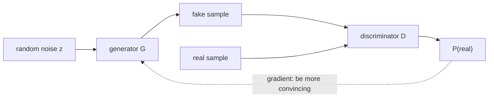

<!-- Written by `npm run lessons` from the lesson data in src/data. Edit the lesson there, not this page. -->

# GANs: a generator against a discriminator

**ML Foundations · Unit 7: Generative models and reinforcement learning · Lesson 2 of 6**

> **In one line.** A generative adversarial network (GAN) trains two networks against each other: a generator that turns random noise into fake samples, and a discriminator that tries to tell fake from real. Each improves by beating the other.

[Open this lesson on the site](https://learn.hamropedia.com/foundations/gans-a-generator-against-a-discriminator/) for its animation, the practice game and tap-to-explain words.

## The problem it solves

A VAE learns to generate by rebuilding its inputs, and its samples come out blurry because its loss rewards safe averages. A GAN has no reconstruction loss at all. The only question it asks is "could this pass for real?", which pushes samples to be sharp.

GANs produced the first photo-realistic generated faces. Diffusion has replaced them for most image generation, but the adversarial idea is still used inside image, audio and video models.

## The idea

A forger and a detective. The generator makes fakes from random noise; the discriminator tries to tell them from real data. Each one's mistakes are the other one's training signal. When the detective can only guess, the fakes are as good as real.

## How it works, step by step

1. The generator G takes random noise z and outputs a fake sample G(z). At the start its outputs are rubbish: here, numbers near 0 when the real data sits around 4.
2. The discriminator D takes a sample and outputs the probability that it is real. Train it on a batch of real samples labelled 1 and a batch of fakes labelled 0, with binary cross-entropy.
3. Now train G with D held still: generate fakes, pass them through D, and change G so that D says "real". The gradient flows back through D into G, telling G which way to move its samples.
4. Alternate: one step for D, one step for G, again and again. A better D gives G a sharper signal, and a better G gives D a harder job.
5. The game is in balance when the fakes are distributed exactly like the real data. Then D can do no better than guess, and outputs 0.5 everywhere.
6. In the lesson's run the fakes first overshoot to a mean of 6.25, then settle. After 3,000 rounds they have mean 4.04 and spread 0.38, against 4 and 0.5 for the real data. D gives fakes 0.50 on average.
7. To generate afterwards, throw D away: sample z and compute G(z).

## Picture it



*Real and fake samples both go into the discriminator. Its verdict trains itself to judge better and, along the dotted path, trains the generator to fool it.*

## Analogy

A forger printing banknotes and a bank clerk checking them. Every note the clerk catches teaches the forger what gave it away; every fake that slips through teaches the clerk to look closer.

**Where the analogy breaks.** A real forger wants the clerk to stay bad at the job. In a GAN the generator needs a good discriminator: a clerk who cannot tell the difference has nothing to teach.

## Worked example

Real data: numbers from a bell curve with mean 4 and spread 0.5. The generator starts by turning noise into numbers near 0. After 3,000 rounds of the game its outputs have mean 4.04 and spread 0.38, and the discriminator gives them 0.50 on average: it can no longer tell.

```python
fake = G(torch.randn(64, 1)).detach()             # detach: this step must not change G
loss_d = bce(D(real(64)), ones) + bce(D(fake), zeros)
opt_d.zero_grad(); loss_d.backward(); opt_d.step()   # 1. D: real -> 1, fake -> 0

loss_g = bce(D(G(torch.randn(64, 1))), ones)
opt_g.zero_grad(); loss_g.backward(); opt_g.step()   # 2. G: make D say "real"
```

## Must know

- Two networks, two losses: D learns to classify real against fake, and G learns to make D wrong.
- The objective is a game: D maximises E[log D(x)] + E[log(1 − D(G(z)))], and G minimises it.
- In practice G maximises log D(G(z)) instead, the non-saturating loss: it gives strong gradients early on, when D rejects every fake easily.
- At the ideal balance D outputs 0.5 everywhere, and the generator's distribution equals the data's.
- There is no likelihood and no reconstruction error, so the loss curves don't show progress. Look at the samples.
- Mode collapse: G finds a few outputs that fool D and produces only those, ignoring the rest of the data.

## Common mistakes

- Reading a falling generator loss as progress. The two losses chase each other; judge by the samples.
- Letting the discriminator's training step change the generator. Detach the fakes for that step.
- Training D far ahead of G. A discriminator that wins easily gives the generator little useful signal.

> **Not true:** A falling generator loss shows that a GAN's samples are getting better.  
> **In fact:** The two losses depend on each other, so either can fall or rise while the samples improve or get worse. Judge a GAN by looking at its samples.

> **Not true:** A discriminator that wins easily: the strongest training signal for the generator.  
> **In fact:** When D wins easily, its feedback hardly changes whatever G does, so G learns little. The two networks have to stay roughly balanced.

## Practise

Try each one yourself first: on paper, in code or out loud. Then open the answer and compare.

### 1. Derive

For a fixed generator, show that the best discriminator is D\*(x) = p_data(x) / (p_data(x) + p_g(x)). What does it output when the generator is perfect?

<details>
<summary>Show one good answer</summary>

Fix the generator, so the fakes have some distribution p_g. The discriminator wants to maximise

E_data[log D(x)] + E_g[log(1 − D(x))] = ∫ [ p_data(x)·log D(x) + p_g(x)·log(1 − D(x)) ] dx.

D can choose its output separately for every x, so maximise the bracket at each x on its own. Write a = p_data(x), b = p_g(x) and y = D(x): maximise a·log y + b·log(1 − y).

Differentiate and set to zero: a/y − b/(1 − y) = 0, so a(1 − y) = b·y, and y = a / (a + b).

So D\*(x) = p_data(x) / (p_data(x) + p_g(x)). Where only real data lives it says 1; where only fakes live it says 0.

When the generator is perfect, p_g = p_data, so D\*(x) = 1/2 everywhere: the best possible judge can only guess. Put D\* back into the objective and it becomes −log 4 plus twice the Jensen–Shannon divergence between the data and the fakes, which is why training the generator against a good discriminator pulls the two distributions together.

</details>

### 2. Build

Train the 1-D GAN from the lesson on numbers with mean 4 and spread 0.5. Every 500 rounds, print the mean and spread of the generated numbers and the discriminator's average output on them.

<details>
<summary>Show one good answer</summary>

Two small networks: G turns one random number into one output, and D turns one number into a score. Each round, D takes one step (real → 1, fake → 0) and G takes one step (make D say "real" for its fakes).

The run below shows the game. The fakes start near 0, overshoot to 6.25, come back, and then wobble around the data's mean of 4. The spread ends a little too small (0.38 against 0.5), which is typical: a GAN finds it easier to place samples where the data is densest. The discriminator's average output on fakes goes to 0.50: it can no longer tell them from real numbers.

```python
import torch
import torch.nn as nn

torch.manual_seed(0)
real = lambda n: 4 + 0.5 * torch.randn(n, 1)            # real data: mean 4, spread 0.5
G = nn.Sequential(nn.Linear(1, 16), nn.ReLU(), nn.Linear(16, 1))    # noise -> fake number
D = nn.Sequential(nn.Linear(1, 16), nn.ReLU(), nn.Linear(16, 1))    # number -> score ("real" if > 0)
opt_g = torch.optim.Adam(G.parameters(), lr=1e-3)
opt_d = torch.optim.Adam(D.parameters(), lr=1e-3)
bce = nn.BCEWithLogitsLoss()
ones, zeros = torch.ones(64, 1), torch.zeros(64, 1)

for step in range(3001):
    # 1. train the discriminator: real -> 1, fake -> 0
    fake = G(torch.randn(64, 1)).detach()               # detach: this step must not change G
    loss_d = bce(D(real(64)), ones) + bce(D(fake), zeros)
    opt_d.zero_grad(); loss_d.backward(); opt_d.step()

    # 2. train the generator: make D say "real" for fakes
    loss_g = bce(D(G(torch.randn(64, 1))), ones)
    opt_g.zero_grad(); loss_g.backward(); opt_g.step()

    if step % 500 == 0:
        with torch.no_grad():
            x = G(torch.randn(5000, 1))
            p = torch.sigmoid(D(x)).mean().item()
        print(f"step {step:4d}  fake mean {x.mean():5.2f}  spread {x.std():4.2f}  D(fake) {p:.2f}")
# step    0  fake mean  0.03  spread 0.28  D(fake) 0.53
# step  500  fake mean  6.25  spread 0.79  D(fake) 0.38
# step 1000  fake mean  4.27  spread 0.45  D(fake) 0.49
# step 1500  fake mean  4.31  spread 0.43  D(fake) 0.48
# step 2000  fake mean  3.86  spread 0.37  D(fake) 0.51
# step 2500  fake mean  4.19  spread 0.41  D(fake) 0.49
# step 3000  fake mean  4.04  spread 0.38  D(fake) 0.50
```

</details>

### 3. Break

Change the real data to two bumps: half the numbers near −2, half near +2. Does the same GAN cover both? Then give the discriminator 20 steps for every generator step, and train for three different seeds. What happens?

<details>
<summary>Show one good answer</summary>

Two bumps, one D step per G step: the GAN covers both. Over five seeds, between 46% and 58% of the fakes land on the left bump, close to the right answer of 50%. But only 77% to 89% of the fakes are near a bump at all: the rest fall in the empty gap between them. The generator is a smooth function of its noise, so to reach both bumps it has to pass through the space in between. Real GANs show the same thing as odd in-between images.

20 D steps per G step: the discriminator stays ahead (its average output on fakes drops to about 0.35), and the generator gives up one bump. In two of three runs 100% of the fakes land on the left bump and none on the right; in the third, 81%. That is mode collapse: the fakes that remain look fine one by one, but half of the data's variety is gone.

So balance matters. Too weak a discriminator teaches nothing; one that runs far ahead can push the generator into a corner. Much of the practical work on GANs (other losses, limits on the discriminator, tricks that let it compare whole batches) is about keeping the two in step.

```python
import torch
import torch.nn as nn

def run(d_steps, seed, rounds):
    torch.manual_seed(seed)
    def real(n):                                         # two bumps: half near -2, half near +2
        side = torch.randint(0, 2, (n, 1)) * 4.0 - 2.0
        return side + 0.3 * torch.randn(n, 1)
    G = nn.Sequential(nn.Linear(1, 16), nn.ReLU(), nn.Linear(16, 1))
    D = nn.Sequential(nn.Linear(1, 16), nn.ReLU(), nn.Linear(16, 1))
    opt_g = torch.optim.Adam(G.parameters(), lr=1e-3)
    opt_d = torch.optim.Adam(D.parameters(), lr=1e-3)
    bce = nn.BCEWithLogitsLoss()
    ones, zeros = torch.ones(64, 1), torch.zeros(64, 1)
    for step in range(rounds):
        for _ in range(d_steps):
            fake = G(torch.randn(64, 1)).detach()
            loss_d = bce(D(real(64)), ones) + bce(D(fake), zeros)
            opt_d.zero_grad(); loss_d.backward(); opt_d.step()
        loss_g = bce(D(G(torch.randn(64, 1))), ones)
        opt_g.zero_grad(); loss_g.backward(); opt_g.step()
    with torch.no_grad():
        x = G(torch.randn(5000, 1))
        left = (x < 0).float().mean().item()
        near = ((x + 2).abs() < 0.9).float().mean().item() + ((x - 2).abs() < 0.9).float().mean().item()
        return left, near, torch.sigmoid(D(x)).mean().item()

for seed in range(5):
    print("1 D step  ", [round(v, 2) for v in run(1, seed, 3000)])
for seed in range(3):
    print("20 D steps", [round(v, 2) for v in run(20, seed, 1000)])
# (share on the left bump, share near a bump, D's average output on fakes)
# 1 D step   [0.53, 0.84, 0.49]
# 1 D step   [0.52, 0.84, 0.49]
# 1 D step   [0.58, 0.77, 0.48]
# 1 D step   [0.5, 0.89, 0.49]
# 1 D step   [0.46, 0.87, 0.48]
# 20 D steps [0.81, 0.8, 0.36]
# 20 D steps [1.0, 1.0, 0.35]
# 20 D steps [1.0, 0.98, 0.33]
```

</details>

### 4. Explain

Explain a GAN with the forger-and-bank-clerk picture, and say what "balance" means.

<details>
<summary>Show one good answer</summary>

A forger prints banknotes and a bank clerk checks them. At first the forger's notes are terrible and the clerk rejects them at a glance. But each rejection tells the forger something: which detail gave the note away. So the next batch is a little better. The clerk, seeing better fakes, has to look more closely, and learns finer details too.

In a GAN the forger is the generator: it turns random noise into samples. The clerk is the discriminator: it gives each sample a probability of being real. The discriminator learns from labelled examples (real ones and fakes). The generator never sees real data at all: it learns only from the discriminator's verdict, by following the gradient that makes "real" more likely.

Balance is the point where the forger's notes are distributed exactly like real ones. The clerk can then do no better than toss a coin, and says 0.5 for everything. Nobody can improve by changing only their own behaviour, so the game stops there.

</details>

## Check you understood

Answer in your head first, then open each one.

<details>
<summary>&lt;b>What does the discriminator output when the generator is perfect?&lt;/b></summary>

0.5 for every input. Real and fake look the same to it, so it can only guess.

</details>

<details>
<summary>&lt;b>What is mode collapse?&lt;/b></summary>

The generator produces only a few kinds of sample that fool the discriminator, instead of covering the whole variety of the real data.

</details>

<details>
<summary>&lt;b>Why is the non-saturating loss used for the generator?&lt;/b></summary>

Early in training D rejects fakes confidently, so log(1 − D(G(z))) is nearly flat and gives tiny gradients. Maximising log D(G(z)) is steep in exactly that case, so G keeps learning.

</details>

<details>
<summary>&lt;b>Why can't you judge a GAN by its loss curves?&lt;/b></summary>

Each network's loss depends on how good the other one is. Both can stay flat while the samples improve, or fall while they get worse. Look at the samples, or use a separate quality score.

</details>

## Go further (optional)

The lesson above is enough on its own. These free extras give a second explanation.

- PLAY · [GAN Lab: play with GANs in your browser](https://poloclub.github.io/ganlab/) · Georgia Tech and Google · runs in the browser  
  **Worth it:** Watch a generator's samples slide towards the real data, while the discriminator's verdict is drawn underneath as a moving background. The game in this lesson, live.
- PAPER · [Generative Adversarial Networks](https://arxiv.org/abs/1406.2661) · Goodfellow et al., 2014
- READ · [Understanding Deep Learning, Ch 15 (generative adversarial networks)](https://udlbook.github.io/udlbook/) · Simon Prince · free

---

[← Autoencoders and VAEs (the ELBO)](autoencoders-and-vaes-the-elbo.md) · [All lessons](../../README.md) · [Diffusion models →](diffusion-models.md)
