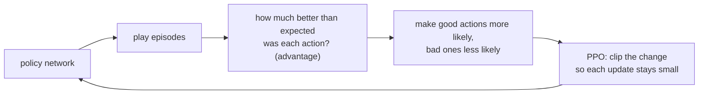

<!-- Written by `npm run lessons` from the lesson data in src/data. Edit the lesson there, not this page. -->

# Policy gradients and PPO

**ML Foundations · Unit 7: Generative models and reinforcement learning · Lesson 6 of 6**

> **In one line.** Policy-gradient methods train a policy network directly by making actions that led to better-than-expected returns more likely; PPO adds a clipped objective that keeps each update small and safe.

[Open this lesson on the site](https://learn.hamropedia.com/foundations/policy-gradients-and-ppo/) for its animation, the practice game and tap-to-explain words.

## The problem it solves

Value-based methods like Q-learning struggle with huge or continuous action spaces — and a language model's "action" is a choice among tens of thousands of tokens. Policy gradients optimise the policy itself and handle such spaces naturally. PPO made them stable enough to use widely, including in classic RLHF for chat models.

## The idea

Policy-gradient methods train the policy network directly: make actions that led to high reward more likely, and actions that led to low reward less likely. PPO adds a safety limit so each update cannot change the policy too much. PPO is the algorithm used in classic RLHF for language models.

## How it works, step by step

1. The policy π(a \| s) is a network that outputs a probability for each action (for an LLM, each next token).
2. Collect episodes by acting with the current policy and record the returns.
3. Advantage A = how much better the outcome was than expected (return minus a baseline, such as a learned value estimate).
4. REINFORCE update: increase log π(a \| s) in proportion to A. Better-than-expected actions become more likely; worse ones less likely.
5. Subtracting a baseline doesn't change the expected direction but greatly reduces noise.
6. PPO measures the ratio r = π_new(a \| s) / π_old(a \| s) and maximises min(r·A, clip(r, 1 − ε, 1 + ε)·A), with ε around 0.2.
7. Clipping removes any reward for moving the policy beyond the trust range in one update, so the same batch can be reused for several small, stable steps.

## Picture it



*Policy gradients nudge the policy towards actions that did better than expected; PPO stops any single update from changing it too much.*

## Analogy

A basketball player adjusting their shot: after a good shot, do a bit more of that; after a miss, a bit less. PPO is a coach who says 'small changes only'.

**Where the analogy breaks.** A player can feel which part of the shot went wrong. Policy gradients only see the total reward, so the signal is very noisy and needs many tries. Baselines and advantages reduce that noise.

## Worked example

The REINFORCE gradient is ∇J ≈ Σ ∇log π(a \| s) · (return − baseline). PPO's clipped objective is min(ratio · A, clip(ratio, 1 − ε, 1 + ε) · A), with ε around 0.2.

```python
ratio = torch.exp(new_logp - old_logp)
unclipped = ratio * adv
clipped = torch.clamp(ratio, 1 - eps, 1 + eps) * adv
loss = -torch.min(unclipped, clipped).mean()
```

## Must know

- Optimise the policy directly: ∇J ≈ E[∇log π(a \| s) · A].
- Subtracting a baseline from the return, which gives the advantage, reduces the variance of the gradient without changing its average.
- PPO's clip keeps the new policy close to the old one.
- On-policy: data must come from (nearly) the current policy.
- In RLHF, the "environment" is a reward model, and a KL penalty keeps the model near its starting point.

## Common mistakes

- Using no baseline, so the gradient estimate is extremely noisy and learning is slow.
- Huge steps without clipping, so the policy collapses.
- Reusing very old data with an on-policy method.

> **Not true:** An on-policy method such as PPO can keep learning from data collected by a much older policy.  
> **In fact:** On-policy methods assume the data came from (nearly) the current policy. Very old data describes a different policy, so the updates it gives are wrong.

> **Not true:** Baseline: subtracting it changes the direction of the policy gradient.  
> **In fact:** A baseline changes only the noise, not the average direction. The gradient points the same way with far less variance, which is why the advantage is used.

## Practise

Try each one yourself first: on paper, in code or out loud. Then open the answer and compare.

### 1. Derive

Derive the log-derivative trick: show that ∇ E[R] = E[R · ∇ log π(a \| s)] for a simple policy.

<details>
<summary>Show one good answer</summary>

We want the gradient of the expected reward J(θ) = E_{a ~ π_θ}[R(a)] with respect to the policy's parameters θ. For a discrete policy (one step, for clarity):

J(θ) = Σ_a π_θ(a) · R(a)  
∇J(θ) = Σ_a ∇π_θ(a) · R(a)      (R doesn't depend on θ)

The trick: ∇ log π = ∇π / π, so ∇π = π · ∇ log π. Substitute:

∇J(θ) = Σ_a π_θ(a) · ∇ log π_θ(a) · R(a) = E_{a ~ π_θ}[ R(a) · ∇ log π_θ(a) ].

Why it matters: the right-hand side is an expectation under the policy itself, so we can estimate it just by sampling actions, running them, and averaging R · ∇ log π. We never need to differentiate the reward or the environment. For whole episodes the same argument gives ∇J = E[ Σ_t ∇ log π(a_t \| s_t) · G_t ], with G_t the return from step t.

Subtracting a baseline b(s) keeps it unbiased, because E[∇ log π] = Σ_a ∇π(a) = ∇ Σ_a π(a) = ∇1 = 0, but it can reduce the variance a lot.

</details>

### 2. Build

Implement REINFORCE with a baseline on CartPole, then PPO's clipped loss. Compare how fast and how smoothly each one learns.

<details>
<summary>Show one good answer</summary>

CartPole: keep a pole balanced on a cart; +1 reward per step, up to 500.

REINFORCE with a baseline: run a whole episode with the policy network, compute each step's return G_t, subtract a learned value estimate V(s_t) (the baseline), and step along Σ ∇ log π(a_t \| s_t) · (G_t − V(s_t)), while training V to predict G_t.

PPO: collect a batch of steps, estimate advantages with GAE, then do several epochs of minibatch updates on the clipped objective min(ratio · A, clip(ratio, 0.8, 1.2) · A), where ratio = π_new(a \| s) / π_old(a \| s), plus a value loss.

In the run below, PPO learns much better: over its last 20 episodes it averages about 480 of a possible 500, against about 220 for REINFORCE with a baseline after 500 episodes (both reach 500 at their best). REINFORCE updates once per episode from a single, noisy sample of what the policy does; PPO collects a batch of steps, uses a lower-variance advantage estimate (GAE), and reuses each batch for several careful updates. That efficiency and stability is why PPO became the standard, including for RLHF.

```python
import numpy as np
import torch
import torch.nn as nn
import gymnasium as gym

def mlp(out):
    return nn.Sequential(nn.Linear(4, 64), nn.Tanh(), nn.Linear(64, 64), nn.Tanh(), nn.Linear(64, out))

def reinforce(episodes=500, baseline=True, seed=0):
    torch.manual_seed(seed); env = gym.make("CartPole-v1")
    policy, value = mlp(2), mlp(1)
    opt = torch.optim.Adam([*policy.parameters(), *value.parameters()], lr=3e-3)
    returns_per_episode = []
    for ep in range(episodes):
        obs, _ = env.reset(seed=seed + ep)
        log_probs, states, rewards, done = [], [], [], False
        while not done:
            s = torch.tensor(obs, dtype=torch.float32)
            dist = torch.distributions.Categorical(logits=policy(s))
            a = dist.sample()
            obs, r, term, trunc, _ = env.step(a.item())
            log_probs.append(dist.log_prob(a)); states.append(s); rewards.append(r); done = term or trunc
        G, returns = 0.0, []
        for r in reversed(rewards):
            G = r + 0.99 * G; returns.insert(0, G)
        returns = torch.tensor(returns)
        v = value(torch.stack(states)).squeeze(1)
        advantage = returns - v.detach() if baseline else returns
        loss = -(torch.stack(log_probs) * advantage).mean() + ((v - returns) ** 2).mean() * baseline
        opt.zero_grad(); loss.backward(); opt.step()
        returns_per_episode.append(sum(rewards))
    return returns_per_episode

def ppo(iterations=40, steps=2048, epochs=10, clip=0.2, lr=3e-4, seed=0):
    torch.manual_seed(seed); env = gym.make("CartPole-v1")
    policy, value = mlp(2), mlp(1)
    opt = torch.optim.Adam([*policy.parameters(), *value.parameters()], lr=lr)
    obs, _ = env.reset(seed=seed); episode_return, finished = 0.0, []
    for it in range(iterations):
        S, A, LP, R, D, V = [], [], [], [], [], []
        for _ in range(steps):
            s = torch.tensor(obs, dtype=torch.float32)
            with torch.no_grad():
                dist = torch.distributions.Categorical(logits=policy(s)); a = dist.sample()
                S.append(s); A.append(a); LP.append(dist.log_prob(a)); V.append(value(s).squeeze())
            obs, r, term, trunc, _ = env.step(a.item())
            R.append(r); D.append(term); episode_return += r
            if term or trunc:
                finished.append(episode_return); episode_return = 0.0; obs, _ = env.reset()
        with torch.no_grad():
            next_v = value(torch.tensor(obs, dtype=torch.float32)).squeeze()
        adv, gae = torch.zeros(steps), 0.0
        for t in reversed(range(steps)):                              # GAE
            nv = next_v if t == steps - 1 else V[t + 1]
            delta = R[t] + 0.99 * nv * (1 - D[t]) - V[t]
            gae = delta + 0.99 * 0.95 * (1 - D[t]) * gae
            adv[t] = gae
        S, A, LP, V = torch.stack(S), torch.stack(A), torch.stack(LP), torch.stack(V)
        returns = adv + V
        adv = (adv - adv.mean()) / (adv.std() + 1e-8)
        for _ in range(epochs):
            for idx in torch.randperm(steps).split(256):
                dist = torch.distributions.Categorical(logits=policy(S[idx]))
                ratio = torch.exp(dist.log_prob(A[idx]) - LP[idx])
                if clip is None:
                    policy_loss = -(ratio * adv[idx]).mean()                 # no clipping
                else:
                    policy_loss = -torch.min(ratio * adv[idx], ratio.clamp(1 - clip, 1 + clip) * adv[idx]).mean()
                value_loss = ((value(S[idx]).squeeze(1) - returns[idx]) ** 2).mean()
                opt.zero_grad(); (policy_loss + 0.5 * value_loss).backward(); opt.step()
    return finished

if __name__ == "__main__":
    r = reinforce()
    p = ppo()
    for name, rets in [("REINFORCE + baseline", r), ("PPO", p)]:
        last = rets[-20:]
        print(f"{name}: {len(rets)} episodes, mean return of the last 20 {np.mean(last):.0f} (std {np.std(last):.0f}), "
              f"best {max(rets):.0f}")
```

</details>

### 3. Break

Remove the baseline from REINFORCE and compare the noise in the learning curve. Then remove PPO's clipping and take large updates.

<details>
<summary>Show one good answer</summary>

Without the baseline, REINFORCE pushes up the probability of every action in proportion to the whole return that followed, and on CartPole every return is positive. So every action gets reinforced, the good ones only slightly more than the bad ones, and the signal is buried in noise. The learning curve becomes far noisier: in the run below, the return over the last 50 episodes swings with a standard deviation of about 160 without the baseline, against about 24 with it. (Its average happened to be higher in this one run, 246 against 195, which is what high variance looks like: run a few seeds and the no-baseline results scatter widely.) With a baseline, actions are judged against what was expected (the advantage), so below-average actions are pushed down and above-average ones up.

PPO without clipping, with large updates (a bigger learning rate and many epochs on each batch): the new policy can move far from the policy that collected the data. The advantages were measured for the old policy, so once the ratio π_new / π_old is far from 1 they no longer describe what the new policy does, and a few huge steps can wreck a policy that was working: the return collapses and may not recover. Clipping the ratio to [0.8, 1.2] removes the incentive to move further than that in one update, a cheap, safe trust region. In the run below, with the same aggressive settings (10 times the learning rate, 30 epochs per batch), the clipped version still reaches and holds the maximum return of 500, while the unclipped one ends lower, averaging about 400.

```python
import numpy as np
# reinforce and ppo come from the Build answer above: save it as rl.py
from rl import reinforce, ppo

for baseline in [True, False]:
    rets = reinforce(baseline=baseline)
    print(f"REINFORCE, baseline={baseline}: mean return of the last 50 {np.mean(rets[-50:]):.0f}, "
          f"episode-to-episode noise (std of the last 50) {np.std(rets[-50:]):.0f}")

for clip in [0.2, None]:
    rets = ppo(iterations=25, epochs=30, lr=3e-3, clip=clip)              # deliberately large updates
    print(f"PPO, clip={clip}: mean return of the last 20 episodes {np.mean(rets[-20:]):.0f}, best {max(rets):.0f}")
```

</details>

### 4. Explain

Explain policy gradients and PPO's clipping with the basketball-coach picture.

<details>
<summary>Show one good answer</summary>

A basketball player practising free throws. After a shot that goes in, they do a bit more of whatever they just did; after a miss, a bit less. That is a policy gradient: increase the probability of actions that led to good results, decrease it for bad ones, in proportion to how much better or worse than expected the result was (the baseline is "what I usually score").

PPO is a coach who says: small changes only. If one great shot made the player completely rebuild their technique, the next day could be a disaster: one shot is noisy evidence. So the coach limits how far the technique may change from one practice session to the next. That is the clipping: each update can move the policy only a little away from the one that collected the experience, which makes learning steady instead of erratic.

</details>

## Check you understood

Answer in your head first, then open each one.

<details>
<summary>&lt;b>What does a policy-gradient update do to an action with positive advantage?&lt;/b></summary>

It raises that action's probability in that state, in proportion to how much better than expected it was.

</details>

<details>
<summary>&lt;b>Why subtract a baseline from the return?&lt;/b></summary>

It reduces the variance (noise) of the gradient estimate without changing its expected direction.

</details>

<details>
<summary>&lt;b>What does PPO's clipping prevent?&lt;/b></summary>

Updates that change an action's probability by more than about ±ε in one step, which could otherwise destabilise the policy.

</details>

<details>
<summary>&lt;b>How is PPO used in RLHF?&lt;/b></summary>

The language model is the policy, a reward model scores its answers, and PPO updates the model towards higher reward with a KL penalty to stay close to the original.

</details>

## Go further (optional)

The lesson above is enough on its own. These free extras give a second explanation.

- READ · [Spinning Up, Part 3: Intro to Policy Optimization](https://spinningup.openai.com/en/latest/spinningup/rl_intro3.html) · OpenAI  
  **Worth it:** A short, careful derivation of the policy gradient with runnable code, from the people who popularised PPO. The best bridge from idea to implementation.
- READ · [Policy Gradient Algorithms](https://lilianweng.github.io/posts/2018-04-08-policy-gradient/) · Lilian Weng
- READ · [Understanding Deep Learning, Ch 19 (reinforcement learning)](https://udlbook.github.io/udlbook/) · Simon Prince · free
- PAPER · [Proximal Policy Optimization Algorithms (2017)](https://arxiv.org/abs/1707.06347) · Schulman et al. · arXiv

---

[← Deep Q-networks (DQN): Q-learning with a neural network](deep-q-networks-dqn-q-learning-with-a-neural-network.md) · [All lessons](../../README.md)
