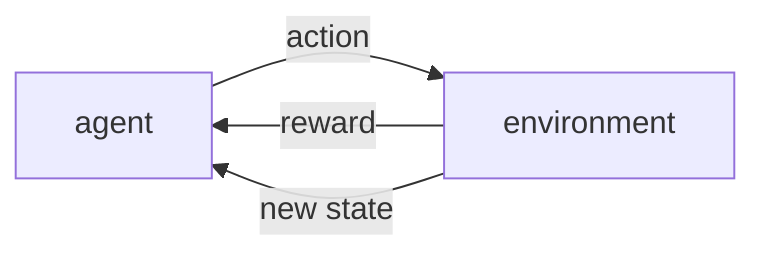

<!-- Written by `npm run lessons` from the lesson data in src/data. Edit the lesson there, not this page. -->

# Reinforcement learning basics: states, actions, rewards, values

**ML Foundations · Unit 7: Generative models and reinforcement learning · Lesson 4 of 6**

> **In one line.** In reinforcement learning, an agent takes actions in an environment, receives rewards, and learns a policy — what to do in each state — that maximises the total (discounted) reward over time.

[Open this lesson on the site](https://learn.hamropedia.com/foundations/reinforcement-learning-basics-states-actions-rewards-values/) for its animation, the practice game and tap-to-explain words.

## The problem it solves

Many problems have no labelled "right answers", only outcomes: win or lose a game, finish a task, keep a robot upright. Reinforcement learning learns from those outcomes by trial and error. It powers game-playing systems, robotics, recommendation tuning, and the RLHF and reasoning training of modern language models.

## The idea

In reinforcement learning (RL), an agent takes actions in an environment and gets rewards. It learns a policy, meaning what to do in each state, that collects the most reward over time. A value function says how good a state is. Q-learning learns how good each action is in each state.

## How it works, step by step

1. The agent sees a state s, takes an action a, and the environment returns a reward r and a new state s′. This repeats over an episode.
2. The return is the sum of future rewards, discounted by γ (between 0 and 1) per step, so sooner rewards count more.
3. The value V(s) is the expected return from state s when following the policy; Q(s, a) is the expected return after taking action a in s.
4. Values satisfy the Bellman equation: the value of a state = the reward for the best next step + γ × the value of where it leads.
5. Value iteration applies that rule repeatedly; value spreads back from rewards. In a grid with γ = 0.8, the square next to the goal is worth 1, the one before that 0.8, then 0.64.
6. Q-learning learns Q from experience without knowing the rules: Q(s, a) ← Q(s, a) + α·(r + γ·max Q(s′, ·) − Q(s, a)).
7. Balance exploration (try new actions) and exploitation (use the best known one), for example with ε-greedy: random action with probability ε.

## Picture it



*The whole of reinforcement learning in one loop: act, get a reward and a new situation, learn, act again.*

## Analogy

Training a dog with treats. Nobody shows the dog the right move. It tries things, and good actions earn treats.

**Where the analogy breaks.** A dog gets its treat straight away. In RL the reward often comes much later, like winning a game after 100 moves, so the agent must work out which earlier actions deserve the credit.

## Worked example

The Q-learning update is Q(s, a) ← Q(s, a) + α · (r + γ · max Q(s′, ·) − Q(s, a)). The discount γ (for example 0.99) makes future rewards count a little less than immediate ones.

```python
td_target = r + gamma * Q[s_next].max() * (not done)
Q[s, a] += alpha * (td_target - Q[s, a])
```

## Must know

- Agent, environment, state, action, reward, policy.
- Return = discounted sum of future rewards; γ sets how far ahead the agent cares.
- V(s) values states; Q(s, a) values actions in states.
- Bellman equation: a value equals immediate reward plus discounted next value.
- Credit assignment: working out which earlier actions earned a delayed reward.
- Exploration versus exploitation is a constant trade-off.

## Common mistakes

- No exploration, so the agent locks onto the first thing that worked.
- γ = 0, so the agent ignores everything but the immediate reward.
- Reward functions that can be "hacked": the agent maximises the number, not what you meant.

> **Not true:** An agent will do what you meant, as long as its reward keeps going up.  
> **In fact:** An agent maximises the number it is given, not your intention. A carelessly designed reward can be collected in ways you never wanted.

> **Not true:** With γ = 0, an agent plans far into the future.  
> **In fact:** γ = 0 makes every future reward count for nothing, so the agent cares only about the next one. A γ close to 1 makes it look far ahead.

## Go deeper (optional): Why value iteration always converges

1. One sweep of value iteration replaces every value: new V(s) = the best over actions of [reward + γ × the average of V over the next states]. Call one sweep T, so the update is V ← T(V).
2. Take any two tables of values, V and U, and let D be the largest difference between them over all states.
3. Inside the brackets, V and U only enter through "γ × the average of the next values". Averages of numbers that differ by at most D differ by at most D, so for every action the two brackets differ by at most γD.
4. Taking the best action on each side cannot widen the gap: two lists that differ by at most γD, entry by entry, have maxima that differ by at most γD. So T(V) and T(U) differ by at most γD.
5. Now let U be the true optimal values V\*, which a sweep leaves unchanged: T(V\*) = V\*. Then every sweep shrinks the distance to V\* by the factor γ. After k sweeps the error is at most γᵏ times the starting error.
6. With γ = 0.8 the error falls below 1% of its start in 21 sweeps. With γ = 0.99 it takes 459: caring about the far future makes planning slower.

**The result.** A sweep of value iteration is a contraction: it shrinks the distance to the optimal values by γ every time. So it converges from any starting values, always to the same answer.

## Practise

Try each one yourself first: on paper, in code or out loud. Then open the answer and compare.

### 1. Derive

States A → B → Goal. Each step moves right. Reaching Goal gives reward 1, every other step gives 0. With γ = 0.9, compute the values of A and B by hand.

<details>
<summary>Show one good answer</summary>

The value of a state is the expected discounted sum of rewards from there: V(s) = r + γ · V(next state).

Goal is the end, so V(Goal) = 0 (no more rewards).

B: one step to Goal, and reaching Goal gives reward 1.  
V(B) = 1 + 0.9 × V(Goal) = 1 + 0 = 1.

A: one step to B with reward 0.  
V(A) = 0 + 0.9 × V(B) = 0.9 × 1 = 0.9.

Each extra step away from the reward multiplies its value by γ = 0.9: a state three steps away would be worth 0.81. That is how a discount makes the agent prefer shorter paths to the same reward.

</details>

### 2. Build

Implement tabular Q-learning on a small grid world or FrozenLake. Plot the reward per episode, and print the learned policy as arrows.

<details>
<summary>Show one good answer</summary>

FrozenLake (4 × 4, not slippery): start in the top-left, reach the goal in the bottom-right, fall into a hole and the episode ends with nothing. The only reward is 1 at the goal.

Tabular Q-learning keeps a 16 × 4 table, one value per (state, action). Each step: choose an action ε-greedily (random with probability ε, which decays from 1 to 0.05, otherwise the best known), take it, and update Q(s, a) ← Q(s, a) + α · (r + γ · max Q(s′, ·) − Q(s, a)).

The reward per episode starts near 0 (random wandering rarely reaches the goal), climbs once the goal is found and its value spreads back through the table, and settles near 1, apart from the occasional exploratory step into a hole. The printed arrows show a shortest safe path from the start to the goal.

```python
import numpy as np
import gymnasium as gym
import matplotlib.pyplot as plt

def q_learning(episodes=2000, gamma=0.95, alpha=0.8, eps_start=1.0, eps_end=0.05, seed=0):
    env = gym.make("FrozenLake-v1", is_slippery=False)
    rng = np.random.default_rng(seed)
    Q, rewards = np.zeros((16, 4)), []
    for ep in range(episodes):
        state, _ = env.reset(seed=seed + ep)
        eps = max(eps_end, eps_start * (1 - ep / (0.6 * episodes)))
        done, total = False, 0.0
        while not done:
            explore = rng.random() < eps
            action = rng.integers(4) if explore else int(np.argmax(Q[state]))
            nxt, r, terminated, truncated, _ = env.step(action)
            target = r + (0 if terminated else gamma * Q[nxt].max())
            Q[state, action] += alpha * (target - Q[state, action])
            state, total, done = nxt, total + r, terminated or truncated
        rewards.append(total)
    return Q, rewards

if __name__ == "__main__":
    Q, rewards = q_learning()
    smooth = np.convolve(rewards, np.ones(50) / 50, mode="valid")
    print(f"success rate, first 200 episodes {np.mean(rewards[:200]):.0%}, last 200 {np.mean(rewards[-200:]):.0%}")
    lake = gym.make("FrozenLake-v1", is_slippery=False).unwrapped.desc.astype(str)
    arrows = np.array(["←", "↓", "→", "↑"])[Q.argmax(1)].reshape(4, 4)
    for row in range(4):
        print(" ".join(lake[row, c] if lake[row, c] in "HG" else arrows[row, c] for c in range(4)))
    plt.plot(smooth); plt.xlabel("episode"); plt.ylabel("reward (moving average of 50)"); plt.show()
```

</details>

### 3. Break

Turn exploration off from the start, so the agent always picks the best-known action. What happens? Then set γ = 0 and see what the agent cares about.

<details>
<summary>Show one good answer</summary>

No exploration from the start (ε = 0): with every Q value at 0, the "best" action is a tie, np.argmax always picks the first one (left), and moving left from the start corner just bumps into the edge. The agent repeats the same useless action until the episode times out, never reaches the goal, never sees a reward, so nothing in the table ever changes. Success rate: 0%, forever. Without exploration, an agent can only learn about things it already does; it needs to try new actions to discover where the rewards are. (Optimistic initial values, starting Q high, are another way to force exploration.)

γ = 0: the agent only cares about the reward of the very next step. Only the one state next to the goal learns that "right" or "down" is good, because only there does an action earn an immediate reward; every other state's values stay 0, since the future doesn't count at all. From the start, the agent has no reason to head anywhere, so its greedy policy fails. The discount is what lets a reward that is many steps away flow back to the states that lead to it.

```python
import numpy as np
# q_learning comes from the Build answer above: save it as qlearn.py
from qlearn import q_learning

_, rewards = q_learning(eps_start=0.0, eps_end=0.0)
print(f"no exploration: success rate {np.mean(rewards):.0%}")

Q, rewards = q_learning(gamma=0.0)
print("gamma = 0: states with any non-zero value:", np.nonzero(Q.max(1))[0].tolist())
print("max Q per state:\n", Q.max(1).reshape(4, 4).round(2))
```

</details>

### 4. Explain

Explain the credit-assignment problem with the dog-training picture.

<details>
<summary>Show one good answer</summary>

Training a dog with treats. Nobody shows the dog the right move; it tries things, and some lead to treats. The hard part is credit assignment: the dog sits, rolls over, barks, and then gets a treat. Which of those earned it? If the treat comes several actions later, the dog has to work out which earlier choices led there.

Reinforcement learning has the same problem, often much worse: in chess, the reward (win or lose) comes after dozens of moves, and the agent must figure out which moves deserved the credit. Value functions solve it by passing value backwards: a state is worth the reward it leads to, discounted by how far away it is, so good early moves gradually learn that they were good.

</details>

## Check you understood

Answer in your head first, then open each one.

<details>
<summary>&lt;b>What does the discount factor γ do?&lt;/b></summary>

It makes future rewards count less than immediate ones; γ near 1 plans far ahead, γ = 0 only cares about the next reward.

</details>

<details>
<summary>&lt;b>What is the difference between V(s) and Q(s, a)?&lt;/b></summary>

V(s) is the expected return from a state; Q(s, a) is the expected return after taking a specific action in that state.

</details>

<details>
<summary>&lt;b>What is the credit-assignment problem?&lt;/b></summary>

When reward arrives late, the agent must work out which of its many earlier actions deserve the credit or blame.

</details>

<details>
<summary>&lt;b>Why does an agent need exploration?&lt;/b></summary>

Without trying unfamiliar actions it can never discover that they are better than what it already knows.

</details>

## Go further (optional)

The lesson above is enough on its own. These free extras give a second explanation.

- PLAY · [Reinforcement Learning](https://mlu-explain.github.io/reinforcement-learning/) · MLU-Explain (Amazon) · animated grid world  
  **Worth it:** An animated agent learns a grid world as you scroll, with its Q-values and policy updating live. Exactly this lesson, in moving pictures.
- READ · [Spinning Up, Part 1: Key Concepts in RL](https://spinningup.openai.com/en/latest/spinningup/rl_intro.html) · OpenAI
- READ · [Reinforcement Learning: An Introduction, Ch 3 and 6](http://incompleteideas.net/book/the-book-2nd.html) · Sutton and Barto · free
- WATCH · [RL Course, Lecture 1: Introduction to Reinforcement Learning](https://www.youtube.com/results?search_query=David+Silver+RL+course+lecture+1+introduction) · David Silver

---

[← Diffusion models](diffusion-models.md) · [All lessons](../../README.md) · [Deep Q-networks (DQN): Q-learning with a neural network →](deep-q-networks-dqn-q-learning-with-a-neural-network.md)
