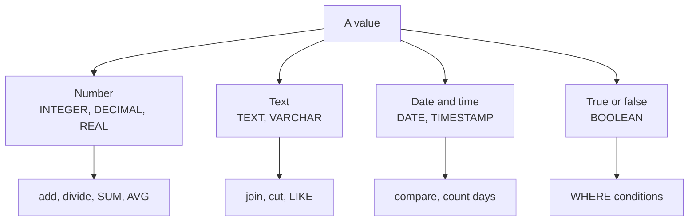

<!-- Written by `npm run lessons` from the lesson data in src/data. Edit the lesson there, not this page. -->

# Data types: numbers, text, dates and true/false

**SQL · Unit 0: Start here: databases, tables and SQL · Lesson 4 of 4 · Should know**

> **In one line.** Every column has a data type, such as INTEGER, a decimal number, TEXT, a date or a boolean. The type decides what values the column can hold, and how they compare, sort and calculate.

[Open this lesson on the site](https://learn.hamropedia.com/sql/data-types-numbers-text-dates-and-true-false/) for its animation, the practice game and tap-to-explain words.

## The problem it solves

The same value acts differently by type. The text '10' sorts before '9', because text compares letter by letter. Integer 7 divided by integer 2 gives 3, not 3.5. Knowing the types explains a whole class of "why is my answer wrong?" bugs.

## The idea

Common types: INTEGER for whole numbers (counts, ids), DECIMAL or NUMERIC for exact money values, REAL or FLOAT for approximate numbers, TEXT or VARCHAR for words, DATE and TIMESTAMP for dates and times, and BOOLEAN for true or false.

You can convert between types with CAST. NULL is not a type: it is the marker for "no value", and any column can hold it unless it is declared NOT NULL.

## Analogy

Containers in a kitchen. A measuring jug (a number column) lets you add and divide; a label maker (text) lets you join and cut words; a calendar (dates) lets you count days. Put the right thing in the right container, or the tools stop working properly.

**Where the analogy breaks.** In a kitchen, a jug simply refuses a label. SQLite is relaxed and lets almost any value into any column, while PostgreSQL rejects the wrong type outright. Don't lean on SQLite's flexibility — write SQL as if every database were strict.

## Syntax

```sql
CAST(value AS INTEGER)
CAST(value AS REAL)
CAST(value AS TEXT)
```

## How it works, step by step

1. An integer divided by an integer gives an integer: `7 / 2` is 3. The part after the point is thrown away.
2. Make one side a decimal and you get the exact answer: `7 / 2.0` or `CAST(7 AS REAL) / 2` is 3.5.
3. Text compares character by character, so '10' &lt; '9' as text. Store numbers in number columns.
4. Dates written as YYYY-MM-DD text sort correctly, because the biggest unit (year) comes first.
5. A boolean expression such as `salary > 60000` is true or false — or unknown when salary is NULL.

## Picture it



*The type decides what you can do with a value. Numbers calculate, text joins and matches patterns, dates compare and count days, and true/false values drive WHERE.*

## Examples on the practice database

**Integer division, and how to avoid it**

```sql
SELECT 7 / 2 AS whole_division,
       7 / 2.0 AS exact_division,
       CAST('42' AS INTEGER) + 1 AS text_to_number;
```

| whole_division | exact_division | text_to_number |
| --- | --- | --- |
| 3 | 3.5 | 43 |

This bites in interviews when you compute a percentage: `delivered / total` gives 0. Multiply by 100.0 first.

---

**Dates as YYYY-MM-DD text compare correctly**

```sql
SELECT name, hire_date
FROM employees
WHERE hire_date >= '2022-01-01'
ORDER BY hire_date;
```

| name | hire_date |
| --- | --- |
| Eli | 2022-07-01 |
| Hana | 2022-11-30 |
| Gus | 2023-04-03 |

Text in single quotes is a string; the comparison works because the year comes first.

## Must know

- INTEGER ÷ INTEGER = INTEGER in SQLite, PostgreSQL and SQL Server. Use 100.0 or CAST to get decimals.
- Use DECIMAL or NUMERIC for money: REAL and FLOAT are approximate and can show 0.30000000000000004.
- Text values go in single quotes: 'London'. Double quotes are for names of tables or columns.
- Store dates in date columns (or YYYY-MM-DD text), never as '06/01/2024', which sorts wrongly.
- NULL means "no value" and can appear in any column that isn't NOT NULL.

## Common mistakes

- Computing a ratio with two integers and getting 0.
- Storing numbers as text and getting '10' sorted before '9'.
- Using double quotes for text values. In PostgreSQL, "London" means a column called London.

> **Not true:** Numbers stored as text sort in the same order as real numbers.  
> **In fact:** Text is compared character by character, so '10' comes before '9'. Store numbers in a number column.

## Other databases

- MySQL is the odd one out: `7 / 2` returns 3.5000, and `DIV` does whole division.
- SQLite has no real DATE or BOOLEAN type: dates are text and true/false are 1 and 0. PostgreSQL has DATE, TIMESTAMP and BOOLEAN types.
- `VARCHAR(50)` caps text at 50 characters in PostgreSQL, MySQL and SQL Server; SQLite ignores the limit.

## In the interview

Data types decide how values compare and calculate. There are two classic traps. One is integer division: 7 / 2 is 3 in most databases, so for percentages I multiply by 100.0 first. The other is storing numbers or dates as text, which makes them sort wrongly. For money I use DECIMAL rather than FLOAT, because floating point can't represent most decimals exactly.

<details>
<summary>&lt;b>CHAR or VARCHAR?&lt;/b></summary>

`CHAR(n)` is fixed length and pads with spaces; `VARCHAR(n)` stores only what you give it, up to n. VARCHAR is the usual choice.

</details>

<details>
<summary>&lt;b>Why not FLOAT for money?&lt;/b></summary>

Floating point stores numbers in binary, so 0.1 + 0.2 is not exactly 0.3. DECIMAL stores exact decimal digits.

</details>

## Practise

Write each answer yourself first, then open the answer and compare.

### 1. Explain

Explain why `7 / 2` gives 3, and two ways to get 3.5.

<details>
<summary>Show one good answer</summary>

7 and 2 are both whole numbers (integers), and integer divided by integer gives an integer: the part after the point is thrown away, so 7 / 2 is 3. It is not rounded; it is cut off.

Two ways to get 3.5:  
• Make one side a decimal: `7 / 2.0` or `7 * 1.0 / 2`.  
• Convert it: `CAST(7 AS REAL) / 2`.

The same trap hits averages and percentages built by dividing two integer columns.

</details>

### 2. Write

Write a query that returns each employee's name and their salary divided by 12, as an exact decimal monthly figure.

<details>
<summary>Show one good answer</summary>

Divide by 12.0, not 12. One decimal side is enough to make the whole division exact. (To show pounds and pence, wrap it in `ROUND(salary / 12.0, 2)`, from the built-in functions lesson.)

```sql
SELECT name, salary, salary / 12.0 AS monthly
FROM employees
ORDER BY emp_id;
```

| name | salary | monthly |
| --- | --- | --- |
| Asha | 95000 | 7916.666666666667 |
| Ben | 70000 | 5833.333333333333 |
| Chen | 70000 | 5833.333333333333 |
| Dara | 60000 | 5000 |
| Eli | 45000 | 3750 |
| Fatima | 52000 | 4333.333333333333 |
| Gus | 38000 | 3166.6666666666665 |
| Hana | 80000 | 6666.666666666667 |

</details>

### 3. Predict

What does `SELECT 1 / 3, 1.0 / 3, '5' < '40';` return? Say all three before running it.

<details>
<summary>Show one good answer</summary>

0, then 0.333…, then 0 (false).

• `1 / 3`: two integers, so the fraction is cut off: 0.  
• `1.0 / 3`: one decimal, so the answer is exact: 0.3333333333333333.  
• `'5' < '40'`: these are text, so they compare letter by letter, like words in a dictionary. The first characters are 5 and 4, and 5 comes after 4, so '5' is bigger. The answer is false, which SQLite shows as 0.

```sql
SELECT 1 / 3, 1.0 / 3, '5' < '40';
```

| 1 / 3 | 1.0 / 3 | '5' < '40' |
| --- | --- | --- |
| 0 | 0.3333333333333333 | 0 |

</details>

### 4. Edge cases

A column stores prices as text: '9', '10', '100'. What does ORDER BY on it return, and how do you fix it?

<details>
<summary>Show one good answer</summary>

Sorting text compares character by character, so you get '10', '100', '9'. The 1s come before the 9.

The quick fix is to sort by the number: `ORDER BY CAST(price AS INTEGER)`. The real fix is to store prices in a number column (INTEGER, or DECIMAL for pence), so they sort, compare and add up correctly everywhere.

Below, WITH just makes a tiny three-row table to test on (you meet it in Unit 4). Change the ORDER BY to plain `price` to see the wrong order.

```sql
WITH prices(price) AS (VALUES ('9'), ('10'), ('100'))
SELECT price
FROM prices
ORDER BY CAST(price AS INTEGER);
```

| price |
| --- |
| 9 |
| 10 |
| 100 |

</details>

## Go further (optional)

- READ · [SQLite docs — Datatypes in SQLite](https://www.sqlite.org/datatype3.html) · official documentation, free
- READ · [PostgreSQL docs — Data Types](https://www.postgresql.org/docs/current/datatype.html) · official documentation, free
- READ · [W3Schools — SQL Data Types](https://www.w3schools.com/sql/sql_datatypes.asp) · short page with a try-it editor, free

---

[← Keys and relationships: primary keys, foreign keys, one-to-many, many-to-many](keys-and-relationships-primary-keys-foreign-keys-one-to-many.md) · [All lessons](../../README.md) · [SELECT and FROM: choosing columns →](../unit-1-reading-data/select-and-from-choosing-columns.md)
