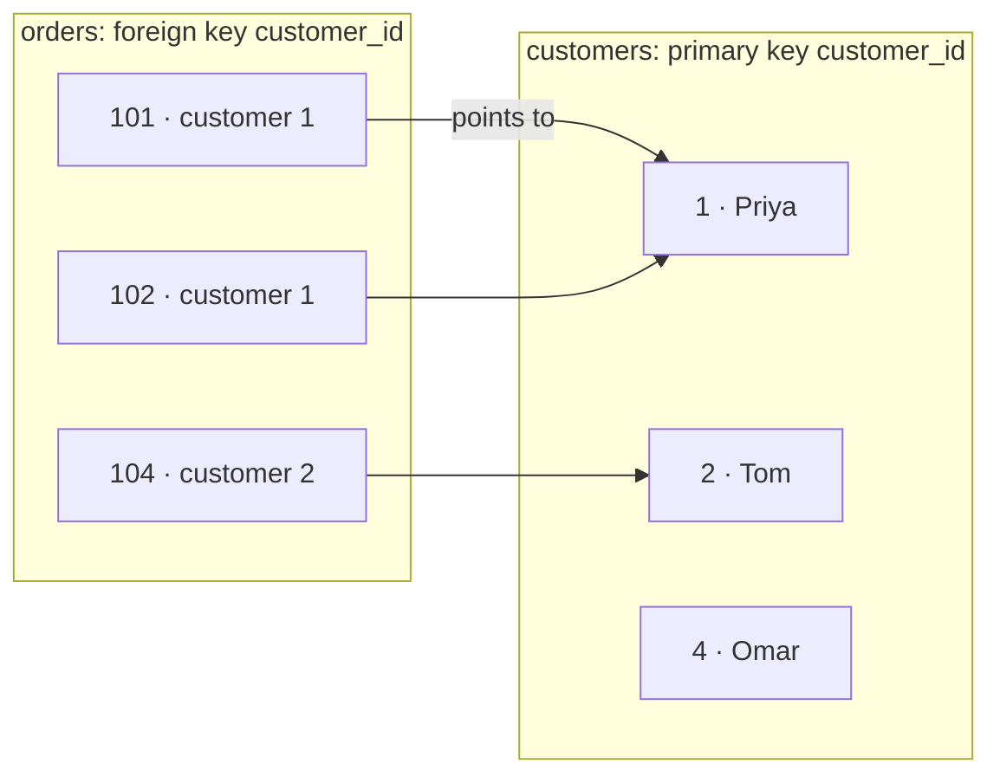

<!-- Written by `npm run lessons` from the lesson data in src/data. Edit the lesson there, not this page. -->

# Keys and relationships: primary keys, foreign keys, one-to-many, many-to-many

**SQL · Unit 0: Start here: databases, tables and SQL · Lesson 3 of 4 · Must know**

> **In one line.** A primary key is a column whose value identifies exactly one row. A foreign key is a column that holds another table's primary key, and these links are how tables relate: one-to-many, many-to-many or one-to-one.

[Open this lesson on the site](https://learn.hamropedia.com/sql/keys-and-relationships-primary-keys-foreign-keys-one-to-many/) for its animation, the practice game and tap-to-explain words.

## The problem it solves

If every order repeated the customer's name, email and city, changing an email would mean editing every one of their orders — and one missed row would leave two different emails. Splitting data into tables linked by keys stores each fact once. Keys are also what joins use to put the rows back together.

## The idea

Every table has a primary key: a column, like emp_id, that is never empty and never repeats, so it points at exactly one row. A foreign key is a column in another table that stores those ids, like orders.customer_id: it says "this order belongs to customer 1". The database can enforce it, so you can't add an order for a customer who doesn't exist.

Relationships come in three shapes. One-to-many: one customer, many orders — the foreign key sits on the "many" side. Many-to-many: an order has many products and a product is in many orders, so a link table (order_items) holds pairs of keys. One-to-one: one row matches at most one row, such as a user and their settings.

## Analogy

Passport numbers. Your passport number is your primary key: one per person, never shared. When a hotel writes your passport number on its booking, that is a foreign key: the booking doesn't copy your whole life story, it just points at you.

**Where the analogy breaks.** A passport number means something in the real world. Good primary keys usually mean nothing at all: just a counter like 1, 2, 3, called a surrogate key. Real-world values like emails can change, and a key should never change.

## Syntax

```sql
CREATE TABLE orders (
  order_id    INTEGER PRIMARY KEY,
  customer_id INTEGER REFERENCES customers(customer_id)
);
```

## How it works, step by step

1. customers.customer_id is the primary key: the values 1 to 6, each used once.
2. orders.customer_id is a foreign key: order 101 holds 1, which means "Priya placed this".
3. One customer can appear in many orders (Priya is in five), but each order points at exactly one customer. That is one-to-many.
4. order_items has a composite primary key: the pair (order_id, product_id). One order holds many products and one product is in many orders. That is many-to-many, and order_items is the link table.
5. employees.manager_id is a foreign key into its own table: Ben's manager_id is 1, which is Asha's emp_id. This is a self-reference, and it is how org charts and folder trees are stored.

## Picture it



*Each order stores only its customer's id. Many orders can point at the same customer (one-to-many), each order points at exactly one customer, and a customer like Omar may have no orders at all.*

## Examples on the practice database

**Follow a foreign key by hand**

```sql
SELECT order_id, customer_id, amount
FROM orders
WHERE customer_id = 1
ORDER BY order_id;
```

| order_id | customer_id | amount |
| --- | --- | --- |
| 101 | 1 | 120 |
| 102 | 1 | 80 |
| 103 | 1 | 45 |
| 105 | 1 | 150 |
| 109 | 1 | 30 |

All five orders hold customer_id 1, so all five belong to Priya. In Unit 3, a JOIN will fetch her name for you.

---

**Many-to-many through the link table**

```sql
SELECT order_id, product_id, quantity
FROM order_items
WHERE product_id = 6
ORDER BY order_id;
```

| order_id | product_id | quantity |
| --- | --- | --- |
| 101 | 6 | 3 |
| 104 | 6 | 5 |
| 105 | 6 | 3 |

Headphones (product 6) appear in three different orders, and order 105 also contains a backpack. Neither column is unique on its own; the pair is.

## Must know

- A primary key is unique and never NULL. A table has exactly one, though it may span several columns.
- A foreign key holds values of another table's primary key — or NULL, if the column allows it.
- One-to-many: the foreign key goes on the "many" side (orders.customer_id), never a list of ids on the "one" side.
- Many-to-many needs a link table with two foreign keys (order_items).
- A natural key is a real-world value (an email); a surrogate key is a meaningless counter (customer_id). Prefer surrogate keys as primary keys.

## Common mistakes

- Putting the foreign key on the wrong side, such as a column of order ids stored inside customers.
- Using a value that can change, like an email or a phone number, as the primary key.
- Thinking a foreign key must always be filled in. It can be NULL unless it is also NOT NULL: employees.dept_id is NULL for Gus.

> **Not true:** An email address makes a good primary key, because every person has a different one.  
> **In fact:** People change their email address, and a primary key should never change: every row that points at it would have to change too. Use an id that carries no meaning.

## Other databases

- SQLite only checks foreign keys after `PRAGMA foreign_keys = ON;` (the practice database switches it on). PostgreSQL, MySQL (InnoDB) and SQL Server always check them.

## In the interview

A primary key uniquely identifies each row: it is unique and never NULL, and I usually make it a meaningless surrogate id. A foreign key is a column that references another table's primary key; it defines the relationship and lets the database reject links to rows that don't exist. One-to-many puts the foreign key on the many side; many-to-many needs a junction table with two foreign keys, usually with the pair as its composite primary key.

<details>
<summary>&lt;b>Primary key or unique key — what is the difference?&lt;/b></summary>

Both forbid duplicates. A table has one primary key, and it can't be NULL. It can have many unique constraints, and in most databases a unique column may still hold NULLs.

</details>

<details>
<summary>&lt;b>What is a composite key?&lt;/b></summary>

A key made of two or more columns together, like (order_id, product_id) in order_items. Neither column is unique on its own, but the pair is.

</details>

<details>
<summary>&lt;b>What happens if you delete a customer who has orders?&lt;/b></summary>

With a foreign key, the database refuses by default. You can choose ON DELETE CASCADE (delete their orders too) or ON DELETE SET NULL instead.

</details>

## Practise

Write each answer yourself first, then open the answer and compare.

### 1. Explain

Explain primary key, foreign key and link table, using customers, orders and order_items.

<details>
<summary>Show one good answer</summary>

A primary key is the column that names exactly one row. In customers it is customer_id: 1 is Priya and nobody else, ever.

A foreign key is a column that holds another table's primary key, to point at that row. orders.customer_id is a foreign key: order 104 has customer_id 2, so it belongs to Tom. One customer can have many orders, so that is one-to-many.

A link table joins two tables that are many-to-many. One order can hold many products, and one product can be in many orders, so neither table can hold the other's key. order_items sits in the middle: each row holds one order_id and one product_id.

</details>

### 2. Write

Write a query that lists every order_items row for order 103.

<details>
<summary>Show one good answer</summary>

Order 103 has two lines: 1 notebook (product 2) and 5 mugs (product 3). That is 1 × £5 + 5 × £8 = £45, order 103's amount.

```sql
SELECT *
FROM order_items
WHERE order_id = 103
ORDER BY product_id;
```

| order_id | product_id | quantity |
| --- | --- | --- |
| 103 | 2 | 1 |
| 103 | 3 | 5 |

</details>

### 3. Predict

Which employees have manager_id = 1? Name them before you run `SELECT name FROM employees WHERE manager_id = 1 ORDER BY name;`.

<details>
<summary>Show one good answer</summary>

Ben, Chen, Dara and Fatima: the four people who report straight to Asha (emp_id 1).

Hana is not in the list: her manager is Ben (2). Eli and Gus report to Dara (4). Asha has no manager at all.

```sql
SELECT name
FROM employees
WHERE manager_id = 1
ORDER BY name;
```

| name |
| --- |
| Ben |
| Chen |
| Dara |
| Fatima |

</details>

### 4. Edge cases

Can two rows of order_items share an order_id? A product_id? Both at once? Explain each answer using the primary key.

<details>
<summary>Show one good answer</summary>

The primary key of order_items is the pair (order_id, product_id), so only the pair must be unique.

• Same order_id: yes. Order 102 has two rows, one for the lamp and one for the backpack.  
• Same product_id: yes. Product 6, the headphones, is in orders 101, 104 and 105.  
• Both at once: no. That would be the same product listed twice in one order. You change the quantity instead.

Try to add a second desk-lamp row to order 102 and the database refuses:

```sql
INSERT INTO order_items VALUES (102, 4, 1);
```

The database refuses this query: `UNIQUE constraint failed: order_items.order_id, order_items.product_id`

</details>

## Go further (optional)

- WATCH · [CS50's Introduction to Databases with SQL — Lecture 1: Relating](https://cs50.harvard.edu/sql/) · Harvard, free
- READ · [W3Schools — SQL PRIMARY KEY](https://www.w3schools.com/sql/sql_primarykey.asp) · short page with a try-it editor, free
- READ · [W3Schools — SQL FOREIGN KEY](https://www.w3schools.com/sql/sql_foreignkey.asp) · short page with a try-it editor, free

---

[← Meet the practice database](meet-the-practice-database.md) · [All lessons](../../README.md) · [Data types: numbers, text, dates and true/false →](data-types-numbers-text-dates-and-true-false.md)
