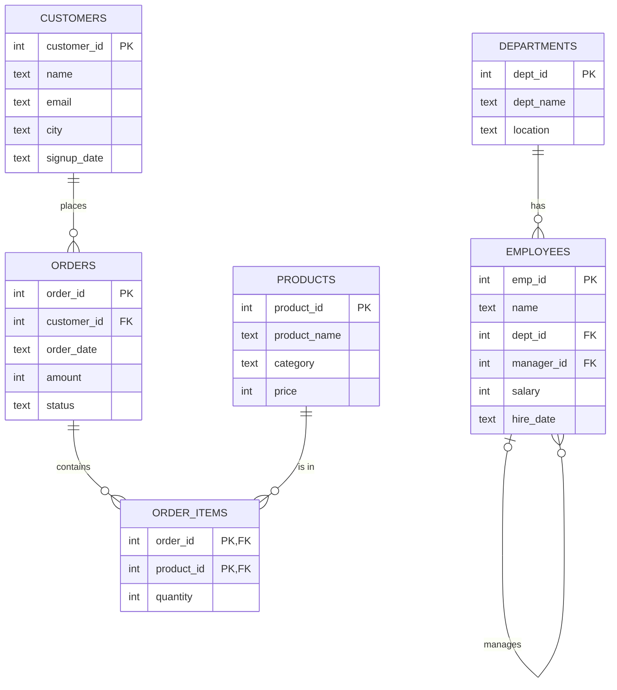

<!-- Written by `npm run lessons` from the lesson data in src/data. Edit the lesson there, not this page. -->

# Meet the practice database

**SQL · Unit 0: Start here: databases, tables and SQL · Lesson 2 of 4 · Must know**

> **In one line.** Six small tables — departments, employees, customers, orders, products and order_items — that every example and exercise in this course uses.

[Open this lesson on the site](https://learn.hamropedia.com/sql/meet-the-practice-database/) for its animation, the practice game and tap-to-explain words.

## The problem it solves

Learning SQL on a different made-up table in every lesson means learning new data each time. With one small database you get to know the rows by heart, so you can check any result by eye. That habit is what catches wrong queries, at work and in interviews.

## The idea

There are two small worlds. The company: departments, and employees who belong to a department and report to a manager. The shop: customers place orders, each order contains products, and order_items records which products are in which order, and how many.

A few awkward cases are planted on purpose, because real data always has them. There is an employee with no department, a customer with no orders, two people on the same salary, and an order with no amount.

## Analogy

A training kitchen with a fixed pantry. Every recipe (query) uses the same ingredients, so you learn how each one behaves, and you notice straight away when a dish comes out wrong.

**Where the analogy breaks.** Real databases have hundreds of tables and millions of rows, so you can't check results by eye there. That is exactly why it pays to practise on data small enough that you can, and to build the habit of testing a query on a few known rows.

## How it works, step by step

1. departments (4 rows): Engineering, Sales, Marketing and HR. HR has no employees yet.
2. employees (8 rows): each has a dept_id that points at departments, and a manager_id that points at another employee. Asha runs the company, so her manager_id is NULL. Gus has no department.
3. customers (6 rows): Tom signed up twice with the same email. Omar has never ordered. Zoe didn't give a city.
4. orders (10 rows), from January to March 2024: each has a customer_id. Order 106 was cancelled and has no amount.
5. products (7 rows): nobody has bought the phone case.
6. order_items (14 rows): one row per product in an order, with the quantity. An order's amount is the sum of quantity × price over its items.

## Picture it



*Each box is a table; PK marks its primary key and FK a foreign key. Read a line from left to right: one department has many employees, one customer places many orders, and order_items links orders to products, because one order can hold many products and one product can be in many orders. The loop on EMPLOYEES is manager_id pointing back into the same table.*

## Examples on the practice database

**The departments table**

```sql
SELECT *
FROM departments
ORDER BY dept_id;
```

| dept_id | dept_name | location |
| --- | --- | --- |
| 1 | Engineering | London |
| 2 | Sales | Manchester |
| 3 | Marketing | London |
| 4 | HR | Leeds |

`SELECT *` means every column. Use it to look at a table; in real queries, name the columns you need.

---

**The employees table**

```sql
SELECT *
FROM employees
ORDER BY emp_id;
```

| emp_id | name | dept_id | manager_id | salary | hire_date |
| --- | --- | --- | --- | --- | --- |
| 1 | Asha | 1 | NULL | 95000 | 2019-03-01 |
| 2 | Ben | 1 | 1 | 70000 | 2020-06-15 |
| 3 | Chen | 1 | 1 | 70000 | 2021-01-10 |
| 4 | Dara | 2 | 1 | 60000 | 2020-02-20 |
| 5 | Eli | 2 | 4 | 45000 | 2022-07-01 |
| 6 | Fatima | 3 | 1 | 52000 | 2021-09-12 |
| 7 | Gus | NULL | 4 | 38000 | 2023-04-03 |
| 8 | Hana | 1 | 2 | 80000 | 2022-11-30 |

Spot the planted cases: Asha's manager_id is NULL, Gus's dept_id is NULL, Ben and Chen both earn 70000, and Hana (80000) earns more than her manager Ben.

---

**The orders table**

```sql
SELECT *
FROM orders
ORDER BY order_id;
```

| order_id | customer_id | order_date | amount | status |
| --- | --- | --- | --- | --- |
| 101 | 1 | 2024-01-06 | 120 | delivered |
| 102 | 1 | 2024-01-07 | 80 | delivered |
| 103 | 1 | 2024-01-08 | 45 | delivered |
| 104 | 2 | 2024-01-21 | 200 | delivered |
| 105 | 1 | 2024-02-02 | 150 | shipped |
| 106 | 3 | 2024-02-12 | NULL | cancelled |
| 107 | 3 | 2024-02-20 | 60 | delivered |
| 108 | 2 | 2024-03-01 | 75 | delivered |
| 109 | 1 | 2024-03-10 | 30 | delivered |
| 110 | 5 | 2024-03-16 | 33 | pending |

Customer 1 (Priya) placed five orders, three of them on consecutive days. Order 106 has no amount.

## Must know

- employees.dept_id points at departments.dept_id; employees.manager_id points at employees.emp_id — the same table.
- orders.customer_id points at customers.customer_id: it says which customer placed each order.
- order_items links orders and products: one row per product in an order.
- Dates are stored as text in YYYY-MM-DD form, so sorting them as text also sorts them by date.
- Amounts and prices are whole pounds, to keep the sums easy to check by hand.

## Common mistakes

- Assuming every employee has a department, or every customer has an order. NULLs and missing rows are where most wrong answers come from.
- Assuming ids are in date order. Here they happen to be; in real data, always sort by the date column.
- Writing a query before knowing the grain of each table — what one row means.

> **Not true:** In the practice database, every employee belongs to a department and every customer has an order.  
> **In fact:** Some don't: an employee can have no department, and a customer no orders. Those NULLs and missing rows are where most wrong answers come from.

## In the interview

Before writing any SQL in an interview, I look at the tables: what one row means in each, which columns are keys, and how the tables join. Then I ask about the awkward cases: can this be NULL, can there be duplicates, can a customer have no orders? Those decide whether I need a LEFT JOIN, a DISTINCT or a COALESCE. Two minutes of that saves a wrong answer.

<details>
<summary>&lt;b>Why look at the data before writing the query?&lt;/b></summary>

To learn the grain, the keys, and the awkward cases — NULLs, duplicates, missing matches — that change the answer.

</details>

<details>
<summary>&lt;b>What is the grain of a table?&lt;/b></summary>

What one row represents. One row of orders is one order; one row of order_items is one product within one order. Mixing grains is how totals get counted twice.

</details>

## Practise

Write each answer yourself first, then open the answer and compare.

### 1. Explain

Without looking, say what one row of order_items means, and how it connects orders to products.

<details>
<summary>Show one good answer</summary>

One row of order_items is one line on a receipt: "order X contains this many of product Y". For example, (102, 4, 2) means order 102 contains 2 of product 4, the desk lamp.

order_id points to a row in orders (who bought it, when, the total). product_id points to a row in products (its name and price). So order_items is the link between the two: one order can hold many products, and one product can appear in many orders.

</details>

### 2. Write

Write a query that shows every column of the customers table, sorted by customer_id.

<details>
<summary>Show one good answer</summary>

`SELECT *` means every column. ORDER BY customer_id puts them in id order, so you can see the two Tom rows (2 and 6) and Zoe's missing city.

```sql
SELECT *
FROM customers
ORDER BY customer_id;
```

| customer_id | name | email | city | signup_date |
| --- | --- | --- | --- | --- |
| 1 | Priya | priya@mail.com | London | 2024-01-02 |
| 2 | Tom | tom@mail.com | Leeds | 2024-01-20 |
| 3 | Lena | lena@mail.com | London | 2024-01-30 |
| 4 | Omar | omar@mail.com | Bristol | 2024-02-14 |
| 5 | Zoe | zoe@mail.com | NULL | 2024-03-10 |
| 6 | Tom | tom@mail.com | Leeds | 2024-03-20 |

</details>

### 3. Predict

How many rows does `SELECT * FROM order_items WHERE order_id = 102;` return, and which products are they?

<details>
<summary>Show one good answer</summary>

2 rows: product 4 (the desk lamp, 2 of them) and product 5 (the backpack, 1).

Check it against orders: 2 × £25 + 1 × £30 = £80, which is exactly order 102's amount. (ORDER BY product_id is added below so the order is fixed.)

```sql
SELECT *
FROM order_items
WHERE order_id = 102
ORDER BY product_id;
```

| order_id | product_id | quantity |
| --- | --- | --- |
| 102 | 4 | 2 |
| 102 | 5 | 1 |

</details>

### 4. Edge cases

List the planted cases from memory: who has no manager, who has no department, who has no orders, which product never sold, and which order has no amount.

<details>
<summary>Show one good answer</summary>

• No manager: Asha (manager_id is NULL; she is the boss).  
• No department: Gus (dept_id is NULL).  
• No orders: Omar. (The second Tom sign-up, customer 6, has none either; Tom's orders are all under id 2.)  
• Never sold: the phone case (product 7).  
• No amount: order 106, which was cancelled.

The others worth knowing: HR has no employees, Ben and Chen earn the same, Hana earns more than her manager Ben, Tom signed up twice with the same email, Zoe has no city, and Priya ordered three days in a row.

</details>

## Go further (optional)

- WATCH · [CS50's Introduction to Databases with SQL — Lecture 0: Querying](https://cs50.harvard.edu/sql/) · Harvard, free
- PRACTICE · [SQLBolt — Lesson 1: SELECT queries 101](https://sqlbolt.com/) · interactive exercises in the browser, free

---

[← What a database, a table and SQL are](what-a-database-a-table-and-sql-are.md) · [All lessons](../../README.md) · [Keys and relationships: primary keys, foreign keys, one-to-many, many-to-many →](keys-and-relationships-primary-keys-foreign-keys-one-to-many.md)
