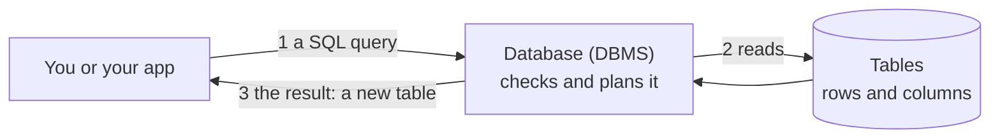

<!-- Written by `npm run lessons` from the lesson data in src/data. Edit the lesson there, not this page. -->

# What a database, a table and SQL are

**SQL · Unit 0: Start here: databases, tables and SQL · Lesson 1 of 4 · Must know**

> **In one line.** A relational database stores data in tables of rows and columns, and SQL (Structured Query Language) is the language you use to ask it questions and to change what it holds.

[Open this lesson on the site](https://learn.hamropedia.com/sql/what-a-database-a-table-and-sql-are/) for its animation, the practice game and tap-to-explain words.

## The problem it solves

A spreadsheet works for a few hundred rows and one person. An app with thousands of users needs data that many people can read and change at the same time, safely, without losing anything, and fast enough to answer in milliseconds. A database does that job, and SQL is how you talk to it.

## The idea

A database is an organised store of data, run by a program called a DBMS (database management system), such as PostgreSQL, MySQL, SQL Server or SQLite.

The data lives in tables. A table is like one sheet in a spreadsheet: each row is one thing (one employee, one order) and each column is one fact about it (name, salary).

You never open the files yourself. You send the database a query — a request written in SQL — and it sends back rows.

## Analogy

A library with a librarian. The shelves are the tables, each book is a row, and the details on its catalogue card (title, author, year) are the columns. You don't walk the shelves yourself: you hand the librarian a request slip — "every book by this author, newest first" — and they bring back exactly those books.

**Where the analogy breaks.** A librarian fetches books one by one, in the order you asked. SQL is declarative: you describe what you want, not how to get it, and the database picks its own way. That is why the order you write a query in is not the order it runs in.

## Syntax

```sql
SELECT column, other_column
FROM table_name
WHERE condition;
```

## How it works, step by step

1. You write a query in SQL, for example: give me the name and salary of everyone in department 1.
2. You send it to the database, from a SQL editor, a Python script, or your app's backend.
3. The database checks the query makes sense: do these tables and columns exist?
4. Its query planner picks the fastest way to find the rows, for example by using an index.
5. It runs that plan and returns the result: a new, temporary table of rows and columns.
6. Reading never changes the stored tables. A SELECT is always safe to run.

## Picture it



*Follow the numbers. You send a query, the database works out how to answer it and reads its tables, and you get back a result — which is itself a small table.*

## Examples on the practice database

**Your first query**

```sql
SELECT name, salary
FROM employees
WHERE dept_id = 1
ORDER BY name;
```

| name | salary |
| --- | --- |
| Asha | 95000 |
| Ben | 70000 |
| Chen | 70000 |
| Hana | 80000 |

Read it like English: select the name and salary, from the employees table, where the department is 1, sorted by name. The answer is a small table of four rows.

## Must know

- A table holds one kind of thing. A row is one of them; a column is one fact about each.
- SQL is declarative: you say what you want, and the database decides how to get it.
- The result of a query is itself a table. That is why a query can be put inside another query.
- SQL keywords are not case-sensitive (`select` works), but writing them in capitals makes a query easier to read.
- Every major database speaks SQL. The core is the same everywhere; small details such as dates and LIMIT differ, and these notes point them out.
- How databases scale — SQL versus NoSQL, replication, sharding — is in [System Design, Unit 3: Data](https://learn.hamropedia.com/system-design/unit/data/).

## Common mistakes

- Thinking SQL runs top to bottom like Python. It doesn't: the database reads FROM first and SELECT near the end.
- Thinking a database is just a big spreadsheet. It also enforces rules, handles many users at once and survives crashes.
- Forgetting the semicolon between two statements. One statement on its own usually runs without it.

> **Not true:** A database is a big spreadsheet: it stores rows, and that is its whole job.  
> **In fact:** A database also enforces rules on the data, serves many users at the same time and survives crashes. A spreadsheet does none of these.

## Other databases

- This page runs SQLite, a small database that lives inside one file — here, inside your browser. PostgreSQL, MySQL and SQL Server run as servers, but the SQL you learn here is the same for almost everything you will write.

## In the interview

A relational database stores data in tables, where each row is one record and each column is one attribute, and the tables are linked through keys. SQL is the declarative language for querying and changing that data: I describe the result I want, and the database's optimiser decides how to get it. That separation is why the same query can become much faster just by adding an index.

<details>
<summary>&lt;b>What is the difference between a database and a DBMS?&lt;/b></summary>

The database is the data itself. The DBMS is the software that stores it and answers queries: PostgreSQL, MySQL, SQL Server, SQLite.

</details>

<details>
<summary>&lt;b>What does "declarative" mean?&lt;/b></summary>

You describe the result you want, not the steps to get it. The database chooses the steps, which is called its query plan.

</details>

<details>
<summary>&lt;b>When would you not use a relational database?&lt;/b></summary>

When the data has no fixed shape, or one simple lookup by key must scale across many machines — a key-value or document store can fit better. For most products, a relational database is the right default.

</details>

## Practise

Write each answer yourself first, then open the answer and compare.

### 1. Explain

Explain to a friend who uses Excel what a table, a row, a column and a query are, using the employees table.

<details>
<summary>Show one good answer</summary>

A table is one sheet in a spreadsheet. The employees table is a sheet with one line per person.

A row is one line: one employee, such as Asha with her id, department, manager, salary and hire date.

A column is one heading, one fact that every row has: name, salary, hire_date.

A query is a question you write down in SQL, such as "give me the name and salary of everyone in department 1". You don't scroll and filter by hand like in Excel: you send the question, and the database sends back just the rows and columns you asked for.

</details>

### 2. Write

Write a query that returns the name and hire_date of every employee in department 2, sorted by name.

<details>
<summary>Show one good answer</summary>

Pick the two columns, name the table, keep department 2, and sort. Dara and Eli are the two people in Sales.

```sql
SELECT name, hire_date
FROM employees
WHERE dept_id = 2
ORDER BY name;
```

| name | hire_date |
| --- | --- |
| Dara | 2020-02-20 |
| Eli | 2022-07-01 |

</details>

### 3. Predict

Before running it, say how many rows `SELECT name FROM employees WHERE salary > 60000;` returns, and which names.

<details>
<summary>Show one good answer</summary>

4 rows: Asha (95,000), Ben (70,000), Chen (70,000) and Hana (80,000).

Dara earns exactly 60,000, and `>` means strictly more than, so she is left out. Use `>=` to include her.

The query has no ORDER BY, so the database may return the 4 names in any order. The query below adds ORDER BY name and the salary, so you can check.

```sql
SELECT name, salary
FROM employees
WHERE salary > 60000
ORDER BY name;
```

| name | salary |
| --- | --- |
| Asha | 95000 |
| Ben | 70000 |
| Chen | 70000 |
| Hana | 80000 |

</details>

### 4. Edge cases

Gus has no department. Will he appear in `SELECT name FROM employees WHERE dept_id = 1;`? Will he appear if there is no WHERE at all?

<details>
<summary>Show one good answer</summary>

With `WHERE dept_id = 1`: no. Gus's dept_id is NULL (unknown), and `NULL = 1` is not true, it is unknown. WHERE keeps only rows where the condition is true, so Gus is dropped.

With no WHERE at all: yes. Nothing filters the rows, so all 8 employees come back, Gus included.

The query below shows the test for every row. Gus gets NULL, not 0 (false): that is why he is in neither "department 1" nor "not department 1".

```sql
SELECT name, dept_id, dept_id = 1 AS in_dept_1
FROM employees
ORDER BY emp_id;
```

| name | dept_id | in_dept_1 |
| --- | --- | --- |
| Asha | 1 | 1 |
| Ben | 1 | 1 |
| Chen | 1 | 1 |
| Dara | 2 | 0 |
| Eli | 2 | 0 |
| Fatima | 3 | 0 |
| Gus | NULL | NULL |
| Hana | 1 | 1 |

</details>

## Go further (optional)

- WATCH · [CS50's Introduction to Databases with SQL — Lecture 0: Querying](https://cs50.harvard.edu/sql/) · Harvard, free
- PRACTICE · [SQLBolt — Lesson 1: SELECT queries 101](https://sqlbolt.com/) · interactive exercises in the browser, free
- READ · [Select Star SQL](https://selectstarsql.com/) · a free interactive book

---

[All lessons](../../README.md) · [Meet the practice database →](meet-the-practice-database.md)
