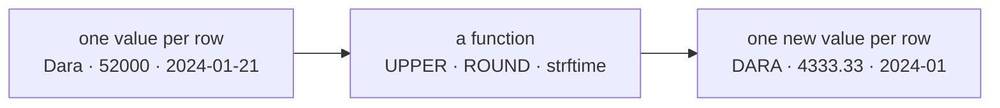

<!-- Written by `npm run lessons` from the lesson data in src/data. Edit the lesson there, not this page. -->

# Built-in functions for text, numbers and dates

**SQL · Unit 1: Reading data: SELECT, WHERE and sorting · Lesson 8 of 8 · Should know**

> **In one line.** Functions such as UPPER, LENGTH, SUBSTR, ROUND and the date functions transform a value inside a query — one value in, one value out, for each row.

[Open this lesson on the site](https://learn.hamropedia.com/sql/built-in-functions-for-text-numbers-and-dates/) for its animation, the practice game and tap-to-explain words.

## The problem it solves

Data rarely arrives in the shape you need: names in mixed case, prices that need rounding, dates you want as "2024-03" or as "how many days ago". Functions do these small transformations inside the query.

## The idea

A function takes values in brackets and returns one value.  
Text: UPPER and LOWER change case, LENGTH counts characters, `SUBSTR(text, start, length)` cuts out a piece (counting from 1), TRIM removes spaces at the ends, and REPLACE swaps text.  
Numbers: `ROUND(x, 2)` rounds to 2 decimal places, ABS removes the minus sign.  
Dates are where databases differ most: SQLite uses strftime and julianday; PostgreSQL uses DATE_TRUNC, EXTRACT and date subtraction.

These run once per row — unlike aggregate functions, which turn many rows into one (Unit 2).

## Analogy

Kitchen tools. A peeler (TRIM), a slicer (SUBSTR), a measuring spoon (ROUND). Each one takes one ingredient and gives back a changed version of it.

**Where the analogy breaks.** Kitchen tools are the same in every kitchen. Date functions are not the same in every database — so in an interview, say which database you are assuming, and the interviewer will usually accept any reasonable syntax.

## Syntax

```sql
UPPER(text)   LENGTH(text)   SUBSTR(text, start, length)
ROUND(number, places)
strftime('%Y-%m', date)   -- SQLite: the year and month
```

## How it works, step by step

1. `UPPER('Dara')` is 'DARA'; `LENGTH('Dara')` is 4; `SUBSTR('Dara', 1, 3)` is 'Dar' (start at character 1, take 3).
2. salary / 12.0 gives a long decimal; `ROUND(…, 2)` keeps 2 decimal places.
3. `strftime('%Y-%m', '2024-01-21')` is '2024-01': the year and month, ready to group by.
4. julianday turns a date into a day number, so subtracting two of them gives the days between.
5. Functions can be nested: `UPPER(SUBSTR(name, 1, 1))` is the first letter in capitals.

## Picture it



*A row function changes each value on its own: one value in, one value out, for every row. Aggregate functions in Unit 2 do the opposite and squash many rows into one.*

## Examples on the practice database

**Text functions**

```sql
SELECT name, UPPER(name) AS shout, LENGTH(name) AS letters, SUBSTR(name, 1, 3) AS first_three
FROM employees
WHERE dept_id = 2
ORDER BY name;
```

| name | shout | letters | first_three |
| --- | --- | --- | --- |
| Dara | DARA | 4 | Dar |
| Eli | ELI | 3 | Eli |

---

**Rounding**

```sql
SELECT name, salary, ROUND(salary / 12.0, 2) AS monthly
FROM employees
WHERE dept_id = 3 OR dept_id IS NULL
ORDER BY name;
```

| name | salary | monthly |
| --- | --- | --- |
| Fatima | 52000 | 4333.33 |
| Gus | 38000 | 3166.67 |

Dividing by 12.0, not 12, avoids integer division. ROUND then keeps two decimal places.

---

**Dates: the month, and days between**

```sql
SELECT order_id, order_date,
       strftime('%Y-%m', order_date) AS month,
       julianday('2024-03-31') - julianday(order_date) AS days_before_end_of_march
FROM orders
WHERE customer_id = 2
ORDER BY order_id;
```

| order_id | order_date | month | days_before_end_of_march |
| --- | --- | --- | --- |
| 104 | 2024-01-21 | 2024-01 | 70 |
| 108 | 2024-03-01 | 2024-03 | 30 |

This is SQLite's way. The notes below give the PostgreSQL, MySQL and SQL Server versions.

## Must know

- A row function runs once per row and returns one value; an aggregate function squashes many rows into one.
- Text positions start at 1, not 0: `SUBSTR('Dara', 1, 3)` is 'Dar'.
- `ROUND(x, 2)` for display; divide by a decimal (12.0) to avoid integer division first.
- Date functions differ the most between databases. Know your target database's month-truncation and date-difference functions.
- Wrapping a column in a function inside WHERE (`WHERE UPPER(name) = …`) stops a normal index on that column being used.

## Common mistakes

- Counting text positions from 0, as in Python.
- Rounding before summing, which adds up rounding errors. Sum first, round at the end.
- Comparing dates stored as '06/01/2024' text — they compare as text, not as dates.

> **Not true:** Rounding each value first and then adding them gives the same total as adding first.  
> **In fact:** Every rounding adds a small error, and the errors add up. Add the exact values first, and round once at the end.

## Other databases

- Month of a date: PostgreSQL `DATE_TRUNC('month', d)` or `TO_CHAR(d, 'YYYY-MM')`; MySQL `DATE_FORMAT(d, '%Y-%m')`; SQL Server `FORMAT(d, 'yyyy-MM')`; SQLite `strftime('%Y-%m', d)`.
- Days between: PostgreSQL `d2 - d1` (dates); MySQL `DATEDIFF(d2, d1)`; SQL Server `DATEDIFF(day, d1, d2)`; SQLite `julianday(d2) - julianday(d1)`.
- Year of a date: `EXTRACT(YEAR FROM d)` in PostgreSQL and MySQL; `YEAR(d)` in MySQL and SQL Server; `strftime('%Y', d)` in SQLite.
- Text length is `LENGTH` in most databases but `LEN` in SQL Server.

## In the interview

Scalar functions transform one value per row. There are string functions like UPPER, SUBSTRING and TRIM, numeric ones like ROUND, and date functions for truncating to a month or finding the days between two dates. Date syntax is the least portable part of SQL, so in an interview I name the dialect I am assuming: usually PostgreSQL, with DATE_TRUNC and date subtraction. I also avoid wrapping indexed columns in functions inside WHERE, because that blocks the index.

<details>
<summary>&lt;b>What is the difference between a scalar function and an aggregate function?&lt;/b></summary>

A scalar function returns one value per row (UPPER, ROUND). An aggregate returns one value per group of rows (SUM, COUNT).

</details>

<details>
<summary>&lt;b>How do you group orders by month in PostgreSQL?&lt;/b></summary>

`GROUP BY DATE_TRUNC('month', order_date)`, which turns every date into the first day of its month.

</details>

## Practise

Write each answer yourself first, then open the answer and compare.

### 1. Explain

Explain the difference between a row function like UPPER and an aggregate like SUM.

<details>
<summary>Show one good answer</summary>

A row function such as UPPER works on one value from one row and gives one value back. 8 employees in, 8 rows out, each with its own upper-case name.

An aggregate such as SUM reads a whole column across many rows and gives back one value for the group. 8 salaries in, one total out. The rows collapse.

That is why you can write `SELECT name, UPPER(name)`, but not `SELECT name, SUM(salary)` without GROUP BY: one name per row can't sit next to one total for all rows.

</details>

### 2. Write

Write a query that shows each customer's name and the part of their email before the @. (Hint: `INSTR(email, '@')` gives the position of the @.)

<details>
<summary>Show one good answer</summary>

`INSTR(email, '@')` finds where the @ is. Take the characters from position 1 up to one before it. For priya@mail.com the @ is at position 6, so take 5 characters.

```sql
SELECT name, email, SUBSTR(email, 1, INSTR(email, '@') - 1) AS username
FROM customers
ORDER BY customer_id;
```

| name | email | username |
| --- | --- | --- |
| Priya | priya@mail.com | priya |
| Tom | tom@mail.com | tom |
| Lena | lena@mail.com | lena |
| Omar | omar@mail.com | omar |
| Zoe | zoe@mail.com | zoe |
| Tom | tom@mail.com | tom |

</details>

### 3. Predict

What does `SELECT SUBSTR('Headphones', 5, 5), LENGTH(TRIM('  Pen  ')), ROUND(2.675, 1);` return?

<details>
<summary>Show one good answer</summary>

'phone', 3 and 2.7.

• `SUBSTR('Headphones', 5, 5)`: start at character 5 (counting from 1: H-e-a-d-p, so it starts at the p) and take 5 characters: "phone".  
• `TRIM` removes the spaces at both ends, leaving "Pen", which has 3 letters.  
• `ROUND(2.675, 1)` keeps one decimal place: 2.7.

```sql
SELECT SUBSTR('Headphones', 5, 5), LENGTH(TRIM('  Pen  ')), ROUND(2.675, 1);
```

| SUBSTR('Headphones', 5, 5) | LENGTH(TRIM('  Pen  ')) | ROUND(2.675, 1) |
| --- | --- | --- |
| phone | 3 | 2.7 |

</details>

### 4. Edge cases

How many days passed between each employee's hire_date and '2024-01-01'? What happens if one of the dates is NULL?

<details>
<summary>Show one good answer</summary>

Subtract the julianday numbers: each date becomes a count of days, so the difference is days between. Asha had been there 1,767 days by 1 January 2024.

If either date is NULL, julianday gives NULL, and the subtraction gives NULL for that row. There is no error, just a blank. Decide what you want: drop those rows with `WHERE hire_date IS NOT NULL`, or show a default with COALESCE. (In SQLite, `SELECT julianday('2024-01-01') - julianday(NULL);` returns NULL.)

```sql
SELECT name, hire_date,
       julianday('2024-01-01') - julianday(hire_date) AS days_to_2024
FROM employees
ORDER BY emp_id;
```

| name | hire_date | days_to_2024 |
| --- | --- | --- |
| Asha | 2019-03-01 | 1767 |
| Ben | 2020-06-15 | 1295 |
| Chen | 2021-01-10 | 1086 |
| Dara | 2020-02-20 | 1411 |
| Eli | 2022-07-01 | 549 |
| Fatima | 2021-09-12 | 841 |
| Gus | 2023-04-03 | 273 |
| Hana | 2022-11-30 | 397 |

</details>

## Go further (optional)

- READ · [SQLite docs — Date And Time Functions](https://www.sqlite.org/lang_datefunc.html) · official documentation, free
- READ · [PostgreSQL docs — Date/Time Functions and Operators](https://www.postgresql.org/docs/current/functions-datetime.html) · official documentation, free
- PRACTICE · [SQLZoo — SELECT from WORLD: string functions](https://sqlzoo.net/) · free exercises

---

[← CASE WHEN: if-then logic inside a query](case-when-if-then-logic-inside-a-query.md) · [All lessons](../../README.md) · [Aggregate functions: COUNT, SUM, AVG, MIN and MAX →](../unit-2-summarising/aggregate-functions-count-sum-avg-min-and-max.md)
