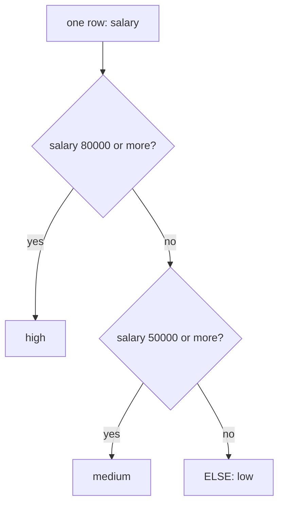

<!-- Written by `npm run lessons` from the lesson data in src/data. Edit the lesson there, not this page. -->

# CASE WHEN: if-then logic inside a query

**SQL · Unit 1: Reading data: SELECT, WHERE and sorting · Lesson 7 of 8 · Must know**

> **In one line.** CASE WHEN condition THEN value … ELSE value END returns a value chosen by the first condition that is true, so a query can label, group or tidy values row by row.

[Open this lesson on the site](https://learn.hamropedia.com/sql/case-when-if-then-logic-inside-a-query/) for its animation, the practice game and tap-to-explain words.

## The problem it solves

Data often needs sorting into buckets — salary bands, "open" or "closed" orders, "new" or "returning" customers — and those labels aren't stored anywhere. CASE builds them inside the query. It is also the key to counting several things in one pass (Unit 2) and to pivoting.

## The idea

CASE is SQL's if-else. For each row, it checks the WHEN conditions from top to bottom and returns the THEN value of the first one that is true. If none is true, it returns the ELSE value — or NULL if there is no ELSE.

CASE is an expression, so it can go anywhere a value can: in SELECT, WHERE, ORDER BY, GROUP BY, or inside SUM and COUNT. The short form, `CASE status WHEN 'shipped' THEN …`, compares one column with several values.

## Analogy

Sorting post into pigeonholes. You read the address, check the first rule ("London?"), then the next ("Leeds?"), and drop the letter into the first hole that fits. Anything that fits no rule goes into "other" — that is ELSE.

**Where the analogy breaks.** A postal worker can put one letter in two holes by mistake. CASE never does: it stops at the first true WHEN, so the order of the WHENs matters. Put the strictest test first.

## Syntax

```sql
CASE
  WHEN condition1 THEN value1
  WHEN condition2 THEN value2
  ELSE other_value
END AS new_column
```

## How it works, step by step

1. For Asha (95000): `salary >= 80000` is true, so the band is 'high', and CASE stops.
2. For Ben (70000): the first test is false; `salary >= 50000` is true, so 'medium'.
3. For Eli (45000): both tests are false, so ELSE gives 'low'.
4. If the tests were in the other order (>= 50000 first), Asha would wrongly get 'medium'. Order matters.
5. END closes the CASE, and AS names the new column.

## Picture it



*CASE checks its WHEN conditions in order and returns the first match. A row that matches nothing gets the ELSE value — or NULL if there is no ELSE.*

## Examples on the practice database

**Salary bands**

```sql
SELECT name, salary,
       CASE
         WHEN salary >= 80000 THEN 'high'
         WHEN salary >= 50000 THEN 'medium'
         ELSE 'low'
       END AS band
FROM employees
ORDER BY salary DESC, name;
```

| name | salary | band |
| --- | --- | --- |
| Asha | 95000 | high |
| Hana | 80000 | high |
| Ben | 70000 | medium |
| Chen | 70000 | medium |
| Dara | 60000 | medium |
| Fatima | 52000 | medium |
| Eli | 45000 | low |
| Gus | 38000 | low |

---

**The short form: compare one column**

```sql
SELECT order_id, status,
       CASE status
         WHEN 'delivered' THEN 'closed'
         WHEN 'cancelled' THEN 'closed'
         ELSE 'open'
       END AS state
FROM orders
WHERE customer_id = 1
ORDER BY order_id;
```

| order_id | status | state |
| --- | --- | --- |
| 101 | delivered | closed |
| 102 | delivered | closed |
| 103 | delivered | closed |
| 105 | shipped | open |
| 109 | delivered | closed |

---

**No ELSE means NULL**

```sql
SELECT name, CASE WHEN dept_id = 1 THEN 'engineering' END AS team
FROM employees
WHERE salary <= 70000
ORDER BY name;
```

| name | team |
| --- | --- |
| Ben | engineering |
| Chen | engineering |
| Dara | NULL |
| Eli | NULL |
| Fatima | NULL |
| Gus | NULL |

Rows that match no WHEN get NULL. Add an ELSE whenever NULL isn't what you want.

## Must know

- CASE returns the THEN value of the first true WHEN, then stops.
- No ELSE means NULL for rows that match nothing.
- Always finish with END, and name the result with AS.
- CASE is an expression: it works in SELECT, WHERE, ORDER BY, GROUP BY and inside aggregates.
- Every THEN should return the same type — all text, or all numbers.

## Common mistakes

- Putting the loose condition first (`>= 50000` before `>= 80000`), so the strict one is never reached.
- Forgetting END, which gives a syntax error.
- Writing `CASE status WHEN NULL THEN …`. The short form uses =, so it never matches NULL. Use `CASE WHEN status IS NULL THEN …`.

> **Not true:** The order of the WHEN branches in a CASE makes no difference to the result.  
> **In fact:** CASE stops at the first WHEN that is true. With `>= 50000` written before `>= 80000`, the second branch is never reached: put the strictest test first.

## Other databases

- MySQL and SQLite also have `IF(condition, a, b)` / `IIF(condition, a, b)`, and SQL Server has IIF. CASE works everywhere, so learn CASE.

## In the interview

CASE is SQL's conditional expression: it evaluates WHEN conditions in order and returns the first matching THEN value, or the ELSE value, or NULL if there is no ELSE. Because it is an expression, it works anywhere. I use it to bucket values and to sort in a custom order. Most of all I use it inside aggregates, like SUM of CASE WHEN status equals delivered THEN 1, to count several categories in a single pass.

<details>
<summary>&lt;b>What happens when no WHEN matches and there is no ELSE?&lt;/b></summary>

CASE returns NULL.

</details>

<details>
<summary>&lt;b>How would you sort orders with pending first, then shipped, then the rest?&lt;/b></summary>

`ORDER BY CASE status WHEN 'pending' THEN 1 WHEN 'shipped' THEN 2 ELSE 3 END`.

</details>

## Practise

Write each answer yourself first, then open the answer and compare.

### 1. Explain

Explain why the order of the WHEN lines matters, using the salary bands.

<details>
<summary>Show one good answer</summary>

CASE checks the WHEN lines from top to bottom and stops at the first one that is true. So the most specific test must come first.

The right order is `WHEN salary >= 80000 THEN 'high'`, then `WHEN salary >= 50000 THEN 'medium'`, then ELSE 'low'.

Swap the first two lines and Asha (95,000) meets `>= 50000` first. That is true, so she becomes 'medium', and the 'high' line is never reached for anyone. The query below has the lines swapped: nobody is high.

```sql
SELECT name, salary,
       CASE
         WHEN salary >= 50000 THEN 'medium'
         WHEN salary >= 80000 THEN 'high'
         ELSE 'low'
       END AS band
FROM employees
ORDER BY salary DESC, name;
```

| name | salary | band |
| --- | --- | --- |
| Asha | 95000 | medium |
| Hana | 80000 | medium |
| Ben | 70000 | medium |
| Chen | 70000 | medium |
| Dara | 60000 | medium |
| Fatima | 52000 | medium |
| Eli | 45000 | low |
| Gus | 38000 | low |

</details>

### 2. Write

Write a query that labels each product as 'cheap' (under £10), 'mid' (£10 to £29) or 'premium' (£30 and up), sorted by price.

<details>
<summary>Show one good answer</summary>

Test the cheapest band first; then each line only needs an upper limit. "Under £10" is `< 10`, and "£10 to £29" is `< 30` once the first line has taken the cheap ones.

```sql
SELECT product_name, price,
       CASE
         WHEN price < 10 THEN 'cheap'
         WHEN price < 30 THEN 'mid'
         ELSE 'premium'
       END AS price_band
FROM products
ORDER BY price;
```

| product_name | price | price_band |
| --- | --- | --- |
| Pen | 2 | cheap |
| Notebook | 5 | cheap |
| Mug | 8 | cheap |
| Phone case | 15 | mid |
| Desk lamp | 25 | mid |
| Backpack | 30 | premium |
| Headphones | 40 | premium |

</details>

### 3. Predict

What `state` does each of Tom's orders get in the short-form example? (Change customer_id to 2 in your head.)

<details>
<summary>Show one good answer</summary>

Tom (customer 2) has two orders, 104 and 108. Both are delivered, so both are 'closed'.

```sql
SELECT order_id, status,
       CASE status
         WHEN 'delivered' THEN 'closed'
         WHEN 'cancelled' THEN 'closed'
         ELSE 'open'
       END AS state
FROM orders
WHERE customer_id = 2
ORDER BY order_id;
```

| order_id | status | state |
| --- | --- | --- |
| 104 | delivered | closed |
| 108 | delivered | closed |

</details>

### 4. Edge cases

Order 106 has a NULL amount. Write a CASE that labels orders 'big' (over £100), 'small', or 'unknown' when the amount is missing.

<details>
<summary>Show one good answer</summary>

Test for NULL first. If you don't, `NULL > 100` is unknown, not true, so order 106 falls through to ELSE and is wrongly labelled 'small'.

```sql
SELECT order_id, amount,
       CASE
         WHEN amount IS NULL THEN 'unknown'
         WHEN amount > 100 THEN 'big'
         ELSE 'small'
       END AS size
FROM orders
ORDER BY order_id;
```

| order_id | amount | size |
| --- | --- | --- |
| 101 | 120 | big |
| 102 | 80 | small |
| 103 | 45 | small |
| 104 | 200 | big |
| 105 | 150 | big |
| 106 | NULL | unknown |
| 107 | 60 | small |
| 108 | 75 | small |
| 109 | 30 | small |
| 110 | 33 | small |

</details>

## Go further (optional)

- READ · [W3Schools — SQL CASE Expression](https://www.w3schools.com/sql/sql_case.asp) · short page with a try-it editor, free
- READ · [Mode SQL Tutorial — SQL CASE](https://mode.com/sql-tutorial/) · Mode, free
- READ · [PostgreSQL docs — Conditional Expressions](https://www.postgresql.org/docs/current/functions-conditional.html) · official documentation, free

---

[← DISTINCT: removing duplicate rows](distinct-removing-duplicate-rows.md) · [All lessons](../../README.md) · [Built-in functions for text, numbers and dates →](built-in-functions-for-text-numbers-and-dates.md)
