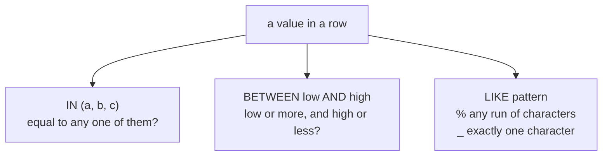

<!-- Written by `npm run lessons` from the lesson data in src/data. Edit the lesson there, not this page. -->

# IN, BETWEEN and LIKE: shorter conditions

**SQL · Unit 1: Reading data: SELECT, WHERE and sorting · Lesson 3 of 8 · Must know**

> **In one line.** IN checks a value against a list, BETWEEN checks a range (both ends included), and LIKE matches text against a pattern with % (any number of characters) and _ (exactly one).

[Open this lesson on the site](https://learn.hamropedia.com/sql/in-between-and-like-shorter-conditions/) for its animation, the practice game and tap-to-explain words.

## The problem it solves

`status = 'shipped' OR status = 'pending' OR status = 'cancelled'` is long and easy to get wrong. Questions like "names starting with P" or "orders in February" come up all the time. These three words make such conditions short and readable.

## The idea

IN: `status IN ('shipped', 'pending')` is true when status equals any value in the list.  
BETWEEN: `amount BETWEEN 50 AND 100` means `amount >= 50 AND amount <= 100`, ends included.  
LIKE: `product_name LIKE 'P%'` matches text starting with P; `%` stands for any number of characters (even none) and `_` for exactly one.  
Put NOT in front of any of them to flip it: NOT IN, NOT BETWEEN, NOT LIKE.

## Analogy

IN is a guest list: is your name on it? BETWEEN is a height limit at a fair ride: between 1.2 m and 1.9 m, both ends allowed. LIKE is a crossword clue with blanks: "P _ _" fits Pen.

**Where the analogy breaks.** A guest list doesn't care about missing names, but SQL does: if the list after NOT IN contains a NULL, nothing matches at all. Unit 4 shows this trap.

## Syntax

```sql
WHERE column IN (value1, value2)
WHERE column BETWEEN low AND high
WHERE text_column LIKE 'pattern%'
```

## How it works, step by step

1. `status IN ('shipped', 'pending')` is checked against each order: shipped matches, pending matches, delivered doesn't.
2. `order_date BETWEEN '2024-02-01' AND '2024-02-29'` keeps every date from the 1st to the 29th of February, both days included.
3. `product_name LIKE 'P%'` keeps Pen and Phone case: P, then anything.
4. `LIKE '%s'` keeps names ending in s: Headphones.
5. `LIKE '_en'` means exactly one character, then "en": Pen matches, but Phone case doesn't.

## Picture it



*Three shortcuts for common conditions: IN for a list of values, BETWEEN for a range with both ends included, and LIKE for a text pattern.*

## Examples on the practice database

**IN: one of a list**

```sql
SELECT order_id, status
FROM orders
WHERE status IN ('shipped', 'pending')
ORDER BY order_id;
```

| order_id | status |
| --- | --- |
| 105 | shipped |
| 110 | pending |

The same as `status = 'shipped' OR status = 'pending'`, but shorter and harder to get wrong.

---

**BETWEEN: a range of dates**

```sql
SELECT order_id, order_date, amount
FROM orders
WHERE order_date BETWEEN '2024-02-01' AND '2024-02-29'
ORDER BY order_date;
```

| order_id | order_date | amount |
| --- | --- | --- |
| 105 | 2024-02-02 | 150 |
| 106 | 2024-02-12 | NULL |
| 107 | 2024-02-20 | 60 |

Both ends are included. This works because the dates are YYYY-MM-DD text; with real timestamps, see the mistakes below.

---

**LIKE: text patterns**

```sql
SELECT product_name
FROM products
WHERE product_name LIKE 'P%' OR product_name LIKE '%s'
ORDER BY product_name;
```

| product_name |
| --- |
| Headphones |
| Pen |
| Phone case |

'P%' finds names starting with P; '%s' finds names ending in s.

## Must know

- `x IN (a, b)` means `x = a OR x = b`.
- `x BETWEEN a AND b` means `x >= a AND x <= b` — both ends included, and a must be the smaller value.
- LIKE wildcards: `%` is any number of characters (including none); `_` is exactly one character.
- NOT IN, NOT BETWEEN and NOT LIKE flip each test.
- A LIKE pattern that starts with % ('%son') can't use a normal index, so it is slow on big tables.

## Common mistakes

- Using BETWEEN on timestamps: `BETWEEN '2024-02-01' AND '2024-02-29'` misses everything after midnight on the 29th. Use `>= '2024-02-01' AND < '2024-03-01'` instead.
- Writing BETWEEN with the bigger value first: `BETWEEN 100 AND 50` returns nothing.
- Forgetting the % in LIKE: `LIKE 'P'` only matches the exact text P.

> **Not true:** `LIKE 'P'` matches every value that starts with P.  
> **In fact:** Without a wildcard, LIKE matches only the exact text P. Write `LIKE 'P%'` for the values that start with P.

## Other databases

- Case: LIKE ignores case in SQLite and usually in MySQL and SQL Server, but is case-sensitive in PostgreSQL, which has ILIKE for case-insensitive matching.
- SQL Server also allows `[abc]` sets in LIKE patterns; PostgreSQL has full regular expressions with `~`.

## In the interview

IN tests membership in a list, and is shorthand for several ORs. BETWEEN tests an inclusive range. LIKE matches text patterns, where percent is any sequence of characters and underscore is exactly one. Two cautions: for timestamps I use a half-open range — greater-or-equal the start and less-than the next day — rather than BETWEEN, and a leading-wildcard LIKE can't use a B-tree index.

<details>
<summary>&lt;b>Is BETWEEN inclusive?&lt;/b></summary>

Yes, at both ends. `BETWEEN 1 AND 5` includes 1 and 5.

</details>

<details>
<summary>&lt;b>How would you find names containing an actual % sign?&lt;/b></summary>

Escape it: `LIKE '%!%%' ESCAPE '!'`. The ESCAPE character says the next % is a real percent sign.

</details>

<details>
<summary>&lt;b>Why is `LIKE '%term%'` slow?&lt;/b></summary>

An index is sorted from the first character, so a pattern that can start anywhere forces a scan of every row. Full-text search indexes solve that.

</details>

## Practise

Write each answer yourself first, then open the answer and compare.

### 1. Explain

Explain what % and _ mean in a LIKE pattern, with one example of each.

<details>
<summary>Show one good answer</summary>

% means "any number of characters, including none". `LIKE 'P%'` matches anything starting with P: Pen and Phone case.

_ means "exactly one character". `LIKE '_en'` matches three-letter words ending in "en": Pen, but not "Phone case" or "en".

Without % or _, LIKE is just an exact match. In SQLite, LIKE ignores upper and lower case for plain English letters; in PostgreSQL it doesn't (use ILIKE there).

```sql
SELECT product_name
FROM products
WHERE product_name LIKE '_en' OR product_name LIKE 'P%'
ORDER BY product_name;
```

| product_name |
| --- |
| Pen |
| Phone case |

</details>

### 2. Write

Write a query for employees hired in 2020 or 2021, using BETWEEN, showing name and hire_date, sorted by hire_date.

<details>
<summary>Show one good answer</summary>

BETWEEN includes both ends, so run from the first day of 2020 to the last day of 2021. Dates stored as YYYY-MM-DD text compare correctly as text.

```sql
SELECT name, hire_date
FROM employees
WHERE hire_date BETWEEN '2020-01-01' AND '2021-12-31'
ORDER BY hire_date;
```

| name | hire_date |
| --- | --- |
| Dara | 2020-02-20 |
| Ben | 2020-06-15 |
| Chen | 2021-01-10 |
| Fatima | 2021-09-12 |

</details>

### 3. Predict

Which product names match `LIKE '%o%'`? List them before you run it.

<details>
<summary>Show one good answer</summary>

Headphones, Notebook and Phone case: every name with an "o" anywhere in it. %o% means "anything, then an o, then anything". Pen, Mug, Desk lamp and Backpack have no o.

```sql
SELECT product_name
FROM products
WHERE product_name LIKE '%o%'
ORDER BY product_name;
```

| product_name |
| --- |
| Headphones |
| Notebook |
| Phone case |

</details>

### 4. Edge cases

Order 106 has a NULL amount. Is it returned by `WHERE amount BETWEEN 0 AND 1000`? By `WHERE amount NOT BETWEEN 0 AND 1000`? Why?

<details>
<summary>Show one good answer</summary>

Neither returns it.

`NULL BETWEEN 0 AND 1000` is unknown, because you can't say whether an unknown number is in the range. `NOT BETWEEN` is NOT unknown, which is still unknown. WHERE keeps only rows where the condition is true, so order 106 falls through both.

That means "in range" plus "not in range" does not add up to every row when there are NULLs. The query below shows both tests for customer 3's orders.

```sql
SELECT order_id, amount,
       amount BETWEEN 0 AND 1000 AS in_range,
       amount NOT BETWEEN 0 AND 1000 AS out_of_range
FROM orders
WHERE customer_id = 3
ORDER BY order_id;
```

| order_id | amount | in_range | out_of_range |
| --- | --- | --- | --- |
| 106 | NULL | NULL | NULL |
| 107 | 60 | 1 | 0 |

</details>

## Go further (optional)

- PRACTICE · [SQLBolt — Lesson 3: Queries with constraints (Pt. 2)](https://sqlbolt.com/) · interactive exercises in the browser, free
- READ · [W3Schools — SQL LIKE Operator](https://www.w3schools.com/sql/sql_like.asp) · short page with a try-it editor, free
- READ · [W3Schools — SQL BETWEEN Operator](https://www.w3schools.com/sql/sql_between.asp) · short page with a try-it editor, free

---

[← WHERE: keeping only the rows you want](where-keeping-only-the-rows-you-want.md) · [All lessons](../../README.md) · [NULL: the missing value →](null-the-missing-value.md)
