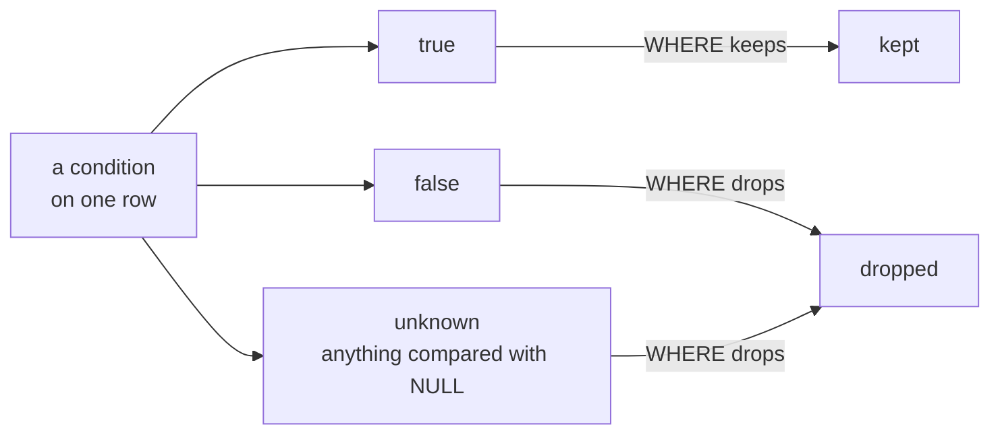

<!-- Written by `npm run lessons` from the lesson data in src/data. Edit the lesson there, not this page. -->

# NULL: the missing value

**SQL · Unit 1: Reading data: SELECT, WHERE and sorting · Lesson 4 of 8 · Must know**

> **In one line.** NULL means "no value" or "unknown". Any comparison with it, even `NULL = NULL`, is unknown rather than true. So you test for it with IS NULL, and replace it with COALESCE.

[Open this lesson on the site](https://learn.hamropedia.com/sql/null-the-missing-value/) for its animation, the practice game and tap-to-explain words.

## The problem it solves

Real data has gaps: an employee with no manager, an order with no amount. NULL causes more wrong answers than anything else in SQL, because it doesn't behave like a normal value. Rows quietly vanish from filters, and sums and averages change, without any error message.

## The idea

NULL is not zero and not empty text; it means "we don't know". So SQL uses three-valued logic: a condition can be true, false or unknown. `manager_id = NULL` is unknown for every row — even a NULL one, because "is this unknown thing equal to that unknown thing?" is itself unknown. WHERE keeps only true, so the query returns nothing.

To test for NULL, use IS NULL or IS NOT NULL. Any arithmetic with NULL gives NULL (`10 + NULL` is NULL). `COALESCE(a, b, …)` returns the first value that isn't NULL, which is how you put in a default.

## Analogy

A form with a blank box for "age". Is a blank age over 30? You can't say yes, and you can't say no — you just don't know. Are two blank ages equal? You don't know that either.

**Where the analogy breaks.** A person looking at two blank boxes might say "they're both blank, so they match". SQL never does that with `=`. Only IS NULL, IS NOT DISTINCT FROM, and grouping (GROUP BY puts all NULLs together) treat NULLs as alike.

## Syntax

```sql
WHERE column IS NULL
WHERE column IS NOT NULL
COALESCE(column, default_value)
```

## How it works, step by step

1. `WHERE manager_id = NULL`: for Asha, NULL = NULL is unknown; for everyone else, 1 = NULL is unknown. Nothing is true, so no rows come back.
2. `WHERE manager_id IS NULL`: true for Asha only. IS NULL is a real test that answers yes or no.
3. `WHERE dept_id <> 1`: for Gus, NULL &lt;> 1 is unknown, so Gus is dropped — even though he is clearly not in department 1.
4. To keep him, say so: `WHERE dept_id <> 1 OR dept_id IS NULL`.
5. `COALESCE(amount, 0)` turns order 106's NULL into 0 and leaves the other amounts alone.

## Picture it



*SQL has three answers, not two. Any comparison with NULL is unknown, and WHERE only keeps rows whose answer is true — so rows with NULLs quietly disappear.*

## Examples on the practice database

**= NULL never matches**

```sql
SELECT name
FROM employees
WHERE manager_id = NULL;
```

| name |
| --- |

*(no rows)*

No error, and no rows — the most dangerous kind of bug. Asha has a NULL manager_id, but NULL = NULL is unknown, not true.

---

**IS NULL is the right test**

```sql
SELECT name, manager_id
FROM employees
WHERE manager_id IS NULL;
```

| name | manager_id |
| --- | --- |
| Asha | NULL |

---

**NULL quietly drops a row from "not equal"**

```sql
SELECT name, dept_id
FROM employees
WHERE dept_id <> 1
ORDER BY name;
```

| name | dept_id |
| --- | --- |
| Dara | 2 |
| Eli | 2 |
| Fatima | 3 |

Gus is missing. His department is unknown, so "not 1" is unknown, and WHERE drops him. Add `OR dept_id IS NULL` to keep him.

---

**COALESCE puts in a default**

```sql
SELECT order_id, amount, COALESCE(amount, 0) AS amount_or_zero
FROM orders
WHERE customer_id = 3
ORDER BY order_id;
```

| order_id | amount | amount_or_zero |
| --- | --- | --- |
| 106 | NULL | 0 |
| 107 | 60 | 60 |

COALESCE returns its first argument that isn't NULL. Choose the default carefully: 0 is right for "nothing paid", but wrong if it means "we don't know".

## Must know

- NULL means unknown or missing. It is not 0 and not ''.
- Never write `= NULL` or `<> NULL`. Use IS NULL and IS NOT NULL.
- Any comparison with NULL is unknown, and WHERE drops unknown rows — including from `<>` and NOT IN.
- Arithmetic with NULL gives NULL: `10 + NULL` is NULL.
- `COALESCE(a, b, c)` returns the first non-NULL value. `NULLIF(a, b)` returns NULL when a = b — handy to avoid dividing by zero.
- Aggregates (SUM, AVG, COUNT of a column) skip NULLs — Unit 2 covers this.

## Common mistakes

- Writing `WHERE manager_id = NULL` and getting no rows, with no error.
- Forgetting that `<>` drops NULL rows: "everyone not in Sales" silently loses people with no department.
- Replacing NULL with 0 in an average, which changes the answer. Decide what the gap really means first.

> **Not true:** Replacing NULL with 0 leaves an average as it was.  
> **In fact:** AVG skips NULLs, but it counts zeros. Turning a missing value into 0 pulls the average down, so first decide what the gap really means.

## Other databases

- NULL-safe equality: PostgreSQL and SQLite have `a IS NOT DISTINCT FROM b` (true when both are NULL); MySQL has `a <=> b`.
- COALESCE works everywhere. MySQL also has `IFNULL(a, b)`, SQL Server has `ISNULL(a, b)`, and Oracle has `NVL(a, b)` — all for two arguments.
- In Oracle, empty text '' is treated as NULL. No other major database does this.

## In the interview

NULL represents a missing or unknown value, and SQL uses three-valued logic: comparisons with NULL return unknown, and WHERE keeps only rows that are true. So I never compare with equals NULL — I use IS NULL or IS NOT NULL — and I watch for filters like not-equal or NOT IN silently dropping NULL rows. When I need a default I use COALESCE, but only after deciding whether the gap really means zero.

<details>
<summary>&lt;b>What does NULL = NULL return?&lt;/b></summary>

NULL (unknown), not true. Use IS NULL, or IS NOT DISTINCT FROM to compare two values that might both be NULL.

</details>

<details>
<summary>&lt;b>Does `COUNT(*)` count NULLs?&lt;/b></summary>

`COUNT(*)` counts rows, so yes. `COUNT(column)` counts only the rows where that column is not NULL.

</details>

<details>
<summary>&lt;b>How do you avoid dividing by zero?&lt;/b></summary>

Wrap the divisor in NULLIF: `a / NULLIF(b, 0)` returns NULL instead of an error when b is 0.

</details>

## Practise

Write each answer yourself first, then open the answer and compare.

### 1. Explain

Explain three-valued logic, and why `WHERE manager_id = NULL` returns no rows.

<details>
<summary>Show one good answer</summary>

In SQL a condition can be true, false or unknown. That is three-valued logic. Any comparison with NULL is unknown, because you can't compare against a value nobody knows.

`WHERE manager_id = NULL` asks "is manager_id equal to unknown?" for each row. The answer is unknown every time, even for Asha, whose manager_id really is NULL. WHERE keeps only rows that are true, so no rows come back.

To find missing values, ask a different question: `WHERE manager_id IS NULL`. IS NULL is always true or false, never unknown.

</details>

### 2. Write

Write a query for customers with no city on record, showing name and city.

<details>
<summary>Show one good answer</summary>

Use IS NULL, never `= NULL`. Only Zoe has no city.

```sql
SELECT name, city
FROM customers
WHERE city IS NULL;
```

| name | city |
| --- | --- |
| Zoe | NULL |

</details>

### 3. Predict

What do `SELECT NULL = NULL, NULL IS NULL, 5 + NULL, COALESCE(NULL, NULL, 7);` return? Say all four.

<details>
<summary>Show one good answer</summary>

NULL, 1 (true), NULL, 7.

• `NULL = NULL`: two unknowns can't be called equal, so it is unknown: NULL.  
• `NULL IS NULL`: true, which SQLite shows as 1.  
• `5 + NULL`: any sum with NULL is NULL.  
• `COALESCE(NULL, NULL, 7)`: the first value that is not NULL, which is 7.

```sql
SELECT NULL = NULL, NULL IS NULL, 5 + NULL, COALESCE(NULL, NULL, 7);
```

| NULL = NULL | NULL IS NULL | 5 + NULL | COALESCE(NULL, NULL, 7) |
| --- | --- | --- | --- |
| NULL | 1 | NULL | 7 |

</details>

### 4. Edge cases

Write "every employee not in department 1", making sure Gus is included.

<details>
<summary>Show one good answer</summary>

`dept_id <> 1` alone misses Gus, because `NULL <> 1` is unknown. Add the NULL case on purpose with `OR dept_id IS NULL`.

Other ways that also work: `COALESCE(dept_id, 0) <> 1`, or `dept_id IS NOT 1` in SQLite (`IS DISTINCT FROM 1` in PostgreSQL).

```sql
SELECT name, dept_id
FROM employees
WHERE dept_id <> 1 OR dept_id IS NULL
ORDER BY name;
```

| name | dept_id |
| --- | --- |
| Dara | 2 |
| Eli | 2 |
| Fatima | 3 |
| Gus | NULL |

</details>

## Go further (optional)

- PRACTICE · [SQLBolt — Lesson 8: A short note on NULLs](https://sqlbolt.com/) · interactive exercises in the browser, free
- READ · [W3Schools — SQL NULL Values](https://www.w3schools.com/sql/sql_null_values.asp) · short page with a try-it editor, free
- READ · [Select Star SQL](https://selectstarsql.com/) · a free interactive book

---

[← IN, BETWEEN and LIKE: shorter conditions](in-between-and-like-shorter-conditions.md) · [All lessons](../../README.md) · [ORDER BY, LIMIT and OFFSET: sorting and top N →](order-by-limit-and-offset-sorting-and-top-n.md)
