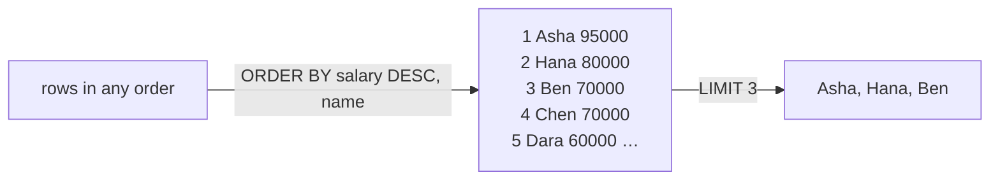

<!-- Written by `npm run lessons` from the lesson data in src/data. Edit the lesson there, not this page. -->

# ORDER BY, LIMIT and OFFSET: sorting and top N

**SQL · Unit 1: Reading data: SELECT, WHERE and sorting · Lesson 5 of 8 · Must know**

> **In one line.** ORDER BY sorts the result by one or more columns (ASC for smallest first, DESC for largest first), and LIMIT keeps only the first n rows, with OFFSET to skip some first.

[Open this lesson on the site](https://learn.hamropedia.com/sql/order-by-limit-and-offset-sorting-and-top-n/) for its animation, the practice game and tap-to-explain words.

## The problem it solves

"The 3 highest salaries", "the newest orders first", "page 2 of the results" — order matters to people. And without ORDER BY, the database may return rows in any order it likes, which can change from one run to the next.

## The idea

ORDER BY salary DESC sorts biggest first. Add more columns to break ties: `ORDER BY salary DESC, name` sorts by salary, and people with the same salary by name. ASC (smallest first) is the default.

LIMIT 3 keeps the first 3 rows after sorting. OFFSET 3 skips 3 rows first, which is how page 2 works when there are 3 rows per page. Without an ORDER BY, LIMIT just takes whichever rows come first — an arbitrary choice.

## Analogy

A race. ORDER BY lines the runners up by finishing time; LIMIT 3 hands out gold, silver and bronze. OFFSET 3 LIMIT 3 is "who came 4th, 5th and 6th?".

**Where the analogy breaks.** In a race, two runners on the same time share a place. LIMIT doesn't: it cuts at exactly n rows, so if 3rd and 4th place tie, one of them is dropped without warning. Unit 5 (RANK) handles ties properly.

## Syntax

```sql
SELECT columns
FROM table_name
ORDER BY column1 DESC, column2 ASC
LIMIT n OFFSET skip;
```

## How it works, step by step

1. The database finds all the rows first (FROM, then WHERE).
2. ORDER BY salary DESC puts the highest salary first: Asha 95000, Hana 80000, then Ben and Chen on 70000…
3. Ben and Chen tie on salary, so the second sort column, name, decides: Ben before Chen.
4. LIMIT 3 keeps the first three rows: Asha, Hana, Ben. Chen is cut off even though he earns the same as Ben.
5. OFFSET 3 LIMIT 3 would skip those three and return the next three.

## Picture it



*First sort, then cut. Ben and Chen tie on 70000, so the second sort column decides who comes first — and LIMIT 3 silently drops Chen.*

## Examples on the practice database

**Sort by salary, then by name**

```sql
SELECT name, salary
FROM employees
ORDER BY salary DESC, name;
```

| name | salary |
| --- | --- |
| Asha | 95000 |
| Hana | 80000 |
| Ben | 70000 |
| Chen | 70000 |
| Dara | 60000 |
| Fatima | 52000 |
| Eli | 45000 |
| Gus | 38000 |

DESC applies only to salary. name has no direction, so it is ASC (A to Z).

---

**Top 3 with LIMIT — and the tie it hides**

```sql
SELECT name, salary
FROM employees
ORDER BY salary DESC, name
LIMIT 3;
```

| name | salary |
| --- | --- |
| Asha | 95000 |
| Hana | 80000 |
| Ben | 70000 |

Chen earns the same as Ben but is cut off. If the question is "the top 3 salaries", say the tie out loud in an interview.

---

**Page 2, three rows per page**

```sql
SELECT order_id, order_date
FROM orders
ORDER BY order_date
LIMIT 3 OFFSET 3;
```

| order_id | order_date |
| --- | --- |
| 104 | 2024-01-21 |
| 105 | 2024-02-02 |
| 106 | 2024-02-12 |

OFFSET 3 skips the first page (orders 101–103). For page n, use OFFSET (n − 1) × page size.

---

**Where do NULLs go?**

```sql
SELECT name, city
FROM customers
ORDER BY city, name;
```

| name | city |
| --- | --- |
| Zoe | NULL |
| Omar | Bristol |
| Tom | Leeds |
| Tom | Leeds |
| Lena | London |
| Priya | London |

SQLite and MySQL put NULLs first when sorting A to Z; PostgreSQL puts them last. Write NULLS FIRST or NULLS LAST to be sure.

## Must know

- Without ORDER BY, row order is not guaranteed — even if it looks sorted today.
- ASC (default) is smallest first; DESC is largest first. Each column gets its own direction.
- Add a second sort column to break ties, so the order is the same every time.
- LIMIT cuts after sorting. It ignores ties.
- OFFSET skips rows; it is fine for small pages but slow for deep pages, because the skipped rows are still read.

## Common mistakes

- Using LIMIT without ORDER BY and expecting the "top" rows.
- Writing `ORDER BY salary, name DESC` and expecting both to be descending. DESC applies only to the column right before it.
- Answering "top 3 salaries" with LIMIT 3 when there are ties.

> **Not true:** LIMIT 3 always returns all of the three highest salaries, even when several people earn the same.  
> **In fact:** With a tie at the cut-off, LIMIT 3 keeps three rows and silently drops the others on the same salary. Ask how ties should count before you answer.

## Other databases

- SQL Server uses `SELECT TOP 3 …`, or `OFFSET 3 ROWS FETCH NEXT 3 ROWS ONLY`. Oracle and the SQL standard use `FETCH FIRST 3 ROWS ONLY`. PostgreSQL, MySQL and SQLite use LIMIT.
- NULL position: PostgreSQL and Oracle put NULLs last for ASC; SQLite, MySQL and SQL Server put them first. PostgreSQL and SQLite accept NULLS FIRST / NULLS LAST.

## In the interview

ORDER BY sorts the final result, with ASC or DESC per column, and I always add a tiebreaker column so the order is deterministic. LIMIT and OFFSET then cut the sorted result. I point out two caveats. LIMIT ignores ties, so "top 3" may need RANK instead. And large OFFSETs are slow, so for deep pagination I use keyset pagination: WHERE id greater than the last id seen.

<details>
<summary>&lt;b>Is the order of rows guaranteed without ORDER BY?&lt;/b></summary>

No. The database returns rows in whatever order is cheapest, and it can change with indexes, data or version.

</details>

<details>
<summary>&lt;b>What is keyset pagination?&lt;/b></summary>

Instead of OFFSET, remember the last value you showed and ask for `WHERE order_id > 106 ORDER BY order_id LIMIT 3`. It uses the index, so page 1000 is as fast as page 1.

</details>

<details>
<summary>&lt;b>Can you ORDER BY a column you didn't SELECT?&lt;/b></summary>

Yes, in most cases. The exception is with DISTINCT, where you can only sort by selected columns.

</details>

## Practise

Write each answer yourself first, then open the answer and compare.

### 1. Explain

Explain why "the 3 highest-paid employees" with LIMIT 3 can be a wrong answer here.

<details>
<summary>Show one good answer</summary>

Because of a tie. Asha (95,000) and Hana (80,000) are first and second, and Ben and Chen both earn 70,000, so they share third place.

`ORDER BY salary DESC LIMIT 3` must cut one of them, and which one depends on the tie-breaker. With no tie-breaker it is whichever the database happens to return first. Either way you leave out someone who is just as highly paid.

So first ask: should ties be included? If yes, the answer has 4 people. Use RANK or DENSE_RANK (Unit 5), or `WHERE salary >= ` the third-highest salary. If no, say how you break the tie, for example `ORDER BY salary DESC, name`.

</details>

### 2. Write

Write a query for the 2 most expensive products, showing product_name and price.

<details>
<summary>Show one good answer</summary>

Sort from most expensive and keep 2. The next product is the £25 desk lamp, so there is no tie to worry about here (but always check for one).

```sql
SELECT product_name, price
FROM products
ORDER BY price DESC
LIMIT 2;
```

| product_name | price |
| --- | --- |
| Headphones | 40 |
| Backpack | 30 |

</details>

### 3. Predict

What does `SELECT name FROM employees ORDER BY hire_date DESC LIMIT 2;` return?

<details>
<summary>Show one good answer</summary>

Gus, then Hana: the two most recent hires. DESC puts the latest date first. Gus joined on 2023-04-03 and Hana on 2022-11-30. Dates in YYYY-MM-DD form sort correctly even though they are text.

```sql
SELECT name, hire_date
FROM employees
ORDER BY hire_date DESC
LIMIT 2;
```

| name | hire_date |
| --- | --- |
| Gus | 2023-04-03 |
| Hana | 2022-11-30 |

</details>

### 4. Edge cases

Write a query that lists customers by city, with the customer who has no city at the end, not the start.

<details>
<summary>Show one good answer</summary>

SQLite puts NULLs first when sorting A to Z, so Zoe would come first. Sort by "is the city missing?" first: `city IS NULL` is 0 for a real city and 1 for NULL, so the missing one goes last.

SQLite and PostgreSQL also accept `ORDER BY city NULLS LAST, name`, which gives the same rows. The `IS NULL` trick also works in MySQL, which has no NULLS LAST.

```sql
SELECT name, city
FROM customers
ORDER BY city IS NULL, city, name;
```

| name | city |
| --- | --- |
| Omar | Bristol |
| Tom | Leeds |
| Tom | Leeds |
| Lena | London |
| Priya | London |
| Zoe | NULL |

</details>

## Go further (optional)

- PRACTICE · [SQLBolt — Lesson 4: Filtering and sorting Query results](https://sqlbolt.com/) · interactive exercises in the browser, free
- READ · [W3Schools — SQL ORDER BY Keyword](https://www.w3schools.com/sql/sql_orderby.asp) · short page with a try-it editor, free
- READ · [PostgreSQL docs — LIMIT and OFFSET](https://www.postgresql.org/docs/current/queries-limit.html) · official documentation, free

---

[← NULL: the missing value](null-the-missing-value.md) · [All lessons](../../README.md) · [DISTINCT: removing duplicate rows →](distinct-removing-duplicate-rows.md)
