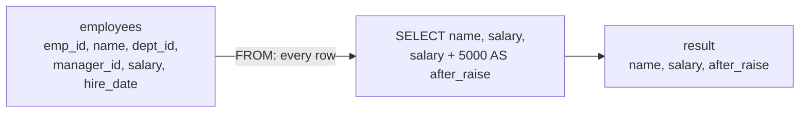

<!-- Written by `npm run lessons` from the lesson data in src/data. Edit the lesson there, not this page. -->

# SELECT and FROM: choosing columns

**SQL · Unit 1: Reading data: SELECT, WHERE and sorting · Lesson 1 of 8 · Must know**

> **In one line.** SELECT lists the columns (or calculations) you want in the result, and FROM names the table they come from.

[Open this lesson on the site](https://learn.hamropedia.com/sql/select-and-from-choosing-columns/) for its animation, the practice game and tap-to-explain words.

## The problem it solves

A table can have dozens of columns, and you usually need two or three. You also often need values that are not stored at all — a salary after a raise, a name and city joined into one label. SELECT lets you choose and calculate exactly the columns you need.

## The idea

After SELECT you write a list, separated by commas. Each item can be a column name (`salary`), a calculation (`salary + 5000`), or a fixed value (`'hello'`). AS gives an item a new name in the result, called an alias. `SELECT *` means every column, in table order.

The rows come from the table named after FROM, and every row of that table is used, because there is no filter yet.

## Analogy

Ordering a set menu but saying "just the starter and the dessert, please". FROM is the menu you are ordering from; SELECT is the courses you want on your plate, in the order you name them.

**Where the analogy breaks.** A waiter can only bring what is on the menu. SELECT can also bring things that don't exist in the table, because it can calculate new values from the columns on the fly.

## Syntax

```sql
SELECT column, expression AS new_name
FROM table_name;
```

## How it works, step by step

1. The database reads FROM first: it takes every row of employees.
2. For each row, it works out every item in the SELECT list: name, salary, and salary + 5000.
3. AS after_raise names the calculated column; without it, the column would be called "salary + 5000".
4. The result has one row for every row of the table, with just these columns.
5. Nothing is saved. The calculated column exists only in this result.

## Picture it



*FROM supplies all six columns of every row; SELECT keeps two of them and calculates a third. The result has the same number of rows but only the columns you asked for.*

## Examples on the practice database

**Choose columns and calculate a new one**

```sql
SELECT name, salary, salary + 5000 AS after_raise
FROM employees
ORDER BY emp_id;
```

| name | salary | after_raise |
| --- | --- | --- |
| Asha | 95000 | 100000 |
| Ben | 70000 | 75000 |
| Chen | 70000 | 75000 |
| Dara | 60000 | 65000 |
| Eli | 45000 | 50000 |
| Fatima | 52000 | 57000 |
| Gus | 38000 | 43000 |
| Hana | 80000 | 85000 |

after_raise is calculated for every row and named with AS. The employees table itself is unchanged.

---

**Join text together with \|\|**

```sql
SELECT dept_name || ' in ' || location AS where_it_is
FROM departments
ORDER BY dept_id;
```

| where_it_is |
| --- |
| Engineering in London |
| Sales in Manchester |
| Marketing in London |
| HR in Leeds |

`||` glues strings together. The text in single quotes, ' in ', is a fixed value added to every row.

## Must know

- SELECT chooses and calculates columns; FROM says which table the rows come from.
- Separate items with commas — and no comma after the last one.
- AS gives a column an alias. Use one for every calculated column, so the result has a readable name.
- `SELECT *` is fine for looking at a table, but in real queries name the columns you need: it is clearer, and faster on wide tables.
- Without a WHERE, every row of the table is in the result.

## Common mistakes

- A trailing comma before FROM: `SELECT name, salary, FROM employees` is a syntax error.
- Using double quotes for text. 'London' is text; "London" means a column called London in PostgreSQL.
- Using an alias in WHERE in the same query. WHERE runs before SELECT, so the alias doesn't exist yet (Unit 2 explains why).

> **Not true:** An alias defined in SELECT can be used in the WHERE of the same query.  
> **In fact:** WHERE runs before SELECT, so the alias does not exist yet. Repeat the calculation in WHERE instead.

## Other databases

- Joining text: PostgreSQL and SQLite use `||`; MySQL uses `CONCAT(a, b)`; SQL Server uses `+` or `CONCAT`. `CONCAT` works almost everywhere.
- AS is optional for column aliases in every major database (`salary + 5000 after_raise` works), but writing AS is clearer.

## In the interview

SELECT defines the columns of the result — stored columns, expressions, or constants — and FROM names the source table. I alias every calculated column with AS, so the output is readable. I avoid SELECT star in production queries: naming the columns is clearer, it reads less data, and the query doesn't silently change when someone adds a column.

<details>
<summary>&lt;b>Why avoid SELECT * in production code?&lt;/b></summary>

It reads columns you don't need, and it can stop the database using a covering index. The result also changes shape when a column is added, which can break the code that reads it.

</details>

<details>
<summary>&lt;b>Can you SELECT without FROM?&lt;/b></summary>

Yes in SQLite, PostgreSQL, MySQL and SQL Server: `SELECT 2 + 3;` returns 5. Oracle needs `FROM dual`.

</details>

## Practise

Write each answer yourself first, then open the answer and compare.

### 1. Explain

Explain what SELECT and FROM each do, and what AS is for, using the employees table.

<details>
<summary>Show one good answer</summary>

FROM says which table to read: `FROM employees` means "look at the employees sheet".

SELECT says which columns to give back, and in what order: `SELECT name, salary` returns just those two, even though the table has six. It can also work things out, such as `salary + 5000`.

AS gives a column a new name in the result: `salary + 5000 AS after_raise`. Without it, the column would be called "salary + 5000". AS only renames the result; the table itself does not change.

</details>

### 2. Write

Write a query that returns each product's name, its price, and the price of 3 of them, called price_for_three.

<details>
<summary>Show one good answer</summary>

Work out the new column in SELECT and name it with AS. Every product comes back, because there is no WHERE.

```sql
SELECT product_name, price, price * 3 AS price_for_three
FROM products
ORDER BY product_id;
```

| product_name | price | price_for_three |
| --- | --- | --- |
| Pen | 2 | 6 |
| Notebook | 5 | 15 |
| Mug | 8 | 24 |
| Desk lamp | 25 | 75 |
| Backpack | 30 | 90 |
| Headphones | 40 | 120 |
| Phone case | 15 | 45 |

</details>

### 3. Predict

How many rows and columns does `SELECT name, name FROM employees;` return?

<details>
<summary>Show one good answer</summary>

8 rows and 2 columns. There is no WHERE, so you get one row per employee. SELECT returns exactly what you list, and you listed name twice, so both columns are the same name. Asking for a column twice is allowed; it is just pointless.

```sql
SELECT name, name
FROM employees
ORDER BY emp_id;
```

| name | name |
| --- | --- |
| Asha | Asha |
| Ben | Ben |
| Chen | Chen |
| Dara | Dara |
| Eli | Eli |
| Fatima | Fatima |
| Gus | Gus |
| Hana | Hana |

</details>

### 4. Edge cases

What does `salary + 5000` give for a row where salary is NULL? (No employee here has one — reason it out, then test it with `SELECT NULL + 5000;`.)

<details>
<summary>Show one good answer</summary>

NULL. NULL means "unknown", and unknown plus 5000 is still unknown. There is no error and no 5000: the NULL quietly spreads through the sum.

If a missing salary should count as 0, say so: `COALESCE(salary, 0) + 5000`.

```sql
SELECT NULL + 5000;
```

| NULL + 5000 |
| --- |
| NULL |

</details>

## Go further (optional)

- PRACTICE · [SQLBolt — Lesson 1: SELECT queries 101](https://sqlbolt.com/) · interactive exercises in the browser, free
- READ · [W3Schools — SQL SELECT Statement](https://www.w3schools.com/sql/sql_select.asp) · short page with a try-it editor, free
- WATCH · [CS50's Introduction to Databases with SQL — Lecture 0: Querying](https://cs50.harvard.edu/sql/) · Harvard, free

---

[← Data types: numbers, text, dates and true/false](../unit-0-start-here/data-types-numbers-text-dates-and-true-false.md) · [All lessons](../../README.md) · [WHERE: keeping only the rows you want →](where-keeping-only-the-rows-you-want.md)
