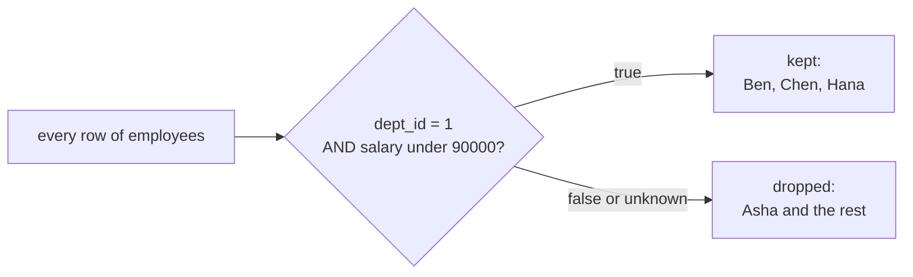

<!-- Written by `npm run lessons` from the lesson data in src/data. Edit the lesson there, not this page. -->

# WHERE: keeping only the rows you want

**SQL · Unit 1: Reading data: SELECT, WHERE and sorting · Lesson 2 of 8 · Must know**

> **In one line.** WHERE keeps only the rows for which a condition is true, using comparisons such as =, &lt;>, &lt;, > and the words AND, OR and NOT.

[Open this lesson on the site](https://learn.hamropedia.com/sql/where-keeping-only-the-rows-you-want/) for its animation, the practice game and tap-to-explain words.

## The problem it solves

Tables hold every row ever stored, and you almost always want a slice: one department, orders over £100, everyone hired this year. WHERE is how you say which rows count.

## The idea

A condition is a statement about a row that is either true or false, like `salary > 60000`. The database checks it against every row and keeps the rows where it is true.

You can combine conditions: AND needs both to be true, OR needs at least one, and NOT flips true and false. Comparisons are `=`, `<>` (not equal; `!=` also works), `<`, `<=`, `>` and `>=`. Text values go in single quotes.

## Analogy

A bouncer with a list of rules. Every row walks up to the door; if it passes the rules, it gets in. "Over 18 AND on the guest list" is stricter than "over 18 OR on the guest list".

**Where the analogy breaks.** A bouncer answers yes or no. SQL has a third answer, unknown, which comes from NULL — and WHERE treats unknown the same as no. The NULL lesson next in this unit shows why that matters.

## Syntax

```sql
SELECT columns
FROM table_name
WHERE condition AND (other OR another);
```

## How it works, step by step

1. FROM takes every row of employees.
2. WHERE checks the condition `dept_id = 1 AND salary < 90000` on each row.
3. Asha: department 1 is true, but 95000 &lt; 90000 is false. Both must be true for AND, so Asha is dropped.
4. Ben, Chen and Hana pass both tests, so they are kept. Everyone outside department 1 fails the first test.
5. SELECT then picks the columns from the rows that are left.
6. AND is worked out before OR, just as × comes before + in maths. Use brackets whenever you mix them.

## Picture it



*WHERE is a filter: each row is tested one at a time. Only rows where the condition is true go through. False and unknown are both dropped.*

## Examples on the practice database

**Two conditions with AND**

```sql
SELECT name, salary
FROM employees
WHERE dept_id = 1 AND salary < 90000
ORDER BY name;
```

| name | salary |
| --- | --- |
| Ben | 70000 |
| Chen | 70000 |
| Hana | 80000 |

Asha is in department 1 but fails the salary test, and AND needs both tests to pass.

---

**OR inside brackets**

```sql
SELECT name, dept_id, salary
FROM employees
WHERE (dept_id = 2 OR dept_id = 3) AND salary > 50000
ORDER BY name;
```

| name | dept_id | salary |
| --- | --- | --- |
| Dara | 2 | 60000 |
| Fatima | 3 | 52000 |

Read it as: in department 2 or 3, and also earning over 50000. Eli is in department 2 but earns 45000.

---

**The same query without brackets — a different answer**

```sql
SELECT name, dept_id, salary
FROM employees
WHERE dept_id = 2 OR dept_id = 3 AND salary > 50000
ORDER BY name;
```

| name | dept_id | salary |
| --- | --- | --- |
| Dara | 2 | 60000 |
| Eli | 2 | 45000 |
| Fatima | 3 | 52000 |

AND is worked out first, so this means: department 2 (any salary), or department 3 with a salary over 50000. Eli sneaks in. Brackets remove the doubt.

## Must know

- WHERE runs on each row, before any grouping, and keeps only rows where the condition is true.
- Comparisons: =, &lt;> (or !=), &lt;, &lt;=, >, >=. One = sign, not two.
- AND needs both sides true; OR needs at least one; NOT flips the answer.
- AND binds tighter than OR. Put brackets around every OR that is mixed with AND.
- Text goes in single quotes and must match exactly: 'Sales' is not 'sales' in most databases.

## Common mistakes

- Mixing AND and OR without brackets, and getting extra rows.
- Writing `==`. SQL uses a single `=` for comparing.
- Writing `WHERE dept_id = 2 OR 3`. Each side of OR must be a full condition: `dept_id = 2 OR dept_id = 3`, or better, `dept_id IN (2, 3)`.

> **Not true:** `WHERE dept_id = 2 OR 3` keeps the rows of departments 2 and 3.  
> **In fact:** Each side of OR must be a full condition: `dept_id = 2 OR dept_id = 3`, or shorter, `dept_id IN (2, 3)`.

## Other databases

- Text comparison: PostgreSQL is case-sensitive ('Sales' ≠ 'sales'); MySQL and SQL Server usually are not, depending on settings; in SQLite `=` is case-sensitive but LIKE is not.

## In the interview

WHERE filters rows before any grouping: the database evaluates the condition for each row and keeps only those where it is true — false and unknown are both dropped. I combine conditions with AND, OR and NOT, and because AND has higher precedence than OR, I always bracket OR conditions when mixing them, so the query says exactly what I mean.

<details>
<summary>&lt;b>Which is evaluated first, AND or OR?&lt;/b></summary>

AND. `a OR b AND c` means `a OR (b AND c)`. Brackets make it explicit.

</details>

<details>
<summary>&lt;b>Can WHERE use a column alias from SELECT?&lt;/b></summary>

No in standard SQL, because WHERE runs before SELECT. Repeat the expression, or wrap the query in a subquery or CTE. (SQLite and MySQL are lenient about this; don't rely on it.)

</details>

## Practise

Write each answer yourself first, then open the answer and compare.

### 1. Explain

Explain the difference between AND and OR with an example from the orders table.

<details>
<summary>Show one good answer</summary>

AND needs both conditions to be true. OR needs at least one.

`WHERE status = 'delivered' AND amount > 100` returns orders that are both delivered and over £100: just 101 and 104.

`WHERE status = 'delivered' OR amount > 100` returns orders that are either: all 7 delivered orders, plus 105, which is only shipped but is over £100. That makes 8.

So AND makes the result smaller, and OR makes it bigger.

</details>

### 2. Write

Write a query for orders that are delivered and worth at least £75, showing order_id and amount, sorted by order_id.

<details>
<summary>Show one good answer</summary>

"At least £75" includes £75, so use `>=`. Order 108 is exactly £75; with `>` it would be missed.

```sql
SELECT order_id, amount
FROM orders
WHERE status = 'delivered' AND amount >= 75
ORDER BY order_id;
```

| order_id | amount |
| --- | --- |
| 101 | 120 |
| 102 | 80 |
| 104 | 200 |
| 108 | 75 |

</details>

### 3. Predict

Which names does `SELECT name FROM employees WHERE NOT dept_id = 1 ORDER BY name;` return? Is Gus in the list?

<details>
<summary>Show one good answer</summary>

Dara, Eli and Fatima. Gus is not in the list.

Gus's dept_id is NULL. `dept_id = 1` is unknown for him, and NOT unknown is still unknown, not true. WHERE keeps only true rows, so he is dropped. To include him, add `OR dept_id IS NULL`.

```sql
SELECT name
FROM employees
WHERE NOT dept_id = 1
ORDER BY name;
```

| name |
| --- |
| Dara |
| Eli |
| Fatima |

</details>

### 4. Edge cases

Rewrite `WHERE status = 'shipped' OR status = 'pending' AND amount > 40` so it means "shipped or pending, and over £40". What did the original return?

<details>
<summary>Show one good answer</summary>

Add brackets around the OR: `WHERE (status = 'shipped' OR status = 'pending') AND amount > 40`.

AND is worked out before OR, so the original really meant "shipped (any amount), or pending and over £40".

Here both versions return only order 105. That is luck: the only shipped order is £150, and the only pending one (110) is £33. If a shipped order were £20, the original would wrongly include it. The brackets make the query say what you mean, whatever the data.

```sql
SELECT order_id, status, amount
FROM orders
WHERE (status = 'shipped' OR status = 'pending') AND amount > 40
ORDER BY order_id;
```

| order_id | status | amount |
| --- | --- | --- |
| 105 | shipped | 150 |

</details>

## Go further (optional)

- PRACTICE · [SQLBolt — Lesson 2: Queries with constraints (Pt. 1)](https://sqlbolt.com/) · interactive exercises in the browser, free
- READ · [W3Schools — SQL WHERE Clause](https://www.w3schools.com/sql/sql_where.asp) · short page with a try-it editor, free
- READ · [Mode SQL Tutorial — SQL WHERE, SQL Comparison Operators, SQL AND, SQL OR](https://mode.com/sql-tutorial/) · Mode, free

---

[← SELECT and FROM: choosing columns](select-and-from-choosing-columns.md) · [All lessons](../../README.md) · [IN, BETWEEN and LIKE: shorter conditions →](in-between-and-like-shorter-conditions.md)
