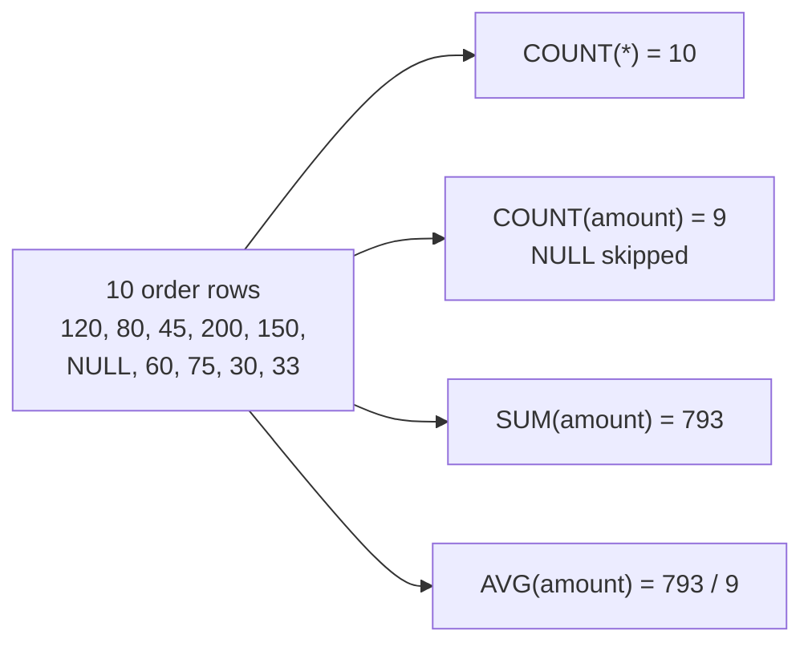

<!-- Written by `npm run lessons` from the lesson data in src/data. Edit the lesson there, not this page. -->

# Aggregate functions: COUNT, SUM, AVG, MIN and MAX

**SQL · Unit 2: Summarising data: aggregates, GROUP BY and HAVING · Lesson 1 of 5 · Must know**

> **In one line.** An aggregate function turns many rows into one value — COUNT counts, SUM adds, AVG averages, MIN and MAX find the smallest and largest — and every one except `COUNT(*)` skips NULLs.

[Open this lesson on the site](https://learn.hamropedia.com/sql/aggregate-functions-count-sum-avg-min-and-max/) for its animation, the practice game and tap-to-explain words.

## The problem it solves

Nobody wants to read 10 million orders. They want "how many?", "how much in total?", "what is the average?". Aggregates answer those in one line — but the NULL rules quietly change the answers if you don't know them.

## The idea

Without GROUP BY, an aggregate squashes the whole table (after WHERE) into one row.  
`COUNT(*)` counts rows.  
`COUNT(column)` counts rows where that column is not NULL.  
`COUNT(DISTINCT column)` counts the different non-NULL values.  
SUM and AVG add and average the non-NULL values.  
MIN and MAX work on numbers, text (alphabetical) and dates.

Because AVG skips NULLs, the average of order amounts is the total divided by 9 orders, not 10.

## Analogy

A cashier at the end of the day. They don't list every sale; they count the receipts (COUNT), add up the takings (SUM), and note the biggest and smallest sale (MAX, MIN). A receipt with the amount torn off still counts as a receipt, but it adds nothing to the takings.

**Where the analogy breaks.** A cashier would notice the torn receipt and ask about it. SQL doesn't: it silently leaves NULLs out of SUM and AVG, so you have to decide yourself whether a missing value should count as zero.

## Syntax

```sql
SELECT COUNT(*), COUNT(column), COUNT(DISTINCT column),
       SUM(column), AVG(column), MIN(column), MAX(column)
FROM table_name;
```

## How it works, step by step

1. FROM and WHERE decide which rows are in play — here all 10 orders.
2. `COUNT(*)` counts the rows: 10.
3. `COUNT(amount)` counts rows whose amount is not NULL: 9, because order 106 has none.
4. `SUM(amount)` adds the 9 amounts: 793. `AVG(amount)` is 793 ÷ 9 = 88.11, not 793 ÷ 10.
5. If the question means "average per order, counting the missing one as zero", divide SUM by `COUNT(*)` instead: 79.3.

## Picture it



*Many rows go in and one number comes out. COUNT(\*) counts every row; COUNT, SUM and AVG of a column skip the NULL — so AVG divides by 9, not 10.*

## Examples on the practice database

**One summary row for the whole table**

```sql
SELECT COUNT(*) AS employees,
       SUM(salary) AS total_pay,
       AVG(salary) AS average_pay,
       MIN(salary) AS lowest,
       MAX(salary) AS highest
FROM employees;
```

| employees | total_pay | average_pay | lowest | highest |
| --- | --- | --- | --- | --- |
| 8 | 510000 | 63750 | 38000 | 95000 |

---

**Three different counts**

```sql
SELECT COUNT(*) AS all_rows,
       COUNT(dept_id) AS with_a_department,
       COUNT(DISTINCT dept_id) AS different_departments
FROM employees;
```

| all_rows | with_a_department | different_departments |
| --- | --- | --- |
| 8 | 7 | 3 |

Gus has no department, so `COUNT(dept_id)` is 7. The 7 non-NULL values are only 1, 2 and 3, so `COUNT(DISTINCT dept_id)` is 3.

---

**How NULL changes an average**

```sql
SELECT COUNT(*) AS orders,
       COUNT(amount) AS with_amount,
       SUM(amount) AS total,
       ROUND(AVG(amount), 2) AS avg_of_known,
       ROUND(SUM(amount) * 1.0 / COUNT(*), 2) AS avg_over_all
FROM orders;
```

| orders | with_amount | total | avg_of_known | avg_over_all |
| --- | --- | --- | --- | --- |
| 10 | 9 | 793 | 88.11 | 79.3 |

Both averages are "right" — they answer different questions. Say which one you mean.

## Must know

- `COUNT(*)` counts rows; `COUNT(col)` counts non-NULL values; `COUNT(DISTINCT col)` counts different non-NULL values.
- SUM, AVG, MIN and MAX ignore NULLs.
- SUM of no rows (or only NULLs) is NULL, not 0. Wrap it: `COALESCE(SUM(x), 0)`.
- Without GROUP BY, an aggregate query returns exactly one row — even from an empty table.
- MIN and MAX work on text and dates too.

## Common mistakes

- Using `COUNT(column)` when you mean "how many rows", and getting a smaller number because of NULLs.
- Mixing a plain column with an aggregate without GROUP BY: `SELECT name, MAX(salary) FROM employees` is an error in most databases (SQLite allows it but the name is unreliable).
- Putting an aggregate in WHERE: `WHERE SUM(amount) > 100` is an error. That is HAVING's job.

> **Not true:** An aggregate such as SUM can be used in WHERE to filter on a total.  
> **In fact:** WHERE works on single rows, before any total exists. Filtering on an aggregate is the job of HAVING.

## Other databases

- AVG of whole numbers: PostgreSQL and SQLite return a decimal; SQL Server returns a whole number (AVG of 1 and 2 is 1). Use `AVG(x * 1.0)` there.

## In the interview

Aggregate functions collapse a set of rows into one value: COUNT, SUM, AVG, MIN and MAX. The detail interviewers probe is NULL handling. COUNT star counts rows, and COUNT of a column skips NULLs. SUM and AVG ignore NULLs, so an average is over the known values only. I also remember that SUM over no rows is NULL, so I COALESCE it to zero when the result feeds a report.

<details>
<summary>&lt;b>What is the difference between `COUNT(*)`, `COUNT(1)` and `COUNT(column)`?&lt;/b></summary>

`COUNT(*)` and `COUNT(1)` both count rows, at the same speed. `COUNT(column)` counts only rows where that column is not NULL.

</details>

<details>
<summary>&lt;b>What does SUM return when there are no rows?&lt;/b></summary>

NULL. COUNT returns 0. Use `COALESCE(SUM(x), 0)` when you need 0.

</details>

<details>
<summary>&lt;b>Can you use an aggregate in WHERE?&lt;/b></summary>

No — WHERE runs before rows are grouped. Filter on aggregates with HAVING, or in an outer query.

</details>

## Practise

Write each answer yourself first, then open the answer and compare.

### 1. Explain

Explain why `AVG(amount)` on orders is 88.11 and not 79.3.

<details>
<summary>Show one good answer</summary>

AVG skips NULLs. There are 10 orders, but order 106 has no amount, so only 9 amounts are averaged. The 9 known amounts add up to £793, and 793 ÷ 9 = 88.11.

79.3 is 793 ÷ 10: it treats the missing amount as £0. That is a different question ("average per order, counting a missing amount as nothing"). If that is what you want, say so: `SUM(amount) * 1.0 / COUNT(*)`, or `AVG(COALESCE(amount, 0))`.

```sql
SELECT COUNT(*) AS orders,
       COUNT(amount) AS with_amount,
       SUM(amount) AS total,
       ROUND(AVG(amount), 2) AS avg_amount
FROM orders;
```

| orders | with_amount | total | avg_amount |
| --- | --- | --- | --- |
| 10 | 9 | 793 | 88.11 |

</details>

### 2. Write

Write one query that returns the number of products, the cheapest price, the dearest price and the average price.

<details>
<summary>Show one good answer</summary>

Four aggregates in one SELECT, with no GROUP BY, give one summary row for the whole table. ROUND keeps the average readable: 125 ÷ 7 = 17.857…

```sql
SELECT COUNT(*) AS products,
       MIN(price) AS cheapest,
       MAX(price) AS dearest,
       ROUND(AVG(price), 2) AS average_price
FROM products;
```

| products | cheapest | dearest | average_price |
| --- | --- | --- | --- |
| 7 | 2 | 40 | 17.86 |

</details>

### 3. Predict

What do `COUNT(*)`, `COUNT(city)` and `COUNT(DISTINCT city)` return on the customers table?

<details>
<summary>Show one good answer</summary>

6, 5 and 3.

• `COUNT(*)` counts rows: 6 sign-ups.  
• `COUNT(city)` counts values that are not NULL: Zoe has no city, so 5.  
• `COUNT(DISTINCT city)` counts different cities: London, Leeds and Bristol, so 3. The NULL is not counted, and the two Londons and two Leeds count once each.

```sql
SELECT COUNT(*), COUNT(city), COUNT(DISTINCT city)
FROM customers;
```

| COUNT(*) | COUNT(city) | COUNT(DISTINCT city) |
| --- | --- | --- |
| 6 | 5 | 3 |

</details>

### 4. Edge cases

What does `SELECT SUM(amount), COUNT(*) FROM orders WHERE status = 'refunded';` return? Why isn't it 0 and 0?

<details>
<summary>Show one good answer</summary>

One row: NULL and 0.

No order is 'refunded', so the aggregates see no rows. COUNT of nothing is 0. But SUM of nothing is NULL, not 0, because there is nothing to add up. (Without GROUP BY, an aggregate query always returns exactly one row, even when no rows match.)

If a report should show 0, write `COALESCE(SUM(amount), 0)`.

```sql
SELECT SUM(amount), COUNT(*)
FROM orders
WHERE status = 'refunded';
```

| SUM(amount) | COUNT(*) |
| --- | --- |
| NULL | 0 |

</details>

## Go further (optional)

- PRACTICE · [SQLBolt — Lesson 10: Queries with aggregates (Pt. 1)](https://sqlbolt.com/) · interactive exercises in the browser, free
- READ · [W3Schools — SQL COUNT() Function](https://www.w3schools.com/sql/sql_count.asp) · short page with a try-it editor, free
- READ · [Mode SQL Tutorial — SQL Aggregate Functions, COUNT, SUM, MIN/MAX, AVG](https://mode.com/sql-tutorial/) · Mode, free

---

[← Built-in functions for text, numbers and dates](../unit-1-reading-data/built-in-functions-for-text-numbers-and-dates.md) · [All lessons](../../README.md) · [GROUP BY: one result row per group →](group-by-one-result-row-per-group.md)
