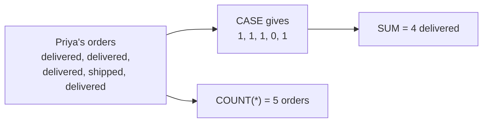

<!-- Written by `npm run lessons` from the lesson data in src/data. Edit the lesson there, not this page. -->

# Conditional aggregation: counting several things at once

**SQL · Unit 2: Summarising data: aggregates, GROUP BY and HAVING · Lesson 4 of 5 · Must know**

> **In one line.** Conditional aggregation puts CASE inside an aggregate, such as `SUM(CASE WHEN status = 'delivered' THEN 1 ELSE 0 END)`, so that it counts or sums only the rows that match. One query can then produce several different totals, or turn rows into columns (a pivot).

[Open this lesson on the site](https://learn.hamropedia.com/sql/conditional-aggregation-counting-several-things-at-once/) for its animation, the practice game and tap-to-explain words.

## The problem it solves

"For each customer, how many orders were delivered and how many weren't?" Running two queries and gluing them together is slow and messy. Interviewers love this pattern because it shows you understand that aggregates work on whatever values you give them.

## The idea

An aggregate adds up whatever expression you hand it. Hand SUM a CASE that gives 1 for the rows you care about and 0 for the rest, and it counts just those rows. Hand it `CASE WHEN … THEN amount END` and it sums just those amounts.

Do this several times in one SELECT, with different conditions, and you get several columns from one pass over the data. Use it with months as the conditions and the rows become columns — that is a pivot. For a percentage, divide one conditional count by `COUNT(*)`, using 100.0 to avoid integer division.

## Analogy

Counting a class with tally marks on a sheet with several columns: as each pupil walks past, you add a mark under "walked", "cycled" or "came by bus". One walk-past fills in every column at once.

**Where the analogy breaks.** With tally marks a pupil can only go in one column. Conditional aggregation has no such rule: one row can count towards several columns if several conditions are true, so make your conditions not overlap when they should add up to the total.

## Syntax

```sql
SELECT group_column,
       SUM(CASE WHEN condition THEN 1 ELSE 0 END) AS how_many,
       SUM(CASE WHEN condition THEN value END)    AS how_much
FROM table_name
GROUP BY group_column;
```

## How it works, step by step

1. GROUP BY customer_id makes one group per customer.
2. For each row, the CASE gives 1 if the order is delivered and 0 if not.
3. SUM adds those 1s and 0s, which is the number of delivered orders in the group.
4. A second SUM with the opposite condition counts the rest. `COUNT(*)` gives the total.
5. For a pivot, each column's CASE picks one month: `CASE WHEN order_date LIKE '2024-01%' THEN amount ELSE 0 END`.

## Picture it



*CASE turns each row into a 1 or a 0, and SUM adds them up — a count of just the matching rows, worked out next to the other totals in the same pass.*

## Examples on the practice database

**Several counts in one query**

```sql
SELECT customer_id,
       COUNT(*) AS orders,
       SUM(CASE WHEN status = 'delivered' THEN 1 ELSE 0 END) AS delivered,
       SUM(CASE WHEN status <> 'delivered' THEN 1 ELSE 0 END) AS not_delivered
FROM orders
GROUP BY customer_id
ORDER BY customer_id;
```

| customer_id | orders | delivered | not_delivered |
| --- | --- | --- | --- |
| 1 | 5 | 4 | 1 |
| 2 | 2 | 2 | 0 |
| 3 | 2 | 1 | 1 |
| 5 | 1 | 0 | 1 |

---

**A pivot: one column per month**

```sql
SELECT customer_id,
       SUM(CASE WHEN order_date LIKE '2024-01%' THEN amount ELSE 0 END) AS jan,
       SUM(CASE WHEN order_date LIKE '2024-02%' THEN amount ELSE 0 END) AS feb,
       SUM(CASE WHEN order_date LIKE '2024-03%' THEN amount ELSE 0 END) AS mar
FROM orders
GROUP BY customer_id
ORDER BY customer_id;
```

| customer_id | jan | feb | mar |
| --- | --- | --- | --- |
| 1 | 245 | 150 | 30 |
| 2 | 200 | 0 | 75 |
| 3 | 0 | 60 | 0 |
| 5 | 0 | 0 | 33 |

Rows became columns. Lena's February is 60: order 106's NULL amount is skipped by SUM.

---

**A percentage**

```sql
SELECT ROUND(100.0 * SUM(CASE WHEN status = 'delivered' THEN 1 ELSE 0 END) / COUNT(*), 1) AS pct_delivered,
       AVG(CASE WHEN status = 'delivered' THEN 1.0 ELSE 0 END) AS share_delivered
FROM orders;
```

| pct_delivered | share_delivered |
| --- | --- |
| 70 | 0.7 |

7 of 10 orders were delivered. 100.0 (not 100) stops integer division. The AVG of 1s and 0s is a neat shortcut for a share.

## Must know

- `SUM(CASE WHEN cond THEN 1 ELSE 0 END)` counts matching rows; `COUNT(CASE WHEN cond THEN 1 END)` does the same, because COUNT skips the NULLs.
- `SUM(CASE WHEN cond THEN amount END)` sums only matching amounts.
- One pass over the data gives many totals — faster and simpler than several queries.
- A pivot is conditional aggregation with one column per value.
- For percentages, multiply by 100.0 before dividing.

## Common mistakes

- Writing `COUNT(CASE WHEN cond THEN 1 ELSE 0 END)`. COUNT counts the 0s too, because 0 is not NULL. Use SUM, or drop the ELSE.
- Computing a percentage with whole numbers: `100 * 7 / 10` is fine but `7 / 10 * 100` is 0.
- Conditions that overlap when the columns should add up to the total.

> **Not true:** `COUNT(CASE WHEN cond THEN 1 ELSE 0 END)` counts only the rows that match the condition.  
> **In fact:** COUNT counts every value that is not NULL, and 0 is not NULL, so it counts every row. Use SUM instead, or leave out the ELSE.

## Other databases

- PostgreSQL and SQLite support a FILTER clause: `COUNT(*) FILTER (WHERE status = 'delivered')`. It is the same idea with neater syntax.
- SQL Server and Oracle have a PIVOT operator, but CASE works everywhere and interviewers accept it.

## In the interview

Conditional aggregation puts a CASE expression inside an aggregate, like SUM of CASE WHEN status is delivered THEN 1 ELSE 0. That lets me compute several metrics per group in a single pass: counts by status, revenue by month as columns, or a ratio. For ratios I multiply by 100.0 first to avoid integer division, and I make sure SUM rather than COUNT wraps a CASE that returns zero.

<details>
<summary>&lt;b>Why is `COUNT(CASE WHEN x THEN 1 ELSE 0 END)` wrong?&lt;/b></summary>

COUNT counts every non-NULL value, and 0 is not NULL, so it counts all rows. Use SUM, or remove the ELSE so non-matches become NULL.

</details>

<details>
<summary>&lt;b>How do you pivot rows into columns in SQL?&lt;/b></summary>

GROUP BY the row label and write one `SUM(CASE WHEN column = value THEN amount END)` per output column.

</details>

## Practise

Write each answer yourself first, then open the answer and compare.

### 1. Explain

Explain how `SUM(CASE WHEN … THEN 1 ELSE 0 END)` counts rows.

<details>
<summary>Show one good answer</summary>

The CASE runs once for every row and turns it into a number: 1 if the row matches, 0 if it doesn't. SUM then adds up those 1s and 0s. Every match adds 1 and every other row adds nothing, so the total is the number of matching rows.

Because each CASE is its own column, one query can count several different things at once, each with its own condition.

</details>

### 2. Write

For each department, show the number of employees earning 60000 or more and the number earning less, in one query.

<details>
<summary>Show one good answer</summary>

Two SUM(CASE …) columns, one per condition, grouped by department. "60000 or more" is `>= 60000`, so Dara (exactly 60,000) counts in the first column.

```sql
SELECT dept_id,
       SUM(CASE WHEN salary >= 60000 THEN 1 ELSE 0 END) AS earn_60k_or_more,
       SUM(CASE WHEN salary < 60000 THEN 1 ELSE 0 END) AS earn_less
FROM employees
GROUP BY dept_id
ORDER BY dept_id;
```

| dept_id | earn_60k_or_more | earn_less |
| --- | --- | --- |
| NULL | 0 | 1 |
| 1 | 4 | 0 |
| 2 | 1 | 1 |
| 3 | 0 | 1 |

</details>

### 3. Predict

What does `SELECT COUNT(CASE WHEN status = 'delivered' THEN 1 ELSE 0 END) FROM orders;` return, and why is it not 7?

<details>
<summary>Show one good answer</summary>

10, not 7.

COUNT counts every value that is not NULL. The CASE gives 1 or 0, and 0 is a real value, not NULL, so COUNT counts all 10 rows.

Two fixes: use SUM, which adds the 1s and 0s; or keep COUNT but drop the ELSE, so non-matching rows become NULL and are skipped. Both give 7.

```sql
SELECT COUNT(CASE WHEN status = 'delivered' THEN 1 ELSE 0 END) AS counted,
       COUNT(CASE WHEN status = 'delivered' THEN 1 END) AS fixed_count,
       SUM(CASE WHEN status = 'delivered' THEN 1 ELSE 0 END) AS fixed_sum
FROM orders;
```

| counted | fixed_count | fixed_sum |
| --- | --- | --- |
| 10 | 7 | 7 |

</details>

### 4. Edge cases

Write the share of orders that are cancelled, as a percentage with one decimal place, and check it is 10.0.

<details>
<summary>Show one good answer</summary>

1 cancelled order out of 10 is 10.0%. Start with 100.0, not 100, so the division is exact. With whole numbers the fraction is cut off: 1 out of 3 would show 33, not 33.3. (SQLite shows 10.0 as 10.)

```sql
SELECT ROUND(100.0 * SUM(CASE WHEN status = 'cancelled' THEN 1 ELSE 0 END) / COUNT(*), 1) AS pct_cancelled
FROM orders;
```

| pct_cancelled |
| --- |
| 10 |

</details>

## Go further (optional)

- READ · [Mode SQL Tutorial — SQL CASE (Using CASE with aggregate functions)](https://mode.com/sql-tutorial/) · Mode, free
- READ · [PostgreSQL docs — Aggregate Expressions (FILTER)](https://www.postgresql.org/docs/current/sql-expressions.html#SYNTAX-AGGREGATES) · official documentation, free
- PRACTICE · [DataLemur — conditional aggregation questions](https://datalemur.com/questions) · real interview questions, many free

---

[← HAVING: filtering groups, and how it differs from WHERE](having-filtering-groups-and-how-it-differs-from-where.md) · [All lessons](../../README.md) · [The order a query really runs in →](the-order-a-query-really-runs-in.md)
