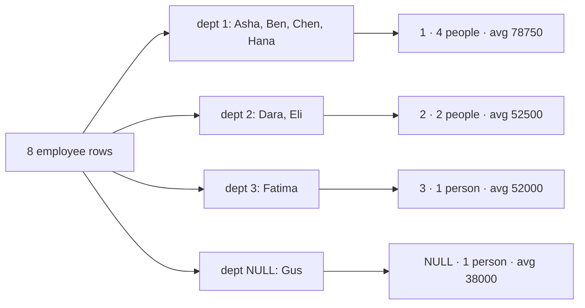

<!-- Written by `npm run lessons` from the lesson data in src/data. Edit the lesson there, not this page. -->

# GROUP BY: one result row per group

**SQL · Unit 2: Summarising data: aggregates, GROUP BY and HAVING · Lesson 2 of 5 · Must know**

> **In one line.** GROUP BY splits the rows into groups that share the same value in the listed columns, and the aggregates then return one row per group.

[Open this lesson on the site](https://learn.hamropedia.com/sql/group-by-one-result-row-per-group/) for its animation, the practice game and tap-to-explain words.

## The problem it solves

One total is rarely enough. Managers ask for "revenue per month", "headcount per department", "orders per customer". GROUP BY gives you a total for every group in one query, instead of one query per group.

## The idea

GROUP BY dept_id puts all rows with the same dept_id into one pile. Each pile becomes one result row, and every aggregate in SELECT is worked out separately for each pile.

The golden rule: every column in SELECT must either be in GROUP BY or be inside an aggregate. Why? A group of 4 employees has 4 names, and the database can't pick one for you. All NULLs fall into one group of their own.

## Analogy

Sorting a bag of coins into piles by type — all the 10p together, all the £1 together — and then counting each pile. GROUP BY makes the piles; COUNT and SUM count them.

**Where the analogy breaks.** With coins you can still see each coin in its pile. After GROUP BY, the separate rows are gone from the result: you only see one row per pile, so you can't ask for "the name" of a group unless you aggregate it.

## Syntax

```sql
SELECT group_column, COUNT(*), SUM(column)
FROM table_name
GROUP BY group_column;
```

## How it works, step by step

1. FROM takes all 8 employees.
2. GROUP BY dept_id makes piles: department 1 (Asha, Ben, Chen, Hana), department 2 (Dara, Eli), department 3 (Fatima), and a NULL pile (Gus).
3. For each pile, `COUNT(*)` and `AVG(salary)` are worked out: department 1 has 4 people averaging 78750.
4. SELECT returns one row per pile: dept_id, plus the aggregates.
5. Department 4 (HR) has no employees, so there is no pile and no row for it. Getting zero rows to show needs a join (Unit 3).

## Picture it



*GROUP BY makes one pile per department, and each pile becomes one result row with its own count and average. NULLs form a pile of their own. HR has nobody, so it gets no pile at all.*

## Examples on the practice database

**Headcount and average salary per department**

```sql
SELECT dept_id, COUNT(*) AS headcount, AVG(salary) AS avg_salary
FROM employees
GROUP BY dept_id
ORDER BY dept_id;
```

| dept_id | headcount | avg_salary |
| --- | --- | --- |
| NULL | 1 | 38000 |
| 1 | 4 | 78750 |
| 2 | 2 | 52500 |
| 3 | 1 | 52000 |

Gus forms the NULL group. HR (department 4) is missing because no rows belong to it.

---

**Revenue per month**

```sql
SELECT strftime('%Y-%m', order_date) AS month,
       COUNT(*) AS orders,
       SUM(amount) AS revenue
FROM orders
GROUP BY strftime('%Y-%m', order_date)
ORDER BY month;
```

| month | orders | revenue |
| --- | --- | --- |
| 2024-01 | 4 | 445 |
| 2024-02 | 3 | 210 |
| 2024-03 | 3 | 138 |

You can group by a calculation, not just a column. February has 3 orders but only 2 amounts, because order 106 is NULL.

---

**Group by two columns**

```sql
SELECT customer_id, status, COUNT(*) AS orders
FROM orders
GROUP BY customer_id, status
ORDER BY customer_id, status;
```

| customer_id | status | orders |
| --- | --- | --- |
| 1 | delivered | 4 |
| 1 | shipped | 1 |
| 2 | delivered | 2 |
| 3 | cancelled | 1 |
| 3 | delivered | 1 |
| 5 | pending | 1 |

One row per pair of customer and status that actually appears in the data.

## Must know

- GROUP BY makes one result row per distinct combination of the grouping columns.
- Every column in SELECT must be in GROUP BY or inside an aggregate.
- All NULLs in a grouping column form one group.
- Groups with no rows don't appear at all. To show zeros (like HR with 0 people), start from the full list and LEFT JOIN (Unit 3).
- Grouped results come back in no particular order. Add ORDER BY.

## Common mistakes

- Selecting a column that is neither grouped nor aggregated, like `SELECT dept_id, name, COUNT(*) … GROUP BY dept_id`.
- Expecting groups with zero rows to appear with a count of 0.
- Grouping by too many columns (such as the id), so every group has one row and nothing is summarised.

> **Not true:** GROUP BY also returns the groups that have no rows, with a count of 0.  
> **In fact:** A group exists only if at least one row falls into it. To show a zero, start from the full list (such as all departments) and LEFT JOIN onto it (Unit 3).

## Other databases

- SQLite and older MySQL let you select a column that isn't grouped and silently pick a value. PostgreSQL, SQL Server and modern MySQL reject it. Write it the strict way.
- GROUP BY an alias (`GROUP BY month`) works in PostgreSQL, MySQL and SQLite, but not in SQL Server — repeat the expression there.

## In the interview

GROUP BY partitions the filtered rows into groups by the grouping columns, and aggregates are computed once per group, giving one output row per group. The rule is that every selected column must be grouped or aggregated. Two details I mention. NULLs form a single group. And groups with no rows simply don't appear, so to report zeros I drive the query from the complete dimension table with a LEFT JOIN.

<details>
<summary>&lt;b>Why must non-aggregated columns be in GROUP BY?&lt;/b></summary>

Each group becomes one row. A column that isn't grouped could have many values in the group, and SQL won't guess which one to show.

</details>

<details>
<summary>&lt;b>How do you show departments with zero employees?&lt;/b></summary>

`SELECT d.dept_name, COUNT(e.emp_id) FROM departments d LEFT JOIN employees e ON e.dept_id = d.dept_id GROUP BY d.dept_name` — COUNT of a column gives 0 when nothing matched.

</details>

## Practise

Write each answer yourself first, then open the answer and compare.

### 1. Explain

Explain the golden rule of GROUP BY, using the employees table.

<details>
<summary>Show one good answer</summary>

Every column in SELECT must either be in the GROUP BY, or be inside an aggregate.

`SELECT dept_id, COUNT(*) FROM employees GROUP BY dept_id` is fine: one dept_id per group, and one count per group.

`SELECT dept_id, name, COUNT(*) … GROUP BY dept_id` breaks the rule. Department 1 has four people (Asha, Ben, Chen and Hana), but the group has room for only one name. Which one? PostgreSQL, SQL Server and (by default) MySQL refuse the query. SQLite runs it and picks one name, which is worse: it looks like an answer but means nothing.

Fix it by grouping by name too, or by aggregating it, for example `MAX(name)` or `GROUP_CONCAT(name)`.

</details>

### 2. Write

Write a query for the number of products and the average price in each category, sorted by category.

<details>
<summary>Show one good answer</summary>

Group by category and aggregate the rest. Electronics averages the £40 headphones and the £15 phone case: 27.5.

```sql
SELECT category, COUNT(*) AS products, AVG(price) AS avg_price
FROM products
GROUP BY category
ORDER BY category;
```

| category | products | avg_price |
| --- | --- | --- |
| Bags | 1 | 30 |
| Electronics | 2 | 27.5 |
| Home | 1 | 25 |
| Kitchen | 1 | 8 |
| Stationery | 2 | 3.5 |

</details>

### 3. Predict

How many rows does `SELECT city, COUNT(*) FROM customers GROUP BY city;` return, and what is the count for Leeds?

<details>
<summary>Show one good answer</summary>

4 rows: Bristol, Leeds, London and one group for NULL. Leeds has 2: both of Tom's sign-ups. London also has 2 (Priya and Lena), Bristol 1 (Omar), and the NULL group 1 (Zoe).

GROUP BY puts all the NULLs together in one group. (ORDER BY is added below so the order is fixed.)

```sql
SELECT city, COUNT(*)
FROM customers
GROUP BY city
ORDER BY city;
```

| city | COUNT(*) |
| --- | --- |
| NULL | 1 |
| Bristol | 1 |
| Leeds | 2 |
| London | 2 |

</details>

### 4. Edge cases

Write a query that returns each customer_id with their total spend, where a customer whose only orders have NULL amounts shows 0, not NULL.

<details>
<summary>Show one good answer</summary>

SUM skips NULLs, but if every amount in a group is NULL, there is nothing to add and SUM returns NULL. Wrap it: `COALESCE(SUM(amount), 0)`.

No customer here has only NULL amounts (customer 3 has one NULL and one £60, so their total is 60). To see the COALESCE work, add `WHERE order_id = 106` and customer 3 shows 0.

Note that Omar, who has no orders at all, is not in the result: he has no rows in orders to group. Showing him needs a LEFT JOIN from customers (Unit 3).

```sql
SELECT customer_id, COALESCE(SUM(amount), 0) AS total_spend
FROM orders
GROUP BY customer_id
ORDER BY customer_id;
```

| customer_id | total_spend |
| --- | --- |
| 1 | 425 |
| 2 | 275 |
| 3 | 60 |
| 5 | 33 |

</details>

## Go further (optional)

- PRACTICE · [SQLBolt — Lesson 11: Queries with aggregates (Pt. 2)](https://sqlbolt.com/) · interactive exercises in the browser, free
- READ · [W3Schools — SQL GROUP BY Statement](https://www.w3schools.com/sql/sql_groupby.asp) · short page with a try-it editor, free
- PRACTICE · [SQLZoo — SUM and COUNT](https://sqlzoo.net/) · free exercises

---

[← Aggregate functions: COUNT, SUM, AVG, MIN and MAX](aggregate-functions-count-sum-avg-min-and-max.md) · [All lessons](../../README.md) · [HAVING: filtering groups, and how it differs from WHERE →](having-filtering-groups-and-how-it-differs-from-where.md)
