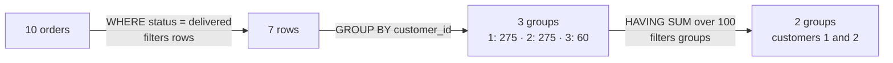

<!-- Written by `npm run lessons` from the lesson data in src/data. Edit the lesson there, not this page. -->

# HAVING: filtering groups, and how it differs from WHERE

**SQL · Unit 2: Summarising data: aggregates, GROUP BY and HAVING · Lesson 3 of 5 · Must know**

> **In one line.** HAVING filters groups after GROUP BY, using aggregates such as `COUNT(*) > 1`, while WHERE filters single rows before any grouping happens.

[Open this lesson on the site](https://learn.hamropedia.com/sql/having-filtering-groups-and-how-it-differs-from-where/) for its animation, the practice game and tap-to-explain words.

## The problem it solves

"Customers with more than one order", "departments whose average salary is over 55000". You can't test those in WHERE, because the counts and averages don't exist until the rows are grouped. HAVING is the filter that runs after grouping.

## The idea

Think of two sieves. WHERE is the first sieve: it removes rows before they are put into groups. HAVING is the second: it removes whole groups after they are counted.

A query can use both: WHERE keeps only delivered orders, GROUP BY makes a group per customer, then HAVING keeps customers whose delivered total is at least £100.

If a condition is about one row (status, date), put it in WHERE — it is cheaper, because fewer rows get grouped.

## Analogy

Picking a football team. WHERE is the trial: players under 16 are sent home before teams are formed. HAVING comes after the teams are formed: any team with fewer than 11 players is dropped from the tournament.

**Where the analogy breaks.** In football you could also drop a team for one bad player. HAVING can't look at individual rows any more — only at things that describe the whole group, such as counts, sums and the grouping columns.

## Syntax

```sql
SELECT group_column, COUNT(*)
FROM table_name
WHERE row_condition
GROUP BY group_column
HAVING group_condition;
```

## How it works, step by step

1. FROM: all 10 orders.
2. `WHERE status = 'delivered'`: 7 rows are left.
3. GROUP BY customer_id: customer 1 has 4 delivered orders (275), customer 2 has 2 (275), customer 3 has 1 (60).
4. HAVING `SUM(amount) >= 100`: customer 3's group fails and is removed.
5. SELECT returns customers 1 and 2 with their totals.

## Picture it



*Two sieves at two different moments. WHERE removes single rows before grouping; HAVING removes whole groups after their totals are known.*

## Examples on the practice database

**Departments with more than one person**

```sql
SELECT dept_id, COUNT(*) AS headcount
FROM employees
GROUP BY dept_id
HAVING COUNT(*) > 1
ORDER BY dept_id;
```

| dept_id | headcount |
| --- | --- |
| 1 | 4 |
| 2 | 2 |

---

**WHERE and HAVING together**

```sql
SELECT customer_id, SUM(amount) AS delivered_total
FROM orders
WHERE status = 'delivered'
GROUP BY customer_id
HAVING SUM(amount) >= 100
ORDER BY customer_id;
```

| customer_id | delivered_total |
| --- | --- |
| 1 | 275 |
| 2 | 275 |

Priya's shipped order (150) isn't counted: WHERE removed it before the sum. Lena's delivered total is only 60.

## Must know

- WHERE filters rows, before GROUP BY. HAVING filters groups, after GROUP BY.
- Aggregates can be used in HAVING but not in WHERE.
- A row-level condition belongs in WHERE: it is clearer and faster.
- HAVING can test an aggregate that isn't in SELECT, such as `HAVING MAX(salary) > 60000`.

## Common mistakes

- Writing `WHERE COUNT(*) > 1` — an error, because counts don't exist yet when WHERE runs.
- Putting a plain row condition in HAVING (`HAVING status = 'delivered'`): it either fails or does something unexpected.
- Using a SELECT alias in HAVING (`HAVING headcount > 1`). Some databases allow it; standard SQL and SQL Server don't. Repeat the aggregate.

> **Not true:** An alias from SELECT can be used in HAVING in every database.  
> **In fact:** Some databases allow it, but standard SQL and SQL Server do not. Repeat the aggregate in HAVING to be safe.

## In the interview

WHERE and HAVING are both filters but run at different stages. WHERE filters individual rows before grouping, so it can't use aggregates. HAVING filters groups after GROUP BY, so it can. If a condition doesn't need an aggregate I put it in WHERE, because filtering early means less data to group.

<details>
<summary>&lt;b>Can you use HAVING without GROUP BY?&lt;/b></summary>

Yes. The whole result is treated as one group: `SELECT COUNT(*) FROM orders HAVING COUNT(*) > 5` returns one row or none.

</details>

<details>
<summary>&lt;b>Which is faster for a row condition, WHERE or HAVING?&lt;/b></summary>

WHERE, because rows are removed before the work of grouping. Many optimisers move such conditions anyway, but write them in WHERE.

</details>

## Practise

Write each answer yourself first, then open the answer and compare.

### 1. Explain

Explain WHERE versus HAVING using the football-trial analogy, then using the orders table.

<details>
<summary>Show one good answer</summary>

At a football trial, WHERE is the check at the gate: each player is judged on their own (too young? go home) before any teams exist. HAVING comes after the teams are formed: it judges whole teams (fewer than 11 players? out of the tournament).

With orders: `WHERE status = 'delivered'` throws out single orders that aren't delivered, before grouping. Then GROUP BY customer_id makes one group per customer, and `HAVING SUM(amount) >= 100` drops customers whose delivered total is under £100.

WHERE can't use SUM or COUNT, because the groups don't exist yet. HAVING can, because it runs after GROUP BY.

</details>

### 2. Write

Write a query for customers who placed at least 2 orders, showing customer_id and the number of orders.

<details>
<summary>Show one good answer</summary>

Group the orders per customer, count them, and keep the groups with 2 or more. That is a test on a group, so it goes in HAVING.

```sql
SELECT customer_id, COUNT(*) AS orders
FROM orders
GROUP BY customer_id
HAVING COUNT(*) >= 2
ORDER BY customer_id;
```

| customer_id | orders |
| --- | --- |
| 1 | 5 |
| 2 | 2 |
| 3 | 2 |

</details>

### 3. Predict

Which dept_ids does `SELECT dept_id FROM employees GROUP BY dept_id HAVING AVG(salary) > 55000;` return?

<details>
<summary>Show one good answer</summary>

Only department 1.

The averages are: department 1, (95,000 + 70,000 + 70,000 + 80,000) ÷ 4 = 78,750; department 2, 52,500; department 3, 52,000; and the NULL group (Gus), 38,000. Only 78,750 is over 55,000.

```sql
SELECT dept_id, AVG(salary)
FROM employees
GROUP BY dept_id
HAVING AVG(salary) > 55000;
```

| dept_id | AVG(salary) |
| --- | --- |
| 1 | 78750 |

</details>

### 4. Edge cases

Customer 3 has one NULL amount. Does `HAVING SUM(amount) > 50` keep them? Does `HAVING COUNT(amount) = COUNT(*)`? Explain.

<details>
<summary>Show one good answer</summary>

`HAVING SUM(amount) > 50`: yes, customer 3 is kept. SUM skips the NULL, so their total is 60, and 60 > 50.

`HAVING COUNT(amount) = COUNT(*)`: no, customer 3 is dropped. `COUNT(amount)` skips the NULL and gives 1, while `COUNT(*)` counts both rows and gives 2. 1 ≠ 2. This is a handy test for "every order in the group has an amount".

The query below shows both tests for every customer, as 1 (true) or 0 (false).

```sql
SELECT customer_id,
       SUM(amount) AS total,
       COUNT(amount) AS with_amount,
       COUNT(*) AS orders,
       SUM(amount) > 50 AS sum_over_50,
       COUNT(amount) = COUNT(*) AS all_known
FROM orders
GROUP BY customer_id
ORDER BY customer_id;
```

| customer_id | total | with_amount | orders | sum_over_50 | all_known |
| --- | --- | --- | --- | --- | --- |
| 1 | 425 | 5 | 5 | 1 | 1 |
| 2 | 275 | 2 | 2 | 1 | 1 |
| 3 | 60 | 1 | 2 | 1 | 0 |
| 5 | 33 | 1 | 1 | 0 | 1 |

</details>

## Go further (optional)

- READ · [W3Schools — SQL HAVING Clause](https://www.w3schools.com/sql/sql_having.asp) · short page with a try-it editor, free
- READ · [Mode SQL Tutorial — SQL HAVING](https://mode.com/sql-tutorial/) · Mode, free
- PRACTICE · [SQLBolt — Lesson 11: Queries with aggregates (Pt. 2)](https://sqlbolt.com/) · interactive exercises in the browser, free

---

[← GROUP BY: one result row per group](group-by-one-result-row-per-group.md) · [All lessons](../../README.md) · [Conditional aggregation: counting several things at once →](conditional-aggregation-counting-several-things-at-once.md)
