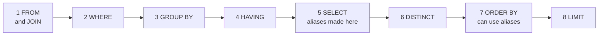

<!-- Written by `npm run lessons` from the lesson data in src/data. Edit the lesson there, not this page. -->

# The order a query really runs in

**SQL · Unit 2: Summarising data: aggregates, GROUP BY and HAVING · Lesson 5 of 5 · Must know**

> **In one line.** You write a query as SELECT, FROM, WHERE, GROUP BY, HAVING, ORDER BY, LIMIT. The database works it out in a different order: FROM, WHERE, GROUP BY, HAVING, SELECT, DISTINCT, ORDER BY, LIMIT. That order explains most "why doesn't this work?" errors.

[Open this lesson on the site](https://learn.hamropedia.com/sql/the-order-a-query-really-runs-in/) for its animation, the practice game and tap-to-explain words.

## The problem it solves

Why can't WHERE use the alias you made in SELECT? Why can ORDER BY use it? Why can't WHERE use COUNT? Without the run order these look like random rules. With it, they are obvious — and interviewers ask about it directly.

## The idea

Each step works on the output of the step before. FROM (and JOIN) builds the rows. WHERE removes rows. GROUP BY makes groups. HAVING removes groups. SELECT works out the output columns and their aliases (window functions run here too). DISTINCT removes duplicate rows. ORDER BY sorts. LIMIT cuts.

So: WHERE runs before SELECT, and can't see its aliases. ORDER BY runs after SELECT, so it can. WHERE runs before GROUP BY, so it can't use aggregates — HAVING runs after, so it can.

## Analogy

Making a sandwich. You write the order as "sandwich: cheese and tomato, on brown bread, cut in half". But you actually get the bread first (FROM), pick the fillings (WHERE), assemble it (GROUP BY and SELECT), and cut it last (ORDER BY, LIMIT). You can't cut what you haven't made yet.

**Where the analogy breaks.** A cook really does work in that order. A database only has to behave as if it does. The optimiser may reorder the real work (for example, use an index to sort early), as long as the answer is the same.

## Syntax

```sql
-- written order        -- run order
SELECT    ...           -- 5
FROM      ...           -- 1
WHERE     ...           -- 2
GROUP BY  ...           -- 3
HAVING    ...           -- 4
ORDER BY  ...           -- 6
LIMIT     ...;          -- 7
```

## How it works, step by step

1. FROM employees: all 8 rows.
2. `WHERE salary > 40000`: Gus (38000) is removed, so 7 rows are left.
3. GROUP BY dept_id: department 1 has 4 rows, department 2 has 2 (Dara, Eli), department 3 has 1 (Fatima).
4. HAVING `COUNT(*) >= 2`: department 3 is removed.
5. SELECT works out dept_id and `AVG(salary)` AS avg_salary for the 2 groups left.
6. ORDER BY avg_salary DESC can use the alias, because SELECT has already run.

## Picture it



*The order the database works in. Anything a step needs must already exist: WHERE can't use SELECT's aliases (made at step 5), but ORDER BY at step 7 can.*

## Examples on the practice database

**Every clause in one query**

```sql
SELECT dept_id, AVG(salary) AS avg_salary
FROM employees
WHERE salary > 40000
GROUP BY dept_id
HAVING COUNT(*) >= 2
ORDER BY avg_salary DESC;
```

| dept_id | avg_salary |
| --- | --- |
| 1 | 78750 |
| 2 | 52500 |

Follow the steps above: WHERE drops Gus, HAVING drops department 3, and ORDER BY uses the alias made in SELECT.

---

**Filtering on an alias: wrap the query**

```sql
SELECT name, bonus
FROM (
  SELECT name, salary / 10 AS bonus
  FROM employees
) AS with_bonus
WHERE bonus > 7000
ORDER BY bonus DESC;
```

| name | bonus |
| --- | --- |
| Asha | 9500 |
| Hana | 8000 |

`WHERE bonus > 7000` fails in a single query in strict databases, because WHERE runs before SELECT makes bonus. The inner query makes it first; Unit 4 covers this properly.

## Must know

- Run order: FROM → WHERE → GROUP BY → HAVING → SELECT → DISTINCT → ORDER BY → LIMIT.
- WHERE can't use SELECT aliases or aggregates; HAVING can use aggregates; ORDER BY can use aliases.
- Window functions are worked out at the SELECT step, so you can't filter on them in WHERE — wrap the query instead.
- To filter on a calculated column, repeat the expression in WHERE or wrap the query in a subquery or CTE.

## Common mistakes

- Using a SELECT alias in WHERE and getting "no such column".
- Expecting LIMIT to run before ORDER BY ("take 3 rows, then sort them").
- Filtering on `ROW_NUMBER()` in WHERE — it doesn't exist yet at that step.

> **Not true:** LIMIT runs before ORDER BY: the database takes a few rows and then sorts them.  
> **In fact:** ORDER BY runs first and LIMIT last: the database sorts all the rows, then keeps the first few. That is what makes "top 3" queries work.

## Other databases

- MySQL and SQLite are lenient and let HAVING (and sometimes WHERE) use SELECT aliases. PostgreSQL and SQL Server follow the strict order. Write it the strict way and it runs everywhere.

## In the interview

SQL is written SELECT first, but logically processed as FROM and JOINs, then WHERE, GROUP BY, HAVING, SELECT, DISTINCT, ORDER BY and finally LIMIT. That explains the common rules: WHERE can't reference SELECT aliases or aggregates because they don't exist yet, HAVING can use aggregates, and ORDER BY can use aliases. To filter on a computed column or a window function, I wrap the query in a CTE and filter outside.

<details>
<summary>&lt;b>Why can ORDER BY use a column alias but WHERE can't?&lt;/b></summary>

ORDER BY runs after SELECT, when the alias exists. WHERE runs before SELECT.

</details>

<details>
<summary>&lt;b>Where do window functions fit in the order?&lt;/b></summary>

At the SELECT step, after WHERE, GROUP BY and HAVING. That is why you filter on them in an outer query.

</details>

## Practise

Write each answer yourself first, then open the answer and compare.

### 1. Explain

Recite the run order from memory, and use it to explain why `WHERE COUNT(*) > 1` fails.

<details>
<summary>Show one good answer</summary>

FROM, WHERE, GROUP BY, HAVING, SELECT, DISTINCT, ORDER BY, LIMIT.

WHERE runs second, straight after FROM, while the rows are still single rows. Groups are only made at step 3, so at the time WHERE runs there is no group for COUNT(\*) to count. The database refuses: "misuse of aggregate".

A test on a count belongs in HAVING, which runs after GROUP BY.

```sql
SELECT customer_id
FROM orders
WHERE COUNT(*) > 1
GROUP BY customer_id;
```

The database refuses this query: `misuse of aggregate`

</details>

### 2. Write

Write a query for categories whose average product price is above £10, sorted by that average from high to low, using an alias in ORDER BY.

<details>
<summary>Show one good answer</summary>

HAVING repeats `AVG(price)`, because HAVING runs before SELECT, so the alias doesn't exist yet. (SQLite and MySQL let you use the alias there; PostgreSQL and SQL Server don't.) ORDER BY runs after SELECT, so the alias avg_price works there everywhere.

```sql
SELECT category, AVG(price) AS avg_price
FROM products
GROUP BY category
HAVING AVG(price) > 10
ORDER BY avg_price DESC;
```

| category | avg_price |
| --- | --- |
| Bags | 30 |
| Electronics | 27.5 |
| Home | 25 |

</details>

### 3. Predict

In the "every clause" example, what would change if WHERE were `salary > 50000`? Work it out step by step, then run it.

<details>
<summary>Show one good answer</summary>

Department 2 disappears, and only department 1 is left, with the same average of 78,750.

1. FROM: all 8 employees.  
2. WHERE salary > 50000: Eli (45,000) and Gus (38,000) are removed. 6 left.  
3. GROUP BY dept_id: department 1 has Asha, Ben, Chen and Hana; department 2 has only Dara; department 3 has only Fatima.  
4. HAVING COUNT(\*) >= 2: only department 1 has 2 or more. With the old filter (> 40000), Eli stayed, so department 2 had 2 people and was kept.  
5. SELECT: department 1, average (95,000 + 70,000 + 70,000 + 80,000) ÷ 4 = 78,750.

```sql
SELECT dept_id, AVG(salary) AS avg_salary
FROM employees
WHERE salary > 50000
GROUP BY dept_id
HAVING COUNT(*) >= 2
ORDER BY avg_salary DESC;
```

| dept_id | avg_salary |
| --- | --- |
| 1 | 78750 |

</details>

### 4. Edge cases

You want employees whose salary is above the company average. Why does `WHERE salary > AVG(salary)` fail, and what would you do instead?

<details>
<summary>Show one good answer</summary>

WHERE runs before any grouping, one row at a time, so it can't use an aggregate. AVG needs all the rows at once, and WHERE only sees one. The database refuses with "misuse of aggregate function AVG()".

Work the average out first, in its own query, and compare with that: a subquery. The company average is 510,000 ÷ 8 = 63,750. Four people are above it.

```sql
SELECT name, salary
FROM employees
WHERE salary > (SELECT AVG(salary) FROM employees)
ORDER BY salary DESC, name;
```

| name | salary |
| --- | --- |
| Asha | 95000 |
| Hana | 80000 |
| Ben | 70000 |
| Chen | 70000 |

</details>

## Go further (optional)

- PRACTICE · [SQLBolt — Lesson 12: Order of execution of a Query](https://sqlbolt.com/) · interactive exercises in the browser, free
- WATCH · [CS50's Introduction to Databases with SQL — Lecture 0: Querying](https://cs50.harvard.edu/sql/) · Harvard, free
- READ · [PostgreSQL docs — SELECT (how a query is processed)](https://www.postgresql.org/docs/current/sql-select.html) · official documentation, free

---

[← Conditional aggregation: counting several things at once](conditional-aggregation-counting-several-things-at-once.md) · [All lessons](../../README.md) · [Joins, and INNER JOIN →](../unit-3-joins/joins-and-inner-join.md)
