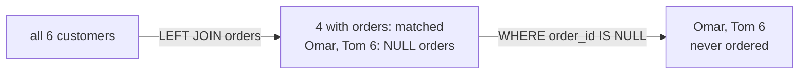

<!-- Written by `npm run lessons` from the lesson data in src/data. Edit the lesson there, not this page. -->

# Finding what is missing: anti-joins

**SQL · Unit 3: Joins: combining tables · Lesson 3 of 7 · Must know**

> **In one line.** An anti-join returns rows from one table that have no match in another — written as `LEFT JOIN … WHERE right.key IS NULL`, or as `WHERE NOT EXISTS (…)`.

[Open this lesson on the site](https://learn.hamropedia.com/sql/finding-what-is-missing-anti-joins/) for its animation, the practice game and tap-to-explain words.

## The problem it solves

"Customers who never ordered", "products that never sold", "employees with no manager on file" — finding what is absent is one of the most common interview questions and real tasks. You can't find it with WHERE alone, because the missing rows aren't there to filter.

## The idea

Do a LEFT JOIN, so every left row is kept and unmatched ones get NULL on the right. Then keep only the unmatched ones: `WHERE o.order_id IS NULL`. Test a column that can never be NULL in a real match — the right table's primary key is perfect.

NOT EXISTS says the same thing more directly: "keep the customer if no order exists for them". Its opposite, the semi-join, keeps rows that do have a match, each only once: `WHERE EXISTS (…)` or `WHERE id IN (…)`.

## Analogy

Checking a guest list against the sign-in sheet. Hold the list (left table) next to the sheet (right table); the names with an empty space next to them on the sheet are the people who didn't come.

**Where the analogy breaks.** With a list you just look for blanks. In SQL you must test the right column for the blank. If you test a column that might legitimately be NULL (like amount), you will wrongly report customers whose real order just has no amount.

## Syntax

```sql
SELECT a.*
FROM table_a a
LEFT JOIN table_b b ON b.key = a.key
WHERE b.key IS NULL;
```

## How it works, step by step

1. customers LEFT JOIN orders keeps all 6 customers; Omar and the second Tom get NULLs for every order column.
2. `WHERE o.order_id IS NULL` keeps only those NULL rows: the customers with no orders.
3. order_id is the orders primary key, so it is NULL only when there was no match — never in a real order.
4. NOT EXISTS version: for each customer, look for any order with their id; keep the customer if there is none.
5. Avoid NOT IN for this when the inner list can hold a NULL — it returns nothing (Unit 4 shows why).

## Picture it



*Keep everyone with a LEFT JOIN, then keep only the rows where the join found nothing. What is left is exactly the missing set.*

## Examples on the practice database

**Customers who never ordered: LEFT JOIN … IS NULL**

```sql
SELECT c.customer_id, c.name
FROM customers c
LEFT JOIN orders o ON o.customer_id = c.customer_id
WHERE o.order_id IS NULL
ORDER BY c.customer_id;
```

| customer_id | name |
| --- | --- |
| 4 | Omar |
| 6 | Tom |

---

**Products never sold: NOT EXISTS**

```sql
SELECT p.product_name
FROM products p
WHERE NOT EXISTS (
  SELECT 1
  FROM order_items oi
  WHERE oi.product_id = p.product_id
)
ORDER BY p.product_name;
```

| product_name |
| --- |
| Phone case |

For each product, the inner query looks for any order line with that product. NOT EXISTS keeps the product when it finds none. Unit 4 explains EXISTS fully.

---

**The opposite, a semi-join: rows that do have a match**

```sql
SELECT dept_name
FROM departments
WHERE dept_id IN (SELECT dept_id FROM employees)
ORDER BY dept_name;
```

| dept_name |
| --- |
| Engineering |
| Marketing |
| Sales |

Each department appears once, however many employees it has. A JOIN would repeat Engineering four times.

## Must know

- Anti-join = rows with no match: `LEFT JOIN … WHERE right.pk IS NULL`, or `NOT EXISTS`.
- Semi-join = rows with at least one match, each once: `EXISTS` or `IN`.
- In the IS NULL test, use a column that is never NULL in a real match — the right table's primary key or join key.
- NOT EXISTS is the safest anti-join: it handles NULLs correctly, and optimisers run it efficiently.
- Don't use `NOT IN (subquery)` if the subquery can return NULL.

## Common mistakes

- Testing a nullable column (`WHERE o.amount IS NULL`), which also returns Lena because order 106 has no amount.
- Using INNER JOIN and wondering why the missing rows never appear.
- Using `NOT IN (SELECT dept_id FROM employees)`: Gus's NULL dept_id makes it return no rows at all.

> **Not true:** `NOT IN (subquery)` is safe even when the subquery returns a NULL.  
> **In fact:** A single NULL in the list makes NOT IN unknown for every row, so nothing comes back. Use NOT EXISTS, which is safe with NULLs.

## Other databases

- Every database supports both forms. Some (SQL Server, Oracle) also have EXCEPT / MINUS for "ids in A but not in B".

## In the interview

To find rows with no match I use an anti-join: either a LEFT JOIN with WHERE the right table's key IS NULL, or NOT EXISTS with a correlated subquery. I prefer NOT EXISTS, because it states the intent directly and is NULL-safe. I avoid NOT IN against a subquery, since a single NULL in that list makes the whole condition unknown and returns nothing.

<details>
<summary>&lt;b>Why not use NOT IN to find customers without orders?&lt;/b></summary>

If the subquery returns any NULL, `x NOT IN (…)` is never true, so you get no rows. NOT EXISTS has no such problem.

</details>

<details>
<summary>&lt;b>Which column should you test for IS NULL after the LEFT JOIN?&lt;/b></summary>

One that is never NULL in a real matched row — the right table's primary key or the join column.

</details>

## Practise

Write each answer yourself first, then open the answer and compare.

### 1. Explain

Explain the two ways to write an anti-join and why the IS NULL column choice matters.

<details>
<summary>Show one good answer</summary>

1. LEFT JOIN, then keep the rows with no match: `LEFT JOIN orders o ON o.customer_id = c.customer_id WHERE o.order_id IS NULL`. Unmatched rows get NULLs in every right-hand column, so you keep just those.  
2. NOT EXISTS: `WHERE NOT EXISTS (SELECT 1 FROM orders o WHERE o.customer_id = c.customer_id)`. Keep the row if the subquery finds nothing.

The IS NULL column matters because NULL can mean two things: "no match" or "matched, but this value is empty". Test a column that is never NULL in a real match: the right table's primary key, or the column you joined on. If you test amount instead, Lena's order 106 (which has no amount) looks like "no order", and Lena wrongly appears.

</details>

### 2. Write

Write a query for departments with no employees, using LEFT JOIN … IS NULL.

<details>
<summary>Show one good answer</summary>

Departments on the left. A department with no employees gets NULL in e.emp_id, and emp_id is the primary key, so it is never NULL for a real employee. Only HR is left.

```sql
SELECT d.dept_id, d.dept_name
FROM departments d
LEFT JOIN employees e ON e.dept_id = d.dept_id
WHERE e.emp_id IS NULL
ORDER BY d.dept_id;
```

| dept_id | dept_name |
| --- | --- |
| 4 | HR |

</details>

### 3. Predict

What does the first example return if you change `WHERE o.order_id IS NULL` to `WHERE o.amount IS NULL`?

<details>
<summary>Show one good answer</summary>

Lena, Omar and the second Tom (id 6), instead of just Omar and Tom.

Omar and Tom have no orders, so their order columns are NULL, amount included. Lena does have orders, but one of them, 106, has a NULL amount, so that row passes the test too. A NULL amount can mean "no order" or "an order with no amount", and this test can't tell them apart. That is why you test the key.

```sql
SELECT c.customer_id, c.name
FROM customers c
LEFT JOIN orders o ON o.customer_id = c.customer_id
WHERE o.amount IS NULL
ORDER BY c.customer_id;
```

| customer_id | name |
| --- | --- |
| 3 | Lena |
| 4 | Omar |
| 6 | Tom |

</details>

### 4. Edge cases

Run `SELECT dept_name FROM departments WHERE dept_id NOT IN (SELECT dept_id FROM employees);`. Explain the result, then fix it.

<details>
<summary>Show one good answer</summary>

It returns no rows at all, even though HR has no employees.

The subquery returns every employee's dept_id, and Gus's is NULL. So for HR the test is `4 NOT IN (1, 1, 1, 2, 2, 3, NULL, 1)`, which means "4 &lt;> 1 AND … AND 4 &lt;> NULL". `4 <> NULL` is unknown, and anything AND unknown can't be true, so HR is not kept. One NULL in the list makes NOT IN fail for every row.

Fix it with NOT EXISTS, which doesn't have this trap, or keep NOT IN but add `WHERE dept_id IS NOT NULL` inside the subquery.

```sql
SELECT dept_name
FROM departments d
WHERE NOT EXISTS (
  SELECT 1 FROM employees e WHERE e.dept_id = d.dept_id
)
ORDER BY dept_name;
```

| dept_name |
| --- |
| HR |

</details>

## Go further (optional)

- PRACTICE · [PostgreSQL Exercises — Joins and Subqueries](https://pgexercises.com/) · pgexercises.com, free
- PRACTICE · [LeetCode — Top SQL 50 study plan](https://leetcode.com/studyplan/top-sql-50/) · free account
- READ · [Mode SQL Tutorial — SQL Joins with Comparison Operators](https://mode.com/sql-tutorial/) · Mode, free

---

[← LEFT JOIN: keep every row from one side](left-join-keep-every-row-from-one-side.md) · [All lessons](../../README.md) · [Self joins: a table joined to itself →](self-joins-a-table-joined-to-itself.md)
