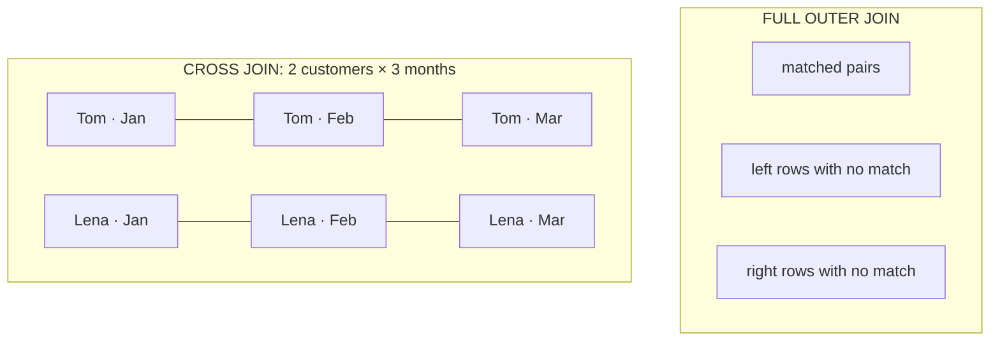

<!-- Written by `npm run lessons` from the lesson data in src/data. Edit the lesson there, not this page. -->

# FULL OUTER JOIN and CROSS JOIN

**SQL · Unit 3: Joins: combining tables · Lesson 6 of 7 · Should know**

> **In one line.** A FULL OUTER JOIN keeps every row from both tables, with NULLs wherever either side has no match. A CROSS JOIN pairs every row of one table with every row of the other.

[Open this lesson on the site](https://learn.hamropedia.com/sql/full-outer-join-and-cross-join/) for its animation, the practice game and tap-to-explain words.

## The problem it solves

Comparing two lists — "which employees have no department, and which departments have no employees?" — needs the unmatched rows from both sides at once. Building a report grid — every customer × every month, zeros included — needs every combination. These two joins do those jobs.

## The idea

FULL OUTER JOIN = a LEFT JOIN and a RIGHT JOIN together: matches as usual, plus the unmatched left rows (right columns NULL) and the unmatched right rows (left columns NULL). It is mainly for reconciling two sources.

CROSS JOIN has no ON at all: 6 customers × 3 months = 18 rows. On its own that is rarely what you want. But it is the standard way to build a complete grid. You then LEFT JOIN the real data onto the grid, so gaps show as zero.

## Analogy

FULL OUTER JOIN is comparing two class registers after a merger: you list everyone who is on both, plus the names that are only on one register. CROSS JOIN is a timetable grid: every class against every period, whether or not anything is scheduled there.

**Where the analogy breaks.** A timetable grid is small. A cross join of two big tables is enormous: a million rows × a million rows is a trillion. So it is only safe when at least one side is tiny.

## Syntax

```sql
SELECT ...
FROM a FULL OUTER JOIN b ON b.key = a.key;

SELECT ...
FROM a CROSS JOIN b;
```

## How it works, step by step

1. FULL OUTER JOIN employees and departments: the 7 matched pairs, plus Gus (no department), plus HR (no employees).
2. Gus's row has NULL department columns; HR's row has NULL employee columns.
3. CROSS JOIN customers and months: each customer row is paired with each month row, with no condition.
4. LEFT JOIN the orders onto that grid on customer and month: cells with no orders get NULL.
5. `COALESCE(SUM(amount), 0)` turns those NULLs into zeros, so the report has no gaps.

## Picture it



*FULL OUTER JOIN keeps matches plus the leftovers from both sides. CROSS JOIN makes every combination — 2 customers × 3 months is 6 rows — ready to have real data joined onto it.*

## Examples on the practice database

**FULL OUTER JOIN: the unmatched from both sides**

```sql
SELECT e.name, d.dept_name
FROM employees e
FULL OUTER JOIN departments d ON d.dept_id = e.dept_id
ORDER BY d.dept_id, e.name;
```

| name | dept_name |
| --- | --- |
| Gus | NULL |
| Asha | Engineering |
| Ben | Engineering |
| Chen | Engineering |
| Hana | Engineering |
| Dara | Sales |
| Eli | Sales |
| Fatima | Marketing |
| NULL | HR |

Gus (no department) and HR (no employees) both appear. Neither an INNER nor a LEFT JOIN shows both.

---

**CROSS JOIN: every combination**

```sql
SELECT p.product_name, d.dept_name
FROM products p
CROSS JOIN departments d
WHERE p.category = 'Stationery'
ORDER BY p.product_name, d.dept_id;
```

| product_name | dept_name |
| --- | --- |
| Notebook | Engineering |
| Notebook | Sales |
| Notebook | Marketing |
| Notebook | HR |
| Pen | Engineering |
| Pen | Sales |
| Pen | Marketing |
| Pen | HR |

A supply sheet: every stationery item for every department. 2 products × 4 departments = 8 rows.

---

**A complete grid with zeros: CROSS JOIN, then LEFT JOIN**

```sql
SELECT c.name, m.month, COALESCE(SUM(o.amount), 0) AS spent
FROM customers c
CROSS JOIN (SELECT DISTINCT strftime('%Y-%m', order_date) AS month FROM orders) AS m
LEFT JOIN orders o
  ON o.customer_id = c.customer_id
 AND strftime('%Y-%m', o.order_date) = m.month
WHERE c.customer_id IN (2, 3)
GROUP BY c.customer_id, c.name, m.month
ORDER BY c.customer_id, m.month;
```

| name | month | spent |
| --- | --- | --- |
| Tom | 2024-01 | 200 |
| Tom | 2024-02 | 0 |
| Tom | 2024-03 | 75 |
| Lena | 2024-01 | 0 |
| Lena | 2024-02 | 60 |
| Lena | 2024-03 | 0 |

Without the grid, Tom's February and Lena's January would be missing rows instead of zeros — which breaks charts and month-on-month maths.

## Must know

- FULL OUTER JOIN = matches + unmatched left rows + unmatched right rows.
- CROSS JOIN has no ON and returns rows(a) × rows(b).
- Grid pattern: CROSS JOIN the dimensions, LEFT JOIN the facts, COALESCE to 0.
- A join with a missing or always-true ON condition is an accidental cross join.

## Common mistakes

- Running a CROSS JOIN between two large tables.
- Forgetting an ON condition and getting a cross join by accident — the row count explodes.
- Using WHERE on one side after a FULL OUTER JOIN, which removes the other side's unmatched rows.

> **Not true:** A CROSS JOIN between two tables of 1,000 rows each returns 2,000 rows.  
> **In fact:** It pairs every row with every row: 1,000 × 1,000 = 1,000,000 rows. That is why a cross join between large tables is dangerous.

## Other databases

- MySQL has no FULL OUTER JOIN: write a LEFT JOIN, then UNION it with the unmatched rows of a RIGHT JOIN. SQLite added FULL OUTER JOIN in 3.39.
- PostgreSQL can build date grids directly with `generate_series('2024-01-01', '2024-03-01', interval '1 month')`.

## In the interview

A FULL OUTER JOIN returns matched rows plus the unmatched rows from both sides, with NULLs filling the gaps — useful for reconciling two sources. A CROSS JOIN is the Cartesian product: every row paired with every row. I mostly use it to build a complete grid, such as every customer by every month. Then I LEFT JOIN the facts onto the grid, so missing combinations show as zero instead of disappearing.

<details>
<summary>&lt;b>How many rows does a CROSS JOIN of 6 and 4 rows return?&lt;/b></summary>

24 — every row of one with every row of the other.

</details>

<details>
<summary>&lt;b>How do you do a FULL OUTER JOIN in MySQL?&lt;/b></summary>

LEFT JOIN UNION the RIGHT JOIN rows where the left side is NULL (UNION ALL with that filter avoids duplicates).

</details>

## Practise

Write each answer yourself first, then open the answer and compare.

### 1. Explain

Explain when you would use FULL OUTER JOIN instead of LEFT JOIN.

<details>
<summary>Show one good answer</summary>

Use LEFT JOIN when one table is the main list and you only care about its unmatched rows: "every department, even empty ones".

Use FULL OUTER JOIN when unmatched rows on both sides matter: "everything in either list, and show me what doesn't line up". With employees and departments it shows Gus (no department) and HR (no employees) in the same result. In real work it is for comparing two sources, such as payments against invoices, or yesterday's file against today's: missing on the left, missing on the right, and matched.

(MySQL has no FULL OUTER JOIN; you write a LEFT JOIN and a RIGHT JOIN and UNION them.)

</details>

### 2. Write

Build a grid of every product category × every order status, with the number of items sold in each cell (0 where none).

<details>
<summary>Show one good answer</summary>

Make the grid first: every category CROSS JOIN every status. Then LEFT JOIN the real numbers onto it, worked out in a subquery (items sold per category and status), and COALESCE the gaps to 0.

The full grid is 5 categories × 4 statuses = 20 cells. The WHERE below keeps two categories so the result fits on screen; delete it to see all 20. Every 'cancelled' cell is 0, because the only cancelled order, 106, has no items.

```sql
SELECT cat.category, st.status, COALESCE(s.items, 0) AS items_sold
FROM (SELECT DISTINCT category FROM products) AS cat
CROSS JOIN (SELECT DISTINCT status FROM orders) AS st
LEFT JOIN (
  SELECT p.category, o.status, SUM(oi.quantity) AS items
  FROM order_items oi
  JOIN products p ON p.product_id = oi.product_id
  JOIN orders o   ON o.order_id = oi.order_id
  GROUP BY p.category, o.status
) AS s ON s.category = cat.category AND s.status = st.status
WHERE cat.category IN ('Electronics', 'Home')
ORDER BY cat.category, st.status;
```

| category | status | items_sold |
| --- | --- | --- |
| Electronics | cancelled | 0 |
| Electronics | delivered | 8 |
| Electronics | pending | 0 |
| Electronics | shipped | 3 |
| Home | cancelled | 0 |
| Home | delivered | 5 |
| Home | pending | 1 |
| Home | shipped | 0 |

</details>

### 3. Predict

How many rows does `SELECT * FROM customers CROSS JOIN departments;` return?

<details>
<summary>Show one good answer</summary>

24 rows: every one of the 6 customers paired with every one of the 4 departments, 6 × 4. A CROSS JOIN has no ON, so nothing is matched and nothing is dropped. (It also has 8 columns, so the check below just counts.)

```sql
SELECT COUNT(*) AS pairs
FROM customers
CROSS JOIN departments;
```

| pairs |
| --- |
| 24 |

</details>

### 4. Edge cases

In the FULL OUTER JOIN example, add `WHERE e.salary > 40000`. Which rows disappear, and why does HR go too?

<details>
<summary>Show one good answer</summary>

Gus disappears, because he earns 38,000. HR disappears too, even though the filter is about salaries.

HR's row has no employee, so e.salary is NULL there. `NULL > 40000` is unknown, and WHERE drops anything that isn't true. The same happens to every row a FULL or LEFT JOIN filled with NULLs: a WHERE on the other table's columns removes them, and the outer join quietly becomes an inner join.

To keep HR, filter the employees before the join (in a subquery, or in the ON), or allow the empty side: `WHERE e.salary > 40000 OR e.emp_id IS NULL`.

```sql
SELECT e.name, d.dept_name
FROM employees e
FULL OUTER JOIN departments d ON d.dept_id = e.dept_id
WHERE e.salary > 40000
ORDER BY d.dept_id, e.name;
```

| name | dept_name |
| --- | --- |
| Asha | Engineering |
| Ben | Engineering |
| Chen | Engineering |
| Hana | Engineering |
| Dara | Sales |
| Eli | Sales |
| Fatima | Marketing |

</details>

## Go further (optional)

- READ · [W3Schools — SQL FULL OUTER JOIN](https://www.w3schools.com/sql/sql_join_full.asp) · short page with a try-it editor, free
- READ · [Mode SQL Tutorial — SQL FULL OUTER JOIN](https://mode.com/sql-tutorial/) · Mode, free
- PRACTICE · [SQLBolt — Lesson 7: OUTER JOINs](https://sqlbolt.com/) · interactive exercises in the browser, free

---

[← Joining three or more tables](joining-three-or-more-tables.md) · [All lessons](../../README.md) · [Join traps: double counting, and ON versus WHERE →](join-traps-double-counting-and-on-versus-where.md)
