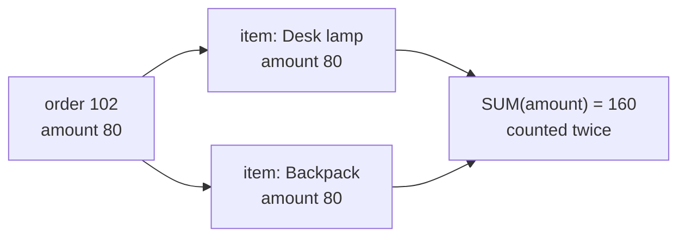

<!-- Written by `npm run lessons` from the lesson data in src/data. Edit the lesson there, not this page. -->

# Join traps: double counting, and ON versus WHERE

**SQL · Unit 3: Joins: combining tables · Lesson 7 of 7 · Must know**

> **In one line.** There are two classic join bugs. Fan-out: joining a "many" table repeats the "one" side, so its numbers get summed several times. And a right-table filter in WHERE, which silently turns a LEFT JOIN into an INNER JOIN.

[Open this lesson on the site](https://learn.hamropedia.com/sql/join-traps-double-counting-and-on-versus-where/) for its animation, the practice game and tap-to-explain words.

## The problem it solves

Both bugs return a result with no error, and the numbers look believable. The total revenue comes out as 1131 instead of 793; customers with no delivered orders quietly vanish from an "all customers" report. Interviewers test for exactly these.

## The idea

Fan-out: after orders JOIN order_items, an order with 2 items appears on 2 rows, each carrying the full order amount. `SUM(o.amount)` now counts it twice. The fix is to sum at the right grain: aggregate the many side first (in a subquery or CTE), then join one row per order.

ON versus WHERE with a LEFT JOIN: a condition in ON decides which right rows match, and left rows are kept regardless. A condition in WHERE runs after the join, on the finished rows. For unmatched rows the right columns are NULL, so `WHERE o.status = 'delivered'` is unknown and the row is thrown away.

## Analogy

Fan-out is like counting a family's income once for each child in the family: join families to children and sum family income, and a family with three children is counted three times. ON versus WHERE is the difference between "invite every pupil, and note which ones brought a permission slip" and "invite only the pupils who brought one".

**Where the analogy breaks.** With a family you would notice the triple count. SQL can't: it has no idea which column belongs to which grain. Checking the row count after each join is the habit that catches it.

## Syntax

```sql
-- keep all left rows, filter which right rows match:
LEFT JOIN orders o ON o.customer_id = c.customer_id AND o.status = 'delivered'

-- aggregate the many side first, then join:
JOIN (SELECT order_id, COUNT(*) AS items FROM order_items GROUP BY order_id) i
  ON i.order_id = o.order_id
```

## How it works, step by step

1. orders has 10 rows. Joined to order_items it has 14 rows, because 5 orders have 2 items each (and order 106 has none).
2. Each of those rows carries its order's full amount, so summing amount adds 102, 103, 105, 109 and 110 twice: 1131.
3. Fix: sum o.amount on orders alone, or pre-aggregate order_items to one row per order before joining.
4. LEFT JOIN with `AND o.status = 'delivered'` in ON: all 6 customers are kept; only delivered orders are attached.
5. The same condition in WHERE: customers with no delivered order have NULL status, so they are removed — 3 customers vanish.

## Picture it



*Fan-out: joining one order to its two items copies the order's amount onto both rows. Summing after the join counts it twice. Sum at the order level, or aggregate the items first.*

## Examples on the practice database

**Fan-out: the total that is too big**

```sql
SELECT SUM(o.amount) AS total_after_join,
       (SELECT SUM(amount) FROM orders) AS true_total
FROM orders o
JOIN order_items oi ON oi.order_id = o.order_id;
```

| total_after_join | true_total |
| --- | --- |
| 1131 | 793 |

Orders with two items are counted twice. Nothing errors — the number is just wrong.

---

**The fix: aggregate the many side first**

```sql
SELECT o.order_id, o.amount, i.item_lines
FROM orders o
JOIN (
  SELECT order_id, COUNT(*) AS item_lines
  FROM order_items
  GROUP BY order_id
) AS i ON i.order_id = o.order_id
WHERE o.customer_id = 1
ORDER BY o.order_id;
```

| order_id | amount | item_lines |
| --- | --- | --- |
| 101 | 120 | 1 |
| 102 | 80 | 2 |
| 103 | 45 | 2 |
| 105 | 150 | 2 |
| 109 | 30 | 2 |

The subquery shrinks order_items to one row per order before the join, so each order — and its amount — appears once.

---

**WHERE turns a LEFT JOIN into an INNER JOIN**

```sql
SELECT c.name, o.order_id
FROM customers c
LEFT JOIN orders o ON o.customer_id = c.customer_id
WHERE o.status = 'delivered'
ORDER BY c.customer_id, o.order_id;
```

| name | order_id |
| --- | --- |
| Priya | 101 |
| Priya | 102 |
| Priya | 103 |
| Priya | 109 |
| Tom | 104 |
| Tom | 108 |
| Lena | 107 |

Omar, Zoe and the second Tom have vanished, even though this is a LEFT JOIN.

---

**Move the condition into ON to keep everyone**

```sql
SELECT c.name, o.order_id
FROM customers c
LEFT JOIN orders o ON o.customer_id = c.customer_id AND o.status = 'delivered'
ORDER BY c.customer_id, o.order_id;
```

| name | order_id |
| --- | --- |
| Priya | 101 |
| Priya | 102 |
| Priya | 103 |
| Priya | 109 |
| Tom | 104 |
| Tom | 108 |
| Lena | 107 |
| Omar | NULL |
| Zoe | NULL |
| Tom | NULL |

Now every customer is kept, and only delivered orders are attached. Zoe's pending order isn't shown, but Zoe is.

## Must know

- After every join, ask: what does one row mean now? Did the row count grow?
- Never sum a "one"-side column after joining a "many" table. Sum first, or pre-aggregate the many side.
- Using DISTINCT to hide fan-out hides the bug, not fixes it — sums can still be wrong.
- With a LEFT JOIN, conditions on the right table go in ON; conditions on the left table go in WHERE.
- With an INNER JOIN, ON and WHERE give the same result.

## Common mistakes

- Writing `SUM(order.amount)` after joining order_items: each order's amount is then added once for every item it has.
- `COUNT(*)` after a fan-out join, counting items instead of orders. Use `COUNT(DISTINCT o.order_id)`.
- Writing `LEFT JOIN … WHERE right.col = x` in an "all customers" report: the WHERE throws away the customers that had no match.

> **Not true:** `COUNT(*)` after joining orders to their items still counts orders.  
> **In fact:** Each order now appears once for every item, so `COUNT(*)` counts items. Use `COUNT(DISTINCT o.order_id)` to count orders.

## In the interview

The two join bugs I always check for are fan-out and misplaced filters. Fan-out happens when a one-to-many join repeats the parent row, so summing a parent column double-counts — I fix it by aggregating the child table to the parent's grain before joining. And with a LEFT JOIN, a filter on the right table belongs in the ON clause; in WHERE it discards the NULL-extended rows and silently becomes an inner join.

<details>
<summary>&lt;b>How do you detect fan-out?&lt;/b></summary>

Compare `COUNT(*)` with `COUNT(DISTINCT parent_id)` after the join, or check the total against the parent table alone.

</details>

<details>
<summary>&lt;b>Is there any difference between ON and WHERE for an INNER JOIN?&lt;/b></summary>

No difference in the result. It only matters for outer joins.

</details>

<details>
<summary>&lt;b>Can I fix fan-out with DISTINCT?&lt;/b></summary>

It may fix a list of names, but `SUM(DISTINCT amount)` is wrong too — two different orders of £80 would be counted once. Fix the grain instead.

</details>

## Practise

Write each answer yourself first, then open the answer and compare.

### 1. Explain

Explain fan-out using order 102, and the two ways to avoid it.

<details>
<summary>Show one good answer</summary>

Order 102 is worth £80 and has two item lines (the lamp and the backpack). Join orders to order_items and order 102 becomes two rows, both carrying amount 80. `SUM(o.amount)` then adds £80 twice: £160 for one £80 order. That repeating is fan-out: the "one" side is copied once per row on the "many" side.

Two ways to avoid it:  
1. Aggregate the many side first, down to one row per order (`GROUP BY order_id` in a subquery), and then join. Now it is one-to-one again.  
2. Don't join a table you don't need for that number. Sum the amounts from orders alone. Or use the right level: the item lines' own `quantity * price`. For counts, `COUNT(DISTINCT o.order_id)` also works; for sums it doesn't.

```sql
SELECT o.order_id, o.amount, oi.product_id
FROM orders o
JOIN order_items oi ON oi.order_id = o.order_id
WHERE o.order_id = 102
ORDER BY oi.product_id;
```

| order_id | amount | product_id |
| --- | --- | --- |
| 102 | 80 | 4 |
| 102 | 80 | 5 |

</details>

### 2. Write

Write a query that returns, for each customer, the number of orders and the number of item lines — both correct, in one query.

<details>
<summary>Show one good answer</summary>

After joining items, each order appears once per item line, so `COUNT(o.order_id)` would count item lines. `COUNT(DISTINCT o.order_id)` counts each order once. `COUNT(oi.order_id)` counts item lines, and skips the NULLs from orders with none (106) and customers with none.

LEFT JOINs keep Omar and the second Tom with 0 and 0. Lena has 2 orders but only 1 item line, because 106 is empty.

```sql
SELECT c.customer_id, c.name,
       COUNT(DISTINCT o.order_id) AS orders,
       COUNT(oi.order_id) AS item_lines
FROM customers c
LEFT JOIN orders o       ON o.customer_id = c.customer_id
LEFT JOIN order_items oi ON oi.order_id = o.order_id
GROUP BY c.customer_id, c.name
ORDER BY c.customer_id;
```

| customer_id | name | orders | item_lines |
| --- | --- | --- | --- |
| 1 | Priya | 5 | 9 |
| 2 | Tom | 2 | 2 |
| 3 | Lena | 2 | 1 |
| 4 | Omar | 0 | 0 |
| 5 | Zoe | 1 | 2 |
| 6 | Tom | 0 | 0 |

</details>

### 3. Predict

What does `SELECT COUNT(*), COUNT(DISTINCT o.order_id) FROM orders o JOIN order_items oi ON oi.order_id = o.order_id;` return?

<details>
<summary>Show one good answer</summary>

14 and 9. The join makes one row per item line (14). Those rows cover 9 different orders: every order except 106, which has no items. The gap between the two numbers is exactly the fan-out.

```sql
SELECT COUNT(*), COUNT(DISTINCT o.order_id)
FROM orders o
JOIN order_items oi ON oi.order_id = o.order_id;
```

| COUNT(*) | COUNT(DISTINCT o.order_id) |
| --- | --- |
| 14 | 9 |

</details>

### 4. Edge cases

Write "every department and how many employees earn over 60000", keeping departments with 0. Where must the salary condition go?

<details>
<summary>Show one good answer</summary>

The salary condition must go in the ON, not the WHERE.

In the ON, it decides which employees count as a match. Departments with no high earners still keep their row (with NULLs), and `COUNT(e.emp_id)` gives them 0.

In the WHERE, it runs after the join, and the NULL rows fail `e.salary > 60000`. Sales, Marketing and HR vanish, and you get only Engineering. (Dara earns exactly 60,000, so Sales really is 0.)

```sql
SELECT d.dept_name, COUNT(e.emp_id) AS over_60k
FROM departments d
LEFT JOIN employees e ON e.dept_id = d.dept_id AND e.salary > 60000
GROUP BY d.dept_id, d.dept_name
ORDER BY d.dept_id;
```

| dept_name | over_60k |
| --- | --- |
| Engineering | 4 |
| Sales | 0 |
| Marketing | 0 |
| HR | 0 |

</details>

## Go further (optional)

- READ · [Mode SQL Tutorial — SQL Joins with Comparison Operators](https://mode.com/sql-tutorial/) · Mode, free
- PRACTICE · [PostgreSQL Exercises — Joins and Subqueries](https://pgexercises.com/) · pgexercises.com, free
- PRACTICE · [SQLBolt — Lesson 7: OUTER JOINs](https://sqlbolt.com/) · interactive exercises in the browser, free

---

[← FULL OUTER JOIN and CROSS JOIN](full-outer-join-and-cross-join.md) · [All lessons](../../README.md) · [Subqueries: a query inside a query →](../unit-4-subqueries/subqueries-a-query-inside-a-query.md)
