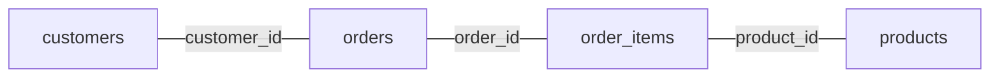

<!-- Written by `npm run lessons` from the lesson data in src/data. Edit the lesson there, not this page. -->

# Joining three or more tables

**SQL · Unit 3: Joins: combining tables · Lesson 5 of 7 · Must know**

> **In one line.** You join more than two tables by adding one JOIN … ON for each table, following the keys: orders to customers, orders to order_items, order_items to products. Each result row can then hold columns from all of them.

[Open this lesson on the site](https://learn.hamropedia.com/sql/joining-three-or-more-tables/) for its animation, the practice game and tap-to-explain words.

## The problem it solves

"What did each customer buy?" needs the customer's name (customers), the order (orders), the line items (order_items) and the product names (products). That is four tables. Many-to-many relationships always need at least three.

## The idea

Each JOIN adds one table to the rows you have so far, so a chain of joins follows the arrows in the database diagram. Start from the table whose grain you want in the result — here, one row per item bought, so order_items — or from the table you must keep in full.

Each new JOIN needs its own ON condition linking it to a table already in the query. GROUP BY afterwards sums across all of them, for example revenue per category = `SUM(quantity × price)`.

## Analogy

Following a paper trail. A receipt line says "product 6, quantity 3, order 101". You look up order 101 to find the customer, then customer 1 to find the name, then product 6 to find "Headphones". Each lookup is one join.

**Where the analogy breaks.** On paper you choose which lookups to do. SQL does every join for every row, and an INNER JOIN anywhere in the chain drops rows that fail to match at that step — like order 106, which has no items.

## Syntax

```sql
SELECT ...
FROM orders o
JOIN customers c    ON c.customer_id = o.customer_id
JOIN order_items oi ON oi.order_id   = o.order_id
JOIN products p     ON p.product_id  = oi.product_id;
```

## How it works, step by step

1. FROM orders o: one row per order.
2. JOIN customers c: each order gains its customer's columns. Still one row per order.
3. JOIN order_items oi: an order with 2 items becomes 2 rows. The grain is now one row per item.
4. JOIN products p: each item row gains the product name and price.
5. Order 106 has no items, so the INNER JOIN to order_items drops it. Use LEFT JOINs if it must stay.

## Picture it



*Each JOIN walks one step along a key. To get from a customer to a product name you must pass through orders and order_items, the link table.*

## Examples on the practice database

**What each order contained**

```sql
SELECT o.order_id, c.name AS customer, p.product_name, oi.quantity
FROM orders o
JOIN customers c    ON c.customer_id = o.customer_id
JOIN order_items oi ON oi.order_id = o.order_id
JOIN products p     ON p.product_id = oi.product_id
WHERE o.order_date < '2024-01-22'
ORDER BY o.order_id, p.product_name;
```

| order_id | customer | product_name | quantity |
| --- | --- | --- | --- |
| 101 | Priya | Headphones | 3 |
| 102 | Priya | Backpack | 1 |
| 102 | Priya | Desk lamp | 2 |
| 103 | Priya | Mug | 5 |
| 103 | Priya | Notebook | 1 |
| 104 | Tom | Headphones | 5 |

Orders 102 and 103 each appear twice — one row per item. The grain changed when order_items joined in.

---

**Revenue per category**

```sql
SELECT p.category, SUM(oi.quantity * p.price) AS revenue
FROM order_items oi
JOIN products p ON p.product_id = oi.product_id
GROUP BY p.category
ORDER BY revenue DESC;
```

| category | revenue |
| --- | --- |
| Electronics | 440 |
| Home | 150 |
| Bags | 120 |
| Kitchen | 48 |
| Stationery | 35 |

quantity × price is worked out per item row, then summed per category. The five add up to 793, the same as all order amounts.

---

**Customers who bought headphones**

```sql
SELECT DISTINCT c.name
FROM customers c
JOIN orders o       ON o.customer_id = c.customer_id
JOIN order_items oi ON oi.order_id = o.order_id
JOIN products p     ON p.product_id = oi.product_id
WHERE p.product_name = 'Headphones'
ORDER BY c.name;
```

| name |
| --- |
| Priya |
| Tom |

Priya bought headphones in two orders, so without DISTINCT her name would appear twice.

## Must know

- One JOIN … ON per extra table; each ON links the new table to one already joined.
- Follow the keys in the diagram. Many-to-many goes through the link table.
- Know the grain after every join: joining a "many" table multiplies rows.
- One INNER JOIN in a chain can drop rows; switch to LEFT JOIN where rows must survive.
- Use clear aliases (c, o, oi, p) and line the ON conditions up so the chain is easy to read.

## Common mistakes

- Joining two tables on the wrong pair of columns (`oi.product_id = o.order_id`) — it runs but returns nonsense.
- Mixing LEFT and INNER joins so that a later INNER JOIN removes the rows the LEFT JOIN kept.
- Summing an order-level column (o.amount) after joining item rows, which counts it once per item (see Join traps).

> **Not true:** A join on the wrong pair of columns always stops with an error.  
> **In fact:** If the types fit, it runs and returns nonsense: `oi.product_id = o.order_id` happily pairs unrelated rows. Check each ON against the keys in the diagram.

## In the interview

For multi-table queries I follow the foreign keys one hop at a time, adding a JOIN with its own ON condition for each table. I keep track of the grain after each join: joining a child table like order_items turns one row per order into one row per item. For many-to-many I go through the junction table, and I use LEFT JOINs wherever rows without a match must survive.

<details>
<summary>&lt;b>Does the order of INNER JOINs matter?&lt;/b></summary>

Not for the result — inner joins can be reordered freely, and the optimiser picks its own order. With LEFT JOINs, order does matter.

</details>

<details>
<summary>&lt;b>How do you get from customers to products?&lt;/b></summary>

customers → orders (customer_id) → order_items (order_id) → products (product_id).

</details>

## Practise

Write each answer yourself first, then open the answer and compare.

### 1. Explain

Explain what happens to the number of rows after each join in the first example.

<details>
<summary>Show one good answer</summary>

Count the rows after each step:

1. orders: 10 rows.  
2. JOIN customers: still 10. Each order has exactly one customer, so nothing is added or lost.  
3. JOIN order_items: 14. Each order is repeated once per item line (order 102 has two lines, so it now appears twice), and order 106, which has no items, is dropped.  
4. JOIN products: still 14. Each item line has exactly one product.  
5. WHERE order_date &lt; '2024-01-22': 6 rows, the item lines of orders 101 to 104.

The rule: joining to the "one" side keeps the count; joining to the "many" side multiplies it; an INNER JOIN with no match removes rows.

```sql
SELECT (SELECT COUNT(*) FROM orders) AS orders_only,
       (SELECT COUNT(*) FROM orders o
          JOIN order_items oi ON oi.order_id = o.order_id) AS with_items,
       (SELECT COUNT(*) FROM orders o
          JOIN order_items oi ON oi.order_id = o.order_id
          WHERE o.order_date < '2024-01-22') AS after_where;
```

| orders_only | with_items | after_where |
| --- | --- | --- |
| 10 | 14 | 6 |

</details>

### 2. Write

Write a query for the total quantity of each product bought by Priya, with product names, sorted by quantity.

<details>
<summary>Show one good answer</summary>

Walk the keys from customers to orders to order_items to products, keep Priya, then group by product and add up the quantities. Mug, Notebook and Pen tie on 5, so the name breaks the tie.

```sql
SELECT p.product_name, SUM(oi.quantity) AS total_quantity
FROM customers c
JOIN orders o       ON o.customer_id = c.customer_id
JOIN order_items oi ON oi.order_id = o.order_id
JOIN products p     ON p.product_id = oi.product_id
WHERE c.name = 'Priya'
GROUP BY p.product_id, p.product_name
ORDER BY total_quantity DESC, p.product_name;
```

| product_name | total_quantity |
| --- | --- |
| Headphones | 6 |
| Mug | 5 |
| Notebook | 5 |
| Pen | 5 |
| Backpack | 2 |
| Desk lamp | 2 |

</details>

### 3. Predict

How many rows do you get from joining orders to order_items (all orders, INNER JOIN)? Which order is missing?

<details>
<summary>Show one good answer</summary>

14 rows: one per item line, not one per order. They cover 9 of the 10 orders. Order 106 is missing, because it has no items, so the INNER JOIN finds nothing to pair it with.

```sql
SELECT COUNT(*) AS item_rows, COUNT(DISTINCT o.order_id) AS orders
FROM orders o
JOIN order_items oi ON oi.order_id = o.order_id;
```

| item_rows | orders |
| --- | --- |
| 14 | 9 |

</details>

### 4. Edge cases

Rewrite the first example (without the date filter) so order 106, which has no items, still appears.

<details>
<summary>Show one good answer</summary>

Make the join to order_items a LEFT JOIN, and the join after it (products) a LEFT JOIN too. If products stayed an INNER JOIN, order 106's NULL product_id would match no product, and the row would be dropped again. Once a chain goes LEFT, every join after it must stay LEFT.

The full query returns 15 rows (14 item lines plus 106). The WHERE below only keeps the result short enough to read; delete it to see all 15.

```sql
SELECT o.order_id, c.name AS customer, p.product_name, oi.quantity
FROM orders o
JOIN customers c         ON c.customer_id = o.customer_id
LEFT JOIN order_items oi ON oi.order_id = o.order_id
LEFT JOIN products p     ON p.product_id = oi.product_id
WHERE o.order_date >= '2024-02-01'
ORDER BY o.order_id, p.product_name;
```

| order_id | customer | product_name | quantity |
| --- | --- | --- | --- |
| 105 | Priya | Backpack | 1 |
| 105 | Priya | Headphones | 3 |
| 106 | Lena | NULL | NULL |
| 107 | Lena | Backpack | 2 |
| 108 | Tom | Desk lamp | 3 |
| 109 | Priya | Notebook | 4 |
| 109 | Priya | Pen | 5 |
| 110 | Zoe | Desk lamp | 1 |
| 110 | Zoe | Mug | 1 |

</details>

## Go further (optional)

- PRACTICE · [SQLZoo — More JOIN operations](https://sqlzoo.net/) · free exercises
- WATCH · [CS50's Introduction to Databases with SQL — Lecture 1: Relating](https://cs50.harvard.edu/sql/) · Harvard, free
- READ · [PostgreSQL docs — Joins Between Tables](https://www.postgresql.org/docs/current/tutorial-join.html) · official documentation, free

---

[← Self joins: a table joined to itself](self-joins-a-table-joined-to-itself.md) · [All lessons](../../README.md) · [FULL OUTER JOIN and CROSS JOIN →](full-outer-join-and-cross-join.md)
