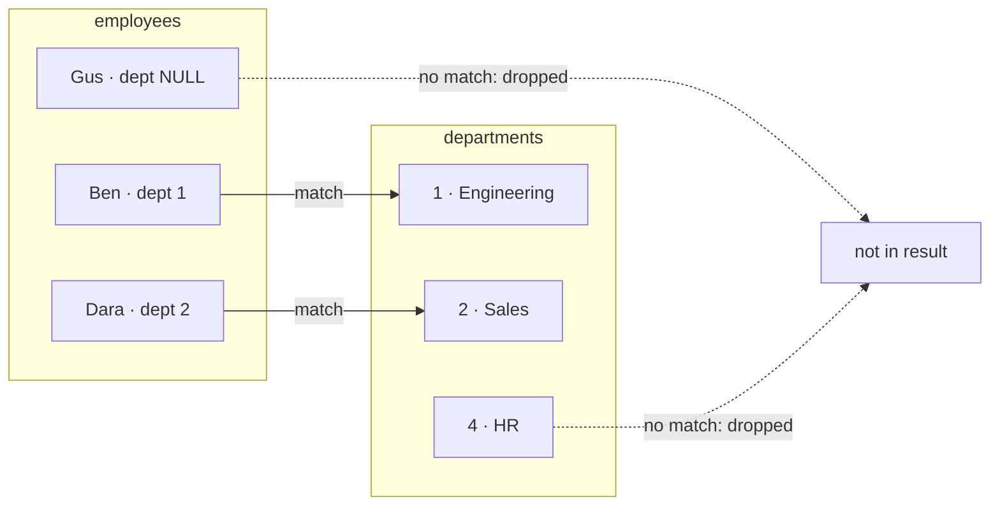

<!-- Written by `npm run lessons` from the lesson data in src/data. Edit the lesson there, not this page. -->

# Joins, and INNER JOIN

**SQL · Unit 3: Joins: combining tables · Lesson 1 of 7 · Must know**

> **In one line.** A JOIN combines rows from two tables wherever a condition (usually matching keys) is true, and INNER JOIN keeps only the rows that found a match on both sides.

[Open this lesson on the site](https://learn.hamropedia.com/sql/joins-and-inner-join/) for its animation, the practice game and tap-to-explain words.

## The problem it solves

The employees table knows Ben is in department 1, but not that department 1 is called Engineering. That lives in departments. To show "Ben — Engineering" you need columns from both tables in one row. That is a join.

## The idea

You name two tables and a join condition after ON: `employees e JOIN departments d ON d.dept_id = e.dept_id`. The database pairs every employee with every department whose dept_id matches, and each pair becomes one result row holding the columns of both.

INNER JOIN (plain JOIN means the same thing) keeps only pairs that matched. So Gus, whose dept_id is NULL, matches nothing and disappears — and HR, which no employee points to, disappears too.

The short names e and d are table aliases; they save typing and say which table each column comes from.

## Analogy

Matching odd socks from two baskets by colour. A red sock from basket A is paired with a red sock from basket B. INNER JOIN only keeps the pairs; any sock without a partner stays in its basket.

**Where the analogy breaks.** Socks pair one-to-one. Joins don't have to: if one department matches four employees, the department's row is repeated four times — once per partner. That repetition is normal, but it is also where double-counting comes from (see Join traps).

## Syntax

```sql
SELECT a.column, b.column
FROM table_a AS a
INNER JOIN table_b AS b ON b.key = a.key;
```

## How it works, step by step

1. `FROM employees AS e`: take every employee and call the table e.
2. `JOIN departments AS d ON d.dept_id = e.dept_id`: for each employee, find departments with the same dept_id.
3. Ben (dept_id 1) matches Engineering, so one row: Ben, Engineering.
4. Gus (dept_id NULL) matches nothing, because NULL never equals anything — so INNER JOIN drops him.
5. HR (dept_id 4) is never matched by any employee, so it doesn't appear either.
6. SELECT picks e.name and d.dept_name from each matched pair.

## Picture it



*INNER JOIN keeps only pairs that match on the key. Gus (NULL department) and HR (no employees) have no partner, so neither appears in the result.*

## Examples on the practice database

**Employees with their department name**

```sql
SELECT e.name, d.dept_name
FROM employees AS e
INNER JOIN departments AS d ON d.dept_id = e.dept_id
ORDER BY e.name;
```

| name | dept_name |
| --- | --- |
| Asha | Engineering |
| Ben | Engineering |
| Chen | Engineering |
| Dara | Sales |
| Eli | Sales |
| Fatima | Marketing |
| Hana | Engineering |

7 rows, not 8: Gus is gone. HR is gone too. INNER JOIN shows only matches.

---

**Orders with the customer's name**

```sql
SELECT o.order_id, c.name, o.amount
FROM orders o
JOIN customers c ON c.customer_id = o.customer_id
WHERE o.order_date < '2024-02-01'
ORDER BY o.order_id;
```

| order_id | name | amount |
| --- | --- | --- |
| 101 | Priya | 120 |
| 102 | Priya | 80 |
| 103 | Priya | 45 |
| 104 | Tom | 200 |

JOIN on its own means INNER JOIN, and AS is optional for table aliases. Priya's name repeats once per order — that is one-to-many at work.

---

**Join, then group: revenue per city**

```sql
SELECT c.city, SUM(o.amount) AS revenue
FROM orders o
JOIN customers c ON c.customer_id = o.customer_id
GROUP BY c.city
ORDER BY revenue DESC;
```

| city | revenue |
| --- | --- |
| London | 485 |
| Leeds | 275 |
| NULL | 33 |

The join brings the city onto each order; GROUP BY then adds them up. Zoe's order lands in the NULL city group.

## Must know

- A join pairs rows from two tables where the ON condition is true; each pair is one result row.
- INNER JOIN (or just JOIN) keeps only matched rows — unmatched rows on either side vanish.
- NULL keys never match, so rows with a NULL key always drop out of an INNER JOIN.
- Table aliases (e, d) keep queries short. Always prefix columns with them once there is more than one table.
- One-to-many joins repeat the "one" side once per match. That is expected.

## Common mistakes

- Forgetting the ON condition, which pairs every row with every row (a cross join): 8 × 4 = 32 rows.
- Leaving out the prefix on a column both tables have (dept_id), which gives an "ambiguous column" error.
- Using INNER JOIN when the question says "all customers" or "every department" — the ones with no match disappear.

> **Not true:** Leaving out the ON condition makes a join return no rows.  
> **In fact:** Without ON, every row is paired with every row (a cross join): 8 employees and 4 departments give 32 rows.

## Other databases

- Old-style joins list tables with commas and put the condition in WHERE: `FROM employees e, departments d WHERE d.dept_id = e.dept_id`. It works everywhere, but explicit JOIN … ON is clearer and is what interviewers expect.

## In the interview

A join combines rows from two tables based on a condition, normally a foreign key matching a primary key. INNER JOIN returns only rows that match on both sides, so rows with no partner — or a NULL key — are excluded. In a one-to-many join the one side repeats for each match, which is correct but means I have to be careful when summing columns from the one side.

<details>
<summary>&lt;b>Is JOIN the same as INNER JOIN?&lt;/b></summary>

Yes. JOIN on its own is an inner join.

</details>

<details>
<summary>&lt;b>Does a join need a foreign key to exist?&lt;/b></summary>

No. Any condition works, even `ON a.x > b.y`. Foreign keys just make the matching column reliable.

</details>

<details>
<summary>&lt;b>Why did my join return fewer rows than the table has?&lt;/b></summary>

Rows without a match — or with a NULL key — are dropped by an inner join. Use a LEFT JOIN to keep them.

</details>

## Practise

Write each answer yourself first, then open the answer and compare.

### 1. Explain

Explain what INNER JOIN does with Gus and with HR, and why.

<details>
<summary>Show one good answer</summary>

INNER JOIN pairs each employee with the department whose dept_id matches theirs, and keeps only the pairs where `ON d.dept_id = e.dept_id` is true.

Gus: his dept_id is NULL. NULL equals nothing, not even another NULL, so he matches no department and is dropped.

HR: it is department 4, and no employee has dept_id 4. It matches no employee, so it is dropped too.

So INNER JOIN quietly loses rows from both sides that have no partner. You get 7 rows, not 8 employees or 4 departments. If you need the unmatched rows, use a LEFT (or FULL) JOIN.

</details>

### 2. Write

Write a query listing each order_items row with the product name and the quantity, for order 105.

<details>
<summary>Show one good answer</summary>

Start from order_items, since that is where the quantity is, and join products to swap product_id for a name. Order 105 has 1 backpack and 3 headphones: 30 + 3 × 40 = £150, its amount.

```sql
SELECT oi.order_id, p.product_name, oi.quantity
FROM order_items oi
JOIN products p ON p.product_id = oi.product_id
WHERE oi.order_id = 105
ORDER BY p.product_name;
```

| order_id | product_name | quantity |
| --- | --- | --- |
| 105 | Backpack | 1 |
| 105 | Headphones | 3 |

</details>

### 3. Predict

How many rows does `SELECT * FROM orders o JOIN customers c ON c.customer_id = o.customer_id;` return?

<details>
<summary>Show one good answer</summary>

10 rows, one per order. Every order has exactly one customer: customer_id is NOT NULL and points at a real customer. So each order finds one partner, and none is lost or repeated.

Omar and the second Tom have no orders, so they don't appear, but that doesn't change the count: you start from orders. (It also returns 10 columns, 5 from each table, so the check below just counts.)

```sql
SELECT COUNT(*) AS joined_rows
FROM orders o
JOIN customers c ON c.customer_id = o.customer_id;
```

| joined_rows |
| --- |
| 10 |

</details>

### 4. Edge cases

Which employees vanish from `SELECT e.name, m.name FROM employees e JOIN employees m ON m.emp_id = e.manager_id;`? Why?

<details>
<summary>Show one good answer</summary>

Asha vanishes. 7 rows come back, not 8.

The join looks for the row m whose emp_id equals e's manager_id. Asha's manager_id is NULL, so no row matches her, and an INNER JOIN drops rows with no match. To keep her, with NULL as her manager, use LEFT JOIN.

(The aliases employee and manager are added below, because both columns would otherwise be called name.)

```sql
SELECT e.name AS employee, m.name AS manager
FROM employees e
JOIN employees m ON m.emp_id = e.manager_id
ORDER BY e.emp_id;
```

| employee | manager |
| --- | --- |
| Ben | Asha |
| Chen | Asha |
| Dara | Asha |
| Eli | Dara |
| Fatima | Asha |
| Gus | Dara |
| Hana | Ben |

</details>

## Go further (optional)

- PRACTICE · [SQLBolt — Lesson 6: Multi-table queries with JOINs](https://sqlbolt.com/) · interactive exercises in the browser, free
- READ · [W3Schools — SQL INNER JOIN](https://www.w3schools.com/sql/sql_join_inner.asp) · short page with a try-it editor, free
- WATCH · [CS50's Introduction to Databases with SQL — Lecture 1: Relating](https://cs50.harvard.edu/sql/) · Harvard, free

---

[← The order a query really runs in](../unit-2-summarising/the-order-a-query-really-runs-in.md) · [All lessons](../../README.md) · [LEFT JOIN: keep every row from one side →](left-join-keep-every-row-from-one-side.md)
