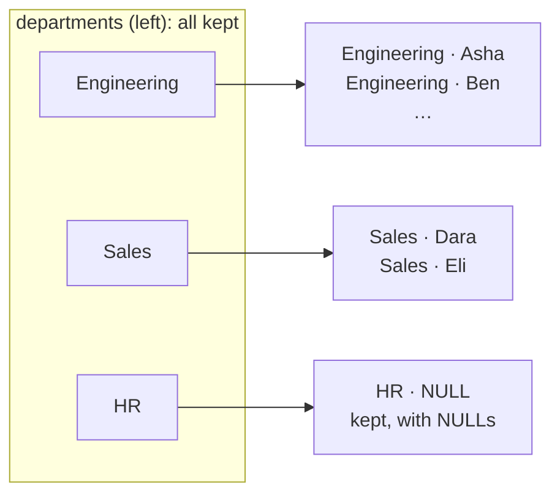

<!-- Written by `npm run lessons` from the lesson data in src/data. Edit the lesson there, not this page. -->

# LEFT JOIN: keep every row from one side

**SQL · Unit 3: Joins: combining tables · Lesson 2 of 7 · Must know**

> **In one line.** A LEFT JOIN keeps every row from the left (first) table, joins matching rows from the right table, and fills the right-hand columns with NULL where there is no match.

[Open this lesson on the site](https://learn.hamropedia.com/sql/left-join-keep-every-row-from-one-side/) for its animation, the practice game and tap-to-explain words.

## The problem it solves

"Show every department with its headcount" must include HR with 0. "Every customer and what they spent" must include Omar, who spent nothing. An INNER JOIN silently drops them. LEFT JOIN keeps them.

## The idea

In `departments d LEFT JOIN employees e`, departments is the left table and every department is kept. Where employees match, you get one row per match, as with INNER JOIN. Where none match — HR — you still get one row, with NULL in every employees column.

Count with `COUNT(e.emp_id)`, not `COUNT(*)`, so HR's NULL row counts as 0.

RIGHT JOIN is the mirror image (keep every row of the right table); people almost always swap the tables and write a LEFT JOIN instead.

## Analogy

A class register. Every pupil's name is on it (the left table). Next to each name you write the homework they handed in (the right table). A pupil who handed nothing in stays on the register with a blank next to their name.

**Where the analogy breaks.** A blank on a register is just empty. In SQL the blank is NULL, and NULL behaves strangely: `COUNT(*)` still counts that row as 1, and a WHERE on a right-hand column can throw the row away again.

## Syntax

```sql
SELECT a.column, b.column
FROM table_a AS a
LEFT JOIN table_b AS b ON b.key = a.key;
```

## How it works, step by step

1. Start with every row of the left table, departments: Engineering, Sales, Marketing, HR.
2. For each, find matching employees. Engineering has 4, so it appears 4 times.
3. HR has no matching employees, so it appears once, with NULL for the employee columns.
4. `COUNT(e.emp_id)` counts only non-NULL ids: 4, 2, 1 and 0 for HR.
5. `COUNT(*)` would wrongly give HR 1, because there is one (NULL-filled) row.

## Picture it



*Every row of the left table survives. Matches are filled in as usual; a row with no match (HR) is kept once, with NULL in all the right-hand columns.*

## Examples on the practice database

**Every department, with its people**

```sql
SELECT d.dept_name, e.name
FROM departments d
LEFT JOIN employees e ON e.dept_id = d.dept_id
ORDER BY d.dept_id, e.name;
```

| dept_name | name |
| --- | --- |
| Engineering | Asha |
| Engineering | Ben |
| Engineering | Chen |
| Engineering | Hana |
| Sales | Dara |
| Sales | Eli |
| Marketing | Fatima |
| HR | NULL |

HR is kept with a NULL name. Gus still isn't here: departments is the side being kept, and he matches no department.

---

**Headcount, with zeros**

```sql
SELECT d.dept_name, COUNT(e.emp_id) AS headcount
FROM departments d
LEFT JOIN employees e ON e.dept_id = d.dept_id
GROUP BY d.dept_id, d.dept_name
ORDER BY d.dept_id;
```

| dept_name | headcount |
| --- | --- |
| Engineering | 4 |
| Sales | 2 |
| Marketing | 1 |
| HR | 0 |

`COUNT(e.emp_id)` skips the NULL, so HR shows 0. With `COUNT(*)`, HR would show 1.

---

**Every customer and what they spent**

```sql
SELECT c.customer_id, c.name,
       COUNT(o.order_id) AS orders,
       COALESCE(SUM(o.amount), 0) AS total_spent
FROM customers c
LEFT JOIN orders o ON o.customer_id = c.customer_id
GROUP BY c.customer_id, c.name
ORDER BY c.customer_id;
```

| customer_id | name | orders | total_spent |
| --- | --- | --- | --- |
| 1 | Priya | 5 | 425 |
| 2 | Tom | 2 | 275 |
| 3 | Lena | 2 | 60 |
| 4 | Omar | 0 | 0 |
| 5 | Zoe | 1 | 33 |
| 6 | Tom | 0 | 0 |

Omar and the second Tom are kept with 0 orders. SUM over their NULL row is NULL, so COALESCE turns it into 0.

## Must know

- LEFT JOIN keeps every row of the left table; unmatched rows get NULLs on the right.
- Put the table you want to keep in full first ("every customer" → customers first).
- Count the right side with `COUNT(right.column)`, not `COUNT(*)`, to get 0 for no matches.
- Wrap sums of the right side in `COALESCE(…, 0)`.
- RIGHT JOIN is LEFT JOIN with the tables swapped; prefer LEFT JOIN for readability.

## Common mistakes

- Using `COUNT(*)` after a LEFT JOIN and getting 1 instead of 0 for rows with no match.
- Adding `WHERE right_table.column = …`, which throws the NULL rows away and turns the LEFT JOIN back into an INNER JOIN (see Join traps).
- Putting the tables the wrong way round, so the side you wanted to keep is on the right.

> **Not true:** `LEFT JOIN … WHERE right.col = x` still keeps the left rows that had no match.  
> **In fact:** Those rows have NULL on the right, so the WHERE condition is not true for them and they are dropped. Put the condition in ON to keep them.

## Other databases

- LEFT JOIN and LEFT OUTER JOIN are the same thing everywhere. RIGHT JOIN only arrived in SQLite in version 3.39 (2022); it has always worked in the other databases.

## In the interview

A LEFT JOIN returns every row from the left table and the matching rows from the right; where there is no match, the right-hand columns are NULL. I use it whenever the question says "all" or "every" — every customer, including those with no orders. After a LEFT JOIN I count a right-hand column rather than COUNT star, so unmatched rows give zero, and I COALESCE sums to zero.

<details>
<summary>&lt;b>LEFT JOIN or INNER JOIN — how do you choose?&lt;/b></summary>

Ask whether rows without a match should appear. "Every customer" means LEFT JOIN; "customers who ordered" means INNER JOIN.

</details>

<details>
<summary>&lt;b>Can a LEFT JOIN return more rows than the left table has?&lt;/b></summary>

Yes. A left row that matches three right rows appears three times. It returns at least as many rows as the left table.

</details>

## Practise

Write each answer yourself first, then open the answer and compare.

### 1. Explain

Explain why HR appears in a LEFT JOIN from departments but not in an INNER JOIN.

<details>
<summary>Show one good answer</summary>

A LEFT JOIN promises to keep every row of the left table, here departments, whether or not it finds a match. HR has no employees, so it gets one row with NULL in every employee column.

An INNER JOIN keeps only pairs that match. HR has nobody to pair with, so it is dropped.

That is why "show every department, even empty ones" needs LEFT JOIN, with departments on the left.

</details>

### 2. Write

Write a query listing every product with the total quantity sold, showing 0 for products never sold.

<details>
<summary>Show one good answer</summary>

Products on the left, so every product stays. SUM of no rows is NULL, so wrap it in COALESCE to show 0 for the phone case.

```sql
SELECT p.product_name, COALESCE(SUM(oi.quantity), 0) AS total_sold
FROM products p
LEFT JOIN order_items oi ON oi.product_id = p.product_id
GROUP BY p.product_id, p.product_name
ORDER BY p.product_id;
```

| product_name | total_sold |
| --- | --- |
| Pen | 5 |
| Notebook | 5 |
| Mug | 6 |
| Desk lamp | 6 |
| Backpack | 4 |
| Headphones | 11 |
| Phone case | 0 |

</details>

### 3. Predict

How many rows does `SELECT * FROM customers c LEFT JOIN orders o ON o.customer_id = c.customer_id;` return?

<details>
<summary>Show one good answer</summary>

12 rows. Each customer appears once per order: Priya 5, Tom (id 2) 2, Lena 2, Zoe 1. That is 10. Customers with no orders still get one row each, with NULLs: Omar and the second Tom (id 6). 10 + 2 = 12.

The query below shows just three columns so it fits on screen.

```sql
SELECT c.customer_id, c.name, o.order_id
FROM customers c
LEFT JOIN orders o ON o.customer_id = c.customer_id
ORDER BY c.customer_id, o.order_id;
```

| customer_id | name | order_id |
| --- | --- | --- |
| 1 | Priya | 101 |
| 1 | Priya | 102 |
| 1 | Priya | 103 |
| 1 | Priya | 105 |
| 1 | Priya | 109 |
| 2 | Tom | 104 |
| 2 | Tom | 108 |
| 3 | Lena | 106 |
| 3 | Lena | 107 |
| 4 | Omar | NULL |
| 5 | Zoe | 110 |
| 6 | Tom | NULL |

</details>

### 4. Edge cases

In the headcount example, change `COUNT(e.emp_id)` to `COUNT(*)`. Which number changes, and why?

<details>
<summary>Show one good answer</summary>

HR changes from 0 to 1. The other departments stay the same.

The LEFT JOIN gives HR one row, with NULLs in the employee columns. `COUNT(*)` counts rows, so it counts that row: 1. `COUNT(e.emp_id)` counts only values that are not NULL, and HR's emp_id is NULL: 0.

After a LEFT JOIN, count a column from the right-hand table (ideally its key), not `*`.

```sql
SELECT d.dept_name, COUNT(e.emp_id) AS count_emp_id, COUNT(*) AS count_star
FROM departments d
LEFT JOIN employees e ON e.dept_id = d.dept_id
GROUP BY d.dept_id, d.dept_name
ORDER BY d.dept_id;
```

| dept_name | count_emp_id | count_star |
| --- | --- | --- |
| Engineering | 4 | 4 |
| Sales | 2 | 2 |
| Marketing | 1 | 1 |
| HR | 0 | 1 |

</details>

## Go further (optional)

- PRACTICE · [SQLBolt — Lesson 7: OUTER JOINs](https://sqlbolt.com/) · interactive exercises in the browser, free
- READ · [W3Schools — SQL LEFT JOIN](https://www.w3schools.com/sql/sql_join_left.asp) · short page with a try-it editor, free
- READ · [Mode SQL Tutorial — SQL LEFT JOIN](https://mode.com/sql-tutorial/) · Mode, free

---

[← Joins, and INNER JOIN](joins-and-inner-join.md) · [All lessons](../../README.md) · [Finding what is missing: anti-joins →](finding-what-is-missing-anti-joins.md)
