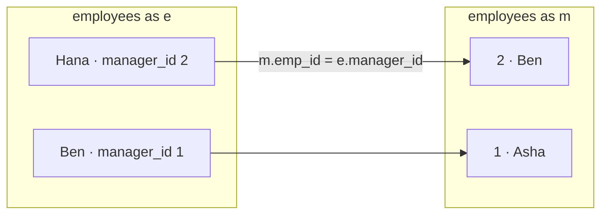

<!-- Written by `npm run lessons` from the lesson data in src/data. Edit the lesson there, not this page. -->

# Self joins: a table joined to itself

**SQL · Unit 3: Joins: combining tables · Lesson 4 of 7 · Must know**

> **In one line.** A self join joins a table to itself, under two different aliases. That lets a row be compared with another row of the same table, such as an employee with their manager.

[Open this lesson on the site](https://learn.hamropedia.com/sql/self-joins-a-table-joined-to-itself/) for its animation, the practice game and tap-to-explain words.

## The problem it solves

manager_id points into the same employees table. To show "Hana reports to Ben", you need Hana's row and Ben's row side by side. There is only one table, so you use it twice.

## The idea

Give the table two aliases and treat them as two copies: e for the employee, m for the manager. Join on `m.emp_id = e.manager_id`, meaning "the manager copy's id equals the employee copy's manager_id". Now each result row has the employee's columns and their manager's columns.

Use a LEFT JOIN if you want to keep Asha, who has no manager. Self joins also compare rows with each other — pairs in the same department, or rows on consecutive days.

## Analogy

Two photocopies of the staff list on your desk. On the left copy you find Hana and read "manager: 2". On the right copy you find person 2 — Ben — and write his name next to hers.

**Where the analogy breaks.** The photocopies are real copies. SQL doesn't copy anything: the aliases are just two names for the same table, which is why you must prefix every column (e.name, m.name) — otherwise "name" is ambiguous.

## Syntax

```sql
SELECT e.name AS employee, m.name AS manager
FROM employees e
LEFT JOIN employees m ON m.emp_id = e.manager_id;
```

## How it works, step by step

1. e and m are both the employees table.
2. For Hana (manager_id 2), find the m row with emp_id 2: Ben.
3. The result row holds e.name = Hana and m.name = Ben.
4. Asha's manager_id is NULL, so she has no match; LEFT JOIN keeps her with a NULL manager.
5. To compare rows, add a condition: `a.emp_id < b.emp_id` makes each pair appear once and stops a row pairing with itself.

## Picture it



*The same table plays two parts. Each employee row (e) is matched with the row of its manager (m) by comparing m.emp_id with e.manager_id.*

## Examples on the practice database

**Each employee and their manager**

```sql
SELECT e.name AS employee, m.name AS manager
FROM employees e
LEFT JOIN employees m ON m.emp_id = e.manager_id
ORDER BY e.emp_id;
```

| employee | manager |
| --- | --- |
| Asha | NULL |
| Ben | Asha |
| Chen | Asha |
| Dara | Asha |
| Eli | Dara |
| Fatima | Asha |
| Gus | Dara |
| Hana | Ben |

---

**Pairs of colleagues in the same department**

```sql
SELECT a.name AS first, b.name AS second, a.dept_id
FROM employees a
JOIN employees b ON b.dept_id = a.dept_id AND a.emp_id < b.emp_id
ORDER BY a.dept_id, a.name, b.name;
```

| first | second | dept_id |
| --- | --- | --- |
| Asha | Ben | 1 |
| Asha | Chen | 1 |
| Asha | Hana | 1 |
| Ben | Chen | 1 |
| Ben | Hana | 1 |
| Chen | Hana | 1 |
| Dara | Eli | 2 |

`a.emp_id < b.emp_id` keeps each pair once (Asha–Ben, never also Ben–Asha) and never pairs someone with themselves.

---

**How many people report to each manager**

```sql
SELECT m.name AS manager, COUNT(*) AS direct_reports
FROM employees e
JOIN employees m ON m.emp_id = e.manager_id
GROUP BY m.emp_id, m.name
ORDER BY direct_reports DESC, manager;
```

| manager | direct_reports |
| --- | --- |
| Asha | 4 |
| Dara | 2 |
| Ben | 1 |

## Must know

- A self join uses the same table twice with two aliases.
- Read the ON condition carefully: `m.emp_id = e.manager_id` means "m is e's manager".
- Use LEFT JOIN to keep rows whose pointer is NULL (the top of the tree).
- `a.id < b.id` gives each pair once; `a.id <> b.id` gives each pair twice.
- A self join reaches one level. For a whole chain of managers, use a recursive CTE (Unit 4).

## Common mistakes

- Swapping the condition (`e.emp_id = m.manager_id`), which lists each person's reports instead of their manager.
- Forgetting the table prefixes in a self join, so the database can't tell which copy's `name` you mean.
- Using INNER JOIN and losing the CEO.

> **Not true:** An INNER self join from employees to their managers also returns the person at the top.  
> **In fact:** The person at the top has no manager, so an INNER JOIN drops them. Use LEFT JOIN to keep every employee.

## In the interview

A self join joins a table to itself with two aliases so I can compare rows within it — the classic case is employees and managers through a self-referencing manager_id. I join the manager alias's primary key to the employee alias's manager_id, and use a LEFT JOIN if the top of the hierarchy must appear. For pair comparisons I add id less-than id, to avoid self-pairs and mirrored duplicates.

<details>
<summary>&lt;b>How would you find employees who earn more than their manager?&lt;/b></summary>

Self join e to m on `m.emp_id = e.manager_id`, then `WHERE e.salary > m.salary`. Here it returns Hana.

</details>

<details>
<summary>&lt;b>How do you get the whole chain of managers, not just one level?&lt;/b></summary>

A recursive CTE that starts from the employee and repeatedly joins to the manager until manager_id is NULL.

</details>

## Practise

Write each answer yourself first, then open the answer and compare.

### 1. Explain

Explain what `m.emp_id = e.manager_id` means in plain words.

<details>
<summary>Show one good answer</summary>

Read the employees table twice, as two copies: e for the employee, m for the manager. `m.emp_id = e.manager_id` says: "for this employee e, find the row in m whose id is the number written in e's manager_id".

For Hana, manager_id is 2, so the match is the row with emp_id 2: Ben. So m.name is her manager's name.

</details>

### 2. Write

Write a query showing each employee, their manager, and their manager's manager (two self joins).

<details>
<summary>Show one good answer</summary>

Join once to get the manager (m), then join again from the manager to their manager (mm). Use LEFT JOINs so people at the top still show, with NULLs: Asha has no manager, and the people under Asha have no manager's manager.

```sql
SELECT e.name AS employee, m.name AS manager, mm.name AS managers_manager
FROM employees e
LEFT JOIN employees m  ON m.emp_id = e.manager_id
LEFT JOIN employees mm ON mm.emp_id = m.manager_id
ORDER BY e.emp_id;
```

| employee | manager | managers_manager |
| --- | --- | --- |
| Asha | NULL | NULL |
| Ben | Asha | NULL |
| Chen | Asha | NULL |
| Dara | Asha | NULL |
| Eli | Dara | Asha |
| Fatima | Asha | NULL |
| Gus | Dara | Asha |
| Hana | Ben | Asha |

</details>

### 3. Predict

How many rows does the first example return if LEFT JOIN becomes JOIN? Who is missing?

<details>
<summary>Show one good answer</summary>

7 rows instead of 8. Asha is missing: her manager_id is NULL, so she has no matching manager row, and an INNER JOIN drops her.

```sql
SELECT e.name AS employee, m.name AS manager
FROM employees e
JOIN employees m ON m.emp_id = e.manager_id
ORDER BY e.emp_id;
```

| employee | manager |
| --- | --- |
| Ben | Asha |
| Chen | Asha |
| Dara | Asha |
| Eli | Dara |
| Fatima | Asha |
| Gus | Dara |
| Hana | Ben |

</details>

### 4. Edge cases

Find employees hired before their manager. Who has no manager, and what does your query do with them?

<details>
<summary>Show one good answer</summary>

Join each employee to their manager, then compare the two hire dates: `WHERE e.hire_date < m.hire_date`.

In this data the answer is nobody: no rows. Every manager joined before the people under them. (Asha joined in 2019, Dara and Ben in 2020, and everyone they manage later.) An empty result is a real answer; don't "fix" the query until it returns something.

Asha has no manager. The INNER JOIN drops her before the WHERE runs. With a LEFT JOIN she would reach the WHERE, but `e.hire_date < NULL` is unknown, so she would be dropped anyway. Either way, she is never counted as "hired before her manager", which is right.

```sql
SELECT e.name, e.hire_date, m.name AS manager, m.hire_date AS manager_hired
FROM employees e
JOIN employees m ON m.emp_id = e.manager_id
WHERE e.hire_date < m.hire_date
ORDER BY e.name;
```

| name | hire_date | manager | manager_hired |
| --- | --- | --- | --- |

*(no rows)*

</details>

## Go further (optional)

- READ · [W3Schools — SQL Self Join](https://www.w3schools.com/sql/sql_join_self.asp) · short page with a try-it editor, free
- PRACTICE · [SQLZoo — Self join](https://sqlzoo.net/) · free exercises
- PRACTICE · [PostgreSQL Exercises — Joins and Subqueries](https://pgexercises.com/) · pgexercises.com, free

---

[← Finding what is missing: anti-joins](finding-what-is-missing-anti-joins.md) · [All lessons](../../README.md) · [Joining three or more tables →](joining-three-or-more-tables.md)
