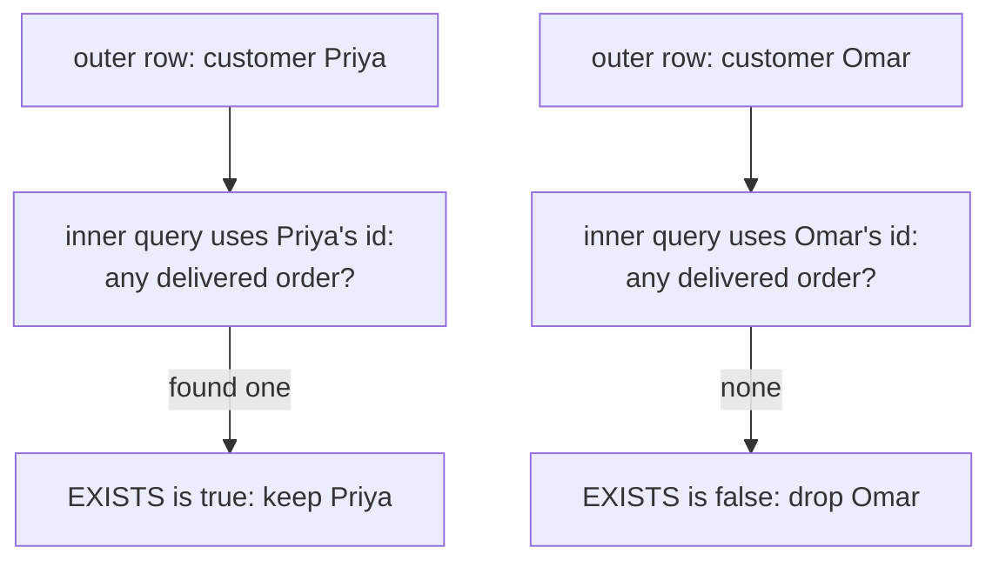

<!-- Written by `npm run lessons` from the lesson data in src/data. Edit the lesson there, not this page. -->

# Correlated subqueries, EXISTS, and the NOT IN trap

**SQL · Unit 4: Subqueries, CTEs and set operations · Lesson 2 of 5 · Must know**

> **In one line.** A correlated subquery refers to a column of the outer row, so it is worked out once for each outer row. EXISTS asks "does the subquery return any row at all?", which makes it the safe way to test for a match.

[Open this lesson on the site](https://learn.hamropedia.com/sql/correlated-subqueries-exists-and-the-not-in-trap/) for its animation, the practice game and tap-to-explain words.

## The problem it solves

"Each customer's latest order", "employees paid above their own department's average", "customers with at least one delivered order" — the comparison changes for every row. And the obvious way to find "no match", NOT IN, has a trap that returns nothing at all when NULLs are around.

## The idea

In `WHERE o.order_date = (SELECT MAX(o2.order_date) FROM orders o2 WHERE o2.customer_id = o.customer_id)`, the inner query uses o.customer_id from the outer row, so it is re-run (in effect) for each order.

EXISTS (subquery) is true if the subquery finds at least one row; what it selects doesn't matter, so people write `SELECT 1`. NOT EXISTS is true when it finds none.

The NOT IN trap: `x NOT IN (1, 2, NULL)` means `x <> 1 AND x <> 2 AND x <> NULL`, and the last part is always unknown — so the whole test is never true.

## Analogy

A correlated subquery is a teacher checking each pupil's mark against that pupil's own previous best, not one class-wide number. EXISTS is calling out "is anyone here from Leeds?" — one hand up is enough, and nobody has to say their name.

**Where the analogy breaks.** A teacher really does check each pupil one at a time. A database usually doesn't: the optimiser rewrites most correlated subqueries into a join that does all the rows at once. Think of it as row by row; don't assume it is slow.

## Syntax

```sql
WHERE EXISTS (
  SELECT 1 FROM other o
  WHERE o.key = outer_table.key
)
```

## How it works, step by step

1. Outer row: order 101 of customer 1. Inner query: the latest order_date for customer 1 is 2024-03-10. 101's date is 2024-01-06, so it fails.
2. Order 109 of customer 1 has date 2024-03-10, which equals the latest, so it is kept.
3. This repeats for every order, so each customer's latest order is kept.
4. EXISTS: for customer Omar, the inner query finds no delivered orders, so EXISTS is false and Omar is dropped.
5. NOT IN with a list containing NULL is never true, so `dept_id NOT IN (SELECT dept_id FROM employees)` returns no rows — because Gus's dept_id is NULL.

## Picture it



*A correlated subquery is asked again for each outer row, using that row's values. EXISTS only needs to know whether at least one row comes back.*

## Examples on the practice database

**Each customer's latest order (correlated)**

```sql
SELECT o.customer_id, o.order_id, o.order_date
FROM orders o
WHERE o.order_date = (
  SELECT MAX(o2.order_date)
  FROM orders o2
  WHERE o2.customer_id = o.customer_id
)
ORDER BY o.customer_id;
```

| customer_id | order_id | order_date |
| --- | --- | --- |
| 1 | 109 | 2024-03-10 |
| 2 | 108 | 2024-03-01 |
| 3 | 107 | 2024-02-20 |
| 5 | 110 | 2024-03-16 |

`o2.customer_id = o.customer_id` is the link to the outer row. If a customer had two orders on their latest day, both would appear.

---

**EXISTS: customers with a delivered order**

```sql
SELECT c.name
FROM customers c
WHERE EXISTS (
  SELECT 1
  FROM orders o
  WHERE o.customer_id = c.customer_id AND o.status = 'delivered'
)
ORDER BY c.customer_id;
```

| name |
| --- |
| Priya |
| Tom |
| Lena |

---

**The NOT IN trap**

```sql
SELECT dept_name
FROM departments
WHERE dept_id NOT IN (SELECT dept_id FROM employees);
```

| dept_name |
| --- |

*(no rows)*

HR has no employees, yet nothing comes back. The list contains Gus's NULL, so "not in the list" is never true.

---

**NOT EXISTS gets it right**

```sql
SELECT d.dept_name
FROM departments d
WHERE NOT EXISTS (
  SELECT 1
  FROM employees e
  WHERE e.dept_id = d.dept_id
);
```

| dept_name |
| --- |
| HR |

## Must know

- A correlated subquery uses outer-row columns; logically it runs once per outer row.
- EXISTS is true when the subquery returns at least one row; `SELECT 1` inside is a convention.
- NOT EXISTS is the NULL-safe "no match" test. Prefer it to NOT IN.
- `x NOT IN (… NULL …)` is never true. `x IN (… NULL …)` still works for the values that match.
- Correlated subqueries are clear for "compare with my own group"; window functions (Unit 5) often do the same faster.

## Common mistakes

- Using NOT IN against a column that can be NULL.
- Forgetting the correlation (`WHERE o2.customer_id = o.customer_id`), which compares every row with the overall maximum instead.
- Thinking EXISTS cares what the subquery selects. It only checks whether a row exists.

> **Not true:** EXISTS gives a different answer depending on which columns the subquery selects.  
> **In fact:** EXISTS only checks whether at least one row comes back. What the row contains makes no difference, which is why `SELECT 1` is the usual choice.

## Other databases

- All major databases support EXISTS, NOT EXISTS and correlated subqueries the same way. If you must use NOT IN, add `WHERE dept_id IS NOT NULL` inside the subquery.

## In the interview

A correlated subquery references the outer query's row, so logically it is evaluated per row — useful for comparisons against a row's own group, like each customer's latest order. EXISTS tests whether a subquery returns any row. NOT EXISTS is my default anti-join, because NOT IN returns nothing if the subquery yields a single NULL: x not in a list containing NULL can never be true.

<details>
<summary>&lt;b>Why is NOT IN dangerous?&lt;/b></summary>

`x NOT IN (a, NULL)` means `x <> a AND x <> NULL`. The second part is unknown, so the whole condition is never true and no rows return.

</details>

<details>
<summary>&lt;b>EXISTS or IN — which is better?&lt;/b></summary>

For "has a match" they are equivalent and usually optimised the same. For "has no match", use NOT EXISTS because of NULLs.

</details>

<details>
<summary>&lt;b>Are correlated subqueries slow?&lt;/b></summary>

Not necessarily: optimisers often turn them into joins. On big data, a window function or a pre-aggregated join is usually faster and clearer.

</details>

## Practise

Write each answer yourself first, then open the answer and compare.

### 1. Explain

Explain, with the HR example, why NOT IN returned nothing.

<details>
<summary>Show one good answer</summary>

The subquery returns every employee's dept_id, and Gus's is NULL. So for HR (dept 4) the test is `4 NOT IN (1, 1, 1, 2, 2, 3, NULL, 1)`.

NOT IN means "not equal to each one": 4 &lt;> 1 AND 4 &lt;> 2 AND … AND 4 &lt;> NULL. The last part is unknown, because nobody can say whether 4 equals an unknown value. TRUE AND unknown is unknown, and WHERE only keeps true. So HR is dropped, and so is every other department. One NULL in the list empties the whole result.

NOT EXISTS asks a different question: "is there any employee row with this dept_id?". For HR the answer is plainly no, so it works.

</details>

### 2. Write

Using EXISTS, write a query for products that appear in at least one order of Priya's.

<details>
<summary>Show one good answer</summary>

For each product, EXISTS asks: "is there at least one item line for this product, in an order placed by Priya?". It stops at the first one it finds. Only the phone case fails.

```sql
SELECT p.product_name
FROM products p
WHERE EXISTS (
  SELECT 1
  FROM order_items oi
  JOIN orders o    ON o.order_id = oi.order_id
  JOIN customers c ON c.customer_id = o.customer_id
  WHERE oi.product_id = p.product_id AND c.name = 'Priya'
)
ORDER BY p.product_name;
```

| product_name |
| --- |
| Backpack |
| Desk lamp |
| Headphones |
| Mug |
| Notebook |
| Pen |

</details>

### 3. Predict

What does `SELECT name FROM employees e WHERE NOT EXISTS (SELECT 1 FROM employees r WHERE r.manager_id = e.emp_id) ORDER BY name;` return?

<details>
<summary>Show one good answer</summary>

Chen, Eli, Fatima, Gus and Hana: everyone who manages nobody.

For each employee e, the subquery looks for anyone whose manager_id is e. Asha (1), Ben (2) and Dara (4) appear as someone's manager, so for them a row exists and they are dropped. Nobody reports to the other five.

```sql
SELECT name
FROM employees e
WHERE NOT EXISTS (
  SELECT 1 FROM employees r WHERE r.manager_id = e.emp_id
)
ORDER BY name;
```

| name |
| --- |
| Chen |
| Eli |
| Fatima |
| Gus |
| Hana |

</details>

### 4. Edge cases

Make the NOT IN version of the HR query return HR, by changing only the subquery.

<details>
<summary>Show one good answer</summary>

Take the NULL out of the list. With Gus's NULL gone, the list is just 1, 2 and 3, and `4 NOT IN (1, 2, 3)` is true.

Use this whenever the column in a NOT IN subquery can be NULL. Or just use NOT EXISTS.

```sql
SELECT dept_name
FROM departments
WHERE dept_id NOT IN (
  SELECT dept_id FROM employees WHERE dept_id IS NOT NULL
);
```

| dept_name |
| --- |
| HR |

</details>

## Go further (optional)

- READ · [PostgreSQL docs — Subquery Expressions (EXISTS, IN, NOT IN)](https://www.postgresql.org/docs/current/functions-subquery.html) · official documentation, free
- PRACTICE · [PostgreSQL Exercises — Joins and Subqueries](https://pgexercises.com/) · pgexercises.com, free
- READ · [W3Schools — SQL EXISTS Operator](https://www.w3schools.com/sql/sql_exists.asp) · short page with a try-it editor, free

---

[← Subqueries: a query inside a query](subqueries-a-query-inside-a-query.md) · [All lessons](../../README.md) · [CTEs: naming each step with WITH →](ctes-naming-each-step-with-with.md)
