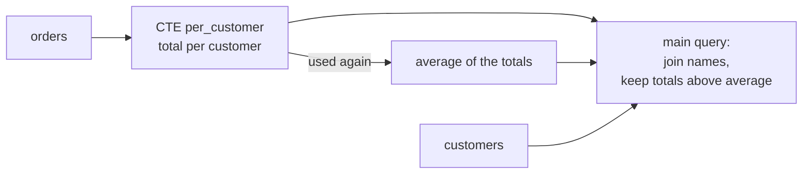

<!-- Written by `npm run lessons` from the lesson data in src/data. Edit the lesson there, not this page. -->

# CTEs: naming each step with WITH

**SQL · Unit 4: Subqueries, CTEs and set operations · Lesson 3 of 5 · Must know**

> **In one line.** A CTE (common table expression) is a named, temporary result, written at the top of a query with WITH name AS (…). Later parts of the query can use it like a table.

[Open this lesson on the site](https://learn.hamropedia.com/sql/ctes-naming-each-step-with-with/) for its animation, the practice game and tap-to-explain words.

## The problem it solves

Subqueries inside subqueries read inside-out and quickly become unreadable. In an interview, the person watching needs to follow your thinking. CTEs let you write a hard query as a list of small, named steps, in the order you would explain them.

## The idea

`WITH per_customer AS (SELECT …)` defines a step and gives it a name. The main query after it can use per_customer like a table — even more than once.

You can chain several CTEs, separated by commas, and each one can use the ones above it.

A CTE exists only for that one query. It is mostly about readability: the database runs it much like the equivalent subquery.

## Analogy

A recipe that says "first make the sauce; set it aside" before the main steps. Later steps just say "add the sauce". You name the sub-result once and refer to it by name.

**Where the analogy breaks.** Sauce made once is used everywhere it is needed. A database may compute a CTE once or re-run it each time it is used — that is up to the optimiser — so don't use CTEs as a speed trick.

## Syntax

```sql
WITH step_one AS (
  SELECT ...
),
step_two AS (
  SELECT ... FROM step_one ...
)
SELECT ...
FROM step_two;
```

## How it works, step by step

1. per_customer: one row per customer with their total spend (425, 275, 60, 33).
2. The main query joins per_customer to customers to get names.
3. The WHERE uses per_customer a second time to work out the average total (198.25).
4. Customers above that average are kept: Priya and Tom.
5. Each step can be tested alone: select from it while you build the query.

## Picture it



*Each CTE is a named step. The main query reads them like tables — and can use one step twice, here both for the rows and for their average.*

## Examples on the practice database

**Customers who spend more than the average customer**

```sql
WITH per_customer AS (
  SELECT customer_id, SUM(amount) AS total
  FROM orders
  GROUP BY customer_id
)
SELECT c.name, p.total
FROM per_customer p
JOIN customers c ON c.customer_id = p.customer_id
WHERE p.total > (SELECT AVG(total) FROM per_customer)
ORDER BY p.total DESC;
```

| name | total |
| --- | --- |
| Priya | 425 |
| Tom | 275 |

---

**Several steps, read top to bottom**

```sql
WITH delivered AS (
  SELECT customer_id, amount
  FROM orders
  WHERE status = 'delivered'
),
totals AS (
  SELECT customer_id, COUNT(*) AS delivered_orders, SUM(amount) AS delivered_total
  FROM delivered
  GROUP BY customer_id
)
SELECT c.name, t.delivered_orders, t.delivered_total,
       CASE WHEN t.delivered_total >= 200 THEN 'gold' ELSE 'standard' END AS tier
FROM totals t
JOIN customers c ON c.customer_id = t.customer_id
ORDER BY t.delivered_total DESC, c.name;
```

| name | delivered_orders | delivered_total | tier |
| --- | --- | --- | --- |
| Priya | 4 | 275 | gold |
| Tom | 2 | 275 | gold |
| Lena | 1 | 60 | standard |

Filter, then total, then label: three small steps instead of one tangle.

## Must know

- WITH name AS (query) defines a CTE; separate several with commas, and use WITH only once.
- A CTE can use the CTEs defined above it, and the main query can use any of them, more than once.
- A CTE lasts for one statement only.
- Use CTEs to make the steps of a hard query readable — interviewers love seeing this.
- Build and test one CTE at a time.

## Common mistakes

- Writing WITH before every CTE. It is `WITH a AS (…), b AS (…)`.
- A comma after the last CTE, before the main SELECT.
- Expecting a CTE to exist in the next query. It is gone after the statement ends.

> **Not true:** A comma is needed after the last CTE, before the main SELECT.  
> **In fact:** Commas go between CTEs only. After the last CTE comes the main SELECT, with no comma.

## Other databases

- PostgreSQL before version 12 always computed a CTE separately (an "optimisation fence"); since 12 it can fold it into the main query, and you can force either with MATERIALIZED / NOT MATERIALIZED.
- MySQL supports CTEs from version 8.0.

## In the interview

A CTE is a named subquery defined with WITH at the top of a statement, which the rest of the query can reference like a table, even multiple times. I use CTEs to break a hard problem into steps — filter, aggregate, rank, then select — which makes the query easy to read and to debug one step at a time. Performance is usually the same as the equivalent subquery.

<details>
<summary>&lt;b>CTE or subquery — what is the difference?&lt;/b></summary>

Mostly readability: a CTE is named, defined once, can be reused within the query, and reads top to bottom. CTEs can also be recursive.

</details>

<details>
<summary>&lt;b>CTE or temporary table?&lt;/b></summary>

A CTE lasts one statement and isn't stored. A temporary table lasts the session, can be indexed, and suits large intermediate results reused by several queries.

</details>

## Practise

Write each answer yourself first, then open the answer and compare.

### 1. Explain

Explain why a CTE makes a query easier to read than nested subqueries.

<details>
<summary>Show one good answer</summary>

Nested subqueries read inside out: you have to find the innermost bracket first and work outwards, and a step needed twice has to be written twice.

A CTE reads top to bottom, like a recipe. Each step gets a name that says what it is (per_customer, delivered, totals), and later steps use it like a table. In the first example, per_customer is used twice, once to join and once for the average, but written only once. Each step can also be run and checked on its own while you build the query.

(It is about readability. In most databases a CTE is not faster than the same subquery.)

</details>

### 2. Write

Using two CTEs, find the product category with the highest revenue.

<details>
<summary>Show one good answer</summary>

Step 1 (line_revenue): the revenue of each item line, with its category. Step 2 (category_revenue): add those up per category. Then keep the category whose revenue equals the maximum. Electronics wins with £440: 11 headphones at £40.

Using `= MAX(…)` instead of `ORDER BY … LIMIT 1` keeps both categories if two ever tie.

```sql
WITH line_revenue AS (
  SELECT p.category, oi.quantity * p.price AS revenue
  FROM order_items oi
  JOIN products p ON p.product_id = oi.product_id
),
category_revenue AS (
  SELECT category, SUM(revenue) AS revenue
  FROM line_revenue
  GROUP BY category
)
SELECT category, revenue
FROM category_revenue
WHERE revenue = (SELECT MAX(revenue) FROM category_revenue);
```

| category | revenue |
| --- | --- |
| Electronics | 440 |

</details>

### 3. Predict

In the first example, what changes if `>` becomes `<`?

<details>
<summary>Show one good answer</summary>

You get the customers who spend less than average, instead of more: Lena (£60) and Zoe (£33), instead of Priya (£425) and Tom (£275).

The per-customer totals are 425, 275, 60 and 33, and their average is 793 ÷ 4 = 198.25. Omar and the second Tom are not in per_customer at all (they have no orders), so they are not below the average either.

```sql
WITH per_customer AS (
  SELECT customer_id, SUM(amount) AS total
  FROM orders
  GROUP BY customer_id
)
SELECT c.name, p.total
FROM per_customer p
JOIN customers c ON c.customer_id = p.customer_id
WHERE p.total < (SELECT AVG(total) FROM per_customer)
ORDER BY p.total DESC;
```

| name | total |
| --- | --- |
| Lena | 60 |
| Zoe | 33 |

</details>

### 4. Edge cases

Customer 3 has an order with a NULL amount. Does it affect per_customer's total for Lena, or the average? Explain.

<details>
<summary>Show one good answer</summary>

Not here.

SUM skips NULLs, so Lena's total is just her £60 order. The NULL is ignored: her total is not NULL and not lower. The average is then taken over the 4 totals (425, 275, 60, 33), so it is 198.25 either way.

It would matter if all of a customer's amounts were NULL. Their total would be NULL, and AVG would skip that customer entirely: the average would be over 3 customers, not 4. If that customer should count as £0, use `COALESCE(SUM(amount), 0)`.

```sql
WITH per_customer AS (
  SELECT customer_id, SUM(amount) AS total,
         COUNT(*) AS orders, COUNT(amount) AS with_amount
  FROM orders
  GROUP BY customer_id
)
SELECT customer_id, total, orders, with_amount,
       (SELECT AVG(total) FROM per_customer) AS avg_total
FROM per_customer
ORDER BY customer_id;
```

| customer_id | total | orders | with_amount | avg_total |
| --- | --- | --- | --- | --- |
| 1 | 425 | 5 | 5 | 198.25 |
| 2 | 275 | 2 | 2 | 198.25 |
| 3 | 60 | 2 | 1 | 198.25 |
| 5 | 33 | 1 | 1 | 198.25 |

</details>

## Go further (optional)

- READ · [PostgreSQL docs — WITH Queries (Common Table Expressions)](https://www.postgresql.org/docs/current/queries-with.html) · official documentation, free
- WATCH · [CS50's Introduction to Databases with SQL — Lecture 3: Writing](https://cs50.harvard.edu/sql/) · Harvard, free
- READ · [Mode SQL Tutorial — Writing Subqueries in SQL](https://mode.com/sql-tutorial/) · Mode, free

---

[← Correlated subqueries, EXISTS, and the NOT IN trap](correlated-subqueries-exists-and-the-not-in-trap.md) · [All lessons](../../README.md) · [Recursive CTEs: walking trees and filling in dates →](recursive-ctes-walking-trees-and-filling-in-dates.md)
