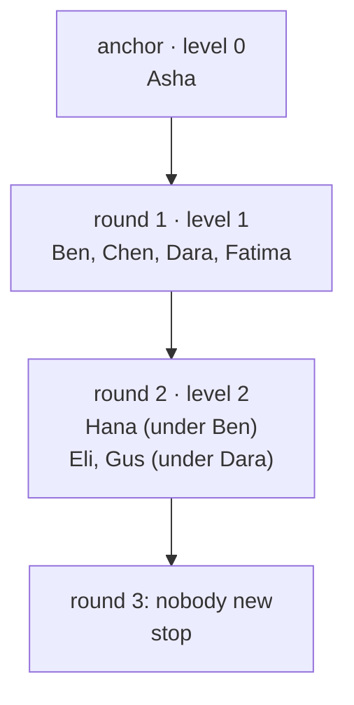

<!-- Written by `npm run lessons` from the lesson data in src/data. Edit the lesson there, not this page. -->

# Recursive CTEs: walking trees and filling in dates

**SQL · Unit 4: Subqueries, CTEs and set operations · Lesson 4 of 5 · Should know**

> **In one line.** A recursive CTE refers to itself. An anchor query gives the starting rows. Then a recursive part, joined with UNION ALL, keeps adding rows from the previous round until no new rows appear.

[Open this lesson on the site](https://learn.hamropedia.com/sql/recursive-ctes-walking-trees-and-filling-in-dates/) for its animation, the practice game and tap-to-explain words.

## The problem it solves

An org chart can be any number of levels deep, so a fixed number of self joins can't walk it. The same goes for folder trees, category trees and "every day in this range, including days with no orders". Recursion handles any depth.

## The idea

The anchor runs once: for the org chart, "the person with no manager" (Asha, level 0). Then the recursive part runs on the rows found in the previous round: "employees whose manager is in the previous round". That finds Ben, Chen, Dara and Fatima (level 1), then their reports Eli, Gus and Hana (level 2), and so on.

When a round finds nothing, it stops. Always give it a way to stop — a WHERE that eventually fails — or it runs forever.

## Analogy

Passing a message down a phone tree. The boss calls her direct reports, each of them calls theirs, and the calling stops when someone has nobody left to call.

**Where the analogy breaks.** A phone tree stops on its own. Data can loop — if A manages B and B manages A — and a recursive CTE would go round forever. Put a limit on the depth when the data might not be a clean tree.

## Syntax

```sql
WITH RECURSIVE tree AS (
  SELECT ... FROM t WHERE <start>            -- anchor
  UNION ALL
  SELECT ... FROM t JOIN tree ON <next step>  -- recursive part
)
SELECT * FROM tree;
```

## How it works, step by step

1. Anchor: `WHERE manager_id IS NULL` finds Asha, level 0.
2. Round 1: employees whose manager_id is Asha's id get level 0 + 1 = 1.
3. Round 2: employees managed by anyone found in round 1 get level 2: Eli and Gus (Dara), Hana (Ben).
4. Round 3 finds nobody managed by Eli, Gus or Hana, so the recursion stops.
5. For a date range, the anchor is the first day and each round adds one day until the last day.

## Picture it



*Each round finds the people who report to someone found in the round before. When a round finds nobody new, the recursion stops.*

## Examples on the practice database

**The simplest: count to 5**

```sql
WITH RECURSIVE numbers(n) AS (
  SELECT 1
  UNION ALL
  SELECT n + 1 FROM numbers WHERE n < 5
)
SELECT n
FROM numbers
ORDER BY n;
```

| n |
| --- |
| 1 |
| 2 |
| 3 |
| 4 |
| 5 |

Start at 1; each round adds 1; `WHERE n < 5` is the stop rule.

---

**The whole org chart, with levels**

```sql
WITH RECURSIVE chart AS (
  SELECT emp_id, name, 0 AS level
  FROM employees
  WHERE manager_id IS NULL
  UNION ALL
  SELECT e.emp_id, e.name, chart.level + 1
  FROM employees e
  JOIN chart ON e.manager_id = chart.emp_id
)
SELECT name, level
FROM chart
ORDER BY level, name;
```

| name | level |
| --- | --- |
| Asha | 0 |
| Ben | 1 |
| Chen | 1 |
| Dara | 1 |
| Fatima | 1 |
| Eli | 2 |
| Gus | 2 |
| Hana | 2 |

---

**Every day in a range, even days with no orders**

```sql
WITH RECURSIVE days(day) AS (
  SELECT '2024-01-05'
  UNION ALL
  SELECT date(day, '+1 day') FROM days WHERE day < '2024-01-09'
)
SELECT d.day, COUNT(o.order_id) AS orders
FROM days d
LEFT JOIN orders o ON o.order_date = d.day
GROUP BY d.day
ORDER BY d.day;
```

| day | orders |
| --- | --- |
| 2024-01-05 | 0 |
| 2024-01-06 | 1 |
| 2024-01-07 | 1 |
| 2024-01-08 | 1 |
| 2024-01-09 | 0 |

The CTE makes the calendar; the LEFT JOIN brings in orders, so the empty days show 0.

## Must know

- Shape: WITH RECURSIVE name AS (anchor UNION ALL recursive part).
- The recursive part joins the table to the CTE itself, using only the rows found in the previous round.
- There must be a stop rule — a WHERE that eventually returns no new rows.
- Carry extra columns (level, a path string) to know how deep each row is.
- Common uses: org charts, category or folder trees, bill of materials, and generating number or date series.

## Common mistakes

- No stop rule, so it runs until the database gives up.
- Using UNION instead of UNION ALL by habit. UNION ALL is the normal choice; UNION removes duplicates and can stop cycles, but costs more.
- Joining the wrong way round (`chart.manager_id = e.emp_id`), which walks up the tree instead of down.

> **Not true:** The anchor part of a recursive CTE runs again in every round.  
> **In fact:** The anchor runs once, to give the starting rows. Only the recursive part repeats, each time using the rows found in the round before.

## Other databases

- PostgreSQL, MySQL 8+ and SQLite need the word RECURSIVE. SQL Server and Oracle use plain WITH.
- PostgreSQL makes date series easier with `generate_series`. SQL Server limits recursion to 100 rounds unless you add `OPTION (MAXRECURSION n)`.

## In the interview

A recursive CTE has two parts, joined with UNION ALL. The anchor member produces the starting rows. The recursive member joins back to the CTE to produce the next level, and repeats until no new rows appear. I use it for hierarchies of unknown depth, like an org chart with a level column, and for generating date series to fill gaps. I always give it a clear termination condition, and a depth limit if the data might contain cycles.

<details>
<summary>&lt;b>How does a recursive CTE know when to stop?&lt;/b></summary>

When the recursive part returns no new rows. A WHERE condition (like n &lt; 5, or reaching people with no reports) makes that happen.

</details>

<details>
<summary>&lt;b>How do you protect against cycles in the data?&lt;/b></summary>

Carry a level or a path column and stop at a maximum depth, or stop when the next id is already in the path.

</details>

## Practise

Write each answer yourself first, then open the answer and compare.

### 1. Explain

Explain what the anchor and the recursive part each do, using the org chart.

<details>
<summary>Show one good answer</summary>

The anchor runs once and gives the starting rows. In the org chart that is the person with no manager: Asha, at level 0.

The recursive part runs again and again. Each time, it takes only the rows found in the round before and finds the people who report to them, adding 1 to the level:  
• round 1: from Asha, it finds Ben, Chen, Dara and Fatima (level 1);  
• round 2: from those four, it finds Hana (under Ben), and Eli and Gus (under Dara) (level 2);  
• round 3: nobody reports to Hana, Eli or Gus. No new rows, so it stops.

UNION ALL stacks all the rounds into one result.

</details>

### 2. Write

Write a recursive CTE that shows Hana's chain of managers as one string: 'Hana → Ben → Asha'.

<details>
<summary>Show one good answer</summary>

Walk up instead of down. The anchor is Hana's row; each round joins to the row of the current person's manager and adds " → name" to the path. The top of the chain is the row whose manager_id is NULL, so keep only that one.

```sql
WITH RECURSIVE chain(emp_id, manager_id, path) AS (
  SELECT emp_id, manager_id, name
  FROM employees
  WHERE name = 'Hana'
  UNION ALL
  SELECT m.emp_id, m.manager_id, chain.path || ' → ' || m.name
  FROM chain
  JOIN employees m ON m.emp_id = chain.manager_id
)
SELECT path
FROM chain
WHERE manager_id IS NULL;
```

| path |
| --- |
| Hana → Ben → Asha |

</details>

### 3. Predict

In the org-chart example, what level does each person get if the anchor is `WHERE name = 'Dara'`?

<details>
<summary>Show one good answer</summary>

Dara is level 0, and Eli and Gus are level 1. That is all: nobody reports to Eli or Gus.

The anchor decides where the walk starts. Starting from Dara, you only see Dara's part of the tree; Asha, Ben and the rest are never reached.

```sql
WITH RECURSIVE chart AS (
  SELECT emp_id, name, 0 AS level
  FROM employees
  WHERE name = 'Dara'
  UNION ALL
  SELECT e.emp_id, e.name, chart.level + 1
  FROM employees e
  JOIN chart ON e.manager_id = chart.emp_id
)
SELECT name, level FROM chart ORDER BY level, name;
```

| name | level |
| --- | --- |
| Dara | 0 |
| Eli | 1 |
| Gus | 1 |

</details>

### 4. Edge cases

What would happen if Asha's manager_id were set to 8 (Hana), making a loop? How would you stop the query running forever?

<details>
<summary>Show one good answer</summary>

Two things go wrong.

The org-chart query as written starts from `manager_id IS NULL`. With the loop nobody has a NULL manager, so the anchor finds nothing, and the result is empty.

Start from Asha by name instead, and it never ends: Asha → Ben → Hana → Asha → … Each round finds "new" rows (the same people, one level deeper), so the recursion never runs out. SQLite runs until it is stopped; SQL Server stops after 100 rounds with an error.

Ways to stop it:  
• a depth limit: `WHERE chart.level < 10` in the recursive part;  
• a visited list: carry the ids seen so far and refuse to visit one again (below);  
• PostgreSQL 14+ has a CYCLE clause that does this for you.

Below, the UPDATE makes the loop, and the visited list stops the walk when it gets back to Asha.

```sql
UPDATE employees SET manager_id = 8 WHERE name = 'Asha';

WITH RECURSIVE chart AS (
  SELECT emp_id, name, 0 AS level, ',' || emp_id || ',' AS visited
  FROM employees
  WHERE name = 'Asha'
  UNION ALL
  SELECT e.emp_id, e.name, chart.level + 1, chart.visited || e.emp_id || ','
  FROM employees e
  JOIN chart ON e.manager_id = chart.emp_id
  WHERE chart.visited NOT LIKE '%,' || e.emp_id || ',%'
)
SELECT name, level FROM chart ORDER BY level, name;
```

| name | level |
| --- | --- |
| Asha | 0 |
| Ben | 1 |
| Chen | 1 |
| Dara | 1 |
| Fatima | 1 |
| Eli | 2 |
| Gus | 2 |
| Hana | 2 |

</details>

## Go further (optional)

- READ · [PostgreSQL docs — Recursive Queries](https://www.postgresql.org/docs/current/queries-with.html#QUERIES-WITH-RECURSIVE) · official documentation, free
- READ · [SQLite docs — The WITH Clause](https://www.sqlite.org/lang_with.html) · official documentation, free
- PRACTICE · [PostgreSQL Exercises — Recursive Queries](https://pgexercises.com/) · pgexercises.com, free

---

[← CTEs: naming each step with WITH](ctes-naming-each-step-with-with.md) · [All lessons](../../README.md) · [UNION, UNION ALL, INTERSECT and EXCEPT →](union-union-all-intersect-and-except.md)
