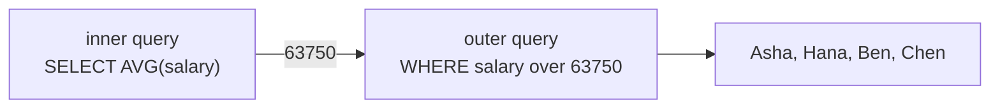

<!-- Written by `npm run lessons` from the lesson data in src/data. Edit the lesson there, not this page. -->

# Subqueries: a query inside a query

**SQL · Unit 4: Subqueries, CTEs and set operations · Lesson 1 of 5 · Must know**

> **In one line.** A subquery is a SELECT inside another query, in brackets: it can return one value (to compare with), a list (for IN), or a whole table (to select FROM).

[Open this lesson on the site](https://learn.hamropedia.com/sql/subqueries-a-query-inside-a-query/) for its animation, the practice game and tap-to-explain words.

## The problem it solves

"Who earns more than the average?" needs the average first, then a comparison. "What is the average customer's total spend?" needs a total per customer first, then an average of those. Each needs two steps, and a subquery puts both steps into one query.

## The idea

The database runs the inner query and uses its result in the outer one. There are three shapes.  
A scalar subquery returns one value — `(SELECT AVG(salary) FROM employees)` — and goes anywhere a single value can.  
A list subquery returns one column of many rows and goes after IN.  
A table subquery (a derived table) goes in FROM, needs an alias, and is used like any other table — which is how you aggregate an aggregate.

## Analogy

Asking a friend to look something up while you wait. "What is the average salary?" — they come back with 63750 — "OK, then show me everyone above that." The inner question is answered first and its answer is slotted into the outer one.

**Where the analogy breaks.** Your friend answers once. A correlated subquery (next lesson) is different: it is asked again for every outer row, with that row's values plugged in.

## Syntax

```sql
WHERE column > (SELECT one_value FROM ...)
WHERE column IN (SELECT one_column FROM ...)
FROM (SELECT ... ) AS alias
```

## How it works, step by step

1. The inner query `SELECT AVG(salary) FROM employees` runs first and returns 63750.
2. The outer query becomes, in effect, `WHERE salary > 63750`.
3. Asha, Hana, Ben and Chen pass; the rest don't.
4. For IN, the inner query returns a list of customer ids (2, 1, 5), and the outer query keeps customers whose id is in the list.
5. For a derived table, the inner query makes a small table (one total per customer) that the outer query averages.

## Picture it



*The inner query runs first and hands its answer to the outer one. Here it hands over a single number; it can also hand over a list (for IN) or a whole table (for FROM).*

## Examples on the practice database

**One value: above the average salary**

```sql
SELECT name, salary
FROM employees
WHERE salary > (SELECT AVG(salary) FROM employees)
ORDER BY salary DESC, name;
```

| name | salary |
| --- | --- |
| Asha | 95000 |
| Hana | 80000 |
| Ben | 70000 |
| Chen | 70000 |

---

**A list: customers who ordered in March**

```sql
SELECT name
FROM customers
WHERE customer_id IN (
  SELECT customer_id
  FROM orders
  WHERE order_date >= '2024-03-01'
)
ORDER BY name;
```

| name |
| --- |
| Priya |
| Tom |
| Zoe |

Only the first Tom (customer 2) ordered in March. Each customer appears once, even with several March orders.

---

**A table: the average of totals**

```sql
SELECT ROUND(AVG(total), 2) AS avg_customer_spend
FROM (
  SELECT customer_id, SUM(amount) AS total
  FROM orders
  GROUP BY customer_id
) AS per_customer;
```

| avg_customer_spend |
| --- |
| 198.25 |

You can't write `AVG(SUM(amount))`. Make the totals first (425, 275, 60, 33), then average them.

## Must know

- A subquery is a query in brackets, run to feed the outer query.
- Scalar subquery: exactly one value. If it returns more than one row, the query fails.
- IN subquery: one column, any number of rows.
- Derived table in FROM: give it an alias. Use it to aggregate an aggregate or to filter on a calculated column.
- Most subqueries can also be written as a join or a CTE; pick whichever reads most clearly.

## Common mistakes

- A scalar subquery that returns several rows ("more than one row returned by a subquery").
- Forgetting the alias on a derived table (required in PostgreSQL before version 16, MySQL and SQL Server).
- Nesting subqueries three deep. Rewrite it with CTEs so it reads top to bottom.

> **Not true:** Subquery in FROM: an alias is optional in PostgreSQL 15, MySQL and SQL Server.  
> **In fact:** PostgreSQL before version 16, MySQL and SQL Server all require an alias for a subquery in FROM. Give it one every time.

## In the interview

A subquery is a nested SELECT whose result the outer query uses: as a single value for comparison, as a list for IN, or as a derived table in FROM. I use derived tables when I need to aggregate in two stages, like averaging per-customer totals. Once nesting gets deeper than one level, I switch to CTEs, so the logic reads top to bottom.

<details>
<summary>&lt;b>Subquery or join — which is faster?&lt;/b></summary>

Usually the same: modern optimisers rewrite IN and EXISTS subqueries as joins. Choose for clarity, then check the plan if it is slow.

</details>

<details>
<summary>&lt;b>What happens if a scalar subquery returns no rows?&lt;/b></summary>

It returns NULL, so a comparison with it is unknown and filters everything out.

</details>

## Practise

Write each answer yourself first, then open the answer and compare.

### 1. Explain

Explain the three shapes of subquery and where each one can go.

<details>
<summary>Show one good answer</summary>

1. One value (a scalar subquery): one row, one column, such as `(SELECT AVG(salary) FROM employees)`. It goes anywhere a single value can: in a WHERE comparison (`salary > (…)`), or as a column in SELECT.  
2. A list: one column, many rows, such as `(SELECT customer_id FROM orders)`. It goes after IN or NOT IN in a WHERE (or inside EXISTS).  
3. A table: many rows and columns. It goes in FROM (or a JOIN), like a table, and needs a name: `FROM (…) AS per_customer`.

The question to ask: how many rows and columns does my subquery return? That decides where it can go.

</details>

### 2. Write

Write a query for products that cost more than the average product price.

<details>
<summary>Show one good answer</summary>

A scalar subquery works out the average (125 ÷ 7 = 17.86), and the outer query compares every price with it.

```sql
SELECT product_name, price
FROM products
WHERE price > (SELECT AVG(price) FROM products)
ORDER BY price DESC;
```

| product_name | price |
| --- | --- |
| Headphones | 40 |
| Backpack | 30 |
| Desk lamp | 25 |

</details>

### 3. Predict

What does the March example return if the date becomes '2024-03-05'?

<details>
<summary>Show one good answer</summary>

Priya and Zoe. Tom drops out.

The March orders are 108 (Tom, 1 March), 109 (Priya, 10 March) and 110 (Zoe, 16 March). From 5 March only 109 and 110 are left, so the list becomes customers 1 and 5.

```sql
SELECT name
FROM customers
WHERE customer_id IN (
  SELECT customer_id
  FROM orders
  WHERE order_date >= '2024-03-05'
)
ORDER BY name;
```

| name |
| --- |
| Priya |
| Zoe |

</details>

### 4. Edge cases

Write a scalar subquery that would fail because it returns more than one row. Then fix it two different ways.

<details>
<summary>Show one good answer</summary>

This uses `=`, which expects one value, but the subquery returns a customer_id for every delivered order (7 of them):

`SELECT name FROM customers WHERE customer_id = (SELECT customer_id FROM orders WHERE status = 'delivered');`

PostgreSQL and SQL Server stop with an error ("more than one row returned by a subquery"). SQLite doesn't: it quietly uses the first row and ignores the rest, which is worse, because the result looks fine.

Fix 1: you meant "any of them", so use IN. That gives Priya, Tom and Lena (below).  
Fix 2: you meant one particular value, so make the subquery return exactly one row: aggregate it, or sort and take one. `WHERE customer_id = (SELECT customer_id FROM orders WHERE status = 'delivered' ORDER BY amount DESC LIMIT 1)` gives Tom, who placed the biggest delivered order (£200).

```sql
SELECT name
FROM customers
WHERE customer_id IN (
  SELECT customer_id FROM orders WHERE status = 'delivered'
)
ORDER BY customer_id;
```

| name |
| --- |
| Priya |
| Tom |
| Lena |

</details>

## Go further (optional)

- READ · [Mode SQL Tutorial — Writing Subqueries in SQL](https://mode.com/sql-tutorial/) · Mode, free
- PRACTICE · [SQLZoo — Nested SELECT](https://sqlzoo.net/) · free exercises
- READ · [W3Schools — SQL ANY and ALL Operators](https://www.w3schools.com/sql/sql_any_all.asp) · short page with a try-it editor, free

---

[← Join traps: double counting, and ON versus WHERE](../unit-3-joins/join-traps-double-counting-and-on-versus-where.md) · [All lessons](../../README.md) · [Correlated subqueries, EXISTS, and the NOT IN trap →](correlated-subqueries-exists-and-the-not-in-trap.md)
