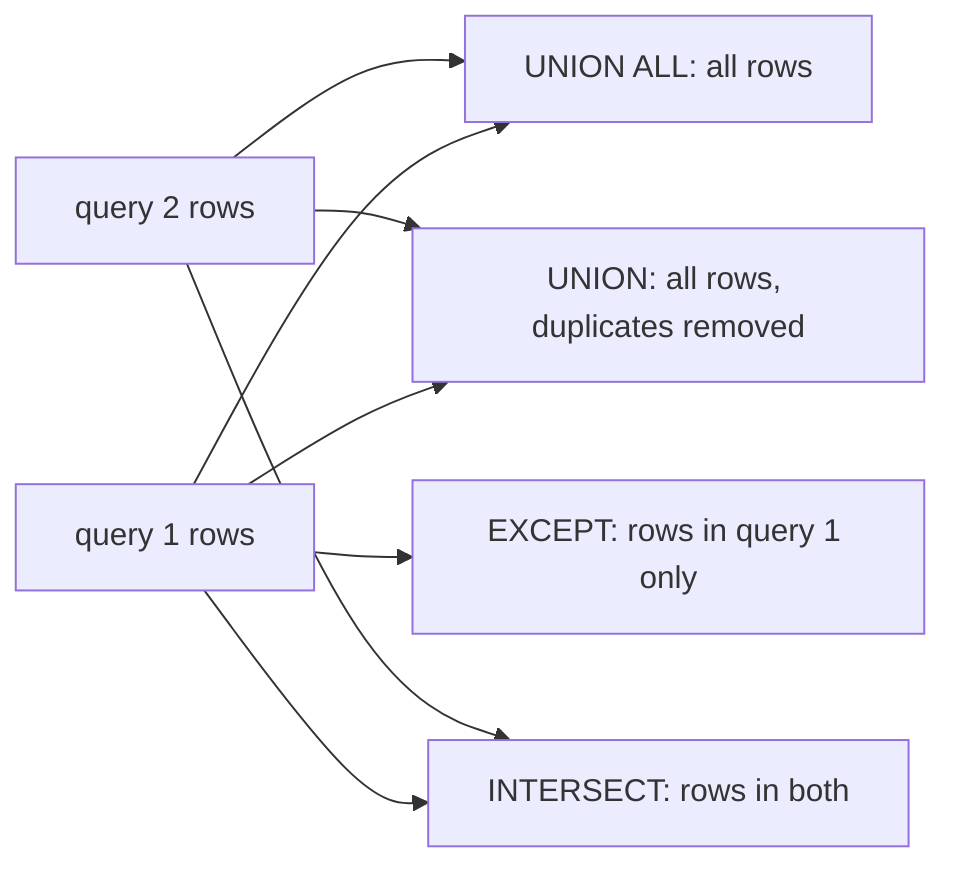

<!-- Written by `npm run lessons` from the lesson data in src/data. Edit the lesson there, not this page. -->

# UNION, UNION ALL, INTERSECT and EXCEPT

**SQL · Unit 4: Subqueries, CTEs and set operations · Lesson 5 of 5 · Should know**

> **In one line.** Set operators stack the results of two queries. UNION ALL keeps every row, and UNION removes duplicates. INTERSECT keeps rows found in both, and EXCEPT keeps rows in the first but not the second.

[Open this lesson on the site](https://learn.hamropedia.com/sql/union-union-all-intersect-and-except/) for its animation, the practice game and tap-to-explain words.

## The problem it solves

Sometimes the rows you need come from two places: every city mentioned by departments or customers; cities that have both a department and a customer. Joins put tables side by side; set operators put results on top of each other.

## The idea

Write two SELECTs with the same number of columns, of matching types, and put a set operator between them. The column names come from the first SELECT.

UNION ALL simply stacks the rows — fast, and keeps duplicates. UNION stacks them and removes duplicate rows — which costs a sort or hash. INTERSECT keeps rows in both results; EXCEPT keeps rows of the first that are not in the second.

A single ORDER BY at the very end sorts the combined result.

## Analogy

Two class lists. UNION ALL staples them together. UNION staples them and crosses out anyone listed twice. INTERSECT is pupils on both lists. EXCEPT is pupils on the first list but not on the second.

**Where the analogy breaks.** Pupils are matched by name. Set operators match whole rows, column by column — so adding a column that differs (like a source label) stops rows from counting as duplicates.

## Syntax

```sql
SELECT col_a, col_b FROM table_one
UNION ALL
SELECT col_x, col_y FROM table_two
ORDER BY col_a;
```

## How it works, step by step

1. Both SELECTs return one column: department locations and customer cities.
2. UNION stacks them (10 rows) and removes duplicate rows, leaving 5 different cities, including NULL.
3. UNION ALL keeps all of them; a source column shows where each row came from.
4. INTERSECT keeps only cities in both lists: Leeds and London.
5. EXCEPT keeps department cities with no customer: Manchester.

## Picture it



*Set operators combine two results vertically. Both queries must return the same number of columns, with matching types; the names come from the first query.*

## Examples on the practice database

**UNION: every city, once**

```sql
SELECT location AS city FROM departments
UNION
SELECT city FROM customers
ORDER BY city;
```

| city |
| --- |
| NULL |
| Bristol |
| Leeds |
| London |
| Manchester |

Duplicates are removed, and the NULLs collapse into one row too.

---

**UNION ALL: keep everything, with a label**

```sql
SELECT 'department' AS source, location AS city FROM departments
UNION ALL
SELECT 'customer', city FROM customers WHERE city IS NOT NULL
ORDER BY city, source;
```

| source | city |
| --- | --- |
| customer | Bristol |
| customer | Leeds |
| customer | Leeds |
| department | Leeds |
| customer | London |
| customer | London |
| department | London |
| department | London |
| department | Manchester |

---

**INTERSECT: in both**

```sql
SELECT city FROM customers
INTERSECT
SELECT location FROM departments
ORDER BY city;
```

| city |
| --- |
| Leeds |
| London |

---

**EXCEPT: in the first, not the second**

```sql
SELECT location FROM departments
EXCEPT
SELECT city FROM customers
ORDER BY location;
```

| location |
| --- |
| Manchester |

## Must know

- Both queries need the same number of columns, in the same order, with compatible types.
- UNION ALL keeps duplicates and is faster; UNION removes them.
- Use UNION ALL unless you really need duplicates removed.
- INTERSECT and EXCEPT also remove duplicates from their result.
- One ORDER BY, at the end, sorts the combined result; column names come from the first query.

## Common mistakes

- Using UNION when the two sets can't overlap — paying for duplicate removal you don't need.
- Putting ORDER BY on the first query instead of at the end.
- Lining columns up in a different order in the second query: they are matched by position, not by name.

> **Not true:** UNION matches the columns of its two queries by name.  
> **In fact:** Columns are matched by position, not by name. If the second query lists them in another order, the values land in the wrong columns.

## Other databases

- Oracle calls EXCEPT `MINUS`. MySQL only added INTERSECT and EXCEPT in version 8.0.31.

## In the interview

Set operators combine two result sets vertically, matching columns by position. UNION ALL appends everything; UNION also removes duplicate rows, which costs a sort or hash, so I default to UNION ALL unless duplicates must go. INTERSECT returns rows present in both results and EXCEPT returns rows in the first but not the second — a neat alternative to an anti-join when comparing id lists.

<details>
<summary>&lt;b>UNION vs UNION ALL?&lt;/b></summary>

UNION removes duplicate rows; UNION ALL keeps them all and is faster because it skips that step.

</details>

<details>
<summary>&lt;b>JOIN vs UNION?&lt;/b></summary>

A join adds columns by matching rows side by side; a union adds rows by stacking results on top of each other.

</details>

## Practise

Write each answer yourself first, then open the answer and compare.

### 1. Explain

Explain the difference between UNION and UNION ALL, and when each is right.

<details>
<summary>Show one good answer</summary>

Both stack two results on top of each other. UNION then removes duplicate rows; UNION ALL keeps every row.

Use UNION when you want a list of different values, such as "every city we have a customer or an office in, once each".

Use UNION ALL when every row counts, such as stacking January's and February's orders before adding them up, or when duplicates can't happen anyway (each half has a different label). It is also faster: UNION has to sort or hash everything to find duplicates.

A useful habit: write UNION ALL by default, and use UNION only when you really mean "remove duplicates".

</details>

### 2. Write

Write one query that lists every person's name from both employees and customers, with a column saying which table they came from.

<details>
<summary>Show one good answer</summary>

Both halves need the same number of columns, in the same order. The label column is a fixed text value in each half. Column names come from the first half, so the second can skip AS.

Tom appears twice because he signed up twice. UNION would merge those two identical rows; whether you want that depends on whether you are listing people or sign-ups.

```sql
SELECT name, 'employee' AS source FROM employees
UNION ALL
SELECT name, 'customer' FROM customers
ORDER BY source, name;
```

| name | source |
| --- | --- |
| Lena | customer |
| Omar | customer |
| Priya | customer |
| Tom | customer |
| Tom | customer |
| Zoe | customer |
| Asha | employee |
| Ben | employee |
| Chen | employee |
| Dara | employee |
| Eli | employee |
| Fatima | employee |
| Gus | employee |
| Hana | employee |

</details>

### 3. Predict

How many rows does `SELECT city FROM customers UNION ALL SELECT location FROM departments;` return?

<details>
<summary>Show one good answer</summary>

10 rows: 6 customer cities plus 4 department locations. UNION ALL removes nothing, so the duplicate Londons and Leeds, and Zoe's NULL, all stay.

```sql
SELECT COUNT(*) AS rows_returned
FROM (
  SELECT city FROM customers
  UNION ALL
  SELECT location FROM departments
);
```

| rows_returned |
| --- |
| 10 |

</details>

### 4. Edge cases

Does UNION treat two NULL cities as duplicates? Check with the first example, and explain how that differs from `=`.

<details>
<summary>Show one good answer</summary>

Yes. UNION (like DISTINCT and GROUP BY) treats two NULLs as duplicates and keeps one. In the first example only Zoe's city is NULL, so add a second NULL to check: below, two NULLs go in and one comes out.

That differs from `=`, where `NULL = NULL` is unknown, not true. The rule: for comparisons, NULL equals nothing; for removing duplicates and grouping, all NULLs count as the same.

```sql
SELECT city FROM customers
UNION
SELECT NULL
ORDER BY city;
```

| city |
| --- |
| NULL |
| Bristol |
| Leeds |
| London |

</details>

## Go further (optional)

- READ · [W3Schools — SQL UNION Operator](https://www.w3schools.com/sql/sql_union.asp) · short page with a try-it editor, free
- READ · [Mode SQL Tutorial — SQL UNION](https://mode.com/sql-tutorial/) · Mode, free
- PRACTICE · [SQLZoo — UNION and set operations](https://sqlzoo.net/) · free exercises

---

[← Recursive CTEs: walking trees and filling in dates](recursive-ctes-walking-trees-and-filling-in-dates.md) · [All lessons](../../README.md) · [What a window function is: OVER and PARTITION BY →](../unit-5-window-functions/what-a-window-function-is-over-and-partition-by.md)
