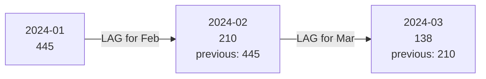

<!-- Written by `npm run lessons` from the lesson data in src/data. Edit the lesson there, not this page. -->

# LAG and LEAD: comparing with the previous or next row

**SQL · Unit 5: Window functions: ranking, running totals and comparing rows · Lesson 3 of 5 · Must know**

> **In one line.** `LAG(column)` returns the value from the previous row and `LEAD(column)` the value from the next row, in the order set by OVER (… ORDER BY …). That lets a row be compared with its neighbour.

[Open this lesson on the site](https://learn.hamropedia.com/sql/lag-and-lead-comparing-with-the-previous-or-next-row/) for its animation, the practice game and tap-to-explain words.

## The problem it solves

"How much did revenue change since last month?", "how many days between a customer's orders?", "did the price go up?" — each compares a row with the one before it. Without LAG, that means a tricky self join on "the previous date". With LAG it is one line.

## The idea

`LAG(revenue) OVER (ORDER BY month)` looks one row back in month order. The first row has no previous row, so it gets NULL (or a default you give as the third argument: `LAG(revenue, 1, 0)`). LEAD looks forward instead. The second argument says how far: `LAG(revenue, 12)` is the same month last year in monthly data.

Add PARTITION BY customer_id and the looking-back stops at each customer's boundary, so one customer's first order never looks back into another customer's orders.

## Analogy

Reading a bank statement line by line with your finger on the line above. LAG is that line above; the difference between them is the change.

**Where the analogy breaks.** On a statement the line above is always the day before. LAG gives the previous row, not the previous day: if a month has no orders, it has no row, and LAG silently compares March with January. Fill the gaps first when it matters.

## Syntax

```sql
LAG(column, offset, default)  OVER (PARTITION BY g ORDER BY d)
LEAD(column, offset, default) OVER (PARTITION BY g ORDER BY d)
```

## How it works, step by step

1. A CTE makes one row per month: January 445, February 210, March 138.
2. `LAG(revenue) OVER (ORDER BY month)`: January has no previous row, so NULL; February gets 445; March gets 210.
3. revenue − `LAG(revenue)` gives the change: NULL, −235, −72.
4. With PARTITION BY customer_id, each customer's first order gets NULL from LAG.
5. LEAD works the same way, looking forward: the last row gets NULL.

## Picture it



*In month order, LAG hands each row the value from the row before it. The first row has nothing before it, so it gets NULL.*

## Examples on the practice database

**Change from the previous month**

```sql
WITH monthly AS (
  SELECT strftime('%Y-%m', order_date) AS month, SUM(amount) AS revenue
  FROM orders
  GROUP BY strftime('%Y-%m', order_date)
)
SELECT month, revenue,
       LAG(revenue) OVER (ORDER BY month) AS prev_revenue,
       revenue - LAG(revenue) OVER (ORDER BY month) AS change
FROM monthly
ORDER BY month;
```

| month | revenue | prev_revenue | change |
| --- | --- | --- | --- |
| 2024-01 | 445 | NULL | NULL |
| 2024-02 | 210 | 445 | -235 |
| 2024-03 | 138 | 210 | -72 |

---

**Days between a customer's orders**

```sql
SELECT customer_id, order_id, order_date,
       LAG(order_date) OVER (PARTITION BY customer_id ORDER BY order_date) AS previous_order,
       julianday(order_date)
         - julianday(LAG(order_date) OVER (PARTITION BY customer_id ORDER BY order_date)) AS days_since
FROM orders
WHERE customer_id IN (1, 2)
ORDER BY customer_id, order_date;
```

| customer_id | order_id | order_date | previous_order | days_since |
| --- | --- | --- | --- | --- |
| 1 | 101 | 2024-01-06 | NULL | NULL |
| 1 | 102 | 2024-01-07 | 2024-01-06 | 1 |
| 1 | 103 | 2024-01-08 | 2024-01-07 | 1 |
| 1 | 105 | 2024-02-02 | 2024-01-08 | 25 |
| 1 | 109 | 2024-03-10 | 2024-02-02 | 37 |
| 2 | 104 | 2024-01-21 | NULL | NULL |
| 2 | 108 | 2024-03-01 | 2024-01-21 | 40 |

PARTITION BY customer_id stops Tom's first order looking back at Priya's last one.

---

**LEAD: who was hired next**

```sql
SELECT name, hire_date,
       LEAD(name) OVER (ORDER BY hire_date) AS next_hire
FROM employees
ORDER BY hire_date;
```

| name | hire_date | next_hire |
| --- | --- | --- |
| Asha | 2019-03-01 | Dara |
| Dara | 2020-02-20 | Ben |
| Ben | 2020-06-15 | Chen |
| Chen | 2021-01-10 | Fatima |
| Fatima | 2021-09-12 | Eli |
| Eli | 2022-07-01 | Hana |
| Hana | 2022-11-30 | Gus |
| Gus | 2023-04-03 | NULL |

## Must know

- LAG = previous row's value; LEAD = next row's value, in the window's ORDER BY.
- The first row (LAG) or last row (LEAD) of each partition gets NULL, or the default you pass.
- `LAG(x, n)` looks n rows back — 12 for "same month last year" in monthly data.
- PARTITION BY keeps each group's comparisons inside the group.
- LAG looks at the previous row, not the previous date: fill missing dates first if gaps matter.

## Common mistakes

- Forgetting PARTITION BY, so one customer's first order is compared with another customer's last.
- Assuming the previous row is the previous day or month when there are gaps.
- Dividing by LAG without guarding against NULL or zero.

> **Not true:** In daily data, the previous row in a window is the previous day, even when days are missing.  
> **In fact:** LAG looks one row back, not one day back. If a day has no row, the previous row is an older day, so check for gaps before calling a change day-on-day.

## Other databases

- Date differences: PostgreSQL `order_date - LAG(order_date) OVER (…)` gives days directly for DATE columns; MySQL uses DATEDIFF; SQL Server uses `DATEDIFF(day, …)`.

## In the interview

LAG and LEAD return a value from a preceding or following row within the window, in the order given by the OVER clause's ORDER BY. I use them for period-over-period changes — revenue minus LAG of revenue — and gaps between events per user with PARTITION BY user. I watch out for the first row returning NULL and for missing periods, since LAG goes to the previous row, which isn't necessarily the previous calendar month.

<details>
<summary>&lt;b>How would you compute month-over-month growth as a percentage?&lt;/b></summary>

`ROUND(100.0 * (revenue - LAG(revenue) OVER w) / LAG(revenue) OVER w, 1)`, guarding with NULLIF in case last month was 0.

</details>

<details>
<summary>&lt;b>How do you get a value from two rows back?&lt;/b></summary>

Pass an offset: `LAG(column, 2) OVER (…)`.

</details>

## Practise

Write each answer yourself first, then open the answer and compare.

### 1. Explain

Explain what LAG returns for the first row of each partition, and why.

<details>
<summary>Show one good answer</summary>

NULL. LAG looks one row back inside the same partition, in the order given by OVER (… ORDER BY …). The first row of a partition has no row before it, so there is nothing to return. LAG never reaches into another partition: the first order of customer 2 doesn't see customer 1's last order.

If you want something else there, give a default as the third argument: `LAG(amount, 1, 0)` returns 0 for the first row.

</details>

### 2. Write

For each of Priya's orders, show the amount and the difference from her previous order's amount.

<details>
<summary>Show one good answer</summary>

Keep Priya's orders, then take each amount minus LAG(amount) in date order. Her first order has nothing to compare with, so its change is NULL.

The WHERE runs before the window function, so LAG only ever sees Priya's orders. That is exactly what you want here.

```sql
SELECT order_id, order_date, amount,
       amount - LAG(amount) OVER (ORDER BY order_date) AS change_from_previous
FROM orders
WHERE customer_id = 1
ORDER BY order_date;
```

| order_id | order_date | amount | change_from_previous |
| --- | --- | --- | --- |
| 101 | 2024-01-06 | 120 | NULL |
| 102 | 2024-01-07 | 80 | -40 |
| 103 | 2024-01-08 | 45 | -35 |
| 105 | 2024-02-02 | 150 | 105 |
| 109 | 2024-03-10 | 30 | -120 |

</details>

### 3. Predict

In the first example, what would `LEAD(revenue) OVER (ORDER BY month)` give for each month?

<details>
<summary>Show one good answer</summary>

Each month gets the next month's revenue: January 210 (February's), February 138 (March's), and March NULL, because there is no month after it. LEAD is LAG looking forward.

```sql
WITH monthly AS (
  SELECT strftime('%Y-%m', order_date) AS month, SUM(amount) AS revenue
  FROM orders
  GROUP BY strftime('%Y-%m', order_date)
)
SELECT month, revenue,
       LEAD(revenue) OVER (ORDER BY month) AS next_revenue
FROM monthly
ORDER BY month;
```

| month | revenue | next_revenue |
| --- | --- | --- |
| 2024-01 | 445 | 210 |
| 2024-02 | 210 | 138 |
| 2024-03 | 138 | NULL |

</details>

### 4. Edge cases

If February had no orders at all, what would LAG return for March in the first example, and how would you fix it?

<details>
<summary>Show one good answer</summary>

January's revenue, 445. With no February orders, the monthly CTE has no February row at all. LAG just takes the row before, which is now January, so March is compared with January but labelled "previous month". No error, just a wrong comparison.

Fix it by making the list of months complete before using LAG. Generate every month (a recursive CTE, or a calendar table), LEFT JOIN the orders onto it, and COALESCE empty months to 0. Then February exists with 0, and March is compared with it.

Below, the two DELETEs remove February (its item lines first, because of the foreign key), and the fixed query still shows February.

```sql
DELETE FROM order_items WHERE order_id IN (105, 107);
DELETE FROM orders WHERE order_date LIKE '2024-02%';

WITH RECURSIVE months(month) AS (
  SELECT '2024-01'
  UNION ALL
  SELECT strftime('%Y-%m', date(month || '-01', '+1 month'))
  FROM months
  WHERE month < '2024-03'
),
monthly AS (
  SELECT m.month, COALESCE(SUM(o.amount), 0) AS revenue
  FROM months m
  LEFT JOIN orders o ON strftime('%Y-%m', o.order_date) = m.month
  GROUP BY m.month
)
SELECT month, revenue,
       LAG(revenue) OVER (ORDER BY month) AS prev_revenue
FROM monthly
ORDER BY month;
```

| month | revenue | prev_revenue |
| --- | --- | --- |
| 2024-01 | 445 | NULL |
| 2024-02 | 0 | 445 |
| 2024-03 | 138 | 0 |

</details>

## Go further (optional)

- READ · [PostgreSQL docs — Window Functions (LAG and LEAD)](https://www.postgresql.org/docs/current/functions-window.html) · official documentation, free
- READ · [Mode SQL Tutorial — SQL Window Functions: LAG and LEAD](https://mode.com/sql-tutorial/) · Mode, free
- PRACTICE · [DataLemur — LAG and LEAD questions](https://datalemur.com/questions) · real interview questions, many free

---

[← Ranking: ROW_NUMBER, RANK and DENSE_RANK](ranking-row-number-rank-and-dense-rank.md) · [All lessons](../../README.md) · [Running totals and moving averages: window frames →](running-totals-and-moving-averages-window-frames.md)
