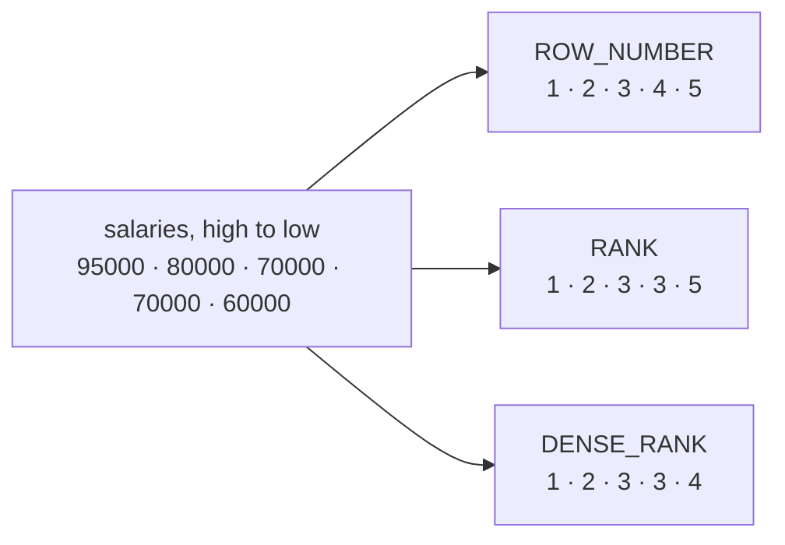

<!-- Written by `npm run lessons` from the lesson data in src/data. Edit the lesson there, not this page. -->

# Ranking: ROW_NUMBER, RANK and DENSE_RANK

**SQL · Unit 5: Window functions: ranking, running totals and comparing rows · Lesson 2 of 5 · Must know**

> **In one line.** ROW_NUMBER numbers the rows 1, 2, 3, 4 with no ties. RANK gives ties the same number and then skips (1, 2, 2, 4). DENSE_RANK gives ties the same number without skipping (1, 2, 2, 3).

[Open this lesson on the site](https://learn.hamropedia.com/sql/ranking-row-number-rank-and-dense-rank/) for its animation, the practice game and tap-to-explain words.

## The problem it solves

"Top 3 per department", "the second-highest salary", "each customer's first order" — ranking questions are the most common window-function questions in interviews. The only hard part is ties, and the three functions differ exactly there.

## The idea

All three need ORDER BY inside OVER, which decides who comes first.  
ROW_NUMBER always gives different numbers, so if two rows tie, which one gets 3 and which gets 4 is arbitrary unless you add a tiebreaker column.  
RANK is like a sports ranking: two people sharing 3rd place means nobody is 4th.  
DENSE_RANK doesn't leave gaps, so "the 2nd highest salary" is simply DENSE_RANK = 2.

Add PARTITION BY to restart the numbering in each group.

## Analogy

A race with two runners crossing the line together in third. ROW_NUMBER is the finish-line camera that must put one of them first. RANK is the medal table: both get third, and the next runner is fifth. DENSE_RANK is "positions": both third, the next runner fourth.

**Where the analogy breaks.** A photo finish has a real answer. ROW_NUMBER's choice between tied rows doesn't — it can differ between runs — so always add a tiebreaker (like name or id) when you use ROW_NUMBER.

## Syntax

```sql
ROW_NUMBER() OVER (PARTITION BY g ORDER BY x DESC, tiebreaker)
RANK()       OVER (PARTITION BY g ORDER BY x DESC)
DENSE_RANK() OVER (PARTITION BY g ORDER BY x DESC)
```

## How it works, step by step

1. Sort by salary, highest first: Asha 95000, Hana 80000, then Ben and Chen on 70000, then Dara 60000.
2. ROW_NUMBER: 1, 2, 3, 4, 5 — Ben and Chen get different numbers; the tiebreaker (name) puts Ben first.
3. RANK: 1, 2, 3, 3, 5 — they share 3, and 4 is skipped.
4. DENSE_RANK: 1, 2, 3, 3, 4 — they share 3, and Dara is 4.
5. To keep only the top rows, compute the rank in a CTE and filter with WHERE outside it.

## Picture it



*Same sorted rows, three ways to number them. The only difference is what happens at the tie on 70000: unique numbers, shared with a gap after, or shared with no gap.*

## Examples on the practice database

**The three side by side**

```sql
SELECT name, salary,
       ROW_NUMBER() OVER (ORDER BY salary DESC, name) AS row_num,
       RANK()       OVER (ORDER BY salary DESC) AS rank_num,
       DENSE_RANK() OVER (ORDER BY salary DESC) AS dense_num
FROM employees
ORDER BY salary DESC, name;
```

| name | salary | row_num | rank_num | dense_num |
| --- | --- | --- | --- | --- |
| Asha | 95000 | 1 | 1 | 1 |
| Hana | 80000 | 2 | 2 | 2 |
| Ben | 70000 | 3 | 3 | 3 |
| Chen | 70000 | 4 | 3 | 3 |
| Dara | 60000 | 5 | 5 | 4 |
| Fatima | 52000 | 6 | 6 | 5 |
| Eli | 45000 | 7 | 7 | 6 |
| Gus | 38000 | 8 | 8 | 7 |

Look at Ben and Chen, then at Dara: 5 by RANK, 4 by DENSE_RANK.

---

**Ranking within each department**

```sql
SELECT dept_id, name, salary,
       DENSE_RANK() OVER (PARTITION BY dept_id ORDER BY salary DESC) AS rank_in_dept
FROM employees
WHERE dept_id IS NOT NULL
ORDER BY dept_id, rank_in_dept, name;
```

| dept_id | name | salary | rank_in_dept |
| --- | --- | --- | --- |
| 1 | Asha | 95000 | 1 |
| 1 | Hana | 80000 | 2 |
| 1 | Ben | 70000 | 3 |
| 1 | Chen | 70000 | 3 |
| 2 | Dara | 60000 | 1 |
| 2 | Eli | 45000 | 2 |
| 3 | Fatima | 52000 | 1 |

PARTITION BY restarts the count at 1 for every department.

---

**Filter on a rank: each customer's second order**

```sql
WITH numbered AS (
  SELECT customer_id, order_id, order_date,
         ROW_NUMBER() OVER (PARTITION BY customer_id ORDER BY order_date) AS nth_order
  FROM orders
)
SELECT customer_id, order_id, order_date
FROM numbered
WHERE nth_order = 2
ORDER BY customer_id;
```

| customer_id | order_id | order_date |
| --- | --- | --- |
| 1 | 102 | 2024-01-07 |
| 2 | 108 | 2024-03-01 |
| 3 | 107 | 2024-02-20 |

The number is made in the CTE, then filtered outside. Zoe has only one order, so she has no second.

## Must know

- ROW_NUMBER: unique 1, 2, 3, 4. Add a tiebreaker so it is the same every run.
- RANK: ties share a number, then a gap (1, 2, 2, 4).
- DENSE_RANK: ties share a number, no gap (1, 2, 2, 3). Use it for "Nth highest value".
- PARTITION BY restarts the numbering per group.
- Pattern for top N per group: rank in a CTE, then `WHERE rank <= N` outside.

## Common mistakes

- Using ROW_NUMBER for "top 3 salaries" when ties should all be included — use RANK or DENSE_RANK.
- Using RANK for "the 2nd highest salary" — after a tie at 1st, there is no rank 2.
- Forgetting the tiebreaker in ROW_NUMBER, so results change from run to run.

> **Not true:** RANK is the function to use for finding the second highest salary.  
> **In fact:** After a tie for first place, RANK jumps from 1 to 3, so there is no rank 2. DENSE_RANK leaves no gaps: use it for "Nth highest".

## Other databases

- Naming a column `rank` fails in MySQL 8, where RANK is a reserved word. Use rank_num or rnk.

## In the interview

All three number rows in the order given by the OVER clause's ORDER BY, optionally restarting per PARTITION BY. ROW_NUMBER gives unique sequential numbers, so I add a deterministic tiebreaker; RANK gives tied rows the same rank and leaves gaps; DENSE_RANK gives the same rank without gaps. For "Nth highest distinct value" I use DENSE_RANK, and for "exactly one row per group" I use ROW_NUMBER — always filtering in an outer query.

<details>
<summary>&lt;b>Which would you use for "the second highest salary"?&lt;/b></summary>

DENSE_RANK = 2, so a tie for first doesn't leave you with no second.

</details>

<details>
<summary>&lt;b>How do you keep exactly one row per customer — their latest order?&lt;/b></summary>

`ROW_NUMBER() OVER (PARTITION BY customer_id ORDER BY order_date DESC, order_id DESC)`, then keep row number 1.

</details>

<details>
<summary>&lt;b>What happens to ROW_NUMBER with ties if there is no tiebreaker?&lt;/b></summary>

Tied rows get different numbers in an arbitrary order, which can change between runs.

</details>

## Practise

Write each answer yourself first, then open the answer and compare.

### 1. Explain

Explain the difference between RANK and DENSE_RANK using Ben, Chen and Dara.

<details>
<summary>Show one good answer</summary>

Sorted by salary, highest first: Asha 95,000 (1st), Hana 80,000 (2nd), then Ben and Chen tie on 70,000, then Dara on 60,000.

Both functions give Ben and Chen the same number, 3. The difference is what comes next:  
• RANK skips: two people took places 3 and 4, so Dara is 5. Like a race: two runners share third, and the next one finishes fifth.  
• DENSE_RANK doesn't skip: Dara is 4, the next different salary.

So "the third-highest salary" is DENSE_RANK = 3, while "the person in fourth place" may not exist with RANK.

</details>

### 2. Write

Write a query for the most expensive product in each category, using ROW_NUMBER.

<details>
<summary>Show one good answer</summary>

Number the products inside each category from most to least expensive, then keep number 1. The CTE is needed because WHERE runs before window functions, so you can't filter on rn in the same query.

ROW_NUMBER always picks exactly one product, even if two tie on price. product_name is added to the ORDER BY so that pick is fixed, not random. To keep every tied product, use RANK instead.

```sql
WITH ranked AS (
  SELECT category, product_name, price,
         ROW_NUMBER() OVER (PARTITION BY category ORDER BY price DESC, product_name) AS rn
  FROM products
)
SELECT category, product_name, price
FROM ranked
WHERE rn = 1
ORDER BY category;
```

| category | product_name | price |
| --- | --- | --- |
| Bags | Backpack | 30 |
| Electronics | Headphones | 40 |
| Home | Desk lamp | 25 |
| Kitchen | Mug | 8 |
| Stationery | Notebook | 5 |

</details>

### 3. Predict

With `RANK() OVER (ORDER BY salary DESC)`, which employees have rank 3? Who has rank 4?

<details>
<summary>Show one good answer</summary>

Rank 3: Ben and Chen, who tie on 70,000.

Rank 4: nobody. The tie used up places 3 and 4, so RANK jumps straight to 5 for Dara.

```sql
SELECT name, salary, RANK() OVER (ORDER BY salary DESC) AS rank_num
FROM employees
ORDER BY salary DESC, name;
```

| name | salary | rank_num |
| --- | --- | --- |
| Asha | 95000 | 1 |
| Hana | 80000 | 2 |
| Ben | 70000 | 3 |
| Chen | 70000 | 3 |
| Dara | 60000 | 5 |
| Fatima | 52000 | 6 |
| Eli | 45000 | 7 |
| Gus | 38000 | 8 |

</details>

### 4. Edge cases

Rewrite "each customer's latest order" so that, if two orders shared the latest date, only one comes back — and say which one.

<details>
<summary>Show one good answer</summary>

Use ROW_NUMBER, which never gives two rows the same number, and add a tie-breaker to its ORDER BY so you decide which one wins: `ORDER BY order_date DESC, order_id DESC`. Here, if two orders shared the latest date, the one with the higher order_id (the one created later) comes back.

Without the tie-breaker, ROW_NUMBER still returns one row, but which one could change from run to run. RANK or DENSE_RANK would return both.

(No customer here has two orders on the same day, so the tie-breaker changes nothing yet; it is there for when one does.)

```sql
WITH numbered AS (
  SELECT customer_id, order_id, order_date,
         ROW_NUMBER() OVER (
           PARTITION BY customer_id
           ORDER BY order_date DESC, order_id DESC
         ) AS rn
  FROM orders
)
SELECT customer_id, order_id, order_date
FROM numbered
WHERE rn = 1
ORDER BY customer_id;
```

| customer_id | order_id | order_date |
| --- | --- | --- |
| 1 | 109 | 2024-03-10 |
| 2 | 108 | 2024-03-01 |
| 3 | 107 | 2024-02-20 |
| 5 | 110 | 2024-03-16 |

</details>

## Go further (optional)

- READ · [PostgreSQL docs — Window Functions (reference)](https://www.postgresql.org/docs/current/functions-window.html) · official documentation, free
- READ · [Mode SQL Tutorial — SQL Window Functions: ROW_NUMBER, RANK and DENSE_RANK](https://mode.com/sql-tutorial/) · Mode, free
- PRACTICE · [DataLemur — ranking window function questions](https://datalemur.com/questions) · real interview questions, many free

---

[← What a window function is: OVER and PARTITION BY](what-a-window-function-is-over-and-partition-by.md) · [All lessons](../../README.md) · [LAG and LEAD: comparing with the previous or next row →](lag-and-lead-comparing-with-the-previous-or-next-row.md)
