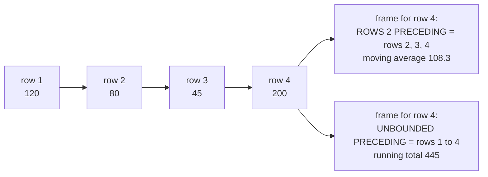

<!-- Written by `npm run lessons` from the lesson data in src/data. Edit the lesson there, not this page. -->

# Running totals and moving averages: window frames

**SQL · Unit 5: Window functions: ranking, running totals and comparing rows · Lesson 4 of 5 · Must know**

> **In one line.** With ORDER BY inside OVER, SUM and AVG become running totals; a frame such as `ROWS BETWEEN 2 PRECEDING AND CURRENT ROW` limits the window to nearby rows, giving a moving average.

[Open this lesson on the site](https://learn.hamropedia.com/sql/running-totals-and-moving-averages-window-frames/) for its animation, the practice game and tap-to-explain words.

## The problem it solves

"Cumulative revenue by day", "7-day moving average of sign-ups" — growth charts are built on these. They also hide a classic trap: the default frame treats tied rows as one, which surprises almost everyone.

## The idea

`SUM(amount) OVER (ORDER BY order_date)` adds up everything from the first row to the current row: a running total. The frame says which rows count: `ROWS BETWEEN 2 PRECEDING AND CURRENT ROW` means this row and the two before it — so AVG over it is a 3-row moving average.

The trap: when you write ORDER BY without a frame, the default is RANGE BETWEEN UNBOUNDED PRECEDING AND CURRENT ROW, and RANGE includes every row tied with the current one. So two orders on the same day both show the total after both. Write ROWS explicitly when you want one row at a time.

## Analogy

A running total is a savings jar you never empty: each week you add the new amount and read the total. A moving average is a "last three weeks" window you slide along: the oldest week drops out as a new one comes in.

**Where the analogy breaks.** Weeks never tie. Rows can: with the default RANGE frame, two rows with the same ORDER BY value are treated as arriving at the same moment, so both see the total including each other.

## Syntax

```sql
SUM(x) OVER (ORDER BY d)                                   -- running total
AVG(x) OVER (ORDER BY d ROWS BETWEEN 2 PRECEDING AND CURRENT ROW)
SUM(x) OVER (ORDER BY d ROWS UNBOUNDED PRECEDING)          -- running total, row by row
```

## How it works, step by step

1. Order the rows by date. For each row, the frame is "from the first row up to me".
2. SUM over that frame grows: 120, 200, 245, 445, 595…
3. Order 106's NULL amount adds nothing, so the total stays at 595 on that row.
4. With `ROWS BETWEEN 2 PRECEDING AND CURRENT ROW`, the frame is at most 3 rows, so AVG gives a 3-order moving average.
5. Ties: ordering salaries with the default frame, Ben and Chen (both 70000) both show 315000. With ROWS they show 245000 and 315000.

## Picture it



*The frame is the part of the window a row can see. "Unbounded preceding" sees everything so far (a running total); "2 preceding" sees only the last three rows (a moving average).*

## Examples on the practice database

**Running total of revenue**

```sql
SELECT order_date, amount,
       SUM(amount) OVER (ORDER BY order_date) AS running_total
FROM orders
ORDER BY order_date;
```

| order_date | amount | running_total |
| --- | --- | --- |
| 2024-01-06 | 120 | 120 |
| 2024-01-07 | 80 | 200 |
| 2024-01-08 | 45 | 245 |
| 2024-01-21 | 200 | 445 |
| 2024-02-02 | 150 | 595 |
| 2024-02-12 | NULL | 595 |
| 2024-02-20 | 60 | 655 |
| 2024-03-01 | 75 | 730 |
| 2024-03-10 | 30 | 760 |
| 2024-03-16 | 33 | 793 |

The last row is 793, the grand total. The NULL row adds nothing.

---

**A running total per customer**

```sql
SELECT customer_id, order_date, amount,
       SUM(amount) OVER (PARTITION BY customer_id ORDER BY order_date) AS customer_running_total
FROM orders
WHERE customer_id IN (1, 3)
ORDER BY customer_id, order_date;
```

| customer_id | order_date | amount | customer_running_total |
| --- | --- | --- | --- |
| 1 | 2024-01-06 | 120 | 120 |
| 1 | 2024-01-07 | 80 | 200 |
| 1 | 2024-01-08 | 45 | 245 |
| 1 | 2024-02-02 | 150 | 395 |
| 1 | 2024-03-10 | 30 | 425 |
| 3 | 2024-02-12 | NULL | NULL |
| 3 | 2024-02-20 | 60 | 60 |

Lena's running total starts as NULL: the SUM of nothing but a NULL is NULL. `COALESCE(…, 0)` would show 0.

---

**A 3-order moving average**

```sql
SELECT order_date, amount,
       ROUND(AVG(amount) OVER (ORDER BY order_date ROWS BETWEEN 2 PRECEDING AND CURRENT ROW), 1) AS moving_avg_3
FROM orders
ORDER BY order_date;
```

| order_date | amount | moving_avg_3 |
| --- | --- | --- |
| 2024-01-06 | 120 | 120 |
| 2024-01-07 | 80 | 100 |
| 2024-01-08 | 45 | 81.7 |
| 2024-01-21 | 200 | 108.3 |
| 2024-02-02 | 150 | 131.7 |
| 2024-02-12 | NULL | 175 |
| 2024-02-20 | 60 | 105 |
| 2024-03-01 | 75 | 67.5 |
| 2024-03-10 | 30 | 55 |
| 2024-03-16 | 33 | 46 |

The first two rows average fewer than 3 values. AVG skips the NULL, so 2024-02-12 is the average of 200 and 150.

---

**The trap: RANGE (the default) versus ROWS**

```sql
SELECT name, salary,
       SUM(salary) OVER (ORDER BY salary DESC) AS default_range,
       SUM(salary) OVER (ORDER BY salary DESC, name ROWS UNBOUNDED PRECEDING) AS rows_frame
FROM employees
ORDER BY salary DESC, name;
```

| name | salary | default_range | rows_frame |
| --- | --- | --- | --- |
| Asha | 95000 | 95000 | 95000 |
| Hana | 80000 | 175000 | 175000 |
| Ben | 70000 | 315000 | 245000 |
| Chen | 70000 | 315000 | 315000 |
| Dara | 60000 | 375000 | 375000 |
| Fatima | 52000 | 427000 | 427000 |
| Eli | 45000 | 472000 | 472000 |
| Gus | 38000 | 510000 | 510000 |

Ben and Chen tie on 70000. The default RANGE frame counts both of them on both rows (315000). ROWS goes one row at a time.

## Must know

- Aggregate + OVER (ORDER BY …) = a running total (or running count, max…).
- The default frame with ORDER BY is RANGE BETWEEN UNBOUNDED PRECEDING AND CURRENT ROW — tied rows are included together.
- Write ROWS explicitly for row-by-row running totals and for moving averages.
- `ROWS BETWEEN n PRECEDING AND CURRENT ROW` is a frame of the last n + 1 rows: the current row and the n before it.
- Without ORDER BY in OVER, the frame is the whole partition, so you get the total, not a running total.

## Common mistakes

- Getting the same running total on tied rows and not knowing why (the RANGE default).
- A "7-day" moving average with ROWS 6 PRECEDING when some days are missing — that is 7 rows, not 7 days.
- Forgetting PARTITION BY, so one customer's running total continues into the next customer's.

> **Not true:** `ROWS 6 PRECEDING` covers the last 7 days, even when some days have no row.  
> **In fact:** It covers the last 7 rows. If some days have no row, those 7 rows reach further back than 7 days, so check for missing days first.

## Other databases

- PostgreSQL, SQLite and Oracle also allow RANGE with an offset for real time windows: `RANGE BETWEEN INTERVAL '6 days' PRECEDING AND CURRENT ROW` (PostgreSQL).
- SQL Server supports ROWS and RANGE frames, but RANGE only with UNBOUNDED or CURRENT ROW.

## In the interview

Adding ORDER BY to an aggregate's OVER clause makes it cumulative, which gives running totals. A frame clause like ROWS BETWEEN 2 PRECEDING AND CURRENT ROW narrows it to a sliding window, for moving averages. The subtle point is the default frame, RANGE up to the current row, which lumps tied ORDER BY values together. So I specify ROWS explicitly, with a unique tiebreaker, whenever ties are possible.

<details>
<summary>&lt;b>What is the default window frame?&lt;/b></summary>

With ORDER BY: RANGE BETWEEN UNBOUNDED PRECEDING AND CURRENT ROW. Without ORDER BY: the whole partition.

</details>

<details>
<summary>&lt;b>ROWS or RANGE — what is the difference?&lt;/b></summary>

ROWS counts physical rows. RANGE works on values, so all rows with the same ORDER BY value are in or out together.

</details>

<details>
<summary>&lt;b>Why might a LAST_VALUE return the current row instead of the last one?&lt;/b></summary>

Because the default frame ends at the current row. Use ROWS BETWEEN UNBOUNDED PRECEDING AND UNBOUNDED FOLLOWING.

</details>

## Practise

Write each answer yourself first, then open the answer and compare.

### 1. Explain

Explain the RANGE default and why it gives Ben and Chen the same running total.

<details>
<summary>Show one good answer</summary>

When OVER has an ORDER BY but no frame, the default frame is RANGE BETWEEN UNBOUNDED PRECEDING AND CURRENT ROW. RANGE works on values, not rows: it means "every row whose ORDER BY value is up to and including mine", and that includes rows that tie with me (my peers).

Ben and Chen both earn 70,000, so they are peers. For Ben, the frame already contains Chen, and for Chen it contains Ben. Both get the same total, 315,000 (95 + 80 + 70 + 70 thousand), instead of 245,000 then 315,000.

To count strictly one row at a time, say ROWS (`ROWS UNBOUNDED PRECEDING`) and add a tie-breaker to the ORDER BY, so the order of the tied rows is fixed.

</details>

### 2. Write

Write a running count of employees by hire_date (1 for the first hire, 2 for the second…).

<details>
<summary>Show one good answer</summary>

`COUNT(*) OVER (ORDER BY hire_date)` counts the rows from the start up to this one. No two people were hired on the same day, so the RANGE default is fine here. If two could share a date, use ROW_NUMBER (or ROWS with a tie-breaker), or both would get the same count.

```sql
SELECT name, hire_date,
       COUNT(*) OVER (ORDER BY hire_date) AS hires_so_far
FROM employees
ORDER BY hire_date;
```

| name | hire_date | hires_so_far |
| --- | --- | --- |
| Asha | 2019-03-01 | 1 |
| Dara | 2020-02-20 | 2 |
| Ben | 2020-06-15 | 3 |
| Chen | 2021-01-10 | 4 |
| Fatima | 2021-09-12 | 5 |
| Eli | 2022-07-01 | 6 |
| Hana | 2022-11-30 | 7 |
| Gus | 2023-04-03 | 8 |

</details>

### 3. Predict

In the moving-average example, what would the frame `ROWS BETWEEN 1 PRECEDING AND 1 FOLLOWING` give for 2024-01-07?

<details>
<summary>Show one good answer</summary>

81.7. The frame is the row before, this row and the row after: 120 (6 Jan), 80 (7 Jan) and 45 (8 Jan). (120 + 80 + 45) ÷ 3 = 81.67, rounded to 81.7. This is a centred average rather than a trailing one.

Note 2024-02-12, order 106: its amount is NULL, and AVG skips it, so that row averages only its two neighbours: (150 + 60) ÷ 2 = 105.

```sql
SELECT order_date, amount,
       ROUND(AVG(amount) OVER (
         ORDER BY order_date ROWS BETWEEN 1 PRECEDING AND 1 FOLLOWING
       ), 1) AS centred_avg_3
FROM orders
ORDER BY order_date;
```

| order_date | amount | centred_avg_3 |
| --- | --- | --- |
| 2024-01-06 | 120 | 100 |
| 2024-01-07 | 80 | 81.7 |
| 2024-01-08 | 45 | 108.3 |
| 2024-01-21 | 200 | 131.7 |
| 2024-02-02 | 150 | 175 |
| 2024-02-12 | NULL | 105 |
| 2024-02-20 | 60 | 67.5 |
| 2024-03-01 | 75 | 55 |
| 2024-03-10 | 30 | 46 |
| 2024-03-16 | 33 | 31.5 |

</details>

### 4. Edge cases

Make Lena's running total show 0 instead of NULL on her first order, and explain where the COALESCE goes.

<details>
<summary>Show one good answer</summary>

Lena's first order (106) has a NULL amount, and a SUM over nothing but a NULL is NULL. The COALESCE goes around the whole window function, outside the OVER: `COALESCE(SUM(amount) OVER (…), 0)`. It only steps in when the running total itself is NULL.

`SUM(COALESCE(amount, 0)) OVER (…)` also works here. It turns each missing amount into 0 before adding. The difference shows only in meaning: the first says "no total yet, show 0"; the second says "a missing amount counts as £0".

Putting a COALESCE inside the OVER brackets wouldn't help: what is in there only decides which rows are in each window and in what order, not the values that are added up.

```sql
SELECT customer_id, order_date, amount,
       COALESCE(SUM(amount) OVER (PARTITION BY customer_id ORDER BY order_date), 0) AS customer_running_total
FROM orders
WHERE customer_id IN (1, 3)
ORDER BY customer_id, order_date;
```

| customer_id | order_date | amount | customer_running_total |
| --- | --- | --- | --- |
| 1 | 2024-01-06 | 120 | 120 |
| 1 | 2024-01-07 | 80 | 200 |
| 1 | 2024-01-08 | 45 | 245 |
| 1 | 2024-02-02 | 150 | 395 |
| 1 | 2024-03-10 | 30 | 425 |
| 3 | 2024-02-12 | NULL | 0 |
| 3 | 2024-02-20 | 60 | 60 |

</details>

## Go further (optional)

- READ · [SQLite docs — Window Functions (frames)](https://www.sqlite.org/windowfunctions.html) · official documentation, free
- READ · [PostgreSQL docs — Window Function Calls (frame clause)](https://www.postgresql.org/docs/current/sql-expressions.html#SYNTAX-WINDOW-FUNCTIONS) · official documentation, free
- READ · [Mode SQL Tutorial — SQL Window Functions: running totals](https://mode.com/sql-tutorial/) · Mode, free

---

[← LAG and LEAD: comparing with the previous or next row](lag-and-lead-comparing-with-the-previous-or-next-row.md) · [All lessons](../../README.md) · [Share of total, NTILE and FIRST_VALUE →](share-of-total-ntile-and-first-value.md)
