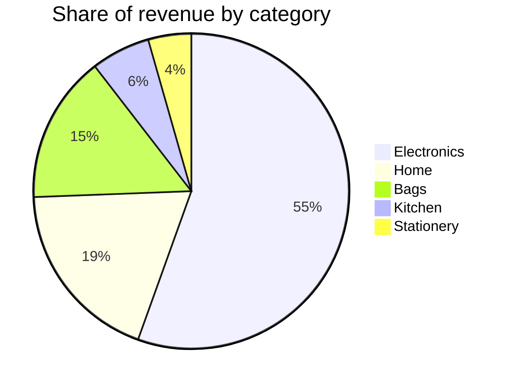

<!-- Written by `npm run lessons` from the lesson data in src/data. Edit the lesson there, not this page. -->

# Share of total, NTILE and FIRST_VALUE

**SQL · Unit 5: Window functions: ranking, running totals and comparing rows · Lesson 5 of 5 · Should know**

> **In one line.** `x / SUM(x) OVER ()` gives each row's share of the total. `NTILE(n)` splits the ordered rows into n roughly equal buckets. FIRST_VALUE and LAST_VALUE pull a value from the first or last row of the window.

[Open this lesson on the site](https://learn.hamropedia.com/sql/share-of-total-ntile-and-first-value/) for its animation, the practice game and tap-to-explain words.

## The problem it solves

"What percentage of revenue does each category bring?", "put customers into spending quartiles", "show the top earner's name next to everyone in their department". These are all common analytics requests, and window functions answer each one in a single line.

## The idea

`SUM(revenue) OVER ()` is the grand total, written on every row, so `100.0 * revenue / SUM(revenue) OVER ()` is the percentage of the total. With PARTITION BY you get the share within each group instead.

`NTILE(4) OVER (ORDER BY salary DESC)` deals the sorted rows into 4 buckets, like dealing cards: 1 is the top quarter.

`FIRST_VALUE(name) OVER (PARTITION BY dept_id ORDER BY salary DESC)` is the name on the first row of each department's window — the top earner.

## Analogy

A pie chart, a league split into divisions, and a team captain. Share of total is each slice of the pie; NTILE puts teams into divisions by points; FIRST_VALUE is the captain's name printed on every player's shirt.

**Where the analogy breaks.** Divisions in a league can be unequal by design. NTILE always makes buckets as equal as possible, so tied values can land in different buckets — fine for "roughly top 25%", wrong if ties must stay together.

## Syntax

```sql
100.0 * x / SUM(x) OVER (PARTITION BY g)
NTILE(4) OVER (ORDER BY x DESC)
FIRST_VALUE(col) OVER (PARTITION BY g ORDER BY x DESC)
```

## How it works, step by step

1. A CTE adds up revenue per category: Electronics 440, Home 150, Bags 120, Kitchen 48, Stationery 35.
2. `SUM(revenue) OVER ()` is 793 on every row.
3. 100.0 × 440 ÷ 793 = 55.5% for Electronics, and so on.
4. `NTILE(4)` over 8 employees sorted by salary gives buckets of 2: 1, 1, 2, 2, 3, 3, 4, 4.
5. `FIRST_VALUE(name)`, ordered by salary DESC within each department, is that department's top earner.

## Picture it



*Each slice is one row's revenue divided by SUM(revenue) OVER () — the grand total of 793 that the window puts on every row.*

## Examples on the practice database

**Each category's share of revenue**

```sql
WITH by_category AS (
  SELECT p.category, SUM(oi.quantity * p.price) AS revenue
  FROM order_items oi
  JOIN products p ON p.product_id = oi.product_id
  GROUP BY p.category
)
SELECT category, revenue,
       ROUND(100.0 * revenue / SUM(revenue) OVER (), 1) AS pct_of_total
FROM by_category
ORDER BY revenue DESC;
```

| category | revenue | pct_of_total |
| --- | --- | --- |
| Electronics | 440 | 55.5 |
| Home | 150 | 18.9 |
| Bags | 120 | 15.1 |
| Kitchen | 48 | 6.1 |
| Stationery | 35 | 4.4 |

---

**NTILE: salary quartiles**

```sql
SELECT name, salary,
       NTILE(4) OVER (ORDER BY salary DESC, name) AS quartile
FROM employees
ORDER BY salary DESC, name;
```

| name | salary | quartile |
| --- | --- | --- |
| Asha | 95000 | 1 |
| Hana | 80000 | 1 |
| Ben | 70000 | 2 |
| Chen | 70000 | 2 |
| Dara | 60000 | 3 |
| Fatima | 52000 | 3 |
| Eli | 45000 | 4 |
| Gus | 38000 | 4 |

---

**FIRST_VALUE: the top earner on every row**

```sql
SELECT dept_id, name, salary,
       FIRST_VALUE(name) OVER (PARTITION BY dept_id ORDER BY salary DESC) AS top_earner
FROM employees
WHERE dept_id IS NOT NULL
ORDER BY dept_id, salary DESC, name;
```

| dept_id | name | salary | top_earner |
| --- | --- | --- | --- |
| 1 | Asha | 95000 | Asha |
| 1 | Hana | 80000 | Asha |
| 1 | Ben | 70000 | Asha |
| 1 | Chen | 70000 | Asha |
| 2 | Dara | 60000 | Dara |
| 2 | Eli | 45000 | Dara |
| 3 | Fatima | 52000 | Fatima |

## Must know

- `SUM(x) OVER ()` = grand total on every row; `SUM(x) OVER (PARTITION BY g)` = group total.
- Share of total: `100.0 * x / SUM(x) OVER (…)` — the 100.0 avoids integer division.
- `NTILE(n)` makes n buckets as equal in size as possible, in the window's order.
- FIRST_VALUE is safe with the default frame; LAST_VALUE needs `ROWS BETWEEN UNBOUNDED PRECEDING AND UNBOUNDED FOLLOWING`.
- You can use a window function over an aggregate (`SUM(SUM(x)) OVER ()`) in a GROUP BY query, but a CTE is easier to read.

## Common mistakes

- Integer division in a share: `revenue / SUM(revenue) OVER ()` gives 0 for every row.
- Using LAST_VALUE with the default frame and getting the current row's value.
- Expecting NTILE to keep tied values in the same bucket.

> **Not true:** `NTILE(4)`: rows with the same value land in the same bucket.  
> **In fact:** NTILE only makes the buckets as equal in size as possible, so tied values can be split between two buckets. Use a rank when ties must stay together.

## In the interview

For share-of-total I divide each row by SUM over an empty or partitioned window, multiplying by 100.0 to avoid integer division. NTILE buckets ordered rows into n near-equal groups, for quartiles or deciles. FIRST_VALUE picks the first row's value in each window. For LAST_VALUE I widen the frame to unbounded following, because the default frame stops at the current row.

<details>
<summary>&lt;b>How would you show each product's share of revenue within its category?&lt;/b></summary>

Use `SUM(revenue) OVER (PARTITION BY category)` as the divisor.

</details>

<details>
<summary>&lt;b>`NTILE(4)` on 10 rows — how big are the buckets?&lt;/b></summary>

3, 3, 2, 2. The leftover rows go to the first buckets.

</details>

## Practise

Write each answer yourself first, then open the answer and compare.

### 1. Explain

Explain why `SUM(revenue) OVER ()` puts the same number on every row.

<details>
<summary>Show one good answer</summary>

`OVER ()` is an empty window. There is no PARTITION BY, so every row is in one big window: the whole result. There is no ORDER BY, so there is no running frame: the window is always all of it. SUM of the same rows is the same number, so every row gets the grand total.

That is exactly what share of total needs: each row divided by the same grand total.

</details>

### 2. Write

For each customer, show their total spend and their percentage of all spending, rounded to 1 decimal place.

<details>
<summary>Show one good answer</summary>

First add up each customer (the CTE), then divide each total by the sum of all totals. Multiply by 100.0, not 100, so the division keeps its decimals.

The rounded shares add up to 100.1, not 100. That is normal when you round each part.

```sql
WITH per_customer AS (
  SELECT customer_id, SUM(amount) AS total
  FROM orders
  GROUP BY customer_id
)
SELECT c.name, p.total,
       ROUND(100.0 * p.total / SUM(p.total) OVER (), 1) AS pct_of_all
FROM per_customer p
JOIN customers c ON c.customer_id = p.customer_id
ORDER BY p.total DESC;
```

| name | total | pct_of_all |
| --- | --- | --- |
| Priya | 425 | 53.6 |
| Tom | 275 | 34.7 |
| Lena | 60 | 7.6 |
| Zoe | 33 | 4.2 |

</details>

### 3. Predict

What quartile would each employee get with `NTILE(3)` instead of `NTILE(4)`?

<details>
<summary>Show one good answer</summary>

8 rows into 3 buckets don't divide evenly, so the first buckets get the extra rows: sizes 3, 3 and 2.

• Bucket 1: Asha, Hana, Ben.  
• Bucket 2: Chen, Dara, Fatima.  
• Bucket 3: Eli, Gus.

Notice Ben and Chen earn the same but land in different buckets. NTILE cuts by position, not by value; the name in the ORDER BY decides which side of the cut each one lands on.

```sql
SELECT name, salary, NTILE(3) OVER (ORDER BY salary DESC, name) AS bucket
FROM employees
ORDER BY salary DESC, name;
```

| name | salary | bucket |
| --- | --- | --- |
| Asha | 95000 | 1 |
| Hana | 80000 | 1 |
| Ben | 70000 | 1 |
| Chen | 70000 | 2 |
| Dara | 60000 | 2 |
| Fatima | 52000 | 2 |
| Eli | 45000 | 3 |
| Gus | 38000 | 3 |

</details>

### 4. Edge cases

Write `LAST_VALUE(name)` for the lowest earner in each department and make it return the right name on every row.

<details>
<summary>Show one good answer</summary>

Sort each department from highest to lowest salary, so the lowest earner is the last row. Then set the frame to the whole partition: `ROWS BETWEEN UNBOUNDED PRECEDING AND UNBOUNDED FOLLOWING`.

Without that frame, the default ends at the current row, so on each row "the last row of the window" is the current row: every person is named as their own lowest earner.

In department 1, Ben and Chen tie for lowest. The name in the ORDER BY makes Chen the last row, so the tie is broken the same way every time.

```sql
SELECT dept_id, name, salary,
       LAST_VALUE(name) OVER (
         PARTITION BY dept_id
         ORDER BY salary DESC, name
         ROWS BETWEEN UNBOUNDED PRECEDING AND UNBOUNDED FOLLOWING
       ) AS lowest_earner
FROM employees
WHERE dept_id IS NOT NULL
ORDER BY dept_id, salary DESC, name;
```

| dept_id | name | salary | lowest_earner |
| --- | --- | --- | --- |
| 1 | Asha | 95000 | Chen |
| 1 | Hana | 80000 | Chen |
| 1 | Ben | 70000 | Chen |
| 1 | Chen | 70000 | Chen |
| 2 | Dara | 60000 | Eli |
| 2 | Eli | 45000 | Eli |
| 3 | Fatima | 52000 | Fatima |

</details>

## Go further (optional)

- READ · [PostgreSQL docs — Window Functions (NTILE, FIRST_VALUE, LAST_VALUE)](https://www.postgresql.org/docs/current/functions-window.html) · official documentation, free
- READ · [Mode SQL Tutorial — SQL Window Functions: NTILE](https://mode.com/sql-tutorial/) · Mode, free
- PRACTICE · [DataLemur — percentage of total questions](https://datalemur.com/questions) · real interview questions, many free

---

[← Running totals and moving averages: window frames](running-totals-and-moving-averages-window-frames.md) · [All lessons](../../README.md) · [CREATE TABLE and ALTER TABLE →](../unit-6-changing-data/create-table-and-alter-table.md)
