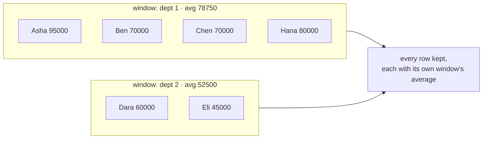

<!-- Written by `npm run lessons` from the lesson data in src/data. Edit the lesson there, not this page. -->

# What a window function is: OVER and PARTITION BY

**SQL · Unit 5: Window functions: ranking, running totals and comparing rows · Lesson 1 of 5 · Must know**

> **In one line.** A window function calculates a value for each row from a set of related rows, its "window", which is defined by OVER (PARTITION BY … ORDER BY …). Unlike GROUP BY, it keeps every row in the result.

[Open this lesson on the site](https://learn.hamropedia.com/sql/what-a-window-function-is-over-and-partition-by/) for its animation, the practice game and tap-to-explain words.

## The problem it solves

"Show each employee with their department's average salary next to them." GROUP BY gives you the averages but throws away the employees; joining the averages back is clumsy. A window function puts the group's number on every row in one step.

## The idea

Add OVER (…) after a function and it becomes a window function. OVER () with nothing inside means "the window is every row". PARTITION BY dept_id splits the rows into windows, one per department, like GROUP BY — but the rows stay separate, and each row gets its own window's answer.

ORDER BY inside OVER sets an order within each window, which ranking and running totals need. Any aggregate (SUM, AVG, COUNT, MIN, MAX) can be used this way, plus special window-only functions such as ROW_NUMBER and LAG.

## Analogy

A class photo where each pupil holds a card. GROUP BY would replace each form group with one person holding the group's average. A window function keeps every pupil in the photo, and each one's card shows their own form group's average.

**Where the analogy breaks.** In the photo the card is written once. A window function is worked out in the SELECT step, after WHERE and GROUP BY — so WHERE can't filter on it. To filter on a window result, wrap the query in a CTE.

## Syntax

```sql
function(...) OVER (
  PARTITION BY group_column
  ORDER BY sort_column
)
```

## How it works, step by step

1. FROM and WHERE produce the rows: 7 employees with a department.
2. PARTITION BY dept_id makes three windows: department 1 (4 people), 2 (2 people), 3 (1 person).
3. `AVG(salary)` is worked out over each window: 78750, 52500, 52000.
4. Each row gets the answer for its own window, and no rows are removed.
5. OVER () with no partition makes one window of all rows: `COUNT(*) OVER ()` is 8 on every row.

## Picture it



*PARTITION BY draws a box around related rows. The function is worked out inside each box, and the answer is written onto every row in it — no row disappears.*

## Examples on the practice database

**Each employee next to their department average**

```sql
SELECT name, dept_id, salary,
       AVG(salary) OVER (PARTITION BY dept_id) AS dept_avg
FROM employees
WHERE dept_id IS NOT NULL
ORDER BY dept_id, name;
```

| name | dept_id | salary | dept_avg |
| --- | --- | --- | --- |
| Asha | 1 | 95000 | 78750 |
| Ben | 1 | 70000 | 78750 |
| Chen | 1 | 70000 | 78750 |
| Hana | 1 | 80000 | 78750 |
| Dara | 2 | 60000 | 52500 |
| Eli | 2 | 45000 | 52500 |
| Fatima | 3 | 52000 | 52000 |

GROUP BY dept_id would give 3 rows. The window keeps all 7.

---

**Group sizes and the grand total on every row**

```sql
SELECT name, dept_id,
       COUNT(*) OVER (PARTITION BY dept_id) AS dept_size,
       COUNT(*) OVER () AS company_size
FROM employees
ORDER BY emp_id;
```

| name | dept_id | dept_size | company_size |
| --- | --- | --- | --- |
| Asha | 1 | 4 | 8 |
| Ben | 1 | 4 | 8 |
| Chen | 1 | 4 | 8 |
| Dara | 2 | 2 | 8 |
| Eli | 2 | 2 | 8 |
| Fatima | 3 | 1 | 8 |
| Gus | NULL | 1 | 8 |
| Hana | 1 | 4 | 8 |

OVER () is one window holding every row. Gus forms his own NULL partition.

---

**How far each salary is from the department average**

```sql
SELECT name, salary,
       salary - AVG(salary) OVER (PARTITION BY dept_id) AS diff_from_avg
FROM employees
WHERE dept_id = 1
ORDER BY salary DESC, name;
```

| name | salary | diff_from_avg |
| --- | --- | --- |
| Asha | 95000 | 16250 |
| Hana | 80000 | 1250 |
| Ben | 70000 | -8750 |
| Chen | 70000 | -8750 |

## Must know

- A window function keeps every row; GROUP BY collapses rows.
- PARTITION BY = which rows share a window. No PARTITION BY = one window of all rows.
- ORDER BY inside OVER = the order within each window (needed for ranks, LAG and running totals).
- Window functions run in the SELECT step: you can't use them in WHERE, GROUP BY or HAVING. Wrap in a CTE to filter.
- Any aggregate becomes a window function when you add OVER.

## Common mistakes

- Writing `WHERE ROW_NUMBER() OVER (…) = 1` — not allowed. Filter in an outer query.
- Adding GROUP BY when you wanted every row kept.
- Confusing the ORDER BY inside OVER (order within the window) with the query's ORDER BY (order of the output).

> **Not true:** A window function can be used directly in WHERE to filter rows.  
> **In fact:** Window functions are worked out after WHERE has run. Compute the value in a subquery or a CTE, then filter in the outer query.

## Other databases

- Window functions work in PostgreSQL, SQL Server, Oracle, MySQL 8+ and SQLite 3.25+. Older MySQL (5.7) has none.

## In the interview

A window function computes a value over a set of rows related to the current row. The OVER clause defines that set: PARTITION BY says which rows share the window, and ORDER BY orders them. Unlike GROUP BY, it doesn't collapse rows, so each row keeps its detail and gains the computed value. Because window functions are evaluated in the SELECT phase, I filter on them from an outer query or CTE.

<details>
<summary>&lt;b>GROUP BY or a window function — how do you choose?&lt;/b></summary>

If you want one row per group, GROUP BY. If you want every row plus a group value next to it (an average, a rank, a running total), a window function.

</details>

<details>
<summary>&lt;b>Why can't you use a window function in WHERE?&lt;/b></summary>

WHERE runs before the SELECT step where window functions are computed. Put the window function in a CTE and filter outside.

</details>

## Practise

Write each answer yourself first, then open the answer and compare.

### 1. Explain

Explain the difference between `AVG(salary) … GROUP BY dept_id` and `AVG(salary) OVER (PARTITION BY dept_id)`.

<details>
<summary>Show one good answer</summary>

`AVG(salary) … GROUP BY dept_id` squashes each department into one row: 8 employees in, 4 rows out (one per department, Gus's NULL included). The names are gone.

`AVG(salary) OVER (PARTITION BY dept_id)` works out the same averages but keeps all 8 rows. Each employee gets their department's average written next to them, so you can compare: "Ben earns 70,000; his department averages 78,750".

Use GROUP BY when you want one row per group, and a window function when you want every row plus a group figure.

```sql
SELECT dept_id, AVG(salary) AS dept_avg
FROM employees
GROUP BY dept_id
ORDER BY dept_id;
```

| dept_id | dept_avg |
| --- | --- |
| NULL | 38000 |
| 1 | 78750 |
| 2 | 52500 |
| 3 | 52000 |

</details>

### 2. Write

For every order, show the order_id, amount, and the customer's total spend across all their orders.

<details>
<summary>Show one good answer</summary>

PARTITION BY customer_id makes one window per customer, and SUM adds up that customer's amounts. Every order keeps its own row. Order 106's NULL is skipped, so Lena's total is 60.

```sql
SELECT order_id, customer_id, amount,
       SUM(amount) OVER (PARTITION BY customer_id) AS customer_total
FROM orders
ORDER BY order_id;
```

| order_id | customer_id | amount | customer_total |
| --- | --- | --- | --- |
| 101 | 1 | 120 | 425 |
| 102 | 1 | 80 | 425 |
| 103 | 1 | 45 | 425 |
| 104 | 2 | 200 | 275 |
| 105 | 1 | 150 | 425 |
| 106 | 3 | NULL | 60 |
| 107 | 3 | 60 | 60 |
| 108 | 2 | 75 | 275 |
| 109 | 1 | 30 | 425 |
| 110 | 5 | 33 | 33 |

</details>

### 3. Predict

What does `SELECT name, MAX(salary) OVER () FROM employees;` return? How many rows?

<details>
<summary>Show one good answer</summary>

8 rows, one per employee, each with 95,000 next to the name.

`OVER ()` is an empty window: no PARTITION BY, so the window is the whole table, and the highest salary in the whole table is Asha's 95,000. A window function never removes rows. (The query has no ORDER BY, so add one if you want the names in a fixed order.)

```sql
SELECT name, MAX(salary) OVER ()
FROM employees
ORDER BY emp_id;
```

| name | MAX(salary) OVER () |
| --- | --- |
| Asha | 95000 |
| Ben | 95000 |
| Chen | 95000 |
| Dara | 95000 |
| Eli | 95000 |
| Fatima | 95000 |
| Gus | 95000 |
| Hana | 95000 |

</details>

### 4. Edge cases

Gus has a NULL dept_id. What dept_avg does he get in the first example if you remove the WHERE?

<details>
<summary>Show one good answer</summary>

38,000: his own salary.

PARTITION BY, like GROUP BY, puts all NULLs into one group. Gus is the only employee with a NULL dept_id, so he is alone in his window and the average of one salary is that salary.

That is technically right but can mislead: "no department" is not a real department. That is why the example filtered him out with `WHERE dept_id IS NOT NULL`.

```sql
SELECT name, dept_id, salary,
       AVG(salary) OVER (PARTITION BY dept_id) AS dept_avg
FROM employees
ORDER BY dept_id, name;
```

| name | dept_id | salary | dept_avg |
| --- | --- | --- | --- |
| Gus | NULL | 38000 | 38000 |
| Asha | 1 | 95000 | 78750 |
| Ben | 1 | 70000 | 78750 |
| Chen | 1 | 70000 | 78750 |
| Hana | 1 | 80000 | 78750 |
| Dara | 2 | 60000 | 52500 |
| Eli | 2 | 45000 | 52500 |
| Fatima | 3 | 52000 | 52000 |

</details>

## Go further (optional)

- READ · [PostgreSQL docs — Window Functions (tutorial)](https://www.postgresql.org/docs/current/tutorial-window.html) · official documentation, free
- READ · [Mode SQL Tutorial — SQL Window Functions](https://mode.com/sql-tutorial/) · Mode, free
- WATCH · [SQL window functions explained (video)](https://www.youtube.com/results?search_query=sql%20window%20functions%20explained) · YouTube search, free

---

[← UNION, UNION ALL, INTERSECT and EXCEPT](../unit-4-subqueries/union-union-all-intersect-and-except.md) · [All lessons](../../README.md) · [Ranking: ROW_NUMBER, RANK and DENSE_RANK →](ranking-row-number-rank-and-dense-rank.md)
