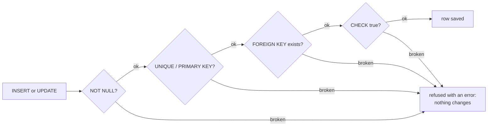

<!-- Written by `npm run lessons` from the lesson data in src/data. Edit the lesson there, not this page. -->

# Constraints: the rules that keep bad data out

**SQL · Unit 6: Building tables and changing data · Lesson 2 of 7 · Must know**

> **In one line.** Constraints are rules the database enforces on every write — PRIMARY KEY, FOREIGN KEY, UNIQUE, NOT NULL, CHECK and DEFAULT — so that rows which break them are refused instead of stored.

[Open this lesson on the site](https://learn.hamropedia.com/sql/constraints-the-rules-that-keep-bad-data-out/) for its animation, the practice game and tap-to-explain words.

## The problem it solves

Application code has bugs, and data arrives from many places. Tom could sign up twice because nothing said emails must be unique. A rule in the database is checked on every insert and update, from every program, every time.

## The idea

NOT NULL: a value is required.  
UNIQUE: no two rows may share the value.  
PRIMARY KEY: unique and not NULL — the row's identity.  
FOREIGN KEY (REFERENCES): the value must exist in another table's key, and you choose what happens when that row is deleted (refuse, ON DELETE CASCADE, or ON DELETE SET NULL).  
CHECK: any condition, such as `price > 0` or `plan IN ('free', 'pro')`.

If a write breaks a rule, the whole statement fails with an error and nothing is changed.

## Analogy

The rules at a passport desk. No photo, no passport (NOT NULL). One passport number per person (UNIQUE). The country you list must be a real country (FOREIGN KEY). Your age can't be negative (CHECK). The officer refuses the form; they don't "fix it later".

**Where the analogy breaks.** An officer might let a small mistake through. A constraint never does — which is the point, but it also means a bulk load can fail on row 9,999,999. Clean or check the data before loading, or load into a staging table first.

## Syntax

```sql
email   TEXT NOT NULL UNIQUE,
price   INTEGER CHECK (price > 0),
dept_id INTEGER REFERENCES departments(dept_id) ON DELETE SET NULL
```

## How it works, step by step

1. Every INSERT and UPDATE is checked against every constraint on the table.
2. subscribers.email is the primary key, so a second row with the same email is a conflict.
3. `ON CONFLICT (email) DO NOTHING` tells the database to skip that row quietly instead of failing.
4. Inserting an order for customer 99, who doesn't exist, breaks the foreign key: refused.
5. Inserting a department with an existing dept_id breaks the primary key: refused.

## Picture it



*Each write passes every rule on the table. If any rule fails, the statement is refused and the table is left exactly as it was.*

## Examples on the practice database

**UNIQUE and CHECK, and skipping duplicates on purpose**

```sql
CREATE TABLE subscribers (
  email TEXT PRIMARY KEY,
  plan  TEXT NOT NULL CHECK (plan IN ('free', 'pro'))
);
INSERT INTO subscribers VALUES ('priya@mail.com', 'pro');
INSERT INTO subscribers VALUES ('tom@mail.com', 'free');
INSERT INTO subscribers VALUES ('tom@mail.com', 'pro')
  ON CONFLICT (email) DO NOTHING;
SELECT * FROM subscribers ORDER BY email;
```

| email | plan |
| --- | --- |
| priya@mail.com | pro |
| tom@mail.com | free |

Tom's second sign-up is skipped. Try it yourself with plan 'gold' and watch the CHECK refuse it.

---

**A foreign key refuses an order for a customer who doesn't exist**

```sql
INSERT INTO orders (order_id, customer_id, order_date, amount, status)
VALUES (111, 99, '2024-03-20', 10, 'pending');
```

The database refuses this query: `FOREIGN KEY constraint failed`

There is no customer 99, so the row is never stored.

---

**A primary key refuses a duplicate id**

```sql
INSERT INTO departments VALUES (1, 'Legal', 'York');
```

The database refuses this query: `UNIQUE constraint failed: departments.dept_id`

Department 1 already exists. A primary key is a UNIQUE rule plus NOT NULL.

## Must know

- NOT NULL, UNIQUE, PRIMARY KEY, FOREIGN KEY, CHECK and DEFAULT are the six to know.
- PRIMARY KEY = UNIQUE + NOT NULL, one per table.
- Foreign key delete options: refuse (default), ON DELETE CASCADE, ON DELETE SET NULL.
- A failed constraint fails the whole statement; nothing is half-written.
- Put rules in the database, not only in the app — the database sees every write.

## Common mistakes

- Relying on the app alone to prevent duplicates (that is how Tom signed up twice).
- Using ON DELETE CASCADE without thinking: deleting one customer silently deletes all their orders.
- Expecting UNIQUE to stop two NULLs. In most databases it doesn't — NULL isn't equal to NULL.

> **Not true:** A UNIQUE constraint stops a column from holding two NULLs.  
> **In fact:** In most databases NULL is not equal to NULL, so UNIQUE lets several NULLs in. Add NOT NULL as well when the column must always be filled.

## Other databases

- SQLite checks foreign keys only after `PRAGMA foreign_keys = ON;`. MySQL ignored CHECK constraints before version 8.0.16.
- Upsert syntax: PostgreSQL and SQLite `ON CONFLICT … DO NOTHING / DO UPDATE`; MySQL `ON DUPLICATE KEY UPDATE`; SQL Server `MERGE`.

## In the interview

Constraints let the database enforce integrity on every write. NOT NULL is for required values, UNIQUE and PRIMARY KEY for identity, FOREIGN KEY for valid references with a chosen delete behaviour, and CHECK for any rule on a row. I put these rules in the schema rather than only in application code, because the database sees every writer, and a violation fails the statement atomically instead of leaving bad data behind.

<details>
<summary>&lt;b>Can a UNIQUE column hold NULLs?&lt;/b></summary>

Yes, in most databases, and usually more than one NULL, because NULLs aren't equal to each other. (SQL Server allows only one by default.)

</details>

<details>
<summary>&lt;b>What does ON DELETE CASCADE do?&lt;/b></summary>

Deleting the parent row also deletes the child rows that reference it — handy for order_items when an order is deleted, dangerous elsewhere.

</details>

<details>
<summary>&lt;b>Why not just validate in the application?&lt;/b></summary>

Several apps, scripts and people write to the same database, and app checks can race. Constraints are checked by the database itself, atomically.

</details>

## Practise

Write each answer yourself first, then open the answer and compare.

### 1. Explain

Explain each of the six constraints with one example from the practice tables.

<details>
<summary>Show one good answer</summary>

• NOT NULL, a value is required: employees.name. Every employee must have a name.  
• UNIQUE, no two rows may share the value: customers.email should have had it. It doesn't, which is exactly how Tom signed up twice.  
• PRIMARY KEY, the row's identity (unique and not NULL): employees.emp_id, and in order_items the pair (order_id, product_id).  
• FOREIGN KEY, the value must exist in another table: orders.customer_id must be a real customer_id in customers.  
• CHECK, any rule about the row: none here yet, but `price > 0` on products or `status IN ('delivered', 'shipped', 'cancelled', 'pending')` on orders would be natural.  
• DEFAULT, the value used when an INSERT leaves the column out: for example `status TEXT NOT NULL DEFAULT 'pending'` on orders.

</details>

### 2. Write

Create a table with an email that must be unique and a price that must be positive, then insert one valid row and one row of each kind that fails.

<details>
<summary>Show one good answer</summary>

The table and the valid row are below. Each of these is refused, and the table stays unchanged:

• A second row with the same email: `INSERT INTO listings VALUES (2, 'shop@mail.com', 35);` gives "UNIQUE constraint failed: listings.email".  
• A price that isn't positive: `INSERT INTO listings VALUES (3, 'other@mail.com', 0);` gives "CHECK constraint failed: price > 0".

Add either line after the INSERT and run it to see the error.

```sql
CREATE TABLE listings (
  listing_id INTEGER PRIMARY KEY,
  email      TEXT NOT NULL UNIQUE,
  price      INTEGER NOT NULL CHECK (price > 0)
);
INSERT INTO listings VALUES (1, 'shop@mail.com', 20);
SELECT * FROM listings;
```

| listing_id | email | price |
| --- | --- | --- |
| 1 | shop@mail.com | 20 |

</details>

### 3. Predict

Will `UPDATE employees SET dept_id = 9 WHERE emp_id = 7;` succeed? Why or why not?

<details>
<summary>Show one good answer</summary>

No. employees.dept_id is a foreign key to departments, and there is no department 9, so the update is refused: "FOREIGN KEY constraint failed". Gus keeps his NULL dept_id.

(NULL itself is allowed in a foreign key column, meaning "no department"; a value that points at nothing is not.)

```sql
UPDATE employees SET dept_id = 9 WHERE emp_id = 7;
```

The database refuses this query: `FOREIGN KEY constraint failed`

</details>

### 4. Edge cases

Can you insert two subscribers whose email is NULL into a table where email is UNIQUE but not the primary key? Try it.

<details>
<summary>Show one good answer</summary>

Yes, both go in. UNIQUE means "no two equal values", and NULL is not equal to anything, not even another NULL, so two NULLs don't clash. PostgreSQL and MySQL behave the same way.

SQL Server is the exception: it allows only one NULL in a UNIQUE column. And PostgreSQL 15+ lets you ask for that with `UNIQUE NULLS NOT DISTINCT`. If an email is really required, the fix is `NOT NULL` as well as UNIQUE.

```sql
CREATE TABLE subscribers (
  id    INTEGER PRIMARY KEY,
  email TEXT UNIQUE
);
INSERT INTO subscribers (id, email) VALUES (1, NULL), (2, NULL);
SELECT id, email FROM subscribers ORDER BY id;
```

| id | email |
| --- | --- |
| 1 | NULL |
| 2 | NULL |

</details>

## Go further (optional)

- READ · [W3Schools — SQL Constraints](https://www.w3schools.com/sql/sql_constraints.asp) · short page with a try-it editor, free
- READ · [PostgreSQL docs — Constraints](https://www.postgresql.org/docs/current/ddl-constraints.html) · official documentation, free
- READ · [SQLite docs — Foreign Key Support](https://www.sqlite.org/foreignkeys.html) · official documentation, free

---

[← CREATE TABLE and ALTER TABLE](create-table-and-alter-table.md) · [All lessons](../../README.md) · [INSERT, UPDATE and DELETE →](insert-update-and-delete.md)
