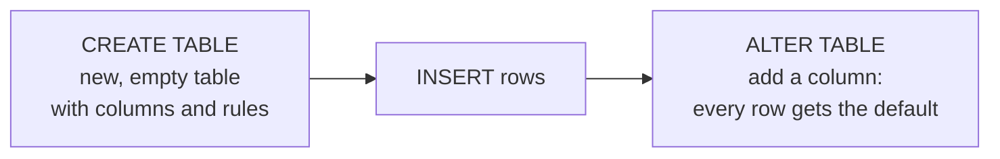

<!-- Written by `npm run lessons` from the lesson data in src/data. Edit the lesson there, not this page. -->

# CREATE TABLE and ALTER TABLE

**SQL · Unit 6: Building tables and changing data · Lesson 1 of 7 · Must know**

> **In one line.** CREATE TABLE defines a new table — its name, its columns, their types and rules — and ALTER TABLE changes an existing table, for example by adding a column.

[Open this lesson on the site](https://learn.hamropedia.com/sql/create-table-and-alter-table/) for its animation, the practice game and tap-to-explain words.

## The problem it solves

Before data can be stored, the database needs to know its shape. Choosing the columns, types and keys well at the start saves painful fixes later, when the table holds millions of rows.

## The idea

CREATE TABLE lists each column with its type and any rules (constraints): `name TEXT NOT NULL`. One column, or a group of columns, is the PRIMARY KEY. DEFAULT gives a value to use when an INSERT doesn't mention the column.

ALTER TABLE changes the table afterwards: ADD COLUMN, RENAME COLUMN, DROP COLUMN. These commands change the structure (the schema), not the rows, and they belong to the part of SQL called DDL.

## Analogy

Designing a paper form before printing it: you decide the boxes (columns), what may be written in each (types), which ones must be filled in (NOT NULL), and which are pre-filled (DEFAULT). ALTER TABLE is printing a new version of the form with an extra box.

**Where the analogy breaks.** A reprinted form doesn't change the forms already filled in. ALTER TABLE does: adding a column adds it to every existing row (with its default or NULL), and on a huge table that can take a long time or lock it.

## Syntax

```sql
CREATE TABLE table_name (
  id     INTEGER PRIMARY KEY,
  column TYPE NOT NULL,
  other  TYPE DEFAULT value
);
ALTER TABLE table_name ADD COLUMN new_column TYPE;
```

## How it works, step by step

1. CREATE TABLE suppliers makes an empty table with three columns.
2. supplier_id is the primary key: unique and never NULL.
3. country has DEFAULT 'UK', so an INSERT that leaves it out gets 'UK'.
4. ALTER TABLE products ADD COLUMN in_stock … DEFAULT 1 adds the column to all 7 existing rows, each with 1.
5. Neither command returns rows; a SELECT afterwards shows the effect.

## Picture it



*CREATE TABLE sets up the shape, INSERT fills it, and ALTER TABLE reshapes it later — the new column is added to every row that already exists.*

## Examples on the practice database

**Create a table and use its default**

```sql
CREATE TABLE suppliers (
  supplier_id INTEGER PRIMARY KEY,
  name        TEXT NOT NULL,
  country     TEXT DEFAULT 'UK'
);
INSERT INTO suppliers (supplier_id, name) VALUES (1, 'PaperCo');
INSERT INTO suppliers VALUES (2, 'SoundWorks', 'Germany');
SELECT * FROM suppliers ORDER BY supplier_id;
```

| supplier_id | name | country |
| --- | --- | --- |
| 1 | PaperCo | UK |
| 2 | SoundWorks | Germany |

The first INSERT names only two columns, so country takes its default.

---

**Add a column to an existing table**

```sql
ALTER TABLE products ADD COLUMN in_stock INTEGER NOT NULL DEFAULT 1;
SELECT product_name, price, in_stock
FROM products
WHERE category = 'Electronics'
ORDER BY product_name;
```

| product_name | price | in_stock |
| --- | --- | --- |
| Headphones | 40 | 1 |
| Phone case | 15 | 1 |

Every existing product gets in_stock = 1. A NOT NULL column added to a table with rows needs a DEFAULT.

## Must know

- CREATE TABLE: name, then each column with its type and rules, separated by commas.
- Give every table a primary key.
- DEFAULT fills a column when an INSERT leaves it out.
- ALTER TABLE ADD / RENAME / DROP COLUMN changes the structure of an existing table.
- CREATE, ALTER and DROP are DDL: they change the schema, not the data.

## Common mistakes

- No primary key, so duplicate rows can't be told apart or removed cleanly.
- Adding a NOT NULL column without a DEFAULT to a table that already has rows — most databases refuse.
- Storing several values in one column ('Pen, Mug'). Each column should hold one value — see normalisation.

> **Not true:** A NOT NULL column with no DEFAULT can always be added to a table that already has rows.  
> **In fact:** The existing rows would have no value for the new column, so most databases refuse. Give the column a DEFAULT, or add it without NOT NULL and fill it in first.

## Other databases

- Auto-numbered ids: PostgreSQL `id INTEGER GENERATED ALWAYS AS IDENTITY` (or SERIAL); MySQL `AUTO_INCREMENT`; SQL Server `IDENTITY(1,1)`; SQLite `INTEGER PRIMARY KEY` does it automatically.
- SQLite's ALTER TABLE is limited (add, rename and drop column only). PostgreSQL can also change a column's type with `ALTER COLUMN … TYPE`.

## In the interview

CREATE TABLE defines a table's columns, data types and constraints — a primary key, NOT NULL, defaults, foreign keys — and ALTER TABLE evolves it later, such as adding a column. I always give tables a primary key, and I choose types deliberately: DECIMAL for money, proper DATE types for dates. I treat schema changes on big tables carefully, because adding or changing columns can rewrite or lock the table.

<details>
<summary>&lt;b>What is a schema?&lt;/b></summary>

The structure of the database: its tables, columns, types and constraints. Also, in PostgreSQL, a named group of tables inside a database.

</details>

<details>
<summary>&lt;b>How do you add a NOT NULL column to a table that already has data?&lt;/b></summary>

Give it a DEFAULT, or add it as nullable, fill in the values with UPDATE, then add the NOT NULL rule.

</details>

## Practise

Write each answer yourself first, then open the answer and compare.

### 1. Explain

Explain what each part of the suppliers CREATE TABLE does.

<details>
<summary>Show one good answer</summary>

`CREATE TABLE suppliers ( … )` makes a new, empty table called suppliers, with the columns listed in the brackets.

• `supplier_id INTEGER PRIMARY KEY`: a whole-number column that identifies each row. Primary key means it must be unique and can't be NULL. (In SQLite, an INTEGER PRIMARY KEY is also numbered automatically if you leave it out.)  
• `name TEXT NOT NULL`: a text column that must always have a value. An INSERT without a name is refused.  
• `country TEXT DEFAULT 'UK'`: a text column that may be left out; if an INSERT doesn't mention it, it gets 'UK'.

The statement changes the structure (the schema) and returns no rows. It is DDL.

</details>

### 2. Write

Create a table reviews with a review id, a product_id that references products, a rating from 1 to 5, and a created date, then insert two rows and select them.

<details>
<summary>Show one good answer</summary>

Each rule from the question becomes a constraint: REFERENCES makes product_id point at a real product, CHECK keeps the rating between 1 and 5, and DEFAULT CURRENT_DATE fills in today's date if an insert leaves it out (here both inserts give a date, so the result is fixed).

Try inserting a rating of 9: the database refuses it with "CHECK constraint failed: rating BETWEEN 1 AND 5".

```sql
CREATE TABLE reviews (
  review_id  INTEGER PRIMARY KEY,
  product_id INTEGER NOT NULL REFERENCES products(product_id),
  rating     INTEGER NOT NULL CHECK (rating BETWEEN 1 AND 5),
  created_on TEXT NOT NULL DEFAULT CURRENT_DATE
);
INSERT INTO reviews (review_id, product_id, rating, created_on) VALUES (1, 6, 5, '2024-03-02');
INSERT INTO reviews (review_id, product_id, rating, created_on) VALUES (2, 3, 4, '2024-03-05');
SELECT r.review_id, p.product_name, r.rating, r.created_on
FROM reviews r
JOIN products p ON p.product_id = r.product_id
ORDER BY r.review_id;
```

| review_id | product_name | rating | created_on |
| --- | --- | --- | --- |
| 1 | Headphones | 5 | 2024-03-02 |
| 2 | Mug | 4 | 2024-03-05 |

</details>

### 3. Predict

After `INSERT INTO suppliers (supplier_id, name) VALUES (3, 'MugMakers');`, what country does MugMakers have?

<details>
<summary>Show one good answer</summary>

'UK'. The INSERT names only supplier_id and name, so country takes its DEFAULT. (Every run starts from the original database, so the query below creates the suppliers table first.)

```sql
CREATE TABLE suppliers (
  supplier_id INTEGER PRIMARY KEY,
  name        TEXT NOT NULL,
  country     TEXT DEFAULT 'UK'
);
INSERT INTO suppliers (supplier_id, name) VALUES (3, 'MugMakers');
SELECT * FROM suppliers;
```

| supplier_id | name | country |
| --- | --- | --- |
| 3 | MugMakers | UK |

</details>

### 4. Edge cases

What happens if you insert a supplier without a name? Try it, and explain the error.

<details>
<summary>Show one good answer</summary>

The database refuses the row: "NOT NULL constraint failed: suppliers.name". name has no DEFAULT, so leaving it out would make it NULL, and NOT NULL forbids that. The whole INSERT fails and nothing is stored.

That is the point of the rule: a supplier without a name is bad data, and the database stops it at the door, whatever program sent it.

```sql
CREATE TABLE suppliers (
  supplier_id INTEGER PRIMARY KEY,
  name        TEXT NOT NULL,
  country     TEXT DEFAULT 'UK'
);
INSERT INTO suppliers (supplier_id, country) VALUES (4, 'France');
```

The database refuses this query: `NOT NULL constraint failed: suppliers.name`

</details>

## Go further (optional)

- PRACTICE · [SQLBolt — Lesson 16: Creating tables](https://sqlbolt.com/) · interactive exercises in the browser, free
- READ · [W3Schools — SQL CREATE TABLE](https://www.w3schools.com/sql/sql_create_table.asp) · short page with a try-it editor, free
- WATCH · [CS50's Introduction to Databases with SQL — Lecture 2: Designing](https://cs50.harvard.edu/sql/) · Harvard, free

---

[← Share of total, NTILE and FIRST_VALUE](../unit-5-window-functions/share-of-total-ntile-and-first-value.md) · [All lessons](../../README.md) · [Constraints: the rules that keep bad data out →](constraints-the-rules-that-keep-bad-data-out.md)
