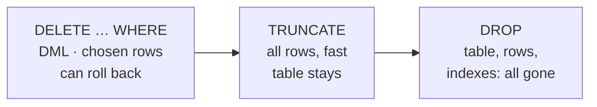

<!-- Written by `npm run lessons` from the lesson data in src/data. Edit the lesson there, not this page. -->

# DDL, DML, DCL, TCL — and DELETE versus TRUNCATE versus DROP

**SQL · Unit 6: Building tables and changing data · Lesson 7 of 7 · Should know**

> **In one line.** SQL commands fall into four families: DDL changes structure (CREATE, ALTER, DROP), DML changes data (INSERT, UPDATE, DELETE), DCL controls access (GRANT, REVOKE) and TCL controls transactions (COMMIT, ROLLBACK). DELETE removes rows, TRUNCATE removes all rows, and DROP removes the whole table.

[Open this lesson on the site](https://learn.hamropedia.com/sql/ddl-dml-dcl-tcl-and-delete-versus-truncate-versus-drop/) for its animation, the practice game and tap-to-explain words.

## The problem it solves

"What is the difference between DELETE, TRUNCATE and DROP?" is one of the most asked SQL theory questions. Knowing the four families answers it neatly, because the three belong to different families.

## The idea

DDL (Data Definition Language) defines the shape: CREATE, ALTER, DROP, TRUNCATE.  
DML (Data Manipulation Language) works on rows: SELECT, INSERT, UPDATE, DELETE.  
DCL (Data Control Language) gives and takes permissions: GRANT, REVOKE.  
TCL (Transaction Control Language): BEGIN, COMMIT, ROLLBACK, SAVEPOINT.

DELETE is DML: it removes rows one by one, can have a WHERE, fires triggers, and can be rolled back. TRUNCATE is DDL-like: it empties the whole table at once, very fast, with no WHERE. DROP removes the table itself — rows, structure, indexes and all.

## Analogy

A filing cabinet. DELETE takes out chosen files one at a time. TRUNCATE tips the whole drawer into the bin. DROP throws away the cabinet.

**Where the analogy breaks.** Bins can be searched afterwards. Whether TRUNCATE can be undone depends on the database: PostgreSQL and SQL Server can roll it back inside a transaction; MySQL and Oracle commit it immediately.

## Syntax

```sql
DELETE FROM t WHERE condition;   -- DML: chosen rows
TRUNCATE TABLE t;                -- DDL: all rows, fast
DROP TABLE t;                    -- DDL: the table itself
```

## How it works, step by step

1. `DELETE FROM order_items WHERE order_id = 110` removes 2 of the 14 rows; 12 remain.
2. TRUNCATE would remove all 14 rows instantly and keep the empty table (SQLite has no TRUNCATE; DELETE without WHERE does the same job).
3. DROP TABLE order_items removes the table completely: querying it afterwards is an error.
4. The catalog (the database's list of its own tables) shows the table is gone.

## Picture it



*From least to most destructive: DELETE removes the rows you choose, TRUNCATE empties the table but keeps it, and DROP removes the table itself.*

## Examples on the practice database

**DELETE with a WHERE removes only some rows**

```sql
DELETE FROM order_items WHERE order_id = 110;
SELECT COUNT(*) AS items_left FROM order_items;
```

| items_left |
| --- |
| 12 |

---

**DROP removes the table itself**

```sql
DROP TABLE order_items;
SELECT name
FROM sqlite_master
WHERE type = 'table'
ORDER BY name;
```

| name |
| --- |
| customers |
| departments |
| employees |
| orders |
| products |

sqlite_master is SQLite's list of its own tables; PostgreSQL and MySQL use information_schema.tables.

## Must know

- DDL: CREATE, ALTER, DROP, TRUNCATE. DML: SELECT, INSERT, UPDATE, DELETE. DCL: GRANT, REVOKE. TCL: COMMIT, ROLLBACK, SAVEPOINT.
- DELETE: chosen rows, WHERE allowed, row by row, fires triggers, can be rolled back.
- TRUNCATE: every row, no WHERE, very fast, usually resets auto-numbering.
- DROP: the table and everything about it.
- TRUNCATE and DROP are refused if other tables' foreign keys point at the table (unless you CASCADE).

## Common mistakes

- Using TRUNCATE when you meant to keep some rows — it has no WHERE.
- Assuming TRUNCATE can always be rolled back — not in MySQL or Oracle.
- Dropping a table that views or foreign keys still depend on.

> **Not true:** TRUNCATE can be undone with ROLLBACK in every database.  
> **In fact:** In MySQL and Oracle, TRUNCATE takes effect at once and cannot be rolled back. DELETE is the one that can be undone inside a transaction everywhere.

## Other databases

- SQLite has no TRUNCATE; `DELETE FROM t;` without WHERE is optimised to do the same thing.
- PostgreSQL: `TRUNCATE … RESTART IDENTITY CASCADE` resets numbering and empties referencing tables too.

## In the interview

SQL commands split into DDL for structure, DML for data, DCL for permissions and TCL for transactions. DELETE is DML: it removes rows matching a WHERE, logs each row, fires triggers and can be rolled back. TRUNCATE removes all rows at once — much faster, no WHERE, often resets identity counters, and in some databases can't be rolled back. DROP removes the table definition along with its data, indexes and permissions.

<details>
<summary>&lt;b>Which is faster for emptying a big table, DELETE or TRUNCATE?&lt;/b></summary>

TRUNCATE: it deallocates the data in one step instead of deleting and logging each row.

</details>

<details>
<summary>&lt;b>Is SELECT DML or something else?&lt;/b></summary>

Usually counted as DML; some books call it DQL (Data Query Language).

</details>

## Practise

Write each answer yourself first, then open the answer and compare.

### 1. Explain

Explain DELETE, TRUNCATE and DROP with the filing-cabinet analogy, then technically.

<details>
<summary>Show one good answer</summary>

With a filing cabinet: DELETE takes out the files you choose, one at a time. TRUNCATE tips the whole drawer into the bin but keeps the drawer. DROP throws away the cabinet itself.

Technically:  
• DELETE is DML. It removes the rows matching a WHERE (or all rows without one), row by row, logging each one and firing triggers. It can be rolled back.  
• TRUNCATE is DDL. It empties the whole table in one fast step, with no WHERE, and usually resets the auto-numbering. Whether it can be rolled back depends on the database (yes in PostgreSQL and SQL Server, no in MySQL and Oracle).  
• DROP is DDL. It removes the table completely: rows, columns, indexes, constraints and permissions. Querying it afterwards is an error.

</details>

### 2. Write

Delete all cancelled orders and their items (items first, because of the foreign key), then count what is left in both tables.

<details>
<summary>Show one good answer</summary>

Delete the children first, then the parents: the foreign key from order_items to orders would refuse it the other way round. Wrapping both in one transaction means you never end up with half the clean-up done.

The only cancelled order is 106, and it has no items, so 9 orders and all 14 item lines remain.

```sql
BEGIN;
DELETE FROM order_items
WHERE order_id IN (SELECT order_id FROM orders WHERE status = 'cancelled');
DELETE FROM orders WHERE status = 'cancelled';
COMMIT;
SELECT (SELECT COUNT(*) FROM orders) AS orders_left,
       (SELECT COUNT(*) FROM order_items) AS items_left;
```

| orders_left | items_left |
| --- | --- |
| 9 | 14 |

</details>

### 3. Predict

After `DELETE FROM products;`, how many rows are in products — and does the statement succeed? (Think about order_items.)

<details>
<summary>Show one good answer</summary>

It fails, and products still has all 7 rows. order_items points at products 1 to 6, so deleting those products would leave item lines pointing at nothing: "FOREIGN KEY constraint failed". A statement either succeeds completely or not at all, so not even the phone case (which no item uses) is deleted.

```sql
DELETE FROM products;
```

The database refuses this query: `FOREIGN KEY constraint failed`

</details>

### 4. Edge cases

Which family does each belong to: GRANT, SAVEPOINT, ALTER, SELECT, TRUNCATE?

<details>
<summary>Show one good answer</summary>

• GRANT: DCL (Data Control Language): it gives a permission.  
• SAVEPOINT: TCL (Transaction Control Language): it marks a point inside a transaction you can roll back to.  
• ALTER: DDL (Data Definition Language): it changes a table's structure.  
• SELECT: DML (Data Manipulation Language). Some books give it its own family, DQL (Data Query Language).  
• TRUNCATE: DDL. It removes rows, but it works on the table as a whole, not row by row, which is why it is DDL and not DML.

</details>

## Go further (optional)

- READ · [W3Schools — SQL DELETE Statement](https://www.w3schools.com/sql/sql_delete.asp) · short page with a try-it editor, free
- READ · [PostgreSQL docs — TRUNCATE](https://www.postgresql.org/docs/current/sql-truncate.html) · official documentation, free
- PRACTICE · [SQLBolt — Lesson 18: Dropping tables](https://sqlbolt.com/) · interactive exercises in the browser, free

---

[← Views: saved queries you can use like tables](views-saved-queries-you-can-use-like-tables.md) · [All lessons](../../README.md) · [Indexes: how a B-tree makes lookups fast →](../unit-7-performance/indexes-how-a-b-tree-makes-lookups-fast.md)
