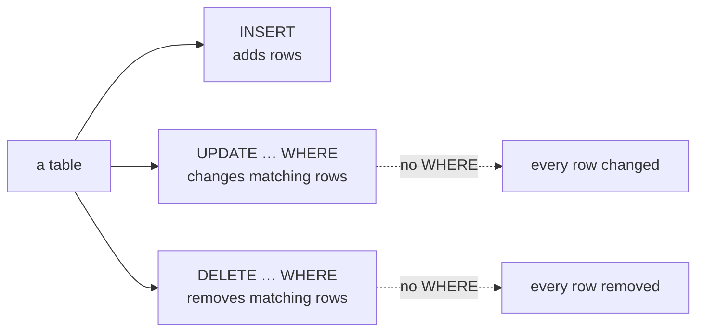

<!-- Written by `npm run lessons` from the lesson data in src/data. Edit the lesson there, not this page. -->

# INSERT, UPDATE and DELETE

**SQL · Unit 6: Building tables and changing data · Lesson 3 of 7 · Must know**

> **In one line.** INSERT adds new rows, UPDATE changes values in existing rows, and DELETE removes rows. UPDATE and DELETE act on every row their WHERE matches, and on every row of the table if there is no WHERE.

[Open this lesson on the site](https://learn.hamropedia.com/sql/insert-update-and-delete/) for its animation, the practice game and tap-to-explain words.

## The problem it solves

A database is only useful if it can be kept up to date: new customers, price changes, cancelled orders. These three statements do all of that — and one missing WHERE can change or wipe every row, so they deserve care.

## The idea

`INSERT INTO table (columns) VALUES (…)` adds a row; list the columns so the order is clear.  
`INSERT … SELECT` copies rows from a query.  
`UPDATE table SET column = value WHERE condition` changes matching rows, and the new value can use the old one (`salary = salary + 5000`).  
`DELETE FROM table WHERE condition` removes matching rows.  
An upsert — `INSERT … ON CONFLICT DO UPDATE` — inserts a row, or updates it if the key already exists.

## Analogy

Editing a spreadsheet. INSERT adds a new line at the bottom. UPDATE is find-and-replace — and WHERE is the "only in this selection" box. DELETE removes lines. Forgetting WHERE is "replace all" across the whole sheet.

**Where the analogy breaks.** A spreadsheet has Undo. The database doesn't: once a change is committed, it is permanent. That is why you run the WHERE as a SELECT first, and use transactions (next lesson) so you can roll back.

## Syntax

```sql
INSERT INTO t (col1, col2) VALUES (v1, v2);
UPDATE t SET col1 = new_value WHERE condition;
DELETE FROM t WHERE condition;
```

## How it works, step by step

1. INSERT adds Ravi as customer 7. The constraints are checked first.
2. `UPDATE employees SET salary = salary + 5000 WHERE dept_id = 2`: Dara and Eli get the raise, nobody else.
3. `DELETE FROM customers WHERE customer_id = 6` removes Tom's duplicate sign-up (he has no orders, so the foreign key allows it).
4. Upsert: inserting product 7 again hits the primary key, so DO UPDATE changes its price instead.
5. Safe habit: write `SELECT * FROM t WHERE …` first, check the rows, then turn it into the UPDATE or DELETE.

## Picture it



*UPDATE and DELETE act on whatever their WHERE matches. Leave the WHERE out and they act on every row in the table.*

## Examples on the practice database

**INSERT a new customer**

```sql
INSERT INTO customers (customer_id, name, email, city, signup_date)
VALUES (7, 'Ravi', 'ravi@mail.com', 'Leeds', '2024-03-25');
SELECT customer_id, name, city
FROM customers
WHERE city = 'Leeds'
ORDER BY customer_id;
```

| customer_id | name | city |
| --- | --- | --- |
| 2 | Tom | Leeds |
| 6 | Tom | Leeds |
| 7 | Ravi | Leeds |

---

**UPDATE using the old value**

```sql
UPDATE employees
SET salary = salary + 5000
WHERE dept_id = 2;
SELECT name, salary
FROM employees
WHERE dept_id = 2
ORDER BY name;
```

| name | salary |
| --- | --- |
| Dara | 65000 |
| Eli | 50000 |

---

**DELETE one row**

```sql
DELETE FROM customers
WHERE customer_id = 6;
SELECT customer_id, name
FROM customers
ORDER BY customer_id;
```

| customer_id | name |
| --- | --- |
| 1 | Priya |
| 2 | Tom |
| 3 | Lena |
| 4 | Omar |
| 5 | Zoe |

Every run on this page starts from the original data, so this delete doesn't affect other examples.

---

**Upsert: insert, or update if it already exists**

```sql
INSERT INTO products (product_id, product_name, category, price)
VALUES (7, 'Phone case', 'Electronics', 12)
ON CONFLICT (product_id) DO UPDATE SET price = excluded.price;
SELECT product_id, product_name, price
FROM products
WHERE category = 'Electronics'
ORDER BY product_id;
```

| product_id | product_name | price |
| --- | --- | --- |
| 6 | Headphones | 40 |
| 7 | Phone case | 12 |

`excluded` means "the row you tried to insert". The phone case already existed, so its price was updated from 15 to 12.

## Must know

- Always list the columns in INSERT; don't rely on the table's column order.
- UPDATE and DELETE without WHERE change every row.
- Run the WHERE as a SELECT first, and check how many rows it hits.
- `INSERT INTO t (…) SELECT …` copies rows from a query.
- An upsert inserts or updates in one atomic statement.

## Common mistakes

- Forgetting WHERE on an UPDATE or DELETE, so every row in the table is changed or removed.
- Deleting parent rows that child rows still reference — the foreign key refuses, or cascades if set to.
- Updating with a value computed from another table without checking the join returns one row per target row.

> **Not true:** An UPDATE with no WHERE changes only the first row of the table.  
> **In fact:** With no WHERE, UPDATE changes every row. Run the WHERE as a SELECT first, and check how many rows it hits.

## Other databases

- PostgreSQL and SQLite support `RETURNING` to see the rows you changed: `DELETE FROM t WHERE … RETURNING *`. SQL Server uses `OUTPUT`.
- UPDATE with a join: PostgreSQL `UPDATE t SET … FROM other WHERE …`; MySQL `UPDATE t JOIN other ON … SET …`; SQL Server `UPDATE t SET … FROM t JOIN other …`.

## In the interview

INSERT adds rows, ideally with an explicit column list; UPDATE changes columns in rows matched by WHERE, and DELETE removes matched rows. I have three safety habits. I run the WHERE as a SELECT first. I wrap risky changes in a transaction, so I can roll back. And when a row may or may not exist, I use an upsert (insert, on conflict do update): one atomic statement instead of a check-then-write race.

<details>
<summary>&lt;b>How would you safely delete a lot of rows?&lt;/b></summary>

Check the count with SELECT first, do it inside a transaction, and on very large tables delete in batches to avoid long locks.

</details>

<details>
<summary>&lt;b>Why is "check if it exists, then insert" a problem?&lt;/b></summary>

Two requests can both check, both see nothing, and both insert. An upsert or a UNIQUE constraint makes it atomic.

</details>

## Practise

Write each answer yourself first, then open the answer and compare.

### 1. Explain

Explain why you should run the WHERE as a SELECT before an UPDATE or DELETE.

<details>
<summary>Show one good answer</summary>

UPDATE and DELETE act on every row their WHERE matches, and there is no undo once it is committed. A WHERE that is slightly wrong (a typo, `OR` where you meant `AND`, a NULL you forgot) can change far more rows than you meant, or none at all.

Running the same WHERE as a SELECT first shows you exactly which rows will be hit and how many. If you expected 2 rows and see 2,000, you have just avoided a disaster. Then turn the SELECT into the UPDATE or DELETE, ideally inside a transaction, and check that the number of rows changed matches.

</details>

### 2. Write

Give everyone in Engineering a 10% raise (whole pounds), then show their names and new salaries.

<details>
<summary>Show one good answer</summary>

Multiply by 110 and divide by 100. With whole numbers, the division drops any pence, which is what "whole pounds" asks for. The department is found by its name, so the query doesn't depend on remembering that Engineering is 1.

```sql
UPDATE employees
SET salary = salary * 110 / 100
WHERE dept_id = (SELECT dept_id FROM departments WHERE dept_name = 'Engineering');
SELECT name, salary
FROM employees
WHERE dept_id = 1
ORDER BY name;
```

| name | salary |
| --- | --- |
| Asha | 104500 |
| Ben | 77000 |
| Chen | 77000 |
| Hana | 88000 |

</details>

### 3. Predict

How many rows does `DELETE FROM order_items WHERE quantity >= 3;` remove?

<details>
<summary>Show one good answer</summary>

7 rows: the item lines with a quantity of 3 or more. They are (101, headphones, 3), (103, mug, 5), (104, headphones, 5), (105, headphones, 3), (108, desk lamp, 3), (109, pen, 5) and (109, notebook, 4). 7 of the 14 remain.

In SQLite, `changes()` reports how many rows the last statement changed.

```sql
DELETE FROM order_items WHERE quantity >= 3;
SELECT changes() AS rows_removed, (SELECT COUNT(*) FROM order_items) AS rows_left;
```

| rows_removed | rows_left |
| --- | --- |
| 7 | 7 |

</details>

### 4. Edge cases

Try `DELETE FROM customers WHERE customer_id = 1;`. What happens and why? What would ON DELETE CASCADE have done?

<details>
<summary>Show one good answer</summary>

It fails: "FOREIGN KEY constraint failed". Priya (customer 1) has five orders, and each one's customer_id points at her. Deleting her would leave those orders pointing at nobody, so the database refuses, and nothing is deleted.

With `ON DELETE CASCADE` on orders.customer_id, deleting Priya would also delete her five orders automatically. Those orders have 9 item lines in order_items, so that foreign key would need CASCADE too; otherwise it would still block the delete. One innocent-looking DELETE would remove 15 rows across three tables, which is why CASCADE should be a deliberate choice.

```sql
DELETE FROM customers WHERE customer_id = 1;
```

The database refuses this query: `FOREIGN KEY constraint failed`

</details>

## Go further (optional)

- PRACTICE · [SQLBolt — Lesson 13: Inserting rows](https://sqlbolt.com/) · interactive exercises in the browser, free
- READ · [W3Schools — SQL UPDATE Statement](https://www.w3schools.com/sql/sql_update.asp) · short page with a try-it editor, free
- WATCH · [CS50's Introduction to Databases with SQL — Lecture 3: Writing](https://cs50.harvard.edu/sql/) · Harvard, free

---

[← Constraints: the rules that keep bad data out](constraints-the-rules-that-keep-bad-data-out.md) · [All lessons](../../README.md) · [Transactions and ACID →](transactions-and-acid.md)
