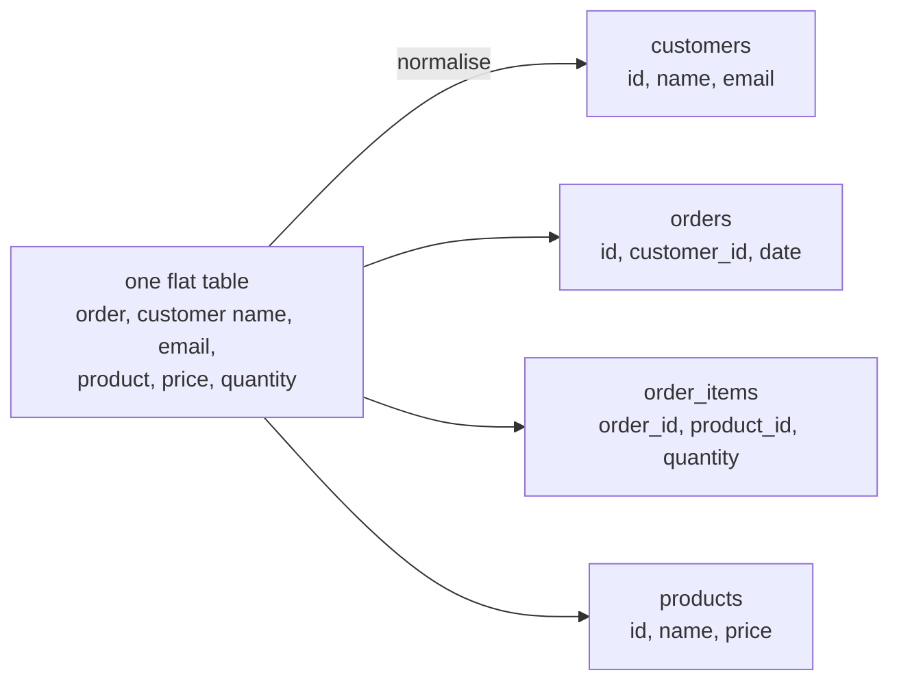

<!-- Written by `npm run lessons` from the lesson data in src/data. Edit the lesson there, not this page. -->

# Normalisation: designing tables that don't contradict themselves

**SQL · Unit 6: Building tables and changing data · Lesson 5 of 7 · Must know**

> **In one line.** Normalisation is designing tables so that each fact is stored in exactly one place. The usual target is third normal form (3NF): one value per cell, and every column depends on the key, the whole key, and nothing but the key.

[Open this lesson on the site](https://learn.hamropedia.com/sql/normalisation-designing-tables-that-dont-contradict-themselves/) for its animation, the practice game and tap-to-explain words.

## The problem it solves

If every order row stored the customer's email, changing Priya's email means updating five rows — miss one and the database says two different things. That is an update anomaly. Normalisation designs it out, and it is a favourite interview question.

## The idea

First normal form (1NF): one value per cell, no lists like 'Pen, Mug', and no repeating columns like item1, item2.  
Second (2NF): in a table with a composite key, every column must depend on the whole key. The product name depends only on product_id, so it belongs in products, not in order_items.  
Third (3NF): no column depends on another non-key column — a customer's city name shouldn't carry the city's country too; that belongs in a cities table.

The practice database is already normalised: customers, orders, order_items and products each hold one kind of fact. Denormalisation is copying data back on purpose, for read speed, accepting the risk.

## Analogy

A school keeping each pupil's address in one office file, instead of writing it on every exercise book. When a family moves, one change updates everything — and no book can show an old address.

**Where the analogy breaks.** In a school, looking up the office file is quick. In a database, every split costs a join at read time. That is why analytics warehouses often denormalise on purpose: reads there matter more than updates.

## How it works, step by step

1. Start with one wide "flat" table: order, customer name, email, product, price, quantity.
2. Priya's email appears on every line she bought — 9 times. Changing it means 9 updates.
3. 1NF: one product per row, not 'Headphones, Backpack' in one cell.
4. 2NF: product_name and price depend only on product_id, so they move to products; customer details move to customers.
5. 3NF: nothing depends on a non-key column. What is left is the practice database: each fact once, joined back when needed.

## Picture it



*Normalising splits a wide table so each fact lives in one place. Joins put the flat view back together when you need it — the next example does exactly that.*

## Examples on the practice database

**What one flat table would look like (built with joins)**

```sql
SELECT o.order_id, c.name, c.email, p.product_name, p.price, oi.quantity
FROM order_items oi
JOIN orders o    ON o.order_id = oi.order_id
JOIN customers c ON c.customer_id = o.customer_id
JOIN products p  ON p.product_id = oi.product_id
WHERE o.customer_id = 1
ORDER BY o.order_id, p.product_name;
```

| order_id | name | email | product_name | price | quantity |
| --- | --- | --- | --- | --- | --- |
| 101 | Priya | priya@mail.com | Headphones | 40 | 3 |
| 102 | Priya | priya@mail.com | Backpack | 30 | 1 |
| 102 | Priya | priya@mail.com | Desk lamp | 25 | 2 |
| 103 | Priya | priya@mail.com | Mug | 8 | 5 |
| 103 | Priya | priya@mail.com | Notebook | 5 | 1 |
| 105 | Priya | priya@mail.com | Backpack | 30 | 1 |
| 105 | Priya | priya@mail.com | Headphones | 40 | 3 |
| 109 | Priya | priya@mail.com | Notebook | 5 | 4 |
| 109 | Priya | priya@mail.com | Pen | 2 | 5 |

Priya's email is repeated 9 times and each price several times. Stored like this, one missed update would make them disagree. Normalised, each is stored once.

## Must know

- 1NF: one value per cell; no lists, no repeating column groups.
- 2NF: 1NF, and no column depends on just part of a composite key.
- 3NF: 2NF, and no column depends on another non-key column.
- Normalised data avoids update, insert and delete anomalies; the cost is more joins.
- Denormalise on purpose (reporting tables, caches) when reads matter more than keeping one copy.

## Common mistakes

- Storing comma-separated lists in a column.
- Copying a value (like a price) into another table without deciding whether it should change when the source changes.
- Normalising so far that simple questions need eight joins. 3NF is usually the right stop.

> **Not true:** The further a design is normalised, the better it always is.  
> **In fact:** Past third normal form, simple questions can need many joins. 3NF is usually the right place to stop.

## Other databases

- Real order systems often store unit_price in order_items on purpose: the price paid at the time must not change when the product's price changes later. That isn't a 2NF violation — it is a different fact.

## In the interview

Normalisation organises tables so each fact is stored once, which prevents update, insert and delete anomalies. First normal form means atomic values with no repeating groups. Second: no partial dependency on part of a composite key. Third: no transitive dependency through a non-key column. In short, every column depends on the key, the whole key and nothing but the key. I normalise transactional systems to about 3NF and denormalise deliberately for analytics or read-heavy paths.

<details>
<summary>&lt;b>What is an update anomaly?&lt;/b></summary>

When the same fact is stored in several rows and an update changes some but not all of them, so the data contradicts itself.

</details>

<details>
<summary>&lt;b>When would you denormalise?&lt;/b></summary>

For read-heavy reporting or performance — for example a star schema in a data warehouse — accepting extra storage and the work of keeping copies in sync.

</details>

<details>
<summary>&lt;b>What is BCNF?&lt;/b></summary>

Boyce–Codd normal form, a slightly stricter 3NF: every determinant must be a candidate key. It rarely comes up beyond the definition.

</details>

## Practise

Write each answer yourself first, then open the answer and compare.

### 1. Explain

Explain 1NF, 2NF and 3NF in one sentence each, using the shop tables.

<details>
<summary>Show one good answer</summary>

• 1NF, one value per cell: an order can't store 'Headphones, Backpack' in one column; each product gets its own row in order_items.  
• 2NF, every column depends on the whole key: in order_items the key is (order_id, product_id), and quantity depends on both, but a product_name would depend on product_id alone, so names live in products.  
• 3NF, no column depends on another non-key column: orders shouldn't hold the customer's email, because the email depends on customer_id, not on the order; it lives once, in customers.

</details>

### 2. Write

Write the query that rebuilds the flat view for Tom (customer 2), and count how many times his email appears.

<details>
<summary>Show one good answer</summary>

The same four-table join as the lesson, for customer 2. Tom has two orders with one item each, so his email appears 2 times. (His second sign-up, customer 6, repeats the same email in customers, but has no orders.)

```sql
SELECT o.order_id, c.name, c.email, p.product_name, p.price, oi.quantity
FROM order_items oi
JOIN orders o    ON o.order_id = oi.order_id
JOIN customers c ON c.customer_id = o.customer_id
JOIN products p  ON p.product_id = oi.product_id
WHERE o.customer_id = 2
ORDER BY o.order_id, p.product_name;
```

| order_id | name | email | product_name | price | quantity |
| --- | --- | --- | --- | --- | --- |
| 104 | Tom | tom@mail.com | Headphones | 40 | 5 |
| 108 | Tom | tom@mail.com | Desk lamp | 25 | 3 |

</details>

### 3. Predict

If products also stored the category's manager name, which normal form would that break, and why?

<details>
<summary>Show one good answer</summary>

Third normal form. The manager's name depends on the category, not on the product: product_id → category → manager. That is a transitive dependency, through a column that isn't the key.

The symptom: the Stationery manager's name would be stored on the pen row and the notebook row. Change the manager and miss one row, and the table says two different things. The fix is a categories table (category, manager_name), with products keeping only the category.

</details>

### 4. Edge cases

Should order_items store the price at the time of the order? Argue both sides.

<details>
<summary>Show one good answer</summary>

For storing it:  
• The price paid is a different fact from today's price. When the headphones go from £40 to £45, last month's order must still say £40, for invoices, refunds and revenue reports.  
• Without it, every old order would silently change value whenever a price changes.  
• So it is not a 2NF violation: unit_price in order_items depends on the whole key (this product, in this order), not on product_id alone.

Against:  
• If prices truly never change, it is a redundant copy taking space.  
• Two columns called "price" invite mistakes: which one does a report use?  
• An alternative is a price-history table with "valid from" dates, joined on the order date. It is fully normalised, but every read becomes more complex.

In practice, almost every real order system stores the price at the time of the order.

</details>

## Go further (optional)

- WATCH · [Database normalisation: 1NF, 2NF, 3NF (video)](https://www.youtube.com/results?search_query=database%20normalization%201NF%202NF%203NF%20explained) · YouTube search, free
- WATCH · [CS50's Introduction to Databases with SQL — Lecture 2: Designing](https://cs50.harvard.edu/sql/) · Harvard, free
- READ · [W3Schools — SQL FOREIGN KEY (linking normalised tables)](https://www.w3schools.com/sql/sql_foreignkey.asp) · short page with a try-it editor, free

---

[← Transactions and ACID](transactions-and-acid.md) · [All lessons](../../README.md) · [Views: saved queries you can use like tables →](views-saved-queries-you-can-use-like-tables.md)
