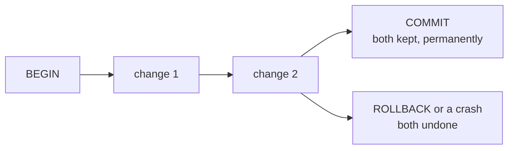

<!-- Written by `npm run lessons` from the lesson data in src/data. Edit the lesson there, not this page. -->

# Transactions and ACID

**SQL · Unit 6: Building tables and changing data · Lesson 4 of 7 · Must know**

> **In one line.** A transaction groups several statements into one all-or-nothing unit: BEGIN, then the changes, then COMMIT to keep them or ROLLBACK to undo them. ACID names the four guarantees it gives: Atomic, Consistent, Isolated, Durable.

[Open this lesson on the site](https://learn.hamropedia.com/sql/transactions-and-acid/) for its animation, the practice game and tap-to-explain words.

## The problem it solves

Moving money means taking £100 from one account and adding it to another. If the system crashes between the two, £100 vanishes. Transactions make sure either both changes happen or neither does — and that two people working at once don't corrupt each other's changes.

## The idea

BEGIN starts a transaction. Changes made inside are visible to you but not yet permanent. COMMIT makes them all permanent at once; ROLLBACK throws them all away.

ACID: Atomic — all or nothing.  
Consistent — the data moves from one valid state to another, never breaking a constraint.  
Isolated — transactions running at the same time don't see each other's half-finished work (how strictly depends on the isolation level).  
Durable — once committed, it survives a crash.

## Analogy

A bank transfer slip that only counts when it is stamped. You can fill in both lines — take from here, add to there — but nothing happens until the stamp (COMMIT). Tear up the slip (ROLLBACK) and it is as if you never started.

**Where the analogy breaks.** A torn-up slip leaves no trace. Inside a database, a long open transaction holds locks that can make other people wait. Keep transactions short: never wait for user input inside one.

## Syntax

```sql
BEGIN;
UPDATE ... ;
UPDATE ... ;
COMMIT;      -- or ROLLBACK;
```

## How it works, step by step

1. BEGIN opens the transaction.
2. Two UPDATEs move Gus into HR and give him a raise. Only this transaction can see the changes so far.
3. COMMIT makes both changes permanent together. A crash before COMMIT would undo both.
4. In the second example, DELETE removes every item — then ROLLBACK undoes it, and all 14 rows are back.
5. If any statement fails, you roll back, and the data is exactly as it was before BEGIN.

## Picture it



*Everything between BEGIN and COMMIT is one unit. It is either kept completely or thrown away completely — never half done.*

## Examples on the practice database

**Two changes, committed together**

```sql
BEGIN;
UPDATE employees SET dept_id = 4 WHERE name = 'Gus';
UPDATE employees SET salary = salary + 2000 WHERE name = 'Gus';
COMMIT;
SELECT name, dept_id, salary FROM employees WHERE name = 'Gus';
```

| name | dept_id | salary |
| --- | --- | --- |
| Gus | 4 | 40000 |

---

**ROLLBACK undoes everything since BEGIN**

```sql
BEGIN;
DELETE FROM order_items;
ROLLBACK;
SELECT COUNT(*) AS items_after_rollback FROM order_items;
```

| items_after_rollback |
| --- |
| 14 |

All 14 rows were deleted inside the transaction, then restored. Try adding a SELECT `COUNT(*)` before ROLLBACK to see 0.

## Must know

- BEGIN … COMMIT makes several statements one all-or-nothing unit; ROLLBACK cancels it.
- Atomic: all or nothing. Consistent: constraints always hold. Isolated: concurrent transactions don't interfere. Durable: committed means saved.
- Isolation levels trade safety for speed: READ COMMITTED, REPEATABLE READ, SERIALIZABLE.
- Anomalies the levels prevent: dirty reads, non-repeatable reads, phantom reads.
- Keep transactions short; long ones hold locks and block others.
- Locks and write skew: [ACID transactions and isolation levels](https://learn.hamropedia.com/system-design/acid-transactions-and-isolation-levels/). Transactions across several services: [Distributed transactions: sagas and the outbox pattern](https://learn.hamropedia.com/system-design/distributed-transactions-sagas-and-the-outbox-pattern/). Both are in System Design.

## Common mistakes

- Running related changes without a transaction, so a failure halfway leaves the data inconsistent.
- Leaving a transaction open (forgetting COMMIT), which holds locks.
- Assuming the default isolation level prevents every race. Two transactions can still both read a balance and both write it.

> **Not true:** Default isolation level: it stops two transactions from overwriting each other's work.  
> **In fact:** Under the usual default, two transactions can both read the same balance and both write it back, so one change is lost. Lock the row first, or use a stricter level.

## Other databases

- Default isolation: PostgreSQL, SQL Server and Oracle use READ COMMITTED; MySQL InnoDB uses REPEATABLE READ; SQLite is effectively SERIALIZABLE.
- Most databases run each statement in its own transaction automatically (autocommit) unless you BEGIN one.

## In the interview

A transaction groups statements into an atomic unit — BEGIN, changes, then COMMIT or ROLLBACK. ACID means atomicity, all or nothing; consistency, constraints hold before and after; isolation, concurrent transactions don't see each other's uncommitted work; and durability, committed changes survive crashes. Isolation is tunable: read committed, repeatable read, serializable. Each level trades anomalies, like non-repeatable or phantom reads, against concurrency. For something like a balance update, I lock the row with SELECT FOR UPDATE or use serializable.

<details>
<summary>&lt;b>What is a dirty read?&lt;/b></summary>

Reading another transaction's changes before it commits. If it then rolls back, you read data that never existed. READ COMMITTED prevents it.

</details>

<details>
<summary>&lt;b>What is a phantom read?&lt;/b></summary>

Running the same query twice in one transaction and getting new rows the second time because someone inserted them. SERIALIZABLE prevents it.

</details>

<details>
<summary>&lt;b>How do you stop two transfers overdrawing an account at the same time?&lt;/b></summary>

Lock the row while you check and update it (`SELECT … FOR UPDATE`), use SERIALIZABLE, or update with a condition: `UPDATE accounts SET balance = balance - 100 WHERE id = 1 AND balance >= 100`.

</details>

## Practise

Write each answer yourself first, then open the answer and compare.

### 1. Explain

Explain each letter of ACID with the bank-transfer example.

<details>
<summary>Show one good answer</summary>

Moving £100 from account A to account B is two UPDATEs: subtract from A, add to B.

• Atomic: they happen together or not at all. If the server crashes after the first UPDATE, the transaction is rolled back, so £100 can't disappear.  
• Consistent: every rule still holds afterwards. If a CHECK says balances can't go below zero, a transfer that would overdraw A fails, and nothing changes.  
• Isolated: someone reading the balances while the transfer runs never sees the halfway point (A already £100 down, B not yet £100 up).  
• Durable: once COMMIT returns, the transfer is saved on disk and survives a crash or power cut a second later.

</details>

### 2. Write

In one transaction, move Eli to Marketing and give him a £3000 raise, then show his row.

<details>
<summary>Show one good answer</summary>

Both changes sit between BEGIN and COMMIT, so they are saved together. Marketing is department 3. Eli's salary goes from 45,000 to 48,000.

Notice his manager_id is still 4 (Dara, in Sales). A real move would probably change that too, in the same transaction.

```sql
BEGIN;
UPDATE employees SET dept_id = 3 WHERE name = 'Eli';
UPDATE employees SET salary = salary + 3000 WHERE name = 'Eli';
COMMIT;
SELECT * FROM employees WHERE name = 'Eli';
```

| emp_id | name | dept_id | manager_id | salary | hire_date |
| --- | --- | --- | --- | --- | --- |
| 5 | Eli | 3 | 4 | 48000 | 2022-07-01 |

</details>

### 3. Predict

What does the second example return if you remove the ROLLBACK line?

<details>
<summary>Show one good answer</summary>

0. Inside the open transaction, the DELETE has already removed all 14 item lines, and the transaction sees its own changes.

The bigger problem is that the transaction is never finished. Nothing is permanent yet, and it holds locks that block other writers until someone commits, rolls back, or disconnects (which rolls it back). Forgetting to end a transaction is a classic way to freeze an application.

```sql
BEGIN;
DELETE FROM order_items;
SELECT COUNT(*) AS items_after_rollback FROM order_items;
```

| items_after_rollback |
| --- |
| 0 |

</details>

### 4. Edge cases

Two people run "read the stock, subtract 1, write it back" at the same moment on a product with 1 left. What can go wrong, and how do you prevent it?

<details>
<summary>Show one good answer</summary>

Both read stock = 1, both compute 1 − 1 = 0, and both write 0. Both sales go through, so one item has been sold twice: a lost update. The second writer overwrote the first one's change without knowing it existed.

Prevent it by making "check and subtract" one atomic step:  
• A conditional update: `UPDATE products SET stock = stock - 1 WHERE product_id = 7 AND stock >= 1`, then check how many rows changed. 0 means sold out.  
• Or lock the row while you read it: `SELECT stock … FOR UPDATE`, then update. The second buyer waits, then reads 0.  
• Plus a `CHECK (stock >= 0)` as a final safety net.

Below, a stock column is added with 1 left, and two buyers run the conditional update. The second one changes 0 rows, so it knows it must refuse the sale.

```sql
ALTER TABLE products ADD COLUMN stock INTEGER NOT NULL DEFAULT 1 CHECK (stock >= 0);
UPDATE products SET stock = stock - 1 WHERE product_id = 7 AND stock >= 1;
UPDATE products SET stock = stock - 1 WHERE product_id = 7 AND stock >= 1;
SELECT product_name, stock, changes() AS second_buyer_got
FROM products
WHERE product_id = 7;
```

| product_name | stock | second_buyer_got |
| --- | --- | --- |
| Phone case | 0 | 0 |

</details>

## Go further (optional)

- READ · [PostgreSQL docs — Transactions (tutorial)](https://www.postgresql.org/docs/current/tutorial-transactions.html) · official documentation, free
- READ · [PostgreSQL docs — Transaction Isolation](https://www.postgresql.org/docs/current/transaction-iso.html) · official documentation, free
- WATCH · [ACID transactions explained (video)](https://www.youtube.com/results?search_query=ACID%20transactions%20explained%20database) · YouTube search, free

---

[← INSERT, UPDATE and DELETE](insert-update-and-delete.md) · [All lessons](../../README.md) · [Normalisation: designing tables that don't contradict themselves →](normalisation-designing-tables-that-dont-contradict-themselves.md)
