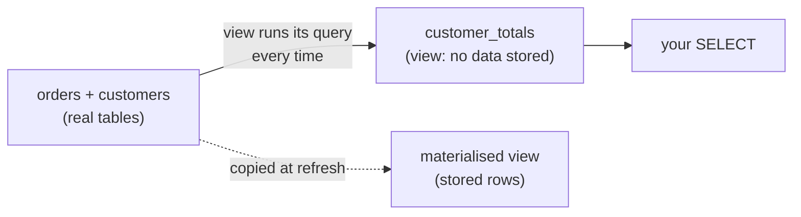

<!-- Written by `npm run lessons` from the lesson data in src/data. Edit the lesson there, not this page. -->

# Views: saved queries you can use like tables

**SQL · Unit 6: Building tables and changing data · Lesson 6 of 7 · Should know**

> **In one line.** A view is a named, saved SELECT that you query like a table. It stores no data of its own, so it always shows the current data. A materialised view stores the result and must be refreshed.

[Open this lesson on the site](https://learn.hamropedia.com/sql/views-saved-queries-you-can-use-like-tables/) for its animation, the practice game and tap-to-explain words.

## The problem it solves

The same "customer totals" query gets copied into ten reports, and when the rule changes, nine get fixed. A view keeps one definition in the database that everyone uses. Views can also hide columns people shouldn't see.

## The idea

`CREATE VIEW customer_totals AS SELECT …` saves the query under a name. `SELECT * FROM customer_totals` runs it. Because the view is only a query, a new order shows up the next time you read it. A materialised view (PostgreSQL, Oracle) is different: it saves the rows, so reading is fast, but the data is only as fresh as the last REFRESH.

## Analogy

A saved search in your email: "unread from my manager". It doesn't copy any emails; it runs the search every time you open it. A materialised view is a printed list of those emails — fast to read, but out of date as soon as a new one arrives.

**Where the analogy breaks.** A saved search is free to run. A view over a big, complex query costs the full query every time you read it — a view makes queries shorter to write, not faster to run.

## Syntax

```sql
CREATE VIEW view_name AS
SELECT ...;

SELECT * FROM view_name WHERE ...;
```

## How it works, step by step

1. CREATE VIEW stores the query text under the name customer_totals.
2. Selecting from the view runs that query and then applies your WHERE and ORDER BY.
3. Insert a new order for Omar, read the view again, and his total is already there.
4. A materialised view would still show his old total until it is refreshed.

## Picture it



*A view is a window onto the tables: it runs its query each time, so it is always current. A materialised view is a stored copy — fast, but only as fresh as its last refresh.*

## Examples on the practice database

**Create a view and query it like a table**

```sql
CREATE VIEW customer_totals AS
SELECT c.customer_id, c.name,
       COUNT(o.order_id) AS orders,
       COALESCE(SUM(o.amount), 0) AS total_spent
FROM customers c
LEFT JOIN orders o ON o.customer_id = c.customer_id
GROUP BY c.customer_id, c.name;

SELECT name, total_spent
FROM customer_totals
WHERE total_spent > 50
ORDER BY total_spent DESC;
```

| name | total_spent |
| --- | --- |
| Priya | 425 |
| Tom | 275 |
| Lena | 60 |

---

**A view is always up to date**

```sql
CREATE VIEW customer_totals AS
SELECT c.customer_id, c.name, COALESCE(SUM(o.amount), 0) AS total_spent
FROM customers c
LEFT JOIN orders o ON o.customer_id = c.customer_id
GROUP BY c.customer_id, c.name;

INSERT INTO orders VALUES (111, 4, '2024-03-25', 90, 'pending');

SELECT name, total_spent FROM customer_totals WHERE customer_id = 4;
```

| name | total_spent |
| --- | --- |
| Omar | 90 |

Omar had spent 0. The new order appears straight away, because the view re-runs its query.

## Must know

- A view is a saved query, used like a table. It stores no rows.
- Views give one shared definition of a metric, and can hide sensitive columns.
- A view is as fast as its underlying query — it doesn't speed things up.
- A materialised view stores the result: fast reads, stale until refreshed.

## Common mistakes

- Expecting a normal view to make a slow query fast.
- Stacking views on views until no one can tell what a query really does.
- Forgetting to refresh a materialised view and reporting old numbers.

> **Not true:** Saving a slow query as a view makes it run faster.  
> **In fact:** A normal view stores no rows: its query runs again every time the view is used. Only a materialised view stores results, and it has to be refreshed.

## Other databases

- Materialised views: PostgreSQL `CREATE MATERIALIZED VIEW` + `REFRESH MATERIALIZED VIEW`; Oracle has them; SQL Server uses "indexed views"; MySQL and SQLite have none.

## In the interview

A view is a stored query that behaves like a virtual table. It holds no data, so it is always current. It is useful for sharing one definition of a metric, or for restricting which columns people see. It doesn't make queries faster. When the query is expensive and slight staleness is fine, I use a materialised view, which stores the result and is refreshed on a schedule.

<details>
<summary>&lt;b>View or materialised view?&lt;/b></summary>

A view runs its query on every read and is always fresh. A materialised view stores the result: fast to read, stale until refreshed.

</details>

<details>
<summary>&lt;b>Can you INSERT into a view?&lt;/b></summary>

Into simple views over one table, often yes. Views with joins or aggregates generally can't be written to without extra rules or triggers.

</details>

## Practise

Write each answer yourself first, then open the answer and compare.

### 1. Explain

Explain the difference between a view and a materialised view.

<details>
<summary>Show one good answer</summary>

A view is a saved query with a name. It stores no rows: every time you select from it, it runs its query against the current tables, so it is always up to date, and only as fast as that query.

A materialised view runs the query once and stores the result rows. Reading it is fast (it is like reading a table), but it is a snapshot: new orders don't appear until you REFRESH it. Use a view for one shared definition of a query; use a materialised view when the query is expensive and slightly old numbers are fine (such as a dashboard refreshed every hour).

</details>

### 2. Write

Create a view product_sales with each product and the total quantity sold (0 if none), then select the top 3 from it.

<details>
<summary>Show one good answer</summary>

The LEFT JOIN keeps every product, and COALESCE turns the phone case's NULL total into 0. The view is then queried like a table.

The desk lamp and the mug tie on 6 for second place; the name in the ORDER BY decides which comes first, and both make the top 3 here.

```sql
CREATE VIEW product_sales AS
SELECT p.product_id, p.product_name, COALESCE(SUM(oi.quantity), 0) AS total_sold
FROM products p
LEFT JOIN order_items oi ON oi.product_id = p.product_id
GROUP BY p.product_id, p.product_name;

SELECT product_name, total_sold
FROM product_sales
ORDER BY total_sold DESC, product_name
LIMIT 3;
```

| product_name | total_sold |
| --- | --- |
| Headphones | 11 |
| Desk lamp | 6 |
| Mug | 6 |

</details>

### 3. Predict

If you UPDATE an order amount, does SELECT from customer_totals show the new total? Would a materialised view?

<details>
<summary>Show one good answer</summary>

Yes. The view stores only its query, so the next SELECT re-runs it against the updated orders table. Below, order 109 goes from £30 to £50, and Priya's total goes from 425 to 445 straight away.

A materialised view would not: it would keep showing 425 until someone ran REFRESH MATERIALIZED VIEW.

```sql
CREATE VIEW customer_totals AS
SELECT c.customer_id, c.name, COALESCE(SUM(o.amount), 0) AS total_spent
FROM customers c
LEFT JOIN orders o ON o.customer_id = c.customer_id
GROUP BY c.customer_id, c.name;

UPDATE orders SET amount = 50 WHERE order_id = 109;

SELECT name, total_spent FROM customer_totals WHERE customer_id = 1;
```

| name | total_spent |
| --- | --- |
| Priya | 445 |

</details>

### 4. Edge cases

Your view uses `SELECT *` from a table, and someone adds a column to that table. What might happen? Why is it safer to list columns?

<details>
<summary>Show one good answer</summary>

It depends on the database, and every option is bad.

• SQLite expands the \* every time the view is read, so the new column appears in the view by itself. If that column is sensitive, it leaks. Below, a view meant to be safe to share suddenly shows a password_hash.  
• PostgreSQL expands the \* once, when the view is created, so the new column never appears, and the view quietly stops matching its table. Dropping a column the view uses, or changing its type, is refused.  
• In SQL Server, the view's stored column list can go out of step with the table until it is refreshed, and columns can come back shifted.

Listing the columns makes the view's shape fixed and visible: nothing new appears by accident, nothing sensitive leaks, and anything that depends on the view keeps getting the same columns.

```sql
CREATE VIEW public_customers AS
SELECT * FROM customers;

ALTER TABLE customers ADD COLUMN password_hash TEXT;
UPDATE customers SET password_hash = 'x9f2…' WHERE customer_id = 1;

SELECT * FROM public_customers WHERE customer_id = 1;
```

| customer_id | name | email | city | signup_date | password_hash |
| --- | --- | --- | --- | --- | --- |
| 1 | Priya | priya@mail.com | London | 2024-01-02 | x9f2… |

</details>

## Go further (optional)

- READ · [W3Schools — SQL Views](https://www.w3schools.com/sql/sql_view.asp) · short page with a try-it editor, free
- READ · [PostgreSQL docs — Materialized Views](https://www.postgresql.org/docs/current/rules-materializedviews.html) · official documentation, free
- READ · [SQLite docs — CREATE VIEW](https://www.sqlite.org/lang_createview.html) · official documentation, free

---

[← Normalisation: designing tables that don't contradict themselves](normalisation-designing-tables-that-dont-contradict-themselves.md) · [All lessons](../../README.md) · [DDL, DML, DCL, TCL — and DELETE versus TRUNCATE versus DROP →](ddl-dml-dcl-tcl-and-delete-versus-truncate-versus-drop.md)
