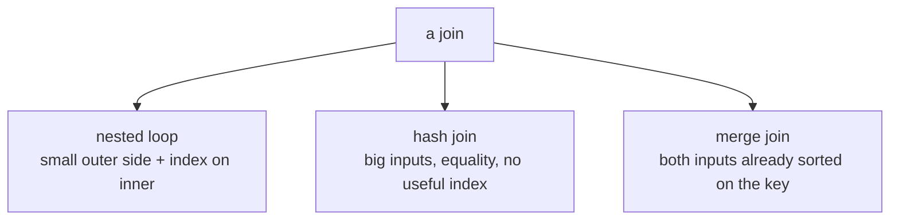

<!-- Written by `npm run lessons` from the lesson data in src/data. Edit the lesson there, not this page. -->

# How a database runs a join: nested loop, hash join, merge join

**SQL · Unit 7: Performance: indexes and query plans · Lesson 4 of 4 · Bonus**

> **In one line.** A database has three main ways to run a join. A nested loop looks up matches in the other table for each row of one. A hash join builds a hash table from one side and probes it with the other. A merge join walks two sorted inputs together. The optimiser picks one for each join.

[Open this lesson on the site](https://learn.hamropedia.com/sql/how-a-database-runs-a-join-nested-loop-hash-join-merge-join/) for its animation, the practice game and tap-to-explain words.

## The problem it solves

In senior interviews you may be asked why a join is slow or what a plan line like "Hash Join" means. Knowing the three methods tells you which index or memory setting will help.

## The idea

Nested loop: for each row of the outer table, find the matching rows in the inner table. It is fast when the outer side is small and the inner side has an index on the join key (that is what SQLite did in the last lesson).

Hash join: read the smaller table into a hash table keyed on the join column, then stream the bigger table past it, checking each row. It is great for big equality joins with no index, but it needs memory.

Merge join: if both sides are sorted on the key (by an index, or by sorting first), walk them side by side, like closing a zip. It is good for big inputs that are already in order.

## Analogy

Matching wedding guests to tables. Nested loop: take each guest and look their name up in the seating plan. Hash join: first make a quick lookup card per surname, then let every guest find their card. Merge join: line up the guests alphabetically and the seating list alphabetically, then walk down both together.

**Where the analogy breaks.** At a wedding you would pick the method by eye. A database picks it from estimates of how many rows each side has — wrong estimates are the main reason it picks badly.

## How it works, step by step

1. Nested loop: outer has N rows, and each inner lookup is an index search, so the cost is about N × log(M). Bad if there is no index on the inner side: N × M.
2. Hash join: build a hash table on the smaller input (one pass), probe it with the larger (one pass): about N + M, using memory.
3. Merge join: if both inputs are already sorted, one pass over each: about N + M; otherwise a sort first.
4. Equality joins can use any method; only nested loops handle conditions like `a.x < b.y`.
5. You influence the choice through indexes, statistics and (in PostgreSQL) memory settings like work_mem.

## Picture it



*The optimiser chooses a join method per join, based on how many rows it expects on each side, whether indexes exist, and whether the inputs are already sorted.*

## Examples on the practice database

**A nested loop: scan one side, search the other by key**

```sql
EXPLAIN QUERY PLAN
SELECT p.category, SUM(oi.quantity * p.price)
FROM order_items oi
JOIN products p ON p.product_id = oi.product_id
GROUP BY p.category;
```

| id | parent | notused | detail |
| --- | --- | --- | --- |
| 7 | 0 | 216 | SCAN oi |
| 9 | 0 | 45 | SEARCH p USING INTEGER PRIMARY KEY (rowid=?) |
| 12 | 0 | 0 | USE TEMP B-TREE FOR GROUP BY |

SQLite mostly uses nested loops: for each order item, it looks the product up by its primary key. PostgreSQL would likely show a Hash Join here on bigger tables.

## Must know

- Nested loop: best for a small outer input with an index on the inner join key.
- Hash join: best for large, unsorted equality joins; needs memory for the hash table.
- Merge join: best when both inputs are already sorted on the join key.
- The optimiser chooses using row-count estimates; stale statistics cause bad choices.
- Indexing join keys (especially foreign keys) is the single most useful join optimisation.

## Common mistakes

- Thinking an index always makes a join faster: for a hash join over whole tables it may not be used at all.
- Ignoring a nested loop over two large tables without an index — it grows as N × M.
- Forcing a join method with hints instead of fixing the statistics or indexes.

> **Not true:** An index on the join column speeds up a hash join over whole tables.  
> **In fact:** A hash join that reads whole tables may not use the index at all. An index helps most when only a few rows are looked up, as in a nested loop.

## Other databases

- PostgreSQL, SQL Server and Oracle use all three methods. SQLite uses nested loops (with automatic temporary indexes). MySQL added hash joins in 8.0.18.

## In the interview

There are three main physical join algorithms. Nested loop iterates the outer input and looks up matches in the inner — ideal when the outer side is small and the inner join key is indexed. Hash join builds an in-memory hash table on the smaller input and probes it with the larger — ideal for big equality joins without useful indexes. Merge join walks two inputs sorted on the key. The optimiser chooses based on estimated cardinalities, so bad statistics are a common cause of a poor join plan.

<details>
<summary>&lt;b>Which join method can handle a non-equality condition like a.start &lt; b.end?&lt;/b></summary>

Only a nested loop. Hash and merge joins need an equality condition.

</details>

<details>
<summary>&lt;b>When does a hash join go to disk?&lt;/b></summary>

When the hash table doesn't fit in the memory allowed (work_mem in PostgreSQL), it spills to disk in batches and slows down.

</details>

## Practise

Write each answer yourself first, then open the answer and compare.

### 1. Explain

Explain the three join methods with the wedding-guest analogy.

<details>
<summary>Show one good answer</summary>

Matching wedding guests to their tables:

• Nested loop: take each guest in turn and look their name up in the seating plan. Quick if the seating plan has an index (sorted by name, so each lookup is fast) or if there are only a few guests. Without an index, every guest reads the whole plan: very slow for big lists.  
• Hash join: first make a quick lookup card for every name in the seating plan (a hash table, kept in memory), then let each guest find their card in one step. Great for two big lists with no index; it needs memory for the cards.  
• Merge join: line the guests up alphabetically, line the seating plan up alphabetically, then walk down both lists together, matching as you go. Great when both are already sorted (by an index); otherwise both must be sorted first.

The optimiser picks one per join, from the sizes, the indexes and the memory available.

</details>

### 2. Write

Write a query joining orders and customers, run EXPLAIN QUERY PLAN, and name the join method SQLite used.

<details>
<summary>Show one good answer</summary>

The plan reads: SCAN o, then SEARCH c using the primary key. That is a nested loop: for each order (the outer loop), look up its customer by key (the inner step). SQLite only does nested loops; it makes them fast with indexes, and builds a temporary index itself when none exists. PostgreSQL would show "Nested Loop", "Hash Join" or "Merge Join" by name.

```sql
EXPLAIN QUERY PLAN
SELECT o.order_id, c.name
FROM orders o
JOIN customers c ON c.customer_id = o.customer_id;
```

| id | parent | notused | detail |
| --- | --- | --- | --- |
| 3 | 0 | 216 | SCAN o |
| 5 | 0 | 45 | SEARCH c USING INTEGER PRIMARY KEY (rowid=?) |

</details>

### 3. Predict

Joining a 10-row table to a 10-million-row table with an index on the big table's join key — which method would you expect?

<details>
<summary>Show one good answer</summary>

A nested loop, with the small table outside. Loop over the 10 rows, and for each one search the big table's index: 10 index lookups of a few steps each, a few dozen page reads in all.

A hash join would have to read all 10 million rows of the big table (to build or to probe), and a merge join would need it sorted. Neither can compete with 10 index lookups.

</details>

### 4. Edge cases

Two 100-million-row tables are joined on a column with no index on either side. Which method should the optimiser pick, and what resource does it need?

<details>
<summary>Show one good answer</summary>

A hash join. A nested loop with no index would compare every row with every row: 100 million × 100 million = 10¹⁶ comparisons, which never finishes. A merge join would first have to sort both 100-million-row tables.

A hash join reads one side (ideally the smaller after filters) and builds a hash table on the join column, then reads the other side once and probes it: about two passes over the data.

The resource it needs is memory, for the hash table. If it doesn't fit, the database splits both sides into batches by hash and writes them to temporary disk space, then joins batch by batch (a "grace" hash join), which is slower but still linear. Big analytical joins are often limited by memory, so the work_mem (PostgreSQL) or join buffer settings matter.

</details>

## Go further (optional)

- READ · [PostgreSQL docs — Planner/Optimizer (join methods)](https://www.postgresql.org/docs/current/planner-optimizer.html) · official documentation, free
- READ · [Use The Index, Luke — a guide to database performance for developers](https://use-the-index-luke.com/) · Markus Winand, free
- WATCH · [Nested loop, hash and merge joins (video)](https://www.youtube.com/results?search_query=nested%20loop%20hash%20join%20merge%20join%20explained) · YouTube search, free

---

[← Index-friendly queries: sargable filters and composite indexes](index-friendly-queries-sargable-filters-and-composite-indexes.md) · [All lessons](../../README.md) · [How to answer any SQL interview question →](../unit-8-interview-problems/how-to-answer-any-sql-interview-question.md)
