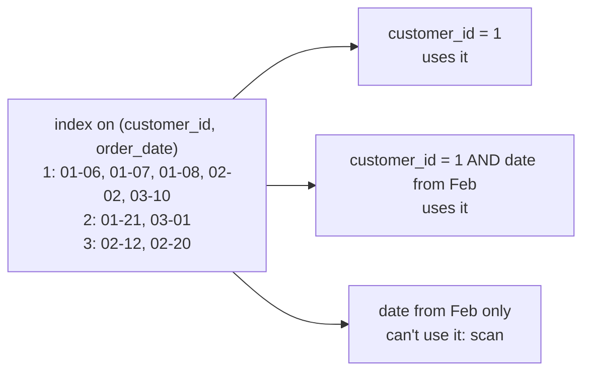

<!-- Written by `npm run lessons` from the lesson data in src/data. Edit the lesson there, not this page. -->

# Index-friendly queries: sargable filters and composite indexes

**SQL · Unit 7: Performance: indexes and query plans · Lesson 3 of 4 · Should know**

> **In one line.** A filter is sargable when the database can use an index for it: the indexed column stands alone on one side of the comparison. A composite index on (a, b) helps queries that filter on a, or on a and b, but not on b alone.

[Open this lesson on the site](https://learn.hamropedia.com/sql/index-friendly-queries-sargable-filters-and-composite-indexes/) for its animation, the practice game and tap-to-explain words.

## The problem it solves

An index can exist and still not be used. `WHERE strftime('%Y-%m', order_date) = '2024-02'` reads every row even with an index on order_date. Knowing the rules lets you write the same filter in a way that uses the index.

## The idea

The index stores the raw column values in order. If you wrap the column in a function (`UPPER(name)`, `strftime(…)`), do maths on it (`salary + 0 > 60000`), or start a LIKE with % ('%son'), the database can't search the sorted values, so it scans. Rewrite the condition so the bare column is compared with a value: a date range instead of a function.

A composite index on (customer_id, order_date) is sorted by customer, then by date within each customer — like a phone book sorted by surname, then first name. It helps `customer_id = 1`, and `customer_id = 1 AND order_date >= …`, but not `order_date >= …` alone: the leftmost-prefix rule.

If the index contains every column the query needs, it is a covering index, and the table itself isn't touched.

## Analogy

A phone book sorted by surname, then first name. Finding "Smith, John" is quick; finding all the Smiths is quick; finding everyone called John is not — you would have to read the whole book.

**Where the analogy breaks.** A person might notice that the Johns are easy to find if there are only five surnames. Some databases can do a "skip scan" too, but don't count on it — design the column order for the queries you really run.

## Syntax

```sql
-- not sargable: the column is inside a function
WHERE strftime('%Y-%m', order_date) = '2024-02'
-- sargable: the bare column, compared with a range
WHERE order_date >= '2024-02-01' AND order_date < '2024-03-01'

CREATE INDEX idx ON orders (customer_id, order_date);
```

## How it works, step by step

1. With an index on order_date, `strftime('%Y-%m', order_date) = '2024-02'` gives SCAN orders: the index can't be used.
2. The same filter as a range on the bare column gives SEARCH … (order_date>? AND order_date&lt;?).
3. A composite index (customer_id, order_date) is searched for `customer_id = 1 AND order_date >= …`.
4. For `order_date >= …` alone, it can't be used: the dates are only sorted within each customer.
5. Selecting only customer_id and order_date lets the index answer on its own: a covering index.

## Picture it



*A composite index is sorted by its first column, then by the second within each value of the first. It helps when the query fixes the leftmost column(s), not when it skips them.*

## Examples on the practice database

**A function on the column blocks the index**

```sql
CREATE INDEX idx_orders_date ON orders(order_date);
EXPLAIN QUERY PLAN
SELECT order_id, amount FROM orders
WHERE strftime('%Y-%m', order_date) = '2024-02';
```

| id | parent | notused | detail |
| --- | --- | --- | --- |
| 2 | 0 | 216 | SCAN orders |

---

**The same filter as a range uses it**

```sql
CREATE INDEX idx_orders_date ON orders(order_date);
EXPLAIN QUERY PLAN
SELECT order_id, amount FROM orders
WHERE order_date >= '2024-02-01' AND order_date < '2024-03-01';
```

| id | parent | notused | detail |
| --- | --- | --- | --- |
| 3 | 0 | 165 | SEARCH orders USING INDEX idx_orders_date (order_date>? AND order_date<?) |

---

**Composite index: leftmost column fixed**

```sql
CREATE INDEX idx_orders_cust_date ON orders(customer_id, order_date);
EXPLAIN QUERY PLAN
SELECT order_id, amount FROM orders
WHERE customer_id = 1 AND order_date >= '2024-02-01';
```

| id | parent | notused | detail |
| --- | --- | --- | --- |
| 3 | 0 | 51 | SEARCH orders USING INDEX idx_orders_cust_date (customer_id=? AND order_date>?) |

---

**Composite index: leftmost column skipped**

```sql
CREATE INDEX idx_orders_cust_date ON orders(customer_id, order_date);
EXPLAIN QUERY PLAN
SELECT order_id, amount FROM orders
WHERE order_date >= '2024-02-01';
```

| id | parent | notused | detail |
| --- | --- | --- | --- |
| 2 | 0 | 216 | SCAN orders |

Dates are only in order within each customer, so the index can't help a date-only filter.

## Must know

- Keep the indexed column bare: no functions, no maths, no leading % in LIKE.
- Rewrite "same month" or "same year" filters as half-open ranges: >= start AND &lt; next start.
- A composite index (a, b) serves filters on a, or a and b — not b alone (leftmost prefix).
- Put the column you test with = first, and the range column after it.
- A covering index holds every column a query needs, so the table isn't read at all.

## Common mistakes

- Writing `WHERE YEAR(order_date) = 2024` on an indexed date column: the function hides the column, so the index can't be used.
- Creating (order_date, customer_id) when the queries filter by customer first.
- Comparing a column with a value of another type (a number column with '42'), which can force a conversion on every row.

> **Not true:** `WHERE YEAR(order_date) = 2024` can still use an index on order_date.  
> **In fact:** The function hides the column, so the index cannot be used and every row is checked. Write a range instead: `order_date >= '2024-01-01' AND order_date < '2025-01-01'`.

## Other databases

- PostgreSQL and Oracle support expression indexes, such as `CREATE INDEX ON customers (LOWER(email))`, which make that exact function sargable. MySQL 8 has functional indexes too.
- PostgreSQL and SQL Server let you add extra non-key columns to make an index covering: `INCLUDE (amount)`.

## In the interview

An index can only be used when the predicate is sargable: the indexed column appears bare, compared with a constant or a range. So I avoid functions or arithmetic on indexed columns, and rewrite things like `YEAR(date) = 2024` as a date range. For composite indexes the leftmost-prefix rule applies: an index on customer_id then order_date serves filters on customer, or on customer and date, but not on date alone. So I put equality columns first and range columns last. When a hot query needs only a few columns, I make the index covering.

<details>
<summary>&lt;b>What does sargable mean?&lt;/b></summary>

Search-ARGument-ABLE: written so the database can use an index to evaluate it.

</details>

<details>
<summary>&lt;b>Index (a, b) or (b, a)?&lt;/b></summary>

Match the queries: the column filtered with = in most queries goes first; a column used for ranges or sorting goes after it.

</details>

<details>
<summary>&lt;b>How do you make a case-insensitive email lookup fast?&lt;/b></summary>

Store emails lower-cased and index them, or create an expression index on `LOWER(email)` and query with `LOWER(email)` = 'x'.

</details>

## Practise

Write each answer yourself first, then open the answer and compare.

### 1. Explain

Explain the leftmost-prefix rule with the phone-book analogy.

<details>
<summary>Show one good answer</summary>

A phone book is sorted by surname, then by first name: an index on (surname, first_name).

• "Smith, John": quick. Find the Smiths, then John among them.  
• All the Smiths: quick. They are all together.  
• Everyone called John: no help at all. The Johns are scattered through every surname, so you would have to read the whole book.

That is the leftmost-prefix rule. A composite index on (a, b) helps a query that fixes a, or a and b, but not one that only filters on b, because b is only sorted within each value of a.

</details>

### 2. Write

Rewrite `WHERE strftime('%Y', hire_date) = '2021'` so an index on hire_date could be used, and check the plan.

<details>
<summary>Show one good answer</summary>

Wrapping the column in a function (`strftime('%Y', hire_date)`) hides it from the index: the database would have to work out the year for every row, so the plan is a SCAN. Say the same thing as a range on the bare column, and the plan becomes a SEARCH on the index. It finds the same people, Chen and Fatima.

```sql
CREATE INDEX idx_employees_hire ON employees(hire_date);
EXPLAIN QUERY PLAN
SELECT name FROM employees
WHERE hire_date >= '2021-01-01' AND hire_date < '2022-01-01';
```

| id | parent | notused | detail |
| --- | --- | --- | --- |
| 3 | 0 | 164 | SEARCH employees USING INDEX idx_employees_hire (hire_date>? AND hire_date<?) |

</details>

### 3. Predict

With an index on employees(salary), is `WHERE salary + 0 > 60000` sargable? What about `WHERE salary > 60000 - 0`?

<details>
<summary>Show one good answer</summary>

`WHERE salary + 0 > 60000` is not sargable: the column is inside a calculation, so the database can't look it up in the index and scans (`SCAN employees`). (Adding + 0 is in fact an old trick to stop an index being used on purpose.)

`WHERE salary > 60000 - 0` is sargable: salary stands alone, and the arithmetic is on the constant side, which is worked out once. The plan is a SEARCH.

```sql
CREATE INDEX idx_employees_salary ON employees(salary);
EXPLAIN QUERY PLAN SELECT name FROM employees WHERE salary > 60000 - 0;
```

| id | parent | notused | detail |
| --- | --- | --- | --- |
| 3 | 0 | 203 | SEARCH employees USING INDEX idx_employees_salary (salary>?) |

</details>

### 4. Edge cases

Design one index that helps both "orders for customer 1, newest first" and "orders for customer 1 in March".

<details>
<summary>Show one good answer</summary>

One composite index on (customer_id, order_date), customer first.

• "Customer 1, newest first": fix customer_id = 1, then read that customer's entries backwards. They are already sorted by date, so there is no sort step (no temp B-tree in the plan, below).  
• "Customer 1 in March": fix customer_id = 1, then take a range on the second column: `order_date >= '2024-03-01' AND order_date < '2024-04-01'`. Its plan is `SEARCH … (customer_id=? AND order_date>? AND order_date<?)`.

The order matters: (order_date, customer_id) would only help the second query, and badly. Both plans even say COVERING here, because order_id is the rowid, which every SQLite index carries.

```sql
CREATE INDEX idx_orders_cust_date ON orders(customer_id, order_date);
EXPLAIN QUERY PLAN
SELECT order_id, order_date FROM orders
WHERE customer_id = 1
ORDER BY order_date DESC;
```

| id | parent | notused | detail |
| --- | --- | --- | --- |
| 3 | 0 | 55 | SEARCH orders USING COVERING INDEX idx_orders_cust_date (customer_id=?) |

</details>

## Go further (optional)

- READ · [Use The Index, Luke — a guide to database performance for developers](https://use-the-index-luke.com/) · Markus Winand, free
- READ · [PostgreSQL docs — Multicolumn Indexes](https://www.postgresql.org/docs/current/indexes-multicolumn.html) · official documentation, free
- READ · [SQLite docs — Query Planning](https://www.sqlite.org/queryplanner.html) · official documentation, free

---

[← Reading a query plan with EXPLAIN](reading-a-query-plan-with-explain.md) · [All lessons](../../README.md) · [How a database runs a join: nested loop, hash join, merge join →](how-a-database-runs-a-join-nested-loop-hash-join-merge-join.md)
