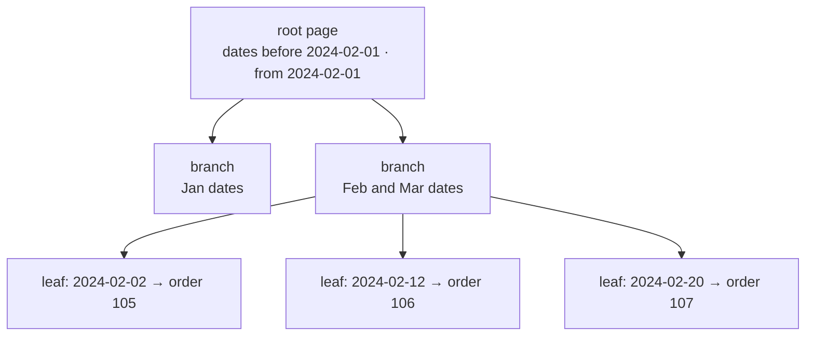

<!-- Written by `npm run lessons` from the lesson data in src/data. Edit the lesson there, not this page. -->

# Indexes: how a B-tree makes lookups fast

**SQL · Unit 7: Performance: indexes and query plans · Lesson 1 of 4 · Must know**

> **In one line.** An index is a separate, sorted copy of one or more columns, usually a B-tree, with pointers back to the rows. The database can then jump to the matching rows instead of scanning the whole table.

[Open this lesson on the site](https://learn.hamropedia.com/sql/indexes-how-a-b-tree-makes-lookups-fast/) for its animation, the practice game and tap-to-explain words.

## The problem it solves

Without an index, `WHERE order_date = '2024-02-12'` must read every row and check it: a full table scan. On 100 million rows that is slow, and it gets slower as the table grows. An index turns it into a few quick steps.

## The idea

A B-tree index keeps the column's values in sorted order, in a shallow tree. A root page points to branch pages, which point to leaf pages. The leaf pages hold each value and the row it belongs to. To find a value, the database walks from the root down — about 3 or 4 steps even for millions of rows — instead of reading everything.

The primary key is indexed automatically. Indexes speed up WHERE, JOIN … ON, ORDER BY and MIN/MAX on the indexed column.

The cost: every INSERT, UPDATE and DELETE must also update every index, and indexes take space.

## Analogy

The index at the back of a textbook. To find "photosynthesis" you don't read every page; you look it up alphabetically and jump to page 214. A full table scan is reading the book cover to cover.

**Where the analogy breaks.** A book index never changes once printed. A database index must be updated on every write — so a table with ten indexes is slow to write to. Index what you search by, not everything.

## Syntax

```sql
CREATE INDEX index_name ON table_name (column);
CREATE UNIQUE INDEX index_name ON table_name (column);
DROP INDEX index_name;
```

## How it works, step by step

1. Without an index on order_date, the plan says SCAN orders: every row is read.
2. CREATE INDEX idx_orders_date ON orders(order_date) builds a sorted list of dates, each pointing to its row.
3. Now the plan says SEARCH orders USING INDEX idx_orders_date (order_date=?): the database jumps to the date.
4. A lookup by the primary key uses the table's own key: SEARCH … USING INTEGER PRIMARY KEY.
5. For 10 rows the difference is invisible; for 100 million it is the difference between a full read and a handful of page reads.

## Picture it



*A B-tree index: sorted values in a shallow tree. Finding 2024-02-12 takes one step per level — root, branch, leaf — then one jump to the row, instead of reading every row.*

## Examples on the practice database

**No index: the database scans every row**

```sql
EXPLAIN QUERY PLAN
SELECT * FROM orders WHERE order_date = '2024-02-12';
```

| id | parent | notused | detail |
| --- | --- | --- | --- |
| 2 | 0 | 216 | SCAN orders |

EXPLAIN QUERY PLAN shows the plan instead of running the query. Read the detail column: SCAN means every row.

---

**With an index: the database searches**

```sql
CREATE INDEX idx_orders_date ON orders(order_date);
EXPLAIN QUERY PLAN
SELECT * FROM orders WHERE order_date = '2024-02-12';
```

| id | parent | notused | detail |
| --- | --- | --- | --- |
| 3 | 0 | 62 | SEARCH orders USING INDEX idx_orders_date (order_date=?) |

SEARCH … USING INDEX means it jumps straight to the matching date.

---

**The primary key is already indexed**

```sql
EXPLAIN QUERY PLAN
SELECT * FROM orders WHERE order_id = 105;
```

| id | parent | notused | detail |
| --- | --- | --- | --- |
| 2 | 0 | 33 | SEARCH orders USING INTEGER PRIMARY KEY (rowid=?) |

## Must know

- An index is a sorted structure (usually a B-tree) pointing back to the rows.
- It helps WHERE, JOIN … ON, ORDER BY and GROUP BY on the indexed columns.
- Primary keys and UNIQUE constraints get an index automatically; foreign keys usually don't — index them yourself.
- Every index slows down writes and uses space. Index the columns you filter and join on.
- An index helps most when it narrows the search to a small share of the rows (high selectivity).
- B-trees versus LSM trees, and indexing at scale: [Database indexing](https://learn.hamropedia.com/system-design/database-indexing/) in System Design.

## Common mistakes

- Indexing every column "just in case", which slows every write.
- Forgetting to index foreign keys, so joins and deletes on the parent table are slow.
- Indexing a column with only a few values (like status) and expecting it to help a query that matches half the table.

> **Not true:** Adding an index to every column makes the whole database faster.  
> **In fact:** Every index has to be updated on each INSERT, UPDATE and DELETE, so extra indexes slow writes down. Index only the columns your queries filter, join or sort on.

## Other databases

- PostgreSQL also has hash, GIN (for arrays, JSON and full-text) and BRIN (for huge, naturally ordered tables) indexes. MySQL InnoDB stores the table itself in primary-key order (a clustered index).

## In the interview

An index is a separate sorted structure, typically a B-tree, mapping column values to row locations, so the database can find matching rows in logarithmic time instead of scanning the table. I index columns used in selective WHERE filters, in join keys (especially foreign keys) and in ORDER BY. I keep the trade-off in mind: every index adds work to inserts, updates and deletes, and uses storage.

<details>
<summary>&lt;b>What is the difference between a clustered and a non-clustered index?&lt;/b></summary>

A clustered index stores the table's rows themselves in index order (one per table, often the primary key, as in SQL Server and MySQL InnoDB). A non-clustered index is a separate structure that points to the rows.

</details>

<details>
<summary>&lt;b>Why not index every column?&lt;/b></summary>

Each index must be updated on every write and takes space, and the optimiser can only use a few per query anyway.

</details>

<details>
<summary>&lt;b>Why might the database ignore your index?&lt;/b></summary>

If the query matches a large share of the rows, a full scan is cheaper than thousands of index jumps. Or the query wraps the column in a function, so the index can't be used.

</details>

## Practise

Write each answer yourself first, then open the answer and compare.

### 1. Explain

Explain an index using the textbook analogy, and say what it costs.

<details>
<summary>Show one good answer</summary>

An index is like the index at the back of a textbook. To find "photosynthesis" you don't read every page; you look the word up in the sorted list and jump to page 214. Without an index, the database has to read the whole table (a full scan), like reading the book cover to cover. With one, it searches a sorted copy of the column (a B-tree) and follows a pointer straight to the matching rows.

What it costs:  
• Slower writes: every INSERT, DELETE, and UPDATE of the indexed column must also update the index. A book's index is printed once; a database's is kept up to date all the time.  
• Space: the index is a second copy of the column, on disk and in memory.  
So you index the columns your important queries filter, join or sort on, not every column.

</details>

### 2. Write

Create an index that would help `SELECT * FROM employees WHERE dept_id = 1;`, and check the plan before and after.

<details>
<summary>Show one good answer</summary>

Before, the plan is `SCAN employees`: every row is read. Create an index on the filtered column, run the same EXPLAIN QUERY PLAN, and it becomes a SEARCH using the new index.

(With 8 rows a scan is just as fast; the plan matters when the table has millions.)

```sql
CREATE INDEX idx_employees_dept ON employees(dept_id);
EXPLAIN QUERY PLAN SELECT * FROM employees WHERE dept_id = 1;
```

| id | parent | notused | detail |
| --- | --- | --- | --- |
| 3 | 0 | 61 | SEARCH employees USING INDEX idx_employees_dept (dept_id=?) |

</details>

### 3. Predict

Will `SELECT * FROM customers WHERE customer_id = 3` use an index without you creating one? Why?

<details>
<summary>Show one good answer</summary>

Yes. customer_id is the primary key, and a primary key is always indexed: the database needs that to check uniqueness on every insert. In SQLite an INTEGER PRIMARY KEY is the row's own id (the rowid), so the plan searches straight to it.

```sql
EXPLAIN QUERY PLAN SELECT * FROM customers WHERE customer_id = 3;
```

| id | parent | notused | detail |
| --- | --- | --- | --- |
| 2 | 0 | 33 | SEARCH customers USING INTEGER PRIMARY KEY (rowid=?) |

</details>

### 4. Edge cases

A status column has only four values and 50% of rows are 'delivered'. Would an index on status help `WHERE status = 'delivered'`? What about `WHERE status = 'pending'`?

<details>
<summary>Show one good answer</summary>

`WHERE status = 'delivered'`: probably not. Half the table matches, so the index would find half a million row pointers (in a million-row table), and fetching each row one by one, jumping around the disk, is slower than simply reading the whole table in order. A good optimiser, with statistics, ignores the index and scans.

`WHERE status = 'pending'`: yes, if pending orders are rare (say 1%). The index jumps straight to the few matching rows. This is the case where an index on a column with few values can pay off.

The usual answer for "a rare value of a common column" is a partial index, which only holds the rows you search for: `CREATE INDEX idx_orders_pending ON orders(order_date) WHERE status = 'pending';`. It is tiny and cheap to maintain.

(SQLite only knows how values are spread after you run ANALYZE. Without it, it will happily use an index on status for 'delivered' too.)

</details>

## Go further (optional)

- READ · [Use The Index, Luke — a guide to database performance for developers](https://use-the-index-luke.com/) · Markus Winand, free
- READ · [W3Schools — SQL CREATE INDEX](https://www.w3schools.com/sql/sql_create_index.asp) · short page with a try-it editor, free
- WATCH · [How database indexes work (video)](https://www.youtube.com/results?search_query=how%20database%20indexes%20work%20b-tree) · YouTube search, free

---

[← DDL, DML, DCL, TCL — and DELETE versus TRUNCATE versus DROP](../unit-6-changing-data/ddl-dml-dcl-tcl-and-delete-versus-truncate-versus-drop.md) · [All lessons](../../README.md) · [Reading a query plan with EXPLAIN →](reading-a-query-plan-with-explain.md)
