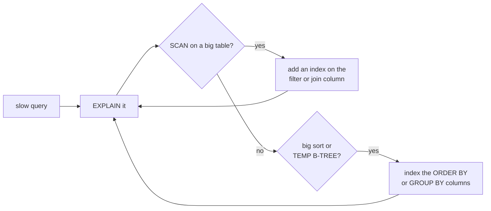

<!-- Written by `npm run lessons` from the lesson data in src/data. Edit the lesson there, not this page. -->

# Reading a query plan with EXPLAIN

**SQL · Unit 7: Performance: indexes and query plans · Lesson 2 of 4 · Should know**

> **In one line.** EXPLAIN shows the plan the database chose for a query — which tables it scans, which indexes it searches, how it joins and sorts — without (or, with ANALYZE, while) running it.

[Open this lesson on the site](https://learn.hamropedia.com/sql/reading-a-query-plan-with-explain/) for its animation, the practice game and tap-to-explain words.

## The problem it solves

"This query is slow — what do you do?" The first answer is always: look at the plan. Guessing wastes time; the plan tells you whether the database is scanning a huge table, missing an index, or sorting millions of rows.

## The idea

Put EXPLAIN in front of a query (in SQLite, EXPLAIN QUERY PLAN). Read each line as one step.

There are three words to look for.  
SCAN means reading a whole table: fine if it is small, a warning sign if it is big.  
SEARCH … USING INDEX means jumping straight to rows: good.  
TEMP B-TREE or Sort means building a sort or a grouping: costly on big data.

For a join, each line is one table, in the order the database reads them: it scans one and searches the other for each row.

PostgreSQL's EXPLAIN ANALYZE also runs the query and shows real times and row counts — compare estimated rows with actual rows to spot bad estimates.

## Analogy

A satnav showing the route before you drive. You can see it plans to go through the city centre (a full scan) instead of the bypass (an index), and fix it before you set off.

**Where the analogy breaks.** A satnav's route is the same every time. A query plan can change as the data grows or statistics update — a plan that is fine on 10 rows may be terrible on 10 million. Always check plans on realistic data.

## Syntax

```sql
EXPLAIN QUERY PLAN SELECT ...;   -- SQLite
EXPLAIN SELECT ...;              -- PostgreSQL, MySQL: the plan
EXPLAIN ANALYZE SELECT ...;      -- PostgreSQL: run it, real timings
```

## How it works, step by step

1. Before an index on orders.customer_id: SCAN o (read every order), and for each one SEARCH c by primary key.
2. Add the index: now the plan is SCAN c (only 6 customers), and SEARCH o USING INDEX for each customer.
3. The order of the lines is the order the tables are read in: the outer table first.
4. For GROUP BY without a helpful index, you see USE TEMP B-TREE FOR GROUP BY: a temporary sort.
5. Fixes usually mean: add or change an index, filter earlier, or rewrite a condition so the index can be used.

## Picture it



*Tuning is a loop: read the plan, find the expensive step (a big scan or a big sort), change the index or the query, and read the plan again.*

## Examples on the practice database

**A join plan before indexing the foreign key**

```sql
EXPLAIN QUERY PLAN
SELECT c.name, o.amount
FROM customers c
JOIN orders o ON o.customer_id = c.customer_id
WHERE c.city = 'Leeds';
```

| id | parent | notused | detail |
| --- | --- | --- | --- |
| 3 | 0 | 216 | SCAN o |
| 5 | 0 | 45 | SEARCH c USING INTEGER PRIMARY KEY (rowid=?) |

Every order is read, and for each one the customer is looked up by its primary key.

---

**After indexing orders.customer_id**

```sql
CREATE INDEX idx_orders_customer ON orders(customer_id);
EXPLAIN QUERY PLAN
SELECT c.name, o.amount
FROM customers c
JOIN orders o ON o.customer_id = c.customer_id
WHERE c.city = 'Leeds';
```

| id | parent | notused | detail |
| --- | --- | --- | --- |
| 4 | 0 | 216 | SCAN c |
| 8 | 0 | 61 | SEARCH o USING INDEX idx_orders_customer (customer_id=?) |

The plan flipped: read the few customers in Leeds, then jump to each one's orders through the new index.

---

**A grouping that needs a temporary sort**

```sql
EXPLAIN QUERY PLAN
SELECT customer_id, SUM(amount)
FROM orders
GROUP BY customer_id
ORDER BY customer_id;
```

| id | parent | notused | detail |
| --- | --- | --- | --- |
| 7 | 0 | 216 | SCAN orders |
| 9 | 0 | 0 | USE TEMP B-TREE FOR GROUP BY |

With an index on customer_id the rows would already be in order, and the temporary B-tree would disappear.

## Must know

- EXPLAIN shows the chosen plan; EXPLAIN ANALYZE (PostgreSQL) runs it and shows real times and rows.
- SCAN = read everything; SEARCH / Index Scan = jump via an index.
- Sorts and temp B-trees for ORDER BY, GROUP BY or DISTINCT are expensive on big data.
- In a join plan, the first table is the outer loop; the inner table should be searched by index.
- Big gaps between estimated and actual row counts point to stale statistics (run ANALYZE).

## Common mistakes

- Tuning by guesswork instead of reading the plan.
- Judging a plan on a tiny test table — the optimiser may choose differently on real data.
- Running EXPLAIN ANALYZE on a DELETE or UPDATE in production. It really runs the statement.

> **Not true:** The plan chosen on a tiny test table is the plan the database will use on the real data.  
> **In fact:** The optimiser decides from table sizes and statistics. On a tiny table it may read everything, where on millions of rows it would use an index, so test on realistic data.

## Other databases

- PostgreSQL plan words: Seq Scan (full scan), Index Scan, Index Only Scan, Bitmap Heap Scan, Nested Loop, Hash Join, Merge Join, Sort.
- MySQL: `EXPLAIN` gives a table with a `type` column — ALL is a full scan, ref/range/const use an index. `EXPLAIN ANALYZE` exists from 8.0.18.

## In the interview

My first step with a slow query is EXPLAIN, or EXPLAIN ANALYZE in PostgreSQL to see real timings and row counts. I look for sequential scans on large tables, expensive sorts, nested loops over big inputs, and estimates that are far from actual counts. Typical fixes are an index on the filter or join columns, rewriting a non-sargable condition, filtering earlier, or refreshing statistics — then I re-check the plan.

<details>
<summary>&lt;b>What is the difference between EXPLAIN and EXPLAIN ANALYZE?&lt;/b></summary>

EXPLAIN shows the plan and estimated costs without running the query. EXPLAIN ANALYZE runs it and adds the actual time and row counts for each step.

</details>

<details>
<summary>&lt;b>What does it mean if estimated rows are 10 but actual rows are 1,000,000?&lt;/b></summary>

The optimiser's statistics are wrong or stale, so it may pick a bad plan. Run ANALYZE to refresh them.

</details>

## Practise

Write each answer yourself first, then open the answer and compare.

### 1. Explain

Explain what SCAN and SEARCH mean in a plan, and which one you want on a big table.

<details>
<summary>Show one good answer</summary>

SCAN means the database reads every row of the table (or of an index) from start to finish. SEARCH means it uses an index to jump straight to the matching rows, like using a book's index instead of reading every page.

On a big table you want SEARCH for selective filters and joins. A SCAN of a million-row table on every request is usually the reason a query is slow. A SCAN is fine when the table is tiny, or when you really need most of its rows (then reading in order beats jumping around).

</details>

### 2. Write

Write EXPLAIN QUERY PLAN for "employees in department 2", then add an index and show the plan changes.

<details>
<summary>Show one good answer</summary>

Before: `SCAN employees`. The index below holds dept_id and name together, so the plan becomes a SEARCH with a COVERING INDEX: the query needs only name, which is already in the index, so the database never reads the table itself.

An index on dept_id alone would also turn the SCAN into a SEARCH, but each match would then need a second lookup into the table to fetch the name.

```sql
CREATE INDEX idx_employees_dept_name ON employees(dept_id, name);
EXPLAIN QUERY PLAN SELECT name FROM employees WHERE dept_id = 2;
```

| id | parent | notused | detail |
| --- | --- | --- | --- |
| 2 | 0 | 55 | SEARCH employees USING COVERING INDEX idx_employees_dept_name (dept_id=?) |

</details>

### 3. Predict

What plan do you expect for `SELECT * FROM products WHERE product_id = 3`? Check it.

<details>
<summary>Show one good answer</summary>

A SEARCH by the primary key: product_id is an INTEGER PRIMARY KEY, which in SQLite is the rowid, so it goes straight to the one row. No index needs to be created.

```sql
EXPLAIN QUERY PLAN SELECT * FROM products WHERE product_id = 3;
```

| id | parent | notused | detail |
| --- | --- | --- | --- |
| 2 | 0 | 33 | SEARCH products USING INTEGER PRIMARY KEY (rowid=?) |

</details>

### 4. Edge cases

Add an index on orders(customer_id) and re-run the GROUP BY plan. Does the temporary B-tree disappear? Why might it still be there?

<details>
<summary>Show one good answer</summary>

Here it disappears. Before the index, the plan is `SCAN orders` plus `USE TEMP B-TREE FOR GROUP BY`: the rows come out in any order, so SQLite builds a temporary sorted structure to group them. With the index, it reads orders through idx_orders_customer, which already returns rows sorted by customer_id, so the groups arrive in order and no sort is needed.

Why it might still be there:  
• The index doesn't cover the query: amount isn't in it, so every row needs an extra lookup into the table. On a big table the optimiser may decide a plain scan plus a sort is cheaper, and keep the temp B-tree. An index on (customer_id, amount) covers the query and removes that doubt.  
• With statistics (after ANALYZE), the optimiser might prefer the scan anyway.  
• The ORDER BY or GROUP BY doesn't match the index order (a different column, or a different direction).

```sql
CREATE INDEX idx_orders_customer ON orders(customer_id);
EXPLAIN QUERY PLAN
SELECT customer_id, SUM(amount)
FROM orders
GROUP BY customer_id
ORDER BY customer_id;
```

| id | parent | notused | detail |
| --- | --- | --- | --- |
| 8 | 0 | 223 | SCAN orders USING INDEX idx_orders_customer |

</details>

## Go further (optional)

- READ · [SQLite docs — EXPLAIN QUERY PLAN](https://www.sqlite.org/eqp.html) · official documentation, free
- READ · [PostgreSQL docs — Using EXPLAIN](https://www.postgresql.org/docs/current/using-explain.html) · official documentation, free
- READ · [Use The Index, Luke — a guide to database performance for developers](https://use-the-index-luke.com/) · Markus Winand, free

---

[← Indexes: how a B-tree makes lookups fast](indexes-how-a-b-tree-makes-lookups-fast.md) · [All lessons](../../README.md) · [Index-friendly queries: sargable filters and composite indexes →](index-friendly-queries-sargable-filters-and-composite-indexes.md)
