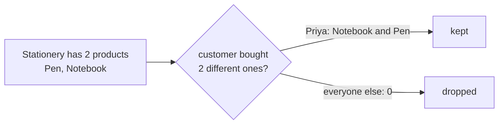

<!-- Written by `npm run lessons` from the lesson data in src/data. Edit the lesson there, not this page. -->

# Customers who bought every product in a category

**SQL · Unit 8: SQL interview problems, from easy to hard · Lesson 16 of 16 · Bonus**

> **In one line.** Find the customers who have bought every product in the Stationery category.

[Open this lesson on the site](https://learn.hamropedia.com/sql/customers-who-bought-every-product-in-a-category/) for its animation, the practice game and tap-to-explain words.

## What the question tests

"Every" questions — relational division — which can't be answered with a plain join. They test counting distinct matches against a total, or thinking in double negatives.

## The pattern

**"All of" (relational division)** · Hard · tables: `customers`, `orders`, `order_items`, `products`

**How to spot it.** "Every", "all of the", "each one of", "the complete set".

## Picture it



*Count the distinct category products each customer bought and compare with the size of the category. Equal means they bought every one.*

## How to approach it

1. Count how many products the category has (here 2: Pen and Notebook).
2. For each customer, count the different products from that category they have bought.
3. Keep customers whose count equals the category's total: GROUP BY with HAVING `COUNT(DISTINCT …)` = (subquery).
4. Or say it as a double negative: there is no Stationery product this customer has not bought.

## Solution

<details>
<summary>Show the solution</summary>

**Solution: count distinct matches and compare with the total**

```sql
SELECT c.name
FROM customers c
JOIN orders o       ON o.customer_id = c.customer_id
JOIN order_items oi ON oi.order_id = o.order_id
JOIN products p     ON p.product_id = oi.product_id
WHERE p.category = 'Stationery'
GROUP BY c.customer_id, c.name
HAVING COUNT(DISTINCT p.product_id) = (
  SELECT COUNT(*) FROM products WHERE category = 'Stationery'
)
ORDER BY c.name;
```

| name |
| --- |
| Priya |

Priya bought notebooks in two orders and pens in one; DISTINCT stops the repeat notebook counting twice.

</details>

## Other correct ways

<details>
<summary>Show them</summary>

**The double negative: no product they haven't bought**

```sql
SELECT c.name
FROM customers c
WHERE NOT EXISTS (
  SELECT 1
  FROM products p
  WHERE p.category = 'Stationery'
    AND NOT EXISTS (
      SELECT 1
      FROM orders o
      JOIN order_items oi ON oi.order_id = o.order_id
      WHERE o.customer_id = c.customer_id
        AND oi.product_id = p.product_id
    )
)
ORDER BY c.name;
```

| name |
| --- |
| Priya |

Read it as: keep the customer if there is no Stationery product that this customer has not bought.

</details>

## Edge cases to say out loud

- An empty category: the counting version returns nobody, while the double-negative version returns every customer ("bought all of nothing"). Ask which is wanted.
- Buying the same product twice must not count twice: use `COUNT(DISTINCT)`.
- Products added to the category later change the answer for past customers — that is usually intended.

## Common mistakes

- `COUNT(*)` instead of `COUNT(DISTINCT product_id)`, so two notebooks look like two different products.
- Hard-coding the total (= 2) instead of counting the category.
- Using IN ('Pen', 'Notebook'), which finds customers who bought any of them, not all.

> **Not true:** `IN ('Pen', 'Notebook')` finds the customers who bought both products.  
> **In fact:** IN is true when a row matches any value in the list, so it finds customers who bought at least one. To require all of them, count the different products each customer bought.

## In the interview

This is relational division — "bought all of". I join each customer to the category's products they bought, group by customer, and keep those whose count of distinct products equals the category's product count from a subquery. An equivalent formulation is a double NOT EXISTS: there's no product in the category that the customer hasn't bought. I'd mention the empty-category case, where the two versions disagree.

<details>
<summary>&lt;b>How would you find customers who bought at least 2 of the 3 products in a category?&lt;/b></summary>

Same query, with HAVING `COUNT(DISTINCT p.product_id) >= 2`.

</details>

<details>
<summary>&lt;b>How would you find customers who bought exactly the Stationery products and nothing else?&lt;/b></summary>

Count distinct stationery products = category size, and also count of non-stationery products = 0 (conditional aggregation over all their items).

</details>

## Practise

Write each answer yourself first, then open the answer and compare.

### 1. Explain

Explain the double NOT EXISTS version in plain words.

<details>
<summary>Show one good answer</summary>

It turns "bought every product" into a double negative: "there is no Stationery product that this customer has not bought".

• The outer NOT EXISTS goes through each Stationery product, looking for one this customer is missing.  
• The inner NOT EXISTS answers, for one product: "has this customer never bought it?" (no item line of theirs has that product).  
• If the search finds no missing product, the customer has bought them all, and they are kept.

It reads oddly, but it works without counting, and it handles products bought several times naturally.

</details>

### 2. Write

Find customers who bought every product in the Electronics category. (Who bought the phone case?)

<details>
<summary>Show one good answer</summary>

Change the category in both places. Nobody qualifies: Electronics has two products, the headphones and the phone case, and nobody has ever bought the phone case. Priya and Tom bought headphones, but one product out of two isn't "every product". An empty result is the right answer.

```sql
SELECT c.name
FROM customers c
JOIN orders o       ON o.customer_id = c.customer_id
JOIN order_items oi ON oi.order_id = o.order_id
JOIN products p     ON p.product_id = oi.product_id
WHERE p.category = 'Electronics'
GROUP BY c.customer_id, c.name
HAVING COUNT(DISTINCT p.product_id) = (
  SELECT COUNT(*) FROM products WHERE category = 'Electronics'
)
ORDER BY c.name;
```

| name |
| --- |

*(no rows)*

</details>

### 3. Predict

If Tom had also bought a pen and a notebook, what would the solution return?

<details>
<summary>Show one good answer</summary>

Priya and Tom. Stationery is the pen and the notebook. Priya already bought both; if Tom also bought one of each, he would have 2 distinct Stationery products too, matching the category's 2. Below, they are added to his order 104.

```sql
INSERT INTO order_items VALUES (104, 1, 1), (104, 2, 1);
SELECT c.name
FROM customers c
JOIN orders o       ON o.customer_id = c.customer_id
JOIN order_items oi ON oi.order_id = o.order_id
JOIN products p     ON p.product_id = oi.product_id
WHERE p.category = 'Stationery'
GROUP BY c.customer_id, c.name
HAVING COUNT(DISTINCT p.product_id) = (
  SELECT COUNT(*) FROM products WHERE category = 'Stationery'
)
ORDER BY c.name;
```

| name |
| --- |
| Priya |
| Tom |

</details>

### 4. Edge cases

Show what each version returns for a category with no products, and explain why they differ.

<details>
<summary>Show one good answer</summary>

Take a category with no products, such as 'Toys'.

• The COUNT version returns nobody. Its WHERE keeps only item lines in that category, and there are none, so there are no groups for HAVING to compare with 0.  
• The double NOT EXISTS version returns every customer (below). "Is there a Toys product this customer hasn't bought?" can never be yes when there are no Toys products, so every customer passes.

Logically, the NOT EXISTS answer is the correct one: "bought every product in an empty set" is vacuously true, like "all my unicorns are pink". In practice, nobody wants that report, so the honest answer is to ask what the business wants for an empty category, and to handle it on purpose, for example by returning nothing when the category has no products.

```sql
SELECT c.name
FROM customers c
WHERE NOT EXISTS (
  SELECT 1
  FROM products p
  WHERE p.category = 'Toys'
    AND NOT EXISTS (
      SELECT 1
      FROM orders o
      JOIN order_items oi ON oi.order_id = o.order_id
      WHERE o.customer_id = c.customer_id
        AND oi.product_id = p.product_id
    )
)
ORDER BY c.name;
```

| name |
| --- |
| Lena |
| Omar |
| Priya |
| Tom |
| Tom |
| Zoe |

</details>

## Go further (optional)

- PRACTICE · [PostgreSQL Exercises — Aggregation](https://pgexercises.com/) · pgexercises.com, free
- PRACTICE · [DataLemur — relational division questions](https://datalemur.com/questions) · real interview questions, many free

---

[← The median salary](the-median-salary.md) · [All lessons](../../README.md)
