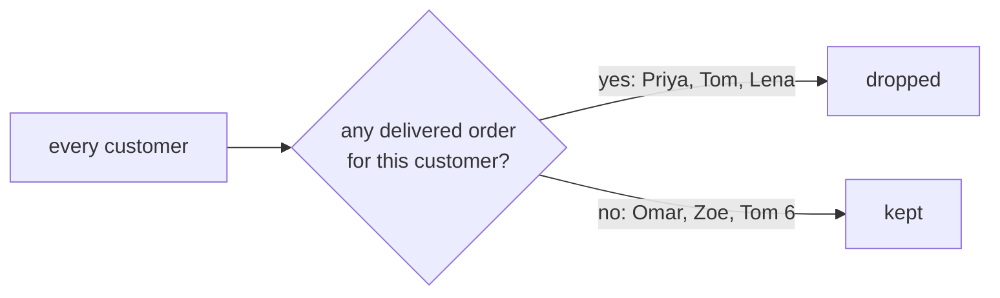

<!-- Written by `npm run lessons` from the lesson data in src/data. Edit the lesson there, not this page. -->

# Customers who have never had an order delivered

**SQL · Unit 8: SQL interview problems, from easy to hard · Lesson 5 of 16 · Must know**

> **In one line.** List every customer who has never had an order delivered — including customers who have never ordered at all.

[Open this lesson on the site](https://learn.hamropedia.com/sql/customers-who-have-never-had-an-order-delivered/) for its animation, the practice game and tap-to-explain words.

## What the question tests

Anti-joins, and the classic trap of putting a condition on the right-hand table in WHERE after a LEFT JOIN, which silently removes the customers you are looking for.

## The pattern

**Rows with no match (anti-join)** · Easy · tables: `customers`, `orders`

**How to spot it.** "Never", "no", "without", "haven't" — you are looking for something that isn't there.

## Picture it



*For each customer, ask one question: does a delivered order exist? Keep the customers where the answer is no.*

## How to approach it

1. Start from customers, because every customer must be considered — including ones with no orders.
2. Look for a delivered order belonging to each customer.
3. Keep the customers for whom none exists: NOT EXISTS, or a LEFT JOIN with the status test inside ON and `WHERE o.order_id IS NULL`.
4. Check: Omar and the second Tom never ordered; Zoe only has a pending order.

## Solution

<details>
<summary>Show the solution</summary>

**Solution: NOT EXISTS**

```sql
SELECT c.customer_id, c.name
FROM customers c
WHERE NOT EXISTS (
  SELECT 1
  FROM orders o
  WHERE o.customer_id = c.customer_id
    AND o.status = 'delivered'
)
ORDER BY c.customer_id;
```

| customer_id | name |
| --- | --- |
| 4 | Omar |
| 5 | Zoe |
| 6 | Tom |

</details>

## Other correct ways

<details>
<summary>Show them</summary>

**LEFT JOIN with the condition in ON**

```sql
SELECT c.customer_id, c.name
FROM customers c
LEFT JOIN orders o
  ON o.customer_id = c.customer_id
 AND o.status = 'delivered'
WHERE o.order_id IS NULL
ORDER BY c.customer_id;
```

| customer_id | name |
| --- | --- |
| 4 | Omar |
| 5 | Zoe |
| 6 | Tom |

The status test must be in ON. In WHERE, `o.status = 'delivered' AND o.order_id IS NULL` could never both be true, and the query would return nothing.

</details>

## Edge cases to say out loud

- Customers with no orders at all: must be included — that is why we start from customers.
- Customers whose only orders are cancelled or pending (Zoe): included.
- Orders with a NULL status: they are not delivered, so they don't count — NOT EXISTS handles this correctly.

## Common mistakes

- `LEFT JOIN … WHERE o.status <> 'delivered'`: drops customers with no orders and keeps customers who also have delivered orders.
- `WHERE customer_id NOT IN (SELECT customer_id FROM orders WHERE status = 'delivered')` is fine here only because customer_id is NOT NULL in orders — say that out loud.
- Starting from orders, which can never return customers who have no orders.

> **Not true:** Starting from orders: the query still finds customers who have no orders at all.  
> **In fact:** A customer with no orders has no row in orders, so a query that starts there can never return them. Start from customers.

## In the interview

This is an anti-join. I drive it from customers so customers with no orders are included, and keep those for which NOT EXISTS finds a delivered order. Equivalently, a LEFT JOIN with the status filter inside the ON clause and WHERE the order id IS NULL. The trap is putting the status filter in WHERE, which turns the left join into an inner join.

<details>
<summary>&lt;b>Why not NOT IN?&lt;/b></summary>

If the subquery could return a NULL, NOT IN returns nothing. NOT EXISTS is always safe.

</details>

<details>
<summary>&lt;b>How would you also show how many orders each of these customers has?&lt;/b></summary>

LEFT JOIN orders (all statuses) and `COUNT(o.order_id)`, grouped by customer, keeping the anti-join as a filter.

</details>

## Practise

Write each answer yourself first, then open the answer and compare.

### 1. Explain

Explain why the status condition must go in ON, not WHERE, in the LEFT JOIN version.

<details>
<summary>Show one good answer</summary>

In the LEFT JOIN version, the ON decides what counts as a match: "an order of this customer that was delivered". A customer with no delivered order finds no match, so they get one row with NULLs, and `WHERE o.order_id IS NULL` keeps exactly those customers.

Move the status test into the WHERE and it runs after the join, on every row. A customer whose orders are all pending gets matched to those orders (not NULL, so `IS NULL` drops them), and a customer with no orders has a NULL status, which fails `o.status = 'delivered'`. Every row fails one test or the other, so nothing comes back.

</details>

### 2. Write

List products that have never been part of a delivered order.

<details>
<summary>Show one good answer</summary>

For each product, look for any item line in a delivered order. Only the phone case has none: it has never been sold at all. Every other product appears in at least one delivered order.

```sql
SELECT p.product_name
FROM products p
WHERE NOT EXISTS (
  SELECT 1
  FROM order_items oi
  JOIN orders o ON o.order_id = oi.order_id
  WHERE oi.product_id = p.product_id
    AND o.status = 'delivered'
)
ORDER BY p.product_name;
```

| product_name |
| --- |
| Phone case |

</details>

### 3. Predict

What does the LEFT JOIN version return if you move the status test into WHERE?

<details>
<summary>Show one good answer</summary>

No rows at all. After the LEFT JOIN, every row either has an order (so order_id is not NULL) or has no order (so status is NULL, and `NULL = 'delivered'` isn't true). A row would need a delivered status and a NULL order_id at once, which is impossible. A filter on the right-hand table in WHERE quietly cancels the LEFT JOIN.

```sql
SELECT c.customer_id, c.name
FROM customers c
LEFT JOIN orders o ON o.customer_id = c.customer_id
WHERE o.status = 'delivered' AND o.order_id IS NULL
ORDER BY c.customer_id;
```

| customer_id | name |
| --- | --- |

*(no rows)*

</details>

### 4. Edge cases

What should happen to a customer whose only order has a NULL status? Does your query do that?

<details>
<summary>Show one good answer</summary>

They have never had an order delivered, so they should be listed. (In this database status is NOT NULL, so it can't happen, but it is worth checking.)

The NOT EXISTS solution gets it right: inside the subquery, `NULL = 'delivered'` is not true, so no delivered order is found, NOT EXISTS is true, and the customer is listed. The LEFT JOIN version also lists them, because the ON finds no match.

The version that gets it wrong flips the logic: "customers who have an order WHERE status &lt;> 'delivered'". `NULL <> 'delivered'` is not true either, so that customer would be missed. Whenever you write a negative test, ask what it does with NULL.

</details>

## Go further (optional)

- PRACTICE · [LeetCode — Top SQL 50 study plan](https://leetcode.com/studyplan/top-sql-50/) · free account
- PRACTICE · [DataLemur — anti-join questions](https://datalemur.com/questions) · real interview questions, many free

---

[← Employees who earn more than their manager](employees-who-earn-more-than-their-manager.md) · [All lessons](../../README.md) · [Find duplicate emails, then remove the duplicates →](find-duplicate-emails-then-remove-the-duplicates.md)
