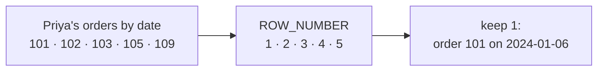

<!-- Written by `npm run lessons` from the lesson data in src/data. Edit the lesson there, not this page. -->

# Each customer's first order

**SQL · Unit 8: SQL interview problems, from easy to hard · Lesson 10 of 16 · Must know**

> **In one line.** For each customer who has ordered, show their first order — its id, date and amount — and how many days after signing up they placed it.

[Open this lesson on the site](https://learn.hamropedia.com/sql/each-customers-first-order/) for its animation, the practice game and tap-to-explain words.

## What the question tests

Picking exactly one row per group (the first event per user) with ROW_NUMBER, and joining back for extra columns. Used for activation, onboarding and funnel questions.

## The pattern

**First (or latest) row per group** · Medium · tables: `orders`, `customers`

**How to spot it.** "First purchase", "most recent login", "latest status", "earliest", one per user.

## Picture it



*Number each customer's orders from oldest to newest, then keep number 1. The same pattern with DESC gives the latest order.*

## How to approach it

1. Number each customer's orders by date: `ROW_NUMBER() OVER (PARTITION BY customer_id ORDER BY order_date, order_id)`.
2. Add order_id as a tiebreaker in case two orders share a date.
3. Keep row number 1 in an outer query.
4. Join customers for the name and sign-up date, and work out the days between.

## Solution

<details>
<summary>Show the solution</summary>

**Solution: ROW_NUMBER = 1**

```sql
WITH numbered AS (
  SELECT customer_id, order_id, order_date, amount,
         ROW_NUMBER() OVER (PARTITION BY customer_id ORDER BY order_date, order_id) AS rn
  FROM orders
)
SELECT c.name, n.order_id, n.order_date, n.amount,
       julianday(n.order_date) - julianday(c.signup_date) AS days_to_first_order
FROM numbered n
JOIN customers c ON c.customer_id = n.customer_id
WHERE n.rn = 1
ORDER BY c.customer_id;
```

| name | order_id | order_date | amount | days_to_first_order |
| --- | --- | --- | --- | --- |
| Priya | 101 | 2024-01-06 | 120 | 4 |
| Tom | 104 | 2024-01-21 | 200 | 1 |
| Lena | 106 | 2024-02-12 | NULL | 13 |
| Zoe | 110 | 2024-03-16 | 33 | 6 |

Lena's first order is the cancelled one with no amount. Ask whether "first order" should mean first delivered order.

</details>

## Other correct ways

<details>
<summary>Show them</summary>

**MIN date, then match it**

```sql
SELECT c.name, o.order_id, o.order_date, o.amount
FROM orders o
JOIN customers c ON c.customer_id = o.customer_id
WHERE o.order_date = (
  SELECT MIN(o2.order_date)
  FROM orders o2
  WHERE o2.customer_id = o.customer_id
)
ORDER BY c.customer_id;
```

| name | order_id | order_date | amount |
| --- | --- | --- | --- |
| Priya | 101 | 2024-01-06 | 120 |
| Tom | 104 | 2024-01-21 | 200 |
| Lena | 106 | 2024-02-12 | NULL |
| Zoe | 110 | 2024-03-16 | 33 |

Returns two rows for a customer with two orders on their first day. ROW_NUMBER with a tiebreaker guarantees one.

</details>

## Edge cases to say out loud

- Two orders on the same first day: the tiebreaker (order_id) decides; say which one you keep.
- Cancelled first orders: confirm whether they count.
- Customers with no orders: not in the result — LEFT JOIN from customers if they should appear.

## Common mistakes

- `GROUP BY customer_id` with `MIN(order_date)` and `amount` in SELECT — the amount isn't tied to the first order.
- Forgetting PARTITION BY, so only one order in the whole table gets number 1.
- No tiebreaker in ROW_NUMBER, so the answer can change between runs.

> **Not true:** `MIN(order_date)` with `amount` in the same SELECT returns the amount of the first order.  
> **In fact:** MIN finds the earliest date, but the amount beside it is not tied to that row. Number each customer's orders with ROW_NUMBER and keep number 1.

## Other databases

- PostgreSQL has a shortcut: `SELECT DISTINCT ON (customer_id) * FROM orders ORDER BY customer_id, order_date, order_id`.
- Days between: PostgreSQL `order_date - signup_date` for DATE columns; MySQL `DATEDIFF(order_date, signup_date)`.

## In the interview

For first-per-group I number rows with ROW_NUMBER, partitioned by customer and ordered by date, with the order id as a tiebreaker. I keep row number one in an outer query. Then I join customers for the sign-up date, to compute the days to first order. I'd confirm whether cancelled orders count, and mention that a MIN-date join can return duplicates on ties while ROW_NUMBER always returns exactly one.

<details>
<summary>&lt;b>How would you get each customer's latest order instead?&lt;/b></summary>

Order the ROW_NUMBER by order_date DESC, order_id DESC and keep row 1.

</details>

<details>
<summary>&lt;b>How would you find each customer's first delivered order?&lt;/b></summary>

Add `WHERE status = 'delivered'` inside the CTE, before numbering.

</details>

## Practise

Write each answer yourself first, then open the answer and compare.

### 1. Explain

Explain why ROW_NUMBER needs a tiebreaker here, with an example.

<details>
<summary>Show one good answer</summary>

ROW_NUMBER must give exactly one row number 1 per customer. If two orders share the earliest date, ordering by date alone leaves the tie unbroken, and the database may pick either one, and pick differently on another run or after an index changes. The answer looks fine but isn't repeatable.

Example: if Priya had placed orders 101 and 111 both on 2024-01-06, `ORDER BY order_date` could return either as her first order. Adding `order_id` as a second sort key (`ORDER BY order_date, order_id`) makes 101 win every time.

</details>

### 2. Write

For each customer, show their latest order and its status.

<details>
<summary>Show one good answer</summary>

Number each customer's orders newest first, with order_id as the tiebreaker, and keep number 1. Zoe's latest (and only) order is still pending.

```sql
WITH numbered AS (
  SELECT customer_id, order_id, order_date, status,
         ROW_NUMBER() OVER (
           PARTITION BY customer_id
           ORDER BY order_date DESC, order_id DESC
         ) AS rn
  FROM orders
)
SELECT c.name, n.order_id, n.order_date, n.status
FROM numbered n
JOIN customers c ON c.customer_id = n.customer_id
WHERE n.rn = 1
ORDER BY c.customer_id;
```

| name | order_id | order_date | status |
| --- | --- | --- | --- |
| Priya | 109 | 2024-03-10 | delivered |
| Tom | 108 | 2024-03-01 | delivered |
| Lena | 107 | 2024-02-20 | delivered |
| Zoe | 110 | 2024-03-16 | pending |

</details>

### 3. Predict

What would the solution return for Lena if the CTE only numbered delivered orders?

<details>
<summary>Show one good answer</summary>

Lena's first delivered order is 107 (20 February, £60), not the cancelled 106, so her days to first order become 21 instead of 13 (she signed up on 30 January).

And Zoe disappears: her only order is pending, so she has no delivered orders to number.

```sql
WITH numbered AS (
  SELECT customer_id, order_id, order_date, amount,
         ROW_NUMBER() OVER (PARTITION BY customer_id ORDER BY order_date, order_id) AS rn
  FROM orders
  WHERE status = 'delivered'
)
SELECT c.name, n.order_id, n.order_date, n.amount,
       julianday(n.order_date) - julianday(c.signup_date) AS days_to_first_order
FROM numbered n
JOIN customers c ON c.customer_id = n.customer_id
WHERE n.rn = 1
ORDER BY c.customer_id;
```

| name | order_id | order_date | amount | days_to_first_order |
| --- | --- | --- | --- | --- |
| Priya | 101 | 2024-01-06 | 120 | 4 |
| Tom | 104 | 2024-01-21 | 200 | 1 |
| Lena | 107 | 2024-02-20 | 60 | 21 |

</details>

### 4. Edge cases

Change the solution so customers with no orders appear with NULLs.

<details>
<summary>Show one good answer</summary>

Start from customers and LEFT JOIN the numbered orders. The `n.rn = 1` test must go in the ON: in the WHERE, it would be NULL for customers with no orders and would drop them again. Omar and the second Tom now appear with NULLs.

```sql
WITH numbered AS (
  SELECT customer_id, order_id, order_date, amount,
         ROW_NUMBER() OVER (PARTITION BY customer_id ORDER BY order_date, order_id) AS rn
  FROM orders
)
SELECT c.name, n.order_id, n.order_date, n.amount,
       julianday(n.order_date) - julianday(c.signup_date) AS days_to_first_order
FROM customers c
LEFT JOIN numbered n ON n.customer_id = c.customer_id AND n.rn = 1
ORDER BY c.customer_id;
```

| name | order_id | order_date | amount | days_to_first_order |
| --- | --- | --- | --- | --- |
| Priya | 101 | 2024-01-06 | 120 | 4 |
| Tom | 104 | 2024-01-21 | 200 | 1 |
| Lena | 106 | 2024-02-12 | NULL | 13 |
| Omar | NULL | NULL | NULL | NULL |
| Zoe | 110 | 2024-03-16 | 33 | 6 |
| Tom | NULL | NULL | NULL | NULL |

</details>

## Go further (optional)

- PRACTICE · [LeetCode — Top SQL 50 study plan](https://leetcode.com/studyplan/top-sql-50/) · free account
- PRACTICE · [DataLemur — first purchase questions](https://datalemur.com/questions) · real interview questions, many free

---

[← Month-over-month revenue growth](month-over-month-revenue-growth.md) · [All lessons](../../README.md) · [Streaks: orders on consecutive days (gaps and islands) →](streaks-orders-on-consecutive-days-gaps-and-islands.md)
